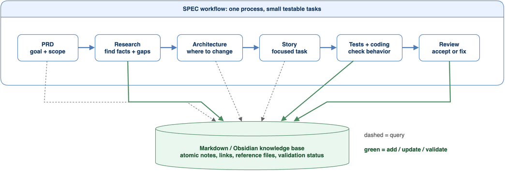

# kosmic

**Knowledge-Oriented, Spec-driven Infrastructure for Coding.**

Kosmic is a Markdown-based AI-agent skill/workflow that gives coding agents persistent project memory and a disciplined, spec-driven process. It is designed for scientific and engineering codebases where correctness depends on context that lives outside any single source file: project conventions, domain assumptions, validation practice, and the hard-won experience of existing developers.

## Why kosmic?

AI coding tools are good at producing code that compiles and runs. In scientific codebases, that is not enough: correctness often depends on conventions, assumptions, validation data, and domain knowledge that are not visible in one local code snippet.

When AI is asked to implement a large scientific change in one task, it may make plausible but wrong assumptions. The code can compile, run, and still produce an incorrect result. The same trap catches human developers too; it is just slower and less visible.

Two problems repeat across scientific software projects:

1. **Hidden conventions.** Correctness depends on knowledge that is implicit in the code, the physics, or the developers' experience.
2. **Too much context at once.** Even when the right information exists, a single large task overloads the context window (and human working memory), so essential assumptions slip through.

Kosmic addresses both by coupling a **spec-driven workflow** that decomposes large tasks with a **knowledge base** that captures and validates hidden conventions.

## The framework



Two workflows run in parallel and reinforce each other:

- **The SPEC workflow** (top lane) turns a large, risky change into small, testable tasks: `PRD → Research → Architecture → Story → Tests + coding → Review`. Each stage produces an artifact the user approves before work continues.
- **The knowledge base** (bottom cylinder) is a Markdown / Obsidian vault of **atomic notes** — one concept per note — with explicit links, source files, validation status, and confidence levels.

The arrows tell the story:

- **Dashed arrows** are *queries*. PRD, Architecture, and Story stages pull facts and conventions from the knowledge base before deciding what to build.
- **Solid arrows** are *updates*. Research, Tests + coding, and Review feed new discoveries and validation results back into the vault.

The knowledge base is not a side artifact. It is what makes the next task safer than the first.

## Key principles

- **Research before coding.** Search the vault, read the relevant code, and write notes before implementation. No unjustified assumptions.
- **Decompose before implementing.** Break features into small stories, each with a clear goal, a bounded context, and an acceptance check.
- **Tests define the target.** For each story, write the checks first; AI output is accepted or rejected by evidence, not by whether it compiles.
- **Knowledge is atomic and portable.** One concept per note. The authoritative `notes/` tree is both Obsidian-readable and an OKF v0.2 bundle: line-1 YAML, non-empty `type`, `draft | stable | deprecated`, and relative Markdown links. Staleness uses `stale_after`.
- **Mandatory review.** No story is marked `done` without code review. AI proposals are first-class input, not automatic answers.
- **Authority is explicit.** `audience` says who may use a Domain Topic; `artifact_role` says how: knowledge informs, guidelines constrain, procedures direct, and dated evidence substantiates. Only procedures are executable skill guidance.
- **Compile mechanics, not judgment.** Repeated deterministic procedure steps graduate into tested, hash-pinned Python routines after Task P review; interpretation, risk, and approval remain in skill prose.

## What it gives you

For AI-assisted development:

- fewer hidden assumptions, because conventions are written down and linked;
- smaller, safer slices of work, each with its own context and check;
- clear acceptance criteria, so AI output can be trusted or rejected on evidence;
- a growing, self-correcting record of *why* the code is the way it is.

For human developers and maintainers:

- better onboarding into difficult code paths;
- clearer review of scientific changes;
- safer incremental development on long-lived codebases;
- reusable knowledge that survives staff turnover and AI session boundaries.

## Installation

Kosmic is installed as an AI-agent skill with Markdown workflows and a deterministic Python 3.11+ Projection CLI. The source skill directory is [`skills/`](skills/), and the installed orchestrator skill name is `kosmic`.

There are two supported paths:

1. **AI-agent install.** Paste the ready-to-use install prompt from [docs/installation.md](docs/installation.md) into Claude Code, Codex, OpenCode, or another coding agent and let it install Kosmic into the correct local skill/instruction location.
2. **Manual install.** Copy the Markdown skill files into your agent's custom skill or persistent-instructions directory. For OpenCode, that is typically:

   ```bash
   mkdir -p ~/.config/opencode/skill/kosmic
   cp -R skills/* ~/.config/opencode/skill/kosmic/
   ```

See [docs/installation.md](docs/installation.md) for detailed instructions, verification steps, and notes for agents that do not support named skills.

## Projection CLI

All Kosmic functionality lives in **one script** — `skills/scripts/kosmic_project_skills.py` — invoked as `<script> <subcommand> …` from the repository root. There is no standalone per-feature executable: `generate-status`, `work start`, `validate-library`, and every other operation are subcommands of this single CLI.

```bash
# from the repository root
python3 skills/scripts/kosmic_project_skills.py generate-status --project <PROJECT> [--work-record RECORD]
python3 skills/scripts/kosmic_project_skills.py --help            # full subcommand list
python3 skills/scripts/kosmic_project_skills.py <subcommand> --help
```

Subcommand groups: `work`, `generate`, `validate`, `validate-proposal`, `init`, `migrate`, `review`, `check-completion`, `spec-create`, `workdir-register`, `migrate-subprojects-{plan,apply,recover}`, `check-math`, `provenance`, `install`, `check-installation`, `check-required-skills`, `generate-library`, `validate-library`, `query-routines`, `migrate-routines`, `resolve-library`, `load-library`, `migrate-library`, `install-library`, `check-library-installation`, `scratch`, `validate-dreams`, `dream-*`, `generate-status`.

Optional convenience: create a personal launcher so `kosmic <subcommand>` works from any directory (not tracked by this repository):

```bash
mkdir -p ~/.local/bin && printf '#!/bin/sh\nexec python3 /path/to/kosmic/skills/scripts/kosmic_project_skills.py "$@"\n' > ~/.local/bin/kosmic && chmod +x ~/.local/bin/kosmic
```

## Quick start

The skill identity is `kosmic`. In agents with named skills, load or invoke `kosmic` using that agent's normal mechanism. For OpenCode:

```
/skill kosmic
```

The knowledge vault directory is `memnotes` by default. Kosmic organizes each Project under `{VAULT}/Projects/{TARGET}/`, assigns an immutable Project Identifier, and keeps one authoritative Obsidian-compatible OKF v0.2 knowledge bundle under `notes/`. Reusable cross-project material is published into the vault-level `Skills/` Shared Domain Skill Library and reached through one installed `memnotes-skills` router. The resolver infers or accepts `do | check | understand | investigate`, computes typed dependency closure, and returns a hash-pinned, byte-bounded plan. Procedure packets may also carry canonical tested routine records discovered statically from source; contributors query this inventory before implementing repeated mechanics.

For the full task catalogue (Task 0: Quick Task through Task 7 plus Task P: Propose Skill Change), Project Skill Pair and Shared Library CLI lifecycles, templates, approval gates, and directory layout, see the [docs](docs/README.md), [skills/README.md](skills/README.md), and [skills/SKILL.md](skills/SKILL.md).

### Contributor specification catalog

`skills/scripts/kosmic_specs.py` provides the scoped `SpecCatalog` interface.
It reads Project identity plus feature-local specification owners, resolves
qualified references, and validates owner-local ancestry and explicitly
declared cross-subproject dependencies. This is identity resolution, not
permission to mutate a Project.

```python
from pathlib import Path
from skills.scripts.kosmic_specs import SpecCatalog

catalog = SpecCatalog(Path("memnotes/Projects/example"))
catalog.validate()
record = catalog.resolve("example/export/story/001")
parents = catalog.ancestry(record)
```

Feature references use `project/subproject/kind/local-id`; shared Quick Tasks
and proposals use `project/kind/local-id`. A local identifier requires an
explicit owner and, where necessary, kind. `next_local_id` proposes a number;
creation must reserve it under its owner lock before writing. Reads reject
escaping paths, symlinks, and non-regular files through retained descriptors.

The catalog accepts the subproject layout. Flat feature inputs report
`MIGRATION_REQUIRED`; migration must use an approved plan, not path aliases.
STATUS/dream consumers use the validated catalog in subproject mode and retain explicit flat bootstrap behavior until approved migration. Work authorization and deployment retain their separate migration/installation approvals.

### Record creation, directory registration, and migration planning

    python3 skills/scripts/kosmic_project_skills.py spec-create \
        --project memnotes/Projects/example --kind prd --title "Wavefunction Export"

    python3 skills/scripts/kosmic_project_skills.py workdir-register \
        --project memnotes/Projects/example --worktree DIR --quick-task REF

    python3 skills/scripts/kosmic_project_skills.py migrate-subprojects-plan \
        --project memnotes/Projects/example

`spec-create` returns the reserved identity and `operation_id`; resume an
interrupted publication only with that operation ID. Work-directory registration
is a bounded bootstrap operation tied to its Quick Task. Migration planning is
read-only; applying a plan remains a separate approved gate.

### Explicit work records and authoritative-receipt completion

Mutating implementation commands resolve `--work-record REF` at invocation time.
They do not retain a work session or approval cache. Start is a stateless check
that rejects pre-existing worktree changes; one record uses one clean worktree.

    python3 skills/scripts/kosmic_project_skills.py work start \
        --project PROJECT --worktree DIR --work-record QUALIFIED_ID
    python3 skills/scripts/kosmic_project_skills.py work show \
        --project PROJECT --work-record QUALIFIED_ID
    python3 skills/scripts/kosmic_project_skills.py check-completion \
        --project PROJECT --work-item CANONICAL_PATH --work-record QUALIFIED_ID  # optional diagnostic — never a required second command
    python3 skills/scripts/kosmic_project_skills.py work finish \
        --project PROJECT --worktree DIR --work-record QUALIFIED_ID \
        --scope worktree:src/ --scope project:notes/

One ordinary `work finish` invocation runs every required completion gate
before publishing: it checks the worktree diff against the declared scopes,
verifies the record-embedded acceptance observations, the pinned two-axis
review, and the shared domain precheck (dependencies, STATUS freshness, retired
inputs, Consumer Interface change, math/proposal/routine gates, related notes,
projection). It then updates status/index/log outputs, publishes the successful
receipt as the authoritative completion marker, and derives the STATUS
projections from that receipt — stepwise, not cross-file atomic. Standalone
`check-completion` remains an optional fail-fast diagnostic over the same
gates; running it first is never required choreography. Until the receipt
matches, `done` remains pending to readers; rerun finish after interruption.
A retry with an already-valid terminal receipt keeps it unchanged and
regenerates only the derived STATUS reports.

Read-only queries and checks need no work record. Bounded bootstrap operations
retain only their documented first-write contracts; there is no work-session
switch or work recovery journal.

An episode stays lean. An existing approved record that already authorizes the
work is reused: the episode starts once and resumes across steps in the same
record and worktree — no restart per step, no extra record, no fresh worktree
per step, and no silent recorded-scope widening — while questions, code search,
and unchanged-input checks need no record at all. Authority is re-derived live
at every mutating invocation, so a mid-episode scope or approval change makes
the next stale or over-broad call fail instead of proceeding on cached
permission. Review packets stay risk-proportional: bounded to the actual delta
plus its acceptance context (fixed base, criteria, observations, checks,
adverse facts), with two distinct independent Standards/Spec reviewers, stable
finding IDs, and the three-round limit always kept; unchanged inputs receive no
fresh audit round, a failed review escalates rather than downgrading, and
numerics/scientific, methods, security, or API/data/schema/publication/receipt
content is reviewed for domain risk regardless of line count. Subagent
checkpoints are justified only by genuine independence, useful parallelism, or
context isolation, each with a bounded question or slice, explicit input/output,
and a named integration owner. Focused checks run during the work and the
integrated suite runs once after changes stabilize, rerunning only changed or
previously failed checks and never skipping scientific validation. An episode
closes in one batched pass — knowledge notes, log entries, and publication
completion together with one appropriate canonical refresh; nothing is forced,
and dataset-only metadata stays native-adjacent.

Every created or presented PRD, Architecture, Epic, or Story — individually or
batched — is handed to a human through an individual Markdown link whose visible
label is that file's full absolute path and whose target opens the actual file;
a directory, index, relative, shortened, or future path never substitutes, and
each file in a batch is listed separately. Receipted Story completions repeat
these links, including final canonical locations after integration. CLI JSON
output is unchanged by presentation, and review approval is never presented as
completion.

## Scope of this repository

This repository ships the kosmic skill, user-facing Markdown docs, and the assets needed by those docs.

## License

MIT.
