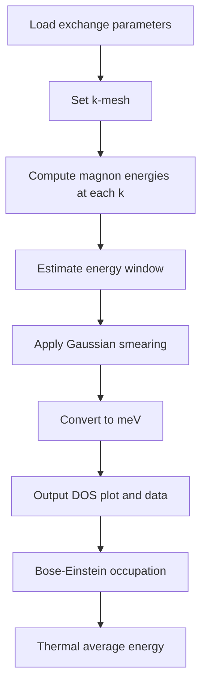

# Magnon Density of States

## Overview

The magnon density of states (DOS) g(ω) counts the number of magnon states per unit energy. It is computed by summing Gaussian-broadened delta functions at each magnon energy over a dense k-point mesh.

## Principles

- DOS requires dense k-mesh sampling for convergence
- Gaussian smearing replaces discrete delta functions
- Energy window should cover full magnon spectrum
- Gamma-centered mesh gives better convergence for magnetic systems

## Details

### Definition

The magnon DOS is defined as:

$$
g(\omega) = \frac{1}{N_k} \sum_{\mathbf{k},n} \delta(\omega - \omega_{n\mathbf{k}})
$$

where ω_{nk} is the energy of magnon band n at wavevector k, and N_k is the total number of k-points.

### Gaussian Smearing

In practice, the delta function is approximated by a Gaussian:

$$
g(\omega) = \frac{1}{N_k} \sum_{\mathbf{k},n} \frac{1}{\sqrt{2\pi}\sigma} \exp\left(-\frac{(\omega - \omega_{n\mathbf{k}})^2}{2\sigma^2}\right)
$$

where σ is the smearing width (typically 0.001 eV ≈ 0.08 meV).

### k-Mesh Sampling

DOS calculations require dense k-mesh sampling:

```python
from TB2J.kpoints import monkhorst_pack
kpts = monkhorst_pack([20, 20, 20], gamma_center=True)
weights = np.ones(len(kpts)) / len(kpts)
```

Gamma-centered mesh is preferred for magnetic systems.

### Energy Window

The energy window should cover the full magnon spectrum. TB2J can auto-estimate by computing energies at high-symmetry points:

```python
def estimate_energy_range(self, padding_factor=1.2):
    kpoints = np.array([
        [0.0, 0.0, 0.0],   # Γ
        [0.5, 0.0, 0.0],   # X
        [0.5, 0.5, 0.0],   # M
        [0.5, 0.5, 0.5],   # R
    ])
    evals = self.magnon._magnon_energies(kpoints)
    min_e = evals.min() - (padding_factor - 1) * (evals.max() - evals.min())
    max_e = evals.max() + (padding_factor - 1) * (evals.max() - evals.min())
    return min_e, max_e
```

## Variables

| Symbol | Description | Units |
|--------|-------------|-------|
| g(ω) | Density of states | states/eV |
| ω | Energy | eV |
| ω_{nk} | Magnon energy at band n, k-point k | eV |
| σ | Gaussian smearing width | eV |
| N_k | Number of k-points | dimensionless |

## Implementation

TB2J uses ASE's DOS calculator:

```python
from ase.dft.dos import DOS

class MagnonDOSCalculator:
    def get_dos(self, width=0.1, window=None, npts=1001):
        if window is None:
            window = self.estimate_energy_range()
        
        dos_calc = DOS(self, width=width, window=window, npts=npts)
        energies = dos_calc.get_energies()  # in eV
        dos_vals = dos_calc.get_dos()       # in states/eV
        
        # Convert to meV for output
        energies = energies * 1000          # eV to meV
        dos_vals = dos_vals / 1000          # states/eV to states/meV
        
        return energies, dos_vals
```

### Command Line Interface

```bash
# Calculate DOS with default settings
TB2J_magnon.py --dos

# Custom k-mesh and smearing
TB2J_magnon.py --dos --kmesh 30 30 30 --width 0.0005

# Specify energy window
TB2J_magnon.py --dos --window 0 100  # 0-100 meV
```

## Conventions

- Internal calculations use eV
- Output uses meV for energies and states/meV for DOS
- Default smearing: 0.001 eV
- Default k-mesh: 20×20×20

## Statistical Mechanics

### Bose-Einstein Occupation

The `MagnonDOS.bose_einstein(energies, temperature)` static method computes the Bose-Einstein distribution:

$$
n(E, T) = \frac{1}{\exp(E / k_B T) - 1}
$$

- **Input**: energies in **meV**, temperature in **K**
- **Output**: occupation number(s), same shape as input
- Energies ≤ 0 return `np.inf` (divergent occupation at zero energy)
- Uses `numpy.expm1` for numerical stability at small arguments (high-T / low-E Rayleigh-Jeans regime)
- Boltzmann constant from `ase.units.kB` (converted to meV/K)

```python
# Single energy
n = MagnonDOS.bose_einstein(10.0, 300)  # 10 meV at 300 K

# Array of energies
E = np.array([5., 10., 20.])
n = MagnonDOS.bose_einstein(E, 300)
```

### Thermal Average Energy

The `MagnonDOS.thermal_average_energy(temperature)` instance method computes the thermal average magnon energy **including the zero-point contribution** of each quantum harmonic oscillator mode:

$$
\langle E \rangle(T) = \frac{\int_0^{E_\text{max}} E \, g(E) \, [n(E,T) + \tfrac{1}{2}] \, dE}{\int_0^{E_\text{max}} g(E) \, dE}
$$

- The `1/2` term is the zero-point energy; at T → 0 the result approaches the zero-point average
- Integration runs over positive energies only (E > 0)
- Trapezoidal quadrature over the stored DOS energy grid
- Accuracy depends on DOS resolution (`npts`)
- Returns thermal average energy in **meV**

```python
dos = MagnonDOS(energies=E_arr, dos=dos_arr)
avg_E = dos.thermal_average_energy(300)  # meV at 300 K
```

## Workflow



## Linked Concepts

- [magnon_diagonalization](magnon_diagonalization.md): How magnon energies are computed
- [magnon_hamiltonian](magnon_hamiltonian.md): The underlying Hamiltonian
- [notation](notation.md): Standard variable notations
