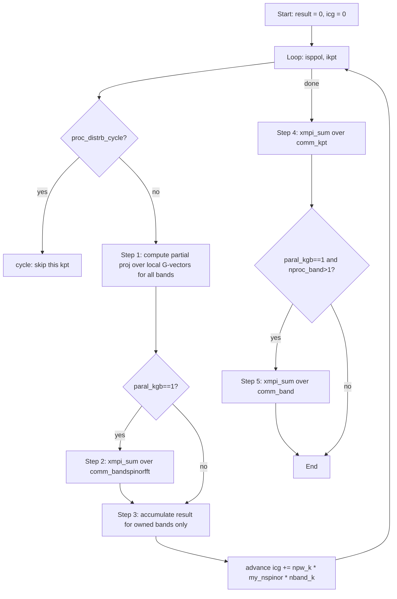

# ABINIT MPI Loop Over cg Template


## Overview

This note provides a complete, correct template for iterating over the `cg` wavefunction array and computing quantities that involve sums over G-vectors and bands, valid for **all ABINIT parallelization modes**: `paral_kgb=0` (classic) and `paral_kgb=1` (bandfft) with any combination of `npkpt`, `npband`, and `npfft`. Incorrect MPI reductions in `paral_kgb=1` are a common source of bugs because the G-vectors for a k-point are split across processes and partial sums must be explicitly completed.

## Principles

- **G-vectors are split in paral_kgb=1**: `npwarr(ikpt)` is LOCAL on each proc. Any inner product `<phi|psi>` computed over `ipw=1..npw_k` is a partial sum that must be reduced over `comm_bandspinorfft`.
- **nband_k is always global**: Physical `cg` storage contains all `nband_k` bands per k-point block on every proc (even if only a subset are "owned" by that proc logically).
- **Band ownership is separate from G-vector ownership**: In `paral_kgb=1`, a proc may hold all bands in `cg` but only accumulate results for its assigned band group.
- **Reduction order matters**: G-vector reduction (`comm_bandspinorfft`) must happen BEFORE band ownership filtering. Final result is reduced over `comm_kpt` and, if `nproc_band>1`, also over `comm_band`.
- **icg advances by `npw_k * my_nspinor * nband_k`** at every k-point (same formula for both modes).

## Details

### Problem Context

When computing a quantity like the occupation matrix or projection coefficient for a wavefunction at a given k-point and band:

$$
P_{n\mathbf{k}} = \sum_{\mathbf{G}} \phi^*(\mathbf{G}) \, c_{n\mathbf{k}}(\mathbf{G})
$$

in `paral_kgb=1`, each proc only holds a subset of the $\mathbf{G}$ vectors for k-point $\mathbf{k}$. The sum above is therefore incomplete until an MPI reduction is performed over `comm_bandspinorfft`, which groups all procs sharing G-vectors for the same k-point.

After the G-vector reduction, the result is complete but replicated on all procs in the `comm_bandspinorfft` group. Each proc then accumulates only the bands it logically owns (determined by `me_band` and `bandpp`), and a final reduction over `comm_kpt` (and `comm_band` if needed) produces the global result.

### Template

The following template computes a real output array `result(natom, ...)` that depends on projections of wavefunction bands onto localized orbitals. It is correct for all parallelization modes.

```fortran
! --- Prerequisite variables (from dtset/mpi_enreg/etc.) ---
! paral_kgb      = mpi_enreg%paral_kgb          (0 or 1)
! nproc_band     = mpi_enreg%nproc_band
! me_band        = mpi_enreg%me_band
! bandpp         = mpi_enreg%bandpp
! comm_bandspinorfft = mpi_enreg%comm_bandspinorfft
! comm_kpt       = mpi_enreg%comm_kpt
! comm_band      = mpi_enreg%comm_band  (if needed)
! my_nspinor     = max(1, nspinor/mpi_enreg%nproc_spinor)

result(:) = zero
icg = 0

! --- Outer loops over spin and k-point ---
do isppol = 1, nsppol
  do ikpt = 1, nkpt

    ! Skip k-points not owned by this proc (paral_kgb=0 ownership check)
    if (proc_distrb_cycle(mpi_enreg%proc_distrb, ikpt, 1, nband_k, isppol, mpi_enreg%me_kpt)) then
      cycle
    end if

    npw_k  = npwarr(ikpt)                              ! LOCAL G-count (both modes)
    nband_k = nband(ikpt + (isppol-1)*nkpt)            ! GLOBAL band count (both modes)
    wtk_k  = dtset%wtk(ikpt)

    ! --- Step 1: Compute partial G-vector sums for ALL bands ---
    ! (Only partial in paral_kgb=1; full sums in paral_kgb=0)
    ABI_MALLOC(proj, (nband_k))
    proj(:) = czero

    do iband = 1, nband_k
      do ipw = 1, npw_k
        cg_ipw = cmplx(cg(1, icg + (iband-1)*npw_k*my_nspinor + ipw), &
                       cg(2, icg + (iband-1)*npw_k*my_nspinor + ipw), kind=dp)
        proj(iband) = proj(iband) + conjg(phi(ipw)) * cg_ipw
      end do
    end do

    ! --- Step 2: Complete G-vector sum (no-op in paral_kgb=0) ---
    if (xmpi_paral == 1 .and. mpi_enreg%paral_kgb == 1) then
      call xmpi_sum(proj, mpi_enreg%comm_bandspinorfft, ierr)
    end if

    ! --- Step 3: Accumulate result for OWNED bands only ---
    do iband = 1, nband_k
      ! Band ownership check (paral_kgb=1 only; always true in paral_kgb=0)
      if (mpi_enreg%paral_kgb == 1 .and. mpi_enreg%nproc_band > 1) then
        if (mod((iband-1)/mpi_enreg%bandpp, mpi_enreg%nproc_band) /= mpi_enreg%me_band) cycle
      end if

      occ_k = occ(iband + (ikpt-1)*mband + (isppol-1)*mband*nkpt)
      result(:) = result(:) + wtk_k * occ_k * f(proj(iband))
    end do

    ABI_FREE(proj)

    ! --- Advance icg (same formula for both modes) ---
    icg = icg + npw_k * my_nspinor * nband_k

  end do ! ikpt
end do ! isppol

! --- Step 4: Reduce result over k-point communicator ---
if (xmpi_paral == 1) then
  call xmpi_sum(result, mpi_enreg%comm_kpt, ierr)
end if

! --- Step 5: Reduce over band communicator (paral_kgb=1 only) ---
if (xmpi_paral == 1 .and. mpi_enreg%paral_kgb == 1 .and. mpi_enreg%nproc_band > 1) then
  call xmpi_sum(result, mpi_enreg%comm_band, ierr)
end if
```

### Common Mistakes and How to Avoid Them

| Mistake | Symptom | Fix |
|---------|---------|-----|
| No `comm_bandspinorfft` reduction after projection | Wrong result with `npfft>1` or `npband>1` | Add `xmpi_sum(proj, comm_bandspinorfft)` after G-loop |
| Using `npwarr` as global G-count in `paral_kgb=1` | Wrong `icg` advance, array out-of-bounds | `npwarr(ikpt)` is LOCAL in `paral_kgb=1`; use it directly |
| Dividing `nband_k` by `nproc_band` for icg advance | Wrong offset into `cg` | Always use the global `nband_k` for `icg` |
| Accumulating all bands without ownership check | Double-counting with multiple `nproc_band` | Skip bands not owned by `me_band` |
| Missing final `comm_band` reduction | Partial result when `nproc_band>1` | Add `xmpi_sum(result, comm_band)` at end |

## Variables

The following variables are used in this note (see [notation](notation.md) for full definitions):

| Symbol | Description | Units |
|--------|-------------|-------|
| `cg(2, mcg)` | Packed wavefunction array (real/imag, G-vector coefficients) | dimensionless |
| `icg` | Running offset into `cg` for the current k-point | integer |
| `npw_k` | LOCAL number of plane waves for k-point `ikpt` on this proc | integer |
| `nband_k` | GLOBAL number of bands for k-point `ikpt` | integer |
| `my_nspinor` | Local spinor count: `max(1, nspinor/nproc_spinor)` | integer |
| `bandpp` | Bands per proc per band-group in `paral_kgb=1` | integer |
| `me_band` | This proc's band index in `paral_kgb=1` | integer |
| `nproc_band` | Number of procs sharing bands in `paral_kgb=1` | integer |
| `comm_bandspinorfft` | MPI communicator for procs sharing G-vectors of one k-point | — |
| `comm_kpt` | MPI communicator over k-points | — |
| `comm_band` | MPI communicator over band procs | — |
| `proj(nband_k)` | Projection `<phi|psi_{n,k}>` for each band | complex dp |
| `occ_k` | Occupation number for band `iband` at k-point `ikpt` | dimensionless |
| `wtk_k` | k-point weight | dimensionless |

## Equations

The projection of a localized orbital $\phi$ onto Bloch state $\psi_{n\mathbf{k}}$ is:

$$
P_{n\mathbf{k}} = \langle \phi | \psi_{n\mathbf{k}} \rangle = \sum_{\mathbf{G}} \phi^*(\mathbf{G}) \, c_{n\mathbf{k}}(\mathbf{G})
$$

In `paral_kgb=1`, the sum runs only over the local G-vectors on each proc. The global projection is recovered by MPI reduction over `comm_bandspinorfft`:

$$
P_{n\mathbf{k}}^{\text{global}} = \sum_{\text{procs}} P_{n\mathbf{k}}^{\text{local}}
$$

The `icg` advance formula (valid for both modes):

$$
\text{icg} \mathrel{+}= \text{npw\_k} \times \text{my\_nspinor} \times \text{nband\_k}
$$

## Workflow



## Conventions

- **Always use `ABI_MALLOC`/`ABI_FREE`** for temporary arrays, never Fortran `allocate`/`deallocate`.
- **`nband_k` is always global**: never divide by `nproc_band` when computing the `icg` advance.
- **`npw_k = npwarr(ikpt)` is LOCAL in `paral_kgb=1`**: treat it as a local quantity.
- **Reduction before filtering**: always complete the G-vector sum (Step 2) before applying band ownership filtering (Step 3). Reversing the order produces incorrect results.
- **`proc_distrb_cycle` for k-point skipping**: use this macro for `paral_kgb=0`; in `paral_kgb=1`, all procs in `comm_bandspinorfft` participate in the same k-point computation, so the check still applies at the k-point level but not band level.

## Linked Concepts

- [abinit_wavefunction_storage](abinit_wavefunction_storage.md) - Layout of `cg`, `icg`, `npwarr`, and band ownership for both parallelization modes
- [abinit_parallelization_overview](abinit_parallelization_overview.md) - Overview of the 4D (k×band×FFT×spinor) MPI grid
- [abinit_mpi_type_data_structure](abinit_mpi_type_data_structure.md) - `mpi_enreg` communicators: `comm_kpt`, `comm_band`, `comm_bandspinorfft`
- [abinit_fft_distribution](abinit_fft_distribution.md) - How the FFT grid is distributed across procs in `paral_kgb=1`
- [notation](notation.md) - Standard variable notations used in this note
