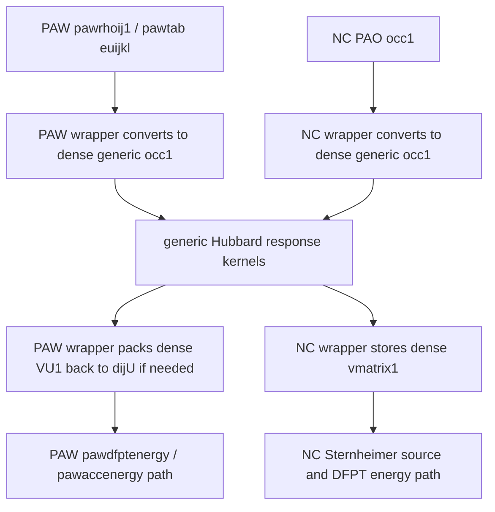
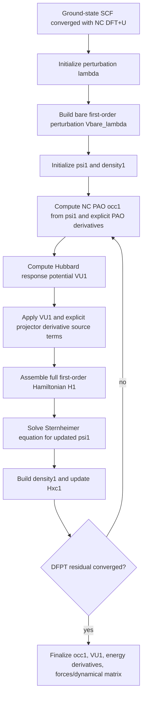
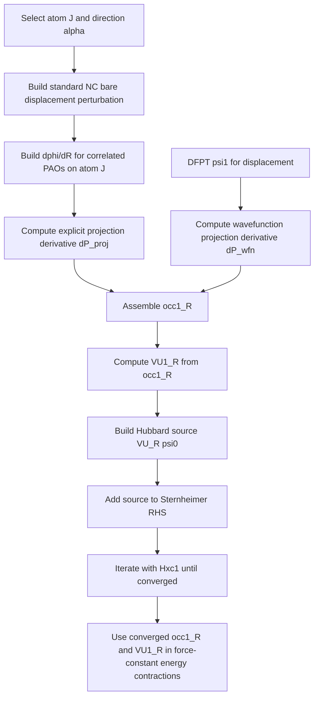
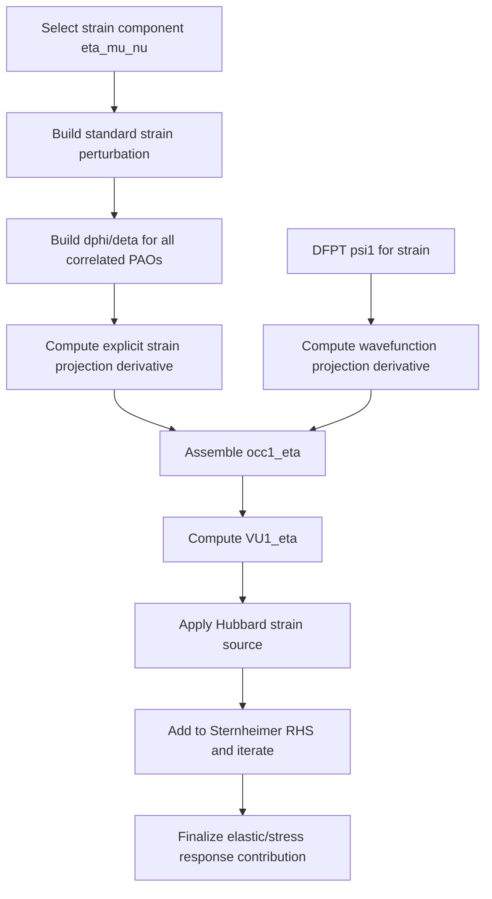
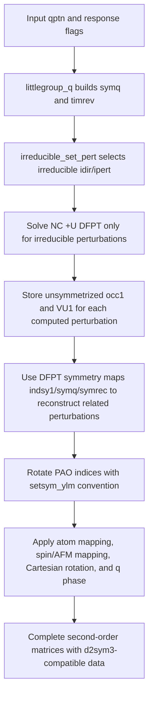
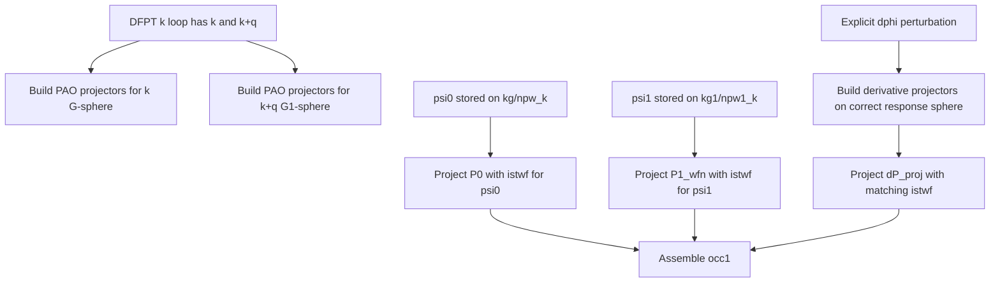
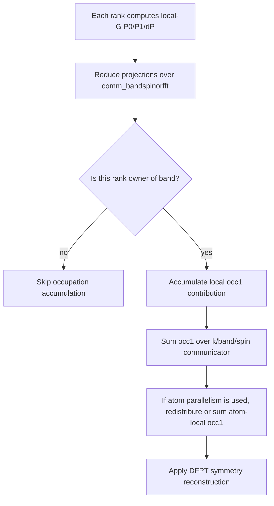
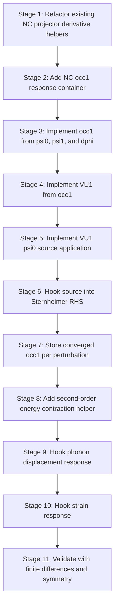

# NC PAO DFT+U DFPT Implementation Report


## Purpose

This report describes how to implement density-functional perturbation theory (DFPT) for norm-conserving pseudo-atomic-orbital DFT+U (NC PAO DFT+U) in ABINIT. The design is based on the PAW DFPT +U implementation pattern, but it does not reuse PAW data structures. The central idea is to reuse the orbital Hubbard mathematics while keeping the localized occupation response representation-specific.

The report covers the ground-state NC +U objects, the first-order occupation response, the derivative of the Hubbard potential, the way the derivative enters the Sternheimer wavefunction equation, displacement and strain perturbation workflows, second-order energy contractions, and a staged ABINIT implementation plan.

## Scope

- Target representation: norm-conserving pseudopotentials with PAO projectors and existing `m_nc_dftu` occupation/potential conventions.
- Target perturbations: atomic displacements, homogeneous strain, and the generic DFPT first-order wavefunction response needed by phonons and elastic tensors.
- Target Hubbard modes: current NC Dudarev mode `dftu_dc=0` and full interaction modes `dftu_dc=1..4` through shared Hubbard kernels.
- Non-goal: calling PAW `pawrhoij`, `paw_ij`, `dijU`, augmentation, or compensation-density machinery from the NC path.
- Non-goal: full non-collinear NC +U DFPT in the first implementation unless a separate spinor occupation response is added.

## Existing ABINIT Basis For The Design

- `src/66_nc_dftu/m_nc_dftu.F90` builds NC PAO occupations, energies, potentials, force derivatives, and stress derivatives.
- `src/66_wfs/m_nc_dftu_hamiltonian.F90` applies the NC +U Hamiltonian contribution to wavefunctions.
- `shared/libpaw/src/m_hubbard_orbital.F90` provides PAW-independent Hubbard kernels for interaction construction, energy/double-counting, and potential construction.
- `src/65_paw/m_paw_dfpt.F90::pawdfptenergy` shows the useful DFPT pattern: build a first-order localized +U potential from one localized density response and contract it with another localized response.
- `shared/libpaw/src/m_pawdij.F90::pawdiju_euijkl` shows the useful linearized potential pattern, but its PAW containers and packed indexing are not reusable for NC.
- `src/72_response/m_dfpt_vtorho.F90` and `src/95_drive/m_dfptnl_loop.F90` show where first-order response densities and PAW first-order on-site objects are produced and consumed.

## Generalization Boundary Relative To PAW +U

The same strategy used for ground-state energy, forces, and stress can be applied to DFPT, but only at the orbital-Hubbard algebra boundary. The PAW routines should not be reused wholesale because their public arguments and internal loops are tied to PAW augmentation data structures. The correct target is to extract smaller generic kernels and keep PAW and NC wrappers around them.

Good candidates for generic shared helpers:

- Linearized Hubbard potential from a first-order occupation matrix:

$$
V_U^1 = \frac{\partial V_U}{\partial n} : n^1.
$$

- Bilinear DFPT Hubbard energy contraction:

$$
E_U^{(a,b)} = \operatorname{Tr}\left[V_U[n^a] n^b\right]
$$

with the correct spin, complex, and double-counting conventions.

- Complex/q-phase orbital-matrix packing rules independent of PAW pair indexing, e.g. real/imaginary `cplex` handling and $q$-phase block handling for dense orbital matrices.
- Double-counting response derivatives for FLL/AMF modes, centralized beside `hubbard_potential` so PAW and NC do not diverge.
- Small trace/contraction utilities over dense orbital occupation matrices, with arguments like `occ1(cplex,norb,norb,nspin)` and `potential1(cplex,norb,norb,nspin)`.

Poor candidates for direct sharing:

- `pawrhoij_type`, `paw_ij_type`, `pawtab%indklmn`, `rhoijselect`, and triangular PAW pair indexing.
- `pawdiju_euijkl` as currently written, because it takes `pawrhoij_type` and `pawtab_type` and emits PAW `dijU` in PAW packed layout.
- `pawdfptenergy` as currently written, because it mixes PAW Hartree/XC on-site terms, PAW augmentation density terms, PAW atom parallelism, and PAW +U terms.
- PAW compensation density, `nhat`, `pawmkrho`, `pawmknhat`, and frozen PAW AE/PS terms.

The practical refactor shape should be:



This keeps the shared code focused on representation-independent orbital algebra while allowing PAW to preserve its existing APIs and packed storage. It also avoids making NC PAO DFPT pretend to be PAW.

## Notation

Let atoms carrying Hubbard corrections be indexed by $I$. The correlated angular momentum shell on atom $I$ has PAO-like localized functions $\{\phi^I_m\}$, with $m=-l_I,\ldots,l_I$. Spin is denoted by $\sigma$ for collinear spin. Bloch band and k-point labels are $n\mathbf{k}$. The perturbation parameter is $\lambda$.

The PAO projection amplitude is:

$$
P^{I\sigma}_{m,n\mathbf{k}} = \langle \phi^I_{m\mathbf{k}} | \psi^\sigma_{n\mathbf{k}} \rangle.
$$

The ground-state occupation matrix in the correlated subspace is:

$$
n^{I\sigma}_{m m'} = \sum_{n\mathbf{k}} w_{\mathbf{k}} f_{n\mathbf{k}\sigma}
P^{I\sigma}_{m,n\mathbf{k}}
\left(P^{I\sigma}_{m',n\mathbf{k}}\right)^*.
$$

The NC code convention from the current implementation must be preserved: `occ_matrix(i,j)` stores $n_{ij}$, and the Hubbard matrix used in the Hamiltonian is consistent with $V_{ij}=\partial E/\partial n_{ji}$.

## Ground-State NC +U Functional

For the Dudarev limit, the raw Hubbard correction is:

$$
E_U^{\mathrm{Dud}} = \frac{1}{2} U_{\mathrm{eff}} \sum_{I\sigma}
\operatorname{Tr}\left[n^{I\sigma} - n^{I\sigma} n^{I\sigma}\right].
$$

The corresponding potential in the PAO occupation basis is:

$$
V^{I\sigma}_{U,mm'} = \frac{\partial E_U^{\mathrm{Dud}}}{\partial n^{I\sigma}_{m'm}}
= U_{\mathrm{eff}}\left(\frac{1}{2}\delta_{mm'} - n^{I\sigma}_{m'm}\right).
$$

For full Lichtenstein/FLL/AMF modes, define the screened Coulomb tensor:

$$
K^I_{m_1m_2m_3m_4}
= \langle m_1 m_3 | \hat{V}^{I}_{ee} | m_2 m_4 \rangle.
$$

The interaction contribution has the general orbital form:

$$
E_{\mathrm{int}}^I[n] = \frac{1}{2}\sum_{\sigma\sigma'}
\sum_{m_1m_2m_3m_4}
\left(
K^I_{m_1m_2m_3m_4}\delta_{\sigma\sigma'}^{\mathrm{direct}}
- K^I_{m_1m_4m_3m_2}\delta_{\sigma\sigma'}^{\mathrm{exchange}}
\right)
n^{I\sigma}_{m_2m_1}
n^{I\sigma'}_{m_4m_3},
$$

where the exact spin factors and double-counting mode are delegated to the shared Hubbard kernel so that PAW and NC use the same orbital math.

The total correction used for reporting is:

$$
E_{U-DC}^I = E_{\mathrm{int}}^I - E_{\mathrm{DC}}^I.
$$

The NC total-energy correction must additionally account for the +U one-electron potential already included in the Hamiltonian band/eigenvalue contribution. The ground-state correction added to total energy is:

$$
E_{\mathrm{NC,total\ correction}}^I
= E_{\mathrm{int}}^I - E_{\mathrm{DC}}^I
- \sum_{\sigma}\operatorname{Tr}\left[V_U^{I\sigma} n^{I\sigma}\right].
$$

This distinction is essential. PAW printed +U energy components and NC total-energy correction terms do not have identical bookkeeping conventions.

## First-Order Occupation Response

The DFPT object that NC +U needs is the first derivative of the PAO occupation matrix:

$$
n^{I\sigma,\lambda}_{m m'} = \frac{d n^{I\sigma}_{m m'}}{d\lambda}.
$$

The derivative has a wavefunction-response part, an occupation/eigenvalue-smearing part when relevant, and an explicit projector derivative part:

$$
n^{I\sigma,\lambda}_{m m'} =
\sum_{n\mathbf{k}} w_{\mathbf{k}}
\left[
f^{\lambda}_{n\mathbf{k}\sigma} P^{I\sigma}_{m,n\mathbf{k}}
\left(P^{I\sigma}_{m',n\mathbf{k}}\right)^*
+ f_{n\mathbf{k}\sigma}
\left(
P^{I\sigma,\lambda}_{m,n\mathbf{k}}
\left(P^{I\sigma}_{m',n\mathbf{k}}\right)^*
+ P^{I\sigma}_{m,n\mathbf{k}}
\left(P^{I\sigma,\lambda}_{m',n\mathbf{k}}\right)^*
\right)
\right].
$$

The first-order projection amplitude is:

$$
P^{I\sigma,\lambda}_{m,n\mathbf{k}} =
\langle \phi^{I,\lambda}_{m\mathbf{k}} | \psi^\sigma_{n\mathbf{k}} \rangle
+ \langle \phi^I_{m\mathbf{k}} | \psi^{\sigma,\lambda}_{n\mathbf{k}} \rangle.
$$

For insulating phonons and fixed occupations, $f^{\lambda}_{n\mathbf{k}\sigma}=0$. For metals, smearing and Fermi-level response must be handled consistently with the existing ABINIT DFPT occupation response.

The PAW analogy is `pawrhoij1`. The NC object should be named as an occupation matrix rather than a PAW density matrix, for example `dftu_occ1` or `nc_dftu_occ_response`.

## Explicit Projector Derivative For Atomic Displacement

For an atomic displacement of atom $J$ along Cartesian component $\alpha$, $\lambda=R_{J\alpha}$. If the PAO projector is centered on atom $I$, then the explicit derivative is nonzero only for $I=J$:

$$
\frac{\partial}{\partial R_{J\alpha}}\phi^I_m(\mathbf{r}-\mathbf{R}_I)
= -\delta_{IJ}\frac{\partial}{\partial r_\alpha}
\phi^I_m(\mathbf{r}-\mathbf{R}_I).
$$

In reciprocal space, for a localized projector Fourier component $\phi^I_m(\mathbf{k}+\mathbf{G})$, the displacement derivative gives the phase-gradient factor:

$$
\frac{\partial}{\partial R_{I\alpha}}
\phi^I_m(\mathbf{k}+\mathbf{G})
= -i(k_\alpha+G_\alpha)\phi^I_m(\mathbf{k}+\mathbf{G})
\quad \text{up to the ABINIT phase convention used by the PAO projector code.}
$$

The explicit-projection derivative at fixed wavefunction is therefore:

$$
\left(P^{I\sigma,R_{J\alpha}}_{m,n\mathbf{k}}\right)_{\mathrm{proj}}
= \delta_{IJ}\langle \partial_{R_{I\alpha}}\phi^I_{m\mathbf{k}} | \psi^\sigma_{n\mathbf{k}} \rangle.
$$

The same convention is already used in the current NC +U force path and should be factored into a reusable projector-derivative helper rather than reimplemented inside DFPT.

## Explicit Projector Derivative For Strain

For homogeneous strain $\eta_{\mu\nu}$, the projector changes through reciprocal-space metric deformation, cell-volume normalization, and spherical-harmonic/radial derivatives. The existing NC stress path already implements these ingredients and should be reused.

The projector normalization contribution for diagonal strain is:

$$
\left(\frac{\partial \phi}{\partial \eta_{\mu\mu}}\right)_{\mathrm{norm}}
= -\frac{1}{2}\phi.
$$

The reciprocal-vector derivative contribution can be written abstractly as:

$$
\frac{\partial \phi_m(\mathbf{q})}{\partial \eta_{\mu\nu}}
= \sum_{\beta}\frac{\partial \phi_m(\mathbf{q})}{\partial q_\beta}
\frac{\partial q_\beta}{\partial \eta_{\mu\nu}}
-\frac{1}{2}\delta_{\mu\nu}\phi_m(\mathbf{q}),
\qquad \mathbf{q}=\mathbf{k}+\mathbf{G}.
$$

For an infinitesimal strain in the convention where reciprocal vectors transform contravariantly:

$$
\frac{\partial q_\beta}{\partial \eta_{\mu\nu}}
= -\delta_{\beta\nu} q_\mu,
$$

so that:

$$
\frac{\partial \phi_m(\mathbf{q})}{\partial \eta_{\mu\nu}}
= -q_\mu\frac{\partial \phi_m(\mathbf{q})}{\partial q_\nu}
-\frac{1}{2}\delta_{\mu\nu}\phi_m(\mathbf{q}).
$$

ABINIT Voigt ordering and symmetry factors must match the current stress implementation: $(11),(22),(33),(32),(31),(21)$.

## Derivative Of The Hubbard Potential

The ground-state Hubbard potential is the derivative of the energy with respect to the transposed occupation matrix:

$$
V^{I\sigma}_{U,mm'}[n] = \frac{\partial E_U}{\partial n^{I\sigma}_{m'm}}.
$$

The first-order Hubbard potential is the Frechet derivative of this potential with respect to the first-order occupation:

$$
V^{I\sigma,\lambda}_{U,mm'} =
\sum_{\sigma'}\sum_{ab}
\frac{\partial V^{I\sigma}_{U,mm'}}
{\partial n^{I\sigma'}_{ab}}
n^{I\sigma',\lambda}_{ab}.
$$

For Dudarev, this is especially simple:

$$
V^{I\sigma,\lambda}_{U,mm'}
= -U_{\mathrm{eff}} n^{I\sigma,\lambda}_{m'm}.
$$

For full Lichtenstein/FLL/AMF modes, the same operation should be implemented through a shared or NC-local linearized potential helper. Abstractly:

$$
V^{I\sigma,\lambda}_{U,mm'} =
\sum_{\sigma'}\sum_{ab}
\mathcal{K}^{I,\sigma\sigma'}_{mm',ab}
n^{I\sigma',\lambda}_{ab}
- V^{I\sigma,\lambda}_{\mathrm{DC},mm'},
$$

where $\mathcal{K}$ is the orbital interaction Hessian implied by `interaction_tensor`, and $V_{\mathrm{DC}}^{\lambda}$ is the derivative of the selected double-counting potential.

For FLL-like double counting, using total shell occupations $N^I_\sigma=\operatorname{Tr}n^{I\sigma}$ and $N^I=\sum_\sigma N^I_\sigma$, a representative form is:

$$
E_{\mathrm{DC}}^{\mathrm{FLL}}
= \frac{1}{2}U N(N-1)
-\frac{1}{2}J\sum_\sigma N_\sigma(N_\sigma-1).
$$

The double-counting potential derivative is diagonal in orbital indices:

$$
V_{\mathrm{DC},mm'}^{\sigma}
= \left[U\left(N-\frac{1}{2}\right)
-J\left(N_\sigma-\frac{1}{2}\right)\right]\delta_{mm'}.
$$

Its first derivative is:

$$
V_{\mathrm{DC},mm'}^{\sigma,\lambda}
= \left[U N^{\lambda}
-J N^{\sigma,\lambda}\right]\delta_{mm'},
\qquad
N^{\sigma,\lambda}=\operatorname{Tr}n^{\sigma,\lambda}.
$$

For AMF-like modes, the double-counting derivative depends on deviations from the shell average. The implementation should not duplicate the formula by hand in multiple places. It should either call a new shared linear-response potential kernel or use a controlled finite-difference-free analytic helper adjacent to `hubbard_potential`.

## Derivative Of The +U Hamiltonian Applied To Wavefunctions

The NC +U Hamiltonian contribution can be written as a separable nonlocal operator:

$$
\hat{V}_U = \sum_{I\sigma}\sum_{mm'}
|\phi^I_m\rangle V^{I\sigma}_{U,mm'}\langle \phi^I_{m'}|.
$$

Its first derivative is:

$$
\hat{V}^{\lambda}_U =
\sum_{I\sigma}\sum_{mm'}
|\phi^{I,\lambda}_m\rangle V^{I\sigma}_{U,mm'}\langle \phi^I_{m'}|
+ |\phi^I_m\rangle V^{I\sigma,\lambda}_{U,mm'}\langle \phi^I_{m'}|
+ |\phi^I_m\rangle V^{I\sigma}_{U,mm'}\langle \phi^{I,\lambda}_{m'}|.
$$

Applied to a ground-state wavefunction, this gives:

$$
\hat{V}^{\lambda}_U |\psi^\sigma_{n\mathbf{k}}\rangle =
\sum_{Imm'}
|\phi^{I,\lambda}_m\rangle V^{I\sigma}_{U,mm'} P^{I\sigma}_{m',n\mathbf{k}}
+ \sum_{Imm'} |\phi^I_m\rangle V^{I\sigma,\lambda}_{U,mm'} P^{I\sigma}_{m',n\mathbf{k}}
+ \sum_{Imm'} |\phi^I_m\rangle V^{I\sigma}_{U,mm'} P^{I\sigma,\lambda,\mathrm{proj}}_{m',n\mathbf{k}}.
$$

The middle term is the self-consistent Hubbard response to the first-order occupation. The first and third terms are explicit PAO-projector derivative terms. For perturbations that do not move or deform the PAO projectors, these explicit terms vanish and only $V_U^\lambda$ remains.

## Sternheimer Equation With NC +U

For norm-conserving pseudopotentials, the ordinary first-order wavefunction response satisfies a Sternheimer equation of the form:

$$
\left(\hat{H}^{(0)} - \epsilon^{(0)}_{n\mathbf{k}\sigma}\right)
|\psi^{\lambda}_{n\mathbf{k}\sigma}\rangle
= -\hat{P}_c
\left(
\hat{H}^{\lambda} - \epsilon^{\lambda}_{n\mathbf{k}\sigma}
\right)
|\psi^{(0)}_{n\mathbf{k}\sigma}\rangle.
$$

With NC +U, the first-order Hamiltonian contains:

$$
\hat{H}^{\lambda} =
\hat{T}^{\lambda}
+ \hat{V}^{\lambda}_{\mathrm{loc}}
+ \hat{V}^{\lambda}_{\mathrm{Hxc}}
+ \hat{V}^{\lambda}_{\mathrm{nlpsp}}
+ \hat{V}^{\lambda}_{U}.
$$

The NC +U term must be included in two places:

$$
\hat{V}^{(0)}_U
\quad \text{inside the left-hand operator through }\hat{H}^{(0)},
$$

and

$$
\hat{V}^{\lambda}_U
\quad \text{inside the right-hand perturbation source.}
$$

Because $V_U^{\lambda}$ depends on $\psi^{\lambda}$ through $n^{\lambda}$, this is a self-consistent DFPT response problem, analogous to the Hartree-XC response potential:

$$
n^{\lambda} = \mathcal{N}[\psi^{\lambda},\phi^{\lambda}],
\qquad
V_U^{\lambda} = \mathcal{F}_U[n^{\lambda}],
\qquad
\psi^{\lambda} = \mathcal{S}[V_{\mathrm{Hxc}}^{\lambda}+V_U^{\lambda}+V_{\mathrm{bare}}^{\lambda}].
$$

Therefore the +U response must participate in the same DFPT self-consistency loop as the density response.

## How To Apply The Potential Derivative In Code

The existing ground-state `m_nc_dftu_hamiltonian.F90` path applies $\hat{V}_U|\psi\rangle$ through PAO projections and `vmatrix`. DFPT needs a sibling operation that applies $\hat{V}_U^\lambda|\psi^{(0)}\rangle$ and, where required by the linear solver, $\hat{V}_U^{(0)}|\psi^\lambda\rangle$.

The left-hand side action already includes $\hat{V}_U^{(0)}|\psi^\lambda\rangle$ if the ground-state Hamiltonian action used by DFPT includes the NC +U Hamiltonian. This should be verified in the relevant `vtowfk`/Sternheimer code path. If not, the NC +U Hamiltonian application must be added to the linear-response Hamiltonian action.

The right-hand source term should add:

$$
|S_U^{\lambda}\rangle =
\hat{V}^{\lambda}_U |\psi^{(0)}\rangle.
$$

The application sequence is:

```mermaid
flowchart TD
    A[Ground-state psi0 and NC PAO projectors] --> B[Compute P0 = <phi0|psi0>]
    A --> C[Build explicit projector derivative dphi/dlambda]
    C --> D[Compute dP_proj = <dphi/dlambda|psi0>]
    E[Current DFPT psi1] --> F[Compute dP_wfn = <phi0|psi1>]
    B --> G[Assemble occ1]
    D --> G
    F --> G
    G --> H[Compute VU1 = dVU/dn : occ1]
    B --> I[Apply |phi0> VU1 <phi0| psi0]
    D --> J[Apply |phi0> VU0 <dphi| psi0]
    C --> K[Apply |dphi> VU0 <phi0| psi0]
    I --> L[DFPT source term S_U]
    J --> L
    K --> L
```

The three source terms correspond to the three terms in $\hat{V}_U^\lambda$:

$$
|S_U^{\lambda}\rangle
= |S_{U,\mathrm{pot}}^{\lambda}\rangle
+ |S_{U,\mathrm{bra}}^{\lambda}\rangle
+ |S_{U,\mathrm{ket}}^{\lambda}\rangle.
$$

The potential-response term is:

$$
|S_{U,\mathrm{pot}}^{\lambda}\rangle
= \sum_{Imm'} |\phi^I_m\rangle
V^{I\sigma,\lambda}_{U,mm'}
P^{I\sigma}_{m',n\mathbf{k}}.
$$

The explicit ket-projector term is:

$$
|S_{U,\mathrm{ket}}^{\lambda}\rangle
= \sum_{Imm'} |\phi^{I,\lambda}_m\rangle
V^{I\sigma}_{U,mm'}
P^{I\sigma}_{m',n\mathbf{k}}.
$$

The explicit bra-projector term is:

$$
|S_{U,\mathrm{bra}}^{\lambda}\rangle
= \sum_{Imm'} |\phi^I_m\rangle
V^{I\sigma}_{U,mm'}
P^{I\sigma,\lambda,\mathrm{proj}}_{m',n\mathbf{k}}.
$$

These terms are the NC analog of how PAW uses first-order `pawrhoij` and first-order `dijU`, except NC must explicitly apply PAO derivative operators in reciprocal space.

## DFPT Self-Consistency Workflow

The NC +U response should be integrated into the regular DFPT loop rather than handled as a post-processing correction. At each DFPT iteration, the current first-order wavefunctions produce a first-order PAO occupation, which produces a first-order Hubbard potential, which contributes to the next Sternheimer source.



The first implementation should keep this loop as close as possible to ABINIT's existing `dfpt_vtowfk` and `dfpt_vtorho` control flow. The +U code should provide small representation-specific hooks rather than a separate DFPT driver.

## Displacement Perturbation Workflow

For a phonon displacement perturbation $\lambda=R_{J\alpha}$, the explicit PAO derivative is localized to correlated atom $J$ if that atom carries a Hubbard correction. The wavefunction response still includes the global change in the Kohn-Sham potential.



The displacement occupation response is:

$$
n^{I\sigma,R_{J\alpha}}_{mm'} =
\sum_{n\mathbf{k}} w_{\mathbf{k}}f_{n\mathbf{k}\sigma}
\left[
\left(P^{I\sigma,R_{J\alpha},\mathrm{proj}}_{m,n\mathbf{k}}
+P^{I\sigma,R_{J\alpha},\mathrm{wfn}}_{m,n\mathbf{k}}\right)
\left(P^{I\sigma}_{m',n\mathbf{k}}\right)^*
+P^{I\sigma}_{m,n\mathbf{k}}
\left(P^{I\sigma,R_{J\alpha},\mathrm{proj}}_{m',n\mathbf{k}}
+P^{I\sigma,R_{J\alpha},\mathrm{wfn}}_{m',n\mathbf{k}}\right)^*
\right].
$$

## Strain Perturbation Workflow

For strain, every PAO projector is affected through the reciprocal-space metric and normalization, not only projectors on one displaced atom. The existing NC stress path has the required radial and spherical-harmonic derivative ingredients.



The strain response must preserve the normalization term:

$$
P^{I\sigma,\eta_{\mu\mu},\mathrm{norm}}_{m,n\mathbf{k}}
= -\frac{1}{2}P^{I\sigma}_{m,n\mathbf{k}}.
$$

Missing or sign-flipping this term will give the wrong diagonal stress sign, as already found in the NC +U stress validation.

## DFPT Symmetry Workflow

DFPT symmetry is not identical to ground-state SCF occupation symmetrization. SCF NC +U symmetrizes a ground-state occupation matrix over the full space group, whereas DFPT response for a finite phonon wavevector must use the little group of the perturbation wavevector $\mathbf{q}$, including the time-reversal flag accepted for that response calculation.

In `m_respfn_driver.F90`, ABINIT builds `symq` with `littlegroup_q`, determines irreducible perturbations with `irreducible_set_pert`, and later completes second-order matrices with `d2sym3`. NC +U DFPT should follow this response symmetry flow instead of calling the SCF `symmetrize_nc_occmatrix` blindly on first-order occupations.

The little-group condition is:

$$
S\mathbf{q} = \mathbf{q} + \mathbf{G}_S
$$

for a pure unitary symmetry operation $S$, or:

$$
-S\mathbf{q} = \mathbf{q} + \mathbf{G}_S
$$

when time reversal is used with the symmetry operation.

For a first-order occupation response associated with perturbation $\lambda=(J\alpha,\mathbf{q})$, symmetry maps it to a related perturbation $\lambda'=(J'\beta,\mathbf{q})$ through atom mapping, Cartesian rotation, spherical-harmonic rotation, and a possible phase factor from the non-symmorphic translation and the perturbation wavevector:

$$
n^{I,\lambda}_{mm'}(\mathbf{q})
\rightarrow
e^{i\mathbf{q}\cdot\Delta\boldsymbol{\tau}}
\sum_{ab}
D^I_{ma}(S)
n^{I',\lambda'}_{ab}(\mathbf{q})
D^I_{m'b}(S).
$$

Here $D^I(S)$ is the real spherical-harmonic rotation matrix from `setsym_ylm`, and $I'$ is the atom mapped to $I$ by `indsym(4,isym,I)`. The exact sign and phase convention must match existing DFPT routines such as `dfpt_sygra` and `d2sym3`; do not invent a separate convention for NC +U.

For $\mathbf{q}=0$, the phase factor reduces to unity and the response symmetry approaches the ground-state form, but the perturbation index and Cartesian direction still transform. For strain perturbations, comments in `m_dfpt_scfcv.F90` state that time-reversal symmetry is always true and explicitly zero the imaginary part of nonlocal second-derivative terms left by the symmetry-reduced k-point set. NC +U strain response should follow the same rule for the strain +U contribution.

The NC +U DFPT symmetry flow should be:



Implementation rule: ground-state `symmetrize_nc_occmatrix` is useful as a reference for rotating PAO orbital indices with `setsym_ylm`, including the transpose convention already documented in `m_nc_dftu.F90`. It is not sufficient for DFPT because it lacks perturbation-index rotation, $\mathbf{q}$-phase handling, little-group filtering, and time-reversal handling for response quantities.

## DFPT `istwfk` And k/q Wavefunction Storage

The `istwfk` issue is more delicate in DFPT than in SCF because the response wavefunction is associated with $\mathbf{k}+\mathbf{q}$ while the ground-state wavefunction is associated with $\mathbf{k}$. The response path carries both ground-state and first-order plane-wave lists, typically `kg`/`npw_k` and `kg1`/`npw1_k`. The first-order PAO projection must use the same storage convention and G-vector list as the first-order wavefunction being projected.

The ground-state projection is:

$$
P^0_{m,n\mathbf{k}} = \sum_{\mathbf{G}\in\mathcal{G}_{\mathbf{k}}}
\left(\phi_m(\mathbf{k}+\mathbf{G})\right)^*
c^0_{n\mathbf{k}}(\mathbf{G}).
$$

The first-order wavefunction projection at finite $\mathbf{q}$ is:

$$
P^1_{m,n\mathbf{k}} = \sum_{\mathbf{G}\in\mathcal{G}_{\mathbf{k}+\mathbf{q}}}
\left(\phi_m(\mathbf{k}+\mathbf{q}+\mathbf{G})\right)^*
c^1_{n\mathbf{k},\lambda}(\mathbf{G}).
$$

Do not assume SCF projection code can be called unchanged for `psi1`. The routine must receive the correct first-order projector array and first-order wavefunction storage:

$$
\texttt{compute\_pao\_proj\_istwfk}
\left(\phi(\mathbf{k}+\mathbf{q}+\mathbf{G}_1),\psi^1(\mathbf{G}_1),\texttt{npw1\_k},\texttt{istwf\_response}\right).
$$

ABINIT response code often passes `istwfk_rbz(ikpt)` while loading both `k` and `k+q` objects, and comments in `m_dfpt_vtorho.F90` indicate that RF calculations may impose `istwf_k=1` for some `kprime` handling. Therefore the NC +U DFPT code should not infer `istwf` from the ground-state dataset alone. It should take the active Hamiltonian object's `istwf_k` for the array being contracted, just as the ground-state Hamiltonian application currently uses `gs_hamk%istwf_k`.

The packed-storage rule remains the same as in SCF: do not repair half-sphere sums with an ad hoc scalar factor. Use the ABINIT packed real convention implemented by `compute_pao_proj_istwfk`, with the Gamma `istwf_k==2` first-coefficient exception and no copied Gamma exception for `istwf_k=3..9`.

The DFPT projection workflow should be:



Validation must include at least one `istwfk=2` Gamma-only case and one non-Gamma time-reversal packed case, e.g. `istwfk=9` if available. The expected failure mode from wrong handling is a factor-of-two error in projections and a factor-of-four error in quadratic occupation or energy terms.

## Symmetry And `istwfk` Checklist For NC +U DFPT

- Use response little-group symmetry (`symq`, `indsy1`, `timrev`) for first-order and second-order response objects, not the full SCF space group unless $\mathbf{q}=0$ and the response driver says it is valid.
- Rotate PAO orbital indices with `setsym_ylm` using the same transpose convention as `symmetrize_nc_occmatrix`.
- Rotate perturbation Cartesian directions with the same real-space or reciprocal-space matrices used by the native DFPT object being matched.
- Apply atom mapping through `indsym(4,isym,iatom)` and preserve AFM spin-channel swapping through `symafm` where collinear spin symmetry permits it.
- Preserve q-dependent phase factors for finite-q phonons; do not average first-order occupations as if they were q=0 ground-state occupations.
- For strain response, enforce the same reality/time-reversal convention as native DFPT strain terms and zero symmetry-induced residual imaginary components where the native code does so.
- For projections, pass the active G-sphere, active `npw`, and active `istwf_k` belonging to the wavefunction being projected.
- Do not use post-hoc `fac_G` corrections for `istwfk>1`.
- Keep contiguous `psi_re(:)` and `psi_im(:)` work arrays before calling `compute_pao_proj_istwfk` to avoid array-temporary warnings.

## Additional Implementation Cautions

The following issues are easy to miss because they are not part of the ground-state NC +U SCF path, or because PAW handles them through mature response-specific containers.

### Locality Does Not Remove k/q Dependence

DFT+U is local in the correlated subspace and on-site in the atom index, but the NC PAO projector matrix elements are still built from Bloch wavefunctions and Bloch-summed localized orbitals. Therefore the correction is not a purely k-independent scalar in a plane-wave DFPT implementation.

The on-site operator is local in real space:

$$
\hat{V}_U = \sum_{I}\sum_{mm'} |\phi^I_m\rangle V^I_{mm'} \langle \phi^I_{m'}|.
$$

Its Bloch matrix elements depend on the wavevector through the projected PAO amplitudes:

$$
\langle \psi_{n\mathbf{k}} | \hat{V}_U | \psi_{n\mathbf{k}} \rangle
= \sum_{I mm'}
\left(P^I_{m,n\mathbf{k}}\right)^*
V^I_{mm'}
P^I_{m',n\mathbf{k}}.
$$

The potential matrix $V^I_{mm'}$ is on-site and has no explicit $\mathbf{k}$ label in the ground state, but $P^I_{m,n\mathbf{k}}$ does. In DFPT, the first-order wavefunction lives at $\mathbf{k}+\mathbf{q}$, so the response projector amplitude is generally:

$$
P^{I,1}_{m,n\mathbf{k}}
= \langle \phi^I_{m,\mathbf{k}+\mathbf{q}} | \psi^1_{n\mathbf{k},\mathbf{q}} \rangle
+ \langle \phi^{I,1}_{m,\mathbf{k}} | \psi^0_{n\mathbf{k}} \rangle,
$$

with the precise $\mathbf{k}$ or $\mathbf{k}+\mathbf{q}$ convention fixed by ABINIT's response Hamiltonian. This is why the `k+q` G-sphere, `istwfk`, complex response storage, and finite-q symmetry phases still matter even though the Hubbard correction is local in the correlated shell.

What locality does simplify:

- There is no long-range Coulomb kernel or macroscopic electric-field nonanalyticity in the +U correction itself.
- The interaction tensor $K^I$ and double-counting formulas are atom-local and do not carry a k index.
- For Γ-only, insulating, fixed-occupation, collinear tests, `occ1` may be real and q-phase handling may reduce to the ground-state-like limit.

What locality does not remove:

- Bloch projector phases and k-dependent PAO matrix elements.
- The need to use the correct `kg`/`kg1`, `npw`/`npw1`, and active `istwf_k` for the wavefunction being projected.
- Finite-q little-group symmetry and non-symmorphic phase factors for response objects.
- Metallic occupation-response terms if occupations change.
- MPI ownership/reduction issues because projections are still summed over distributed G vectors, bands, k points, and spins.

Therefore the cautions in this section are implementation-dependent, not statements that the Hubbard interaction tensor is nonlocal. A first milestone can deliberately avoid many of them by limiting scope, but production DFPT support cannot ignore them.

### Complex Response Storage And q-Phase

Ground-state NC +U occupations are currently real in the implemented collinear path. DFPT first-order occupations are generally complex for finite $\mathbf{q}$, finite frequency, magnetic/vector perturbations, and any case where time-reversal cannot reduce the response to a real quantity. PAW handles this through `cplex_rhoij` and `qphase_rhoij` in `pawrhoij_inquire_dim`; NC should introduce an equivalent NC-specific concept instead of forcing real `occ1` storage.

The finite-q first-order occupation has the Hermiticity relation:

$$
n^{I,\lambda}_{mm'}(\mathbf{q})
= \left[n^{I,\lambda^*}_{m'm}(-\mathbf{q})\right]^*.
$$

At a fixed nonzero $\mathbf{q}$, $n^1(\mathbf{q})$ is not necessarily Hermitian by itself. Therefore validation should check the paired $\pm\mathbf{q}$ relation, not only $n^1=(n^1)^\dagger$.

Implementation consequence: start with a `cplex` dimension for `occ1` and `vmatrix1`, even if the first milestone only fills the real part. Retrofitting complex response storage later will be harder because it affects MPI reduction, symmetry, trace contractions, and DDB output.

### Metallic Occupations And Active-Space Corrections

DFPT has additional occupation-response terms for metals. In `dfpt_vtorho`/`dfpt_vtowfk`, the response path carries `doccde_rbz`, `docckqde`, `fermie1`, `edocc`, `rocceig`, and an active-space corrected first-order wavefunction. The comments state that `cg1_active` is orthogonalized to the active space and may not be coherent with `cg1` in the same way.

The occupation derivative should therefore be decomposed as:

$$
n^{1}_{mm'} = n^{1,\psi}_{mm'} + n^{1,\mathrm{proj}}_{mm'} + n^{1,f}_{mm'}.
$$

The occupation-number term is:

$$
n^{1,f}_{mm'} = \sum_{n\mathbf{k}} w_{\mathbf{k}} f^1_{n\mathbf{k}}
P^0_{m,n\mathbf{k}}
\left(P^0_{m',n\mathbf{k}}\right)^*.
$$

For metals, $f^1_{n\mathbf{k}}$ depends on eigenvalue response and Fermi-level response:

$$
f^1_{n\mathbf{k}} = \frac{\partial f}{\partial \epsilon}
\left(\epsilon^1_{n\mathbf{k}} - \epsilon_F^1\right).
$$

Recommendation: first support insulating fixed-occupation DFPT and explicitly guard or disable metallic NC +U DFPT until $n^{1,f}$ and the active-space wavefunction convention are implemented and tested.

### `cg1` Versus `cg1_active`

The response code distinguishes several first-order wavefunction arrays. `cg1` is the updated response wavefunction used for density construction, while `cg1_active` and `gh0c1_set`/`gh1c_set` appear in eigenvalue-response and active-space contexts. NC +U `occ1` must be built from the same response wavefunction object used by ABINIT to build the first-order density for the selected mode.

Implementation rule: do not choose `cg1`, `cg1_active`, or `cg1_out` by name alone. Follow the call site where `rhor1`/`rhog1` is built for the same perturbation. If the mode uses active-space correction, NC +U occupation response must use the active-space-complete wavefunction or add the missing occupation/eigenvalue contribution explicitly.

### MPI Ownership And Reductions

Ground-state NC +U already has subtle parallel rules: each process computes local-G projection contributions, reduces projections over `comm_bandspinorfft`, and only band-owning processors accumulate the occupation matrix. DFPT repeats this pattern with both `npw_k` and `npw1_k`, with `proc_distrb_nband`, `proc_distrb_cycle`, `me_kpt`, `me_band`, and global reductions over `spaceworld` for response arrays.

The safe NC +U DFPT reduction workflow is:



Do not sum both projections and final occupations over the same band ownership in a way that double-counts bands. Do not skip the projection reduction when `paral_kgb=1`, or the occupation matrix will contain only local-G partial projections.

### Atom Parallelism And Correlated-Atom Ownership

PAW response code allocates first-order `pawrhoij1` differently when `paral_atom` is active and later calls PAW-specific redistribution/summation helpers. NC +U should make a clear decision: either every rank stores all correlated-atom `occ1` objects after MPI reduction, or `occ1` is atom-distributed and every consumer accepts the atom-distributed layout.

The first implementation should prefer replicated `occ1` over correlated atoms after reduction. It is simpler and matches the current NC ground-state `dftu_nc%occ_matrix` usage. Atom-distributed `occ1` can be optimized later if memory becomes a problem.

### Spinor And Non-Collinear Limitations

The existing NC +U path is primarily collinear (`nsppol=1/2`) even though ABINIT response routines carry `nspinor` and `nspden=4` paths. For spinor response, the occupation matrix acquires spinor indices:

$$
n^{I}_{mm'\alpha\beta} = \sum_{n\mathbf{k}} w_{\mathbf{k}} f_{n\mathbf{k}}
P^{I\alpha}_{m,n\mathbf{k}}
\left(P^{I\beta}_{m',n\mathbf{k}}\right)^*.
$$

The Hubbard potential then becomes a spin matrix in addition to an orbital matrix:

$$
V^{I}_{U,mm'\alpha\beta}
= \frac{\partial E_U}{\partial n^{I}_{m'm\beta\alpha}}.
$$

Recommendation: explicitly restrict the first NC +U DFPT implementation to collinear `nspinor=1` unless a separate spinor occupation and potential design is implemented. Silent partial support for `nspinor=2` would be dangerous.

### Gauge, Degenerate Bands, And Phase Continuity

First-order wavefunctions are gauge-dependent, while density and occupation responses must be gauge-invariant after the active-space and occupation-response terms are included. Degenerate occupied subspaces can rotate between iterations or finite-difference runs. A naive band-by-band comparison of `occ1` can fail even when the final response is correct.

For an occupied subspace rotation $U$, projections transform as:

$$
P_{m,n} \rightarrow \sum_{a} P_{m,a} U_{an}.
$$

The summed occupation is invariant only after summing over the full occupied subspace with consistent occupations:

$$
\sum_n f_n P_{m,n}P^*_{m',n}
\rightarrow
\sum_{abn} f_n P_{m,a}U_{an}U^*_{bn}P^*_{m',b}.
$$

If $f_n$ is equal inside the degenerate block, the unitary matrices cancel. If not, the metallic/eigenvalue-response machinery must be used. This is another reason to start validation with insulating systems and fixed occupations.

### DDB Assembly, `blkflg`, ASR, And Charge Neutrality

NC +U second-order contributions must enter the same second-derivative matrix assembly path as other nonlocal terms. In `m_respfn_driver.F90`, `blkflg`, `d2nfr`, `d2nl`, `d2sym3`, `asr`, and `chneut` control which perturbation blocks are present and how they are completed or corrected.

For nonzero $\mathbf{q}$, ABINIT locally resets `chneut` and `asr` because those corrections are not allowed in the same way. NC +U DFPT code must not apply its own acoustic or charge-neutrality corrections before the global DFPT assembly. It should contribute raw consistent blocks and let the existing DDB/dynamical-matrix machinery apply global symmetrization and corrections.

### Energy Factors And Double Counting In Response

The ground-state NC total energy uses:

$$
E_{\mathrm{NC,total\ correction}} = E_{\mathrm{int}} - E_{\mathrm{DC}} - \operatorname{Tr}[V_U n].
$$

The DFPT second-order source and energy contractions should not blindly differentiate this printed total-correction expression term by term. In Sternheimer DFPT, parts of the one-electron potential contribution are already represented by the wavefunction response and eigenvalue terms, just as in ground-state band-sum accounting. The implementation must decide at each insertion point whether it is adding a Hamiltonian source, a frozen-wavefunction second derivative, or a final energy correction.

A safe convention is:

$$
\text{Hamiltonian path: add } \hat{V}_U^0 \text{ and } \hat{V}_U^1.
$$

$$
\text{Energy path: add only the residual functional terms not already counted by ABINIT's eigenvalue/nonlocal energy assembly.}
$$

This should be validated by finite differences of total energy and by checking mixed-derivative symmetry.

### Minimal Guards For First Implementation

The first code patch should fail early or skip NC +U DFPT with a clear message unless the assumptions are satisfied:

- `usedftu_nc=1` with collinear `nspinor=1`.
- insulating or fixed occupations unless metallic $n^{1,f}$ is implemented.
- supported perturbation type explicitly checked: start with $\Gamma$ phonon displacement, then strain, then finite-q phonons.
- no finite frequency unless complex response storage and time-reversal disabling are tested.
- `paral_kgb`, serial, and MPI ownership all covered by tests before enabling by default.

## Second-Order Energy And Dynamical-Matrix Contributions

PAW `pawdfptenergy` suggests the most useful contraction pattern for second-order localized +U terms:

$$
E_U^{(\lambda\mu)} \sim
\sum_{I\sigma}\operatorname{Tr}
\left[V_U^{I\sigma,\lambda} n^{I\sigma,\mu}\right]
\quad \text{plus explicit second-derivative projector terms if the perturbations move the basis.}
$$

More formally, for a functional $E_U[n(\lambda,\mu)]$:

$$
\frac{d^2 E_U}{d\lambda d\mu}
= \sum_{I\sigma}\operatorname{Tr}
\left[V_U^{I\sigma} n^{I\sigma,\lambda\mu}\right]
+ \sum_{I\sigma}\operatorname{Tr}
\left[V_U^{I\sigma,\lambda} n^{I\sigma,\mu}\right].
$$

The first term contains explicit second-order occupation derivatives, including second derivatives of PAO projectors and mixed wavefunction/projector responses. The second term is the linearized Hubbard-kernel contraction of two first-order occupation responses. In a variational DFPT formulation, some second-derivative terms may be supplied by existing nonlocal/projector second derivatives or by the $2n+1$ theorem structure. The implementation should identify which second-order PAO terms are already represented in ABINIT's standard NC nonlocal DFPT machinery and add only the missing +U-specific separable terms.

For Dudarev, the kernel term is:

$$
\sum_{I\sigma}\operatorname{Tr}
\left[V_U^{I\sigma,\lambda} n^{I\sigma,\mu}\right]
= -U_{\mathrm{eff}}\sum_{I\sigma}
\operatorname{Tr}
\left[\left(n^{I\sigma,\lambda}\right)^T n^{I\sigma,\mu}\right],
$$

with transpose/conjugation handled according to the existing NC occupation convention.

The symmetric mixed derivative should satisfy:

$$
E_U^{(\lambda\mu)} = E_U^{(\mu\lambda)}.
$$

This symmetry is a useful validation check for the NC +U DFPT implementation.

## Proposed NC Data Structures

Add a small NC-specific response container rather than extending PAW types:

```fortran
type nc_dftu_occ1_type
  integer :: natom_corr
  integer :: nspin
  integer :: norb_max
  integer, allocatable :: iatom_list(:)
  integer, allocatable :: l_hub(:)
  real(dp), allocatable :: occ1(:,:,:,:)       ! norb, norb, nspin, icorr
  real(dp), allocatable :: occ1_trace(:,:)     ! nspin, icorr
end type nc_dftu_occ1_type
```

If complex occupations are needed for q-dependent perturbations or non-time-reversal cases, use a complex or `cplex`-split storage consistent with the shared Hubbard API:

```fortran
real(dp), allocatable :: occ1_cplex(:,:,:,:,:) ! cplex, norb, norb, nspin, icorr
```

Potential-response storage should mirror the existing ground-state NC `vmatrix` convention:

```fortran
type nc_dftu_v1_type
  real(dp), allocatable :: vmatrix1(:,:,:,:) ! norb, norb, nspin, icorr
end type nc_dftu_v1_type
```

Keep these containers separate from `dftu_nc_type` unless lifecycle and allocation rules are clear. DFPT response objects are perturbation-specific and should not pollute ground-state state unless caching is needed.

## Proposed Core Routines

The implementation should be factored into small routines with testable contracts:

```fortran
subroutine compute_nc_dftu_occ1(dftu, perturbation, psi0, psi1, occ1)
```

This routine computes first-order PAO occupations from ground-state and first-order wavefunctions plus explicit PAO derivatives.

```fortran
subroutine compute_nc_dftu_vmatrix1(dftu, occ1, vmatrix1)
```

This routine computes $V_U^1$ from $n^1$ using Dudarev or shared full-interaction kernels.

```fortran
subroutine apply_nc_dftu_hamiltonian1(dftu, perturbation, psi0, occ1, vmatrix1, hpsi1_u)
```

This routine applies $\hat{V}_U^1|\psi^0\rangle$, including explicit PAO derivative source terms.

```fortran
subroutine compute_nc_dftu_dfpt_energy(dftu, occ_a, occ_b, delta_e)
```

This routine computes the PAW-analog trace contraction $\operatorname{Tr}[V_U[occ_a] occ_b]$ for second-order DFPT energy assembly.

## Suggested ABINIT Integration Points

The exact integration point should be confirmed by reading the current response-driver code, but the design suggests these hooks:

- In the first-order wavefunction solve, ensure the ground-state NC +U Hamiltonian contributes to the linear operator applied to $\psi^1$.
- In the first-order perturbation source construction, add `apply_nc_dftu_hamiltonian1` to include $\hat{V}_U^1|\psi^0\rangle$ and explicit projector derivative source terms.
- In the first-order density finalization path, compute and store the converged `occ1` for each perturbation, analogous to PAW `pawrhoij1` but with NC-specific storage.
- In nonlinear/second-order response paths, pass `occ1` or mixed occupation objects to `compute_nc_dftu_dfpt_energy` where PAW calls `pawdfptenergy`.
- In strain paths, reuse the same PAO derivative code as NC +U stress to avoid duplicate normalization and Voigt-order bugs.

## Full Implementation Workflow



## Validation Plan

Validation should proceed from algebraic unit tests to branch-preserving physical finite differences.

| Level | Test | Expected result |
|---|---|---|
| Unit | Random Hermitian $n^1$ in Dudarev mode | $V_U^1=-U_{\mathrm{eff}}(n^1)^T$ |
| Unit | Finite difference of shared `hubbard_potential` with $n+\epsilon n^1$ | Analytic $V_U^1$ matches finite difference |
| Unit | Hermiticity of `occ1` for real displacement perturbation | $n^1=(n^1)^\dagger$ |
| Unit | Symmetry of second-order contraction | $E^{\lambda\mu}=E^{\mu\lambda}$ |
| Regression | No-U control with NC +U disabled | Existing DFPT results unchanged |
| Regression | U enabled but zero $U$ | Same as no-U within numerical tolerance |
| Physical | Frozen branch finite displacement versus DFPT force constant | Agreement for compact NiO-like case |
| Physical | Strain finite difference versus DFPT elastic contribution | Agreement for diagonal strain before shear |
| Parallel | Same test with serial and MPI k-point distribution | Identical or tolerance-equivalent `occ1`, `VU1`, energy |

For finite differences, use branch-preserving restarts where possible because DFT+U can switch orbital occupation branches between independent SCF calculations.

## 2026-05-27 Finite-Q PAW Consistency Update

The PAW finite-q localized-density reference is `dfpt_accrho -> pawaccrhoij(option=2)`. It is not one-sided in the localized pair indices. For scalar spin, PAW accumulates the first-order packed pair as a wavefunction-response contribution plus an explicit projector-derivative contribution:

$$
\rho^{(1)}_{ij}(\mathbf q)=w f
\left(c_i^{0}c_j^{1}+c_j^{0}c_i^{1}\right)
+w f
\left(\partial_\lambda c_i^{0}c_j^{0}+c_i^{0}\partial_\lambda c_j^{0}\right),
$$

with the real and imaginary finite-q components stored through `qphase=2`. The dense NC analog is therefore:

$$
n^{(1)}_{mm'}(\mathbf q)=\sum_{n\mathbf k}w_{\mathbf k}f_{n\mathbf k}
\left[(P^1_m+D_m)(P^0_{m'})^*+P^0_m(P^1_{m'}+D_{m'})^*\right].
$$

This matches `compute_nc_dftu_occ1_from_projections` when both terms are retained. A temporary one-sided finite-q interpretation was rejected because it contradicted PAW `qphase` storage and would make the paper equations inconsistent with the implementation.

The implementation/source distinction is also important. The occupation response uses the PAW-like two-sided localized-density derivative above. The first-order source is an operator from the input `k` basis to the output `k+q` basis, so `apply_dftu_h1_displacement_nc` must build both input-side `phi0/dphi0` projections and output-side `phi1/dphi1` source projectors. The paper should describe these as separate steps rather than saying a single finite-q projector derivative is always on the response grid.

Current source consistency checks found one active caveat: in this checkout, the explicit NC mixed-DDB insertion block in `m_dfpt_scfcv.F90` is disabled with `if (.false. .and. ...)`. Any paper claim about active finite-q mixed-DDB insertion must be downgraded unless that guard is removed and the regression/production calculations are rerun.

## Main Risks

- Occupation convention mismatch: NC `vmatrix(i,j)=dE/dn(j,i)` must be respected in all response contractions.
- Double-counting derivative duplication: FLL/AMF derivatives should be centralized near shared Hubbard kernels, not rederived separately in DFPT code.
- Explicit projector derivative sign: displacement and strain signs must match the existing force/stress implementation.
- Strain normalization: the $-\frac{1}{2}\phi$ term for diagonal strain is mandatory.
- `istwfk` and real-packed wavefunctions: use `compute_pao_proj_istwfk` with contiguous `psi_re(:)` and `psi_im(:)` work arrays, following the recently fixed ground-state/force/Hamiltonian paths.
- q-dependent perturbations: complex `occ1` may be required even when ground-state occupations are real.
- Self-consistency placement: if $V_U^1$ is added only after Sternheimer convergence, the result will miss the self-consistent Hubbard response.
- Symmetry mismatch: using full SCF occupation symmetrization for finite-q DFPT response will drop little-group restrictions, perturbation-direction rotation, q phases, and response time-reversal rules.
- `k+q` storage mismatch: projecting `psi1` with projectors or `istwf_k` intended for `psi0` can silently produce wrong first-order occupations.
- Metallic response mismatch: omitting `f^1`/`fermie1`/active-space corrections gives an incomplete first-order occupation matrix for metals.
- Complex-response truncation: storing only real `occ1` will be wrong for finite-q or finite-frequency response.
- MPI double-counting or under-counting: incorrect placement of projection reductions and band ownership filters can change `occ1` by large factors.
- DDB assembly mismatch: NC +U second-order blocks must enter the same `blkflg`/`d2sym3`/ASR/chneut workflow as native DFPT terms.

## Minimal First Milestone

The smallest useful milestone is not full phonon support. It is a self-contained NC +U linear-response algebra path that can be validated without changing all DFPT drivers:

1. Build `occ1` from a supplied pair of `psi0` and trial `psi1` for a displacement perturbation.
2. Compute `vmatrix1` for Dudarev and one full-interaction mode.
3. Apply $\hat{V}_U^1|\psi^0\rangle$ to produce a source vector.
4. Validate the source by finite differences of the existing ground-state NC +U Hamiltonian application:

$$
\frac{\hat{V}_U[n+\epsilon n^1,\phi+\epsilon\phi^1]|\psi^0\rangle
-\hat{V}_U[n,\phi]|\psi^0\rangle}{\epsilon}
\approx
\hat{V}_U^1|\psi^0\rangle.
$$

This test isolates the hardest convention issues before the response is wired into the full Sternheimer loop.

## Final Recommendation

Implement NC PAO DFT+U DFPT by adding NC-specific first-order occupation and potential-response helpers, then hook them into ABINIT's existing DFPT self-consistency loop. Use the PAW implementation as the conceptual reference for `occ1 -> VU1 -> trace/source`, but do not reuse PAW types or augmentation logic. Centralize the derivative of the Hubbard potential so Dudarev, FLL, AMF, and future modes do not diverge in their response conventions.

## Deterministic Strain Diagnostics

The NC DFT+U strain path has one production assembly independent of launch-environment variables. `prtvol` selects diagnostic-only finite-difference checks: below 20 none, 20 epsilon-zero PAO parity, 40 first-jet parity, and 60 mixed second-jet parity. In `dfpt_scfcv`, zero-argument host-associated phases isolate the current response-row DDB mutation from the later cache-backed DDB assembly while retaining original ordering and array/MPI ownership. Each diagnostic allocation must use matched `ABI_MALLOC`/`ABI_FREE`; `build_nc_dftu_strained_phi_gamma` owns and releases its `qnorm` spline-coordinate work array.

## Linked Concepts

- [nc-dftu-dfpt-paw-map](nc-dftu-dfpt-paw-map.md)
- [shared-hubbard-kernel-implementation](shared-hubbard-kernel-implementation.md)
- [nc-dftu-force-energy-consistency](nc-dftu-force-energy-consistency.md)
- [paw-dftu-force-computation](paw-dftu-force-computation.md)
- [paw-dftu-generic-reuse-map](paw-dftu-generic-reuse-map.md)
- [architecture-dftu-lichtenstein-nc](architecture-dftu-lichtenstein-nc.md)
