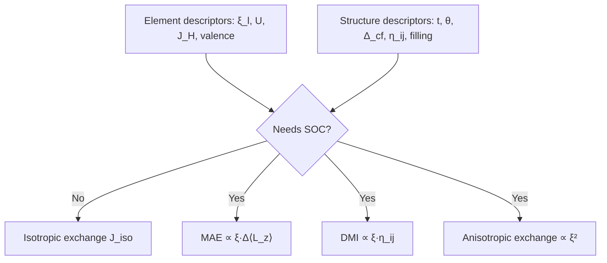

# Magnetic Interaction Descriptor Factorization

## Overview
The four magnetic interactions this project targets — isotropic exchange $J^\text{iso}$,
magnetocrystalline anisotropy (MAE / single-ion anisotropy $K$), Dzyaloshinskii–Moriya interaction
(DMI $\mathbf{D}$), and symmetric anisotropic exchange — are driven by *different combinations* of two
ingredient families: an **element spin–orbit prefactor** $\xi$ and a **local-structure / crystal-field
kernel**. Because the SOC-driven interactions multiply these ingredients, a descriptor set must build
**both** families; this is the design principle of `magnetic_descriptor`.

## Principles
- The full pair interaction is the 3×3 exchange tensor $\mathbf{J}_{ij}$, decomposed (as in TB2J) into
  isotropic $J^\text{iso}$, symmetric anisotropic $\mathbf{J}^\text{sym}$, and antisymmetric DMI
  $\mathbf{D}$ parts; single-ion anisotropy $K$ is the on-site analogue.
- $J^\text{iso}$ is a 0th-order, **SOC-free** superexchange quantity (hopping $t$, $U$, Hund $J_H$).
- MAE/DMI/aniso are **SOC-driven**: MAE and DMI are 1st order in $\xi$ times a structural factor;
  symmetric anisotropic exchange is 2nd order.
- Hence the two README seed directions are complementary: per-shell $\xi_l$ (element) supplies the
  prefactor; bond/crystal-field descriptors (structure) supply the kernel — and the kernel alone fully
  determines $J^\text{iso}$.

## Details
**Isotropic exchange (GKA / Anderson superexchange).** For a cation–anion–cation path,

$$
J^\text{iso} \;\sim\; -\frac{2 t^{2}}{U} \quad (\text{half-filled, AFM}),
\qquad
J^\text{iso} \;\sim\; +\frac{2 t^{2} J_H}{U^{2}} \quad (\text{half-filled}\to\text{empty, FM}),
$$

so the descriptors are hopping $t$ (Slater–Koster $dd\sigma,dd\pi,dd\delta,pd\sigma$, set by bond length
and angle), $U$, $J_H$, and orbital filling — the quantitative form of the Goodenough–Kanamori–Anderson
rules (180° → strong AFM; ~90° / orthogonal → FM).

**Magnetocrystalline anisotropy (Bruno).** To leading order,

$$
\mathrm{MAE} \;\approx\; -\frac{\xi}{4\mu_B}\,\Delta\langle L_z\rangle,
$$

i.e. the element SOC constant $\xi$ (direction 1) times the anisotropy of the orbital moment, which is
set by the crystal-field splitting and orbital occupation (direction 2). This is why 5$d$ oxides have
far larger MAE than 3$d$ oxides at the same geometry: the $\xi$ prefactor dominates.

**Dzyaloshinskii–Moriya interaction (Moriya).** Allowed only when the bond lacks a center of inversion,

$$
\mathbf{D}_{ij} \;\propto\; \xi \times (\text{inversion-symmetry breaking of the } i\text{–}j \text{ path}),
$$

so the descriptors are $\xi$ plus a bond-level inversion-breaking metric $\eta_{ij}$ and the ligand
geometry.

**Symmetric anisotropic exchange** is 2nd order in $\xi$ against the same band/crystal-field kernel.

## Variables
The following variables are used in this note (see [notation](notation.md) for full definitions):

| Symbol | Description | Units |
|--------|-------------|-------|
| $\xi_l$ | Per-shell SOC strength | eV |
| $J^\text{iso}$ | Isotropic exchange | eV / meV |
| $\mathbf{D}$ | DMI vector | eV / meV |
| $K$, MAE | Single-ion / magnetocrystalline anisotropy | eV / meV |
| $t$ | Hopping integral | eV |
| $U$, $J_H$ | Hubbard on-site, Hund exchange | eV |
| $\eta_{ij}$ | Bond inversion-symmetry-breaking metric | dimensionless |
| $\Delta_\text{cf}$ | Crystal-field splitting | eV |

## Equations
Bruno MAE factorization (SOC prefactor × orbital-moment anisotropy):

$$
\mathrm{MAE} \;\approx\; -\frac{\xi}{4\mu_B}\,\Delta\langle L_z\rangle.
$$

DMI allowedness (Moriya): present iff the bond $i$–$j$ has no inversion center; magnitude $\propto \xi\,\eta_{ij}$.

## Workflow

## Conventions
- Treat the two descriptor families as orthogonal inputs; the model (formula or ML) supplies the
  combination rule. This keeps readers, features, and models separable.
- $J^\text{iso}$ is the recommended first target: SOC-free, so its ground truth (scalar-relativistic
  DFT + TB2J) is cheap, and it isolates the structure kernel before adding the $\xi$ prefactor.

## Linked Concepts
- [fr_pseudopotential_soc_encoding](fr_pseudopotential_soc_encoding.md): how to obtain $\xi_l$ from FR pseudos.
- [siesta_onsite_soc_hamiltonian](siesta_onsite_soc_hamiltonian.md): SIESTA-native route to $\xi_l$.
- [notation](notation.md): Standard variable notations used in this note.
