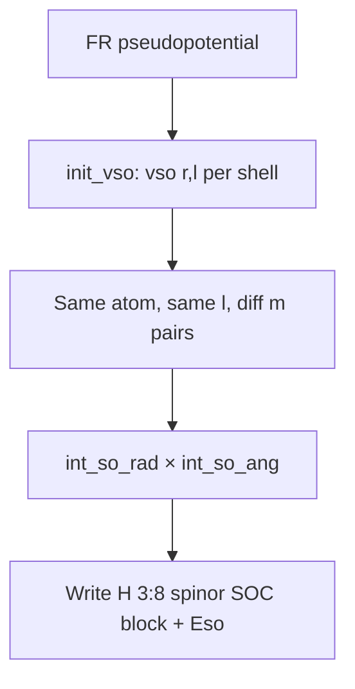

# SIESTA On-Site Spin–Orbit Hamiltonian

## Overview
SIESTA adds spin–orbit coupling to its Hamiltonian with an **on-site approximation**: SOC matrix
elements are built only between orbitals on the *same atom*, with the *same* angular momentum $l$ and
*different* magnetic quantum numbers $m$. The matrix element is the product of a radial part
$V_\text{SO}(r,l)$ (read from the FR pseudopotential) and the angular-momentum operator $\mathbf{L}$.
This gives a second, code-validated route to the per-shell SOC strength $\xi_l$ and shows exactly which
orbital pairs a SOC descriptor must connect.

## Principles
- SOC is on-site and atom-block-diagonal: no inter-atomic SOC matrix elements. The SOC Hamiltonian is
  therefore very sparse.
- Selection rules enforced in `spinorb`: same atom, same $l$, different $m$; $l=0$ contributes nothing.
- The radial SOC potential `vso(:,li,is)` is loaded per shell $l$ from the FR pseudopotential via
  `ncps_has_spin_orbit_potentials`; if no species carries SOC potentials, SIESTA aborts.
- The same machinery provides `get_n_semicore_shells`, used to separate semicore from valence shells.

## Details
In `Refs/siesta/Src/spinorbit.f`, `init_vso()` loops over species and, for each shell, stores

$$
\texttt{vso}(1{:}n_r,\, l,\, \text{species}) = V_\text{SO}(r, l)
$$

taken from `p%vup(:,li)` over the relativistic projector set `p%npotu` with angular momenta
`p%lup(iup)`. The radial grid `r`, the log-grid parameters `a,b`, and the Jacobian `drdi` are stored
for the radial integral.

`spinorb()` then accumulates, for each sparse Hamiltonian entry between orbitals $i,j$ on the same atom,

$$
\langle i|H_\text{SO}|j\rangle \;=\; \underbrace{\int V_\text{SO}(r,l)\,\chi_i(r)\chi_j(r)\,dr}_{\texttt{int\_rad}}
\;\times\;
\underbrace{\langle l,m_i|\mathbf{L}|l,m_j\rangle}_{\texttt{int\_so\_ang}},
$$

and writes the six independent Pauli-block components into `H(:,3:8)` (the spinor 2×2 SOC block), plus
the SOC energy `Eso`. The angular matrix elements `int_so_ang` return the three components of
$\mathbf{L}$ as Clebsch–Gordan factors $L_1,L_2,L_3$ (corresponding to $L_z,L_y,L_x$ up to factors of
$i$), tabulated by $(l,m_i,m_j)$.

The 2×2 spinor SOC block has the form documented in the file header:

$$
\langle i|H_\text{SO}|j\rangle = \tfrac{1}{2} M(l)\,
\begin{pmatrix}
 i L_1 & L_2 - i L_3 \\
 -L_2 - i L_3 & -i L_1
\end{pmatrix}.
$$

## Variables
The following variables are used in this note (see [notation](notation.md) for full definitions):

| Symbol | Description | Units |
|--------|-------------|-------|
| $V_\text{SO}(r,l)$ | Radial SOC potential for shell $l$ (`vso`) | Ry |
| $M(l)$ | Radial SOC matrix element (`int_rad`) | Ry |
| $L_{1,2,3}$ | Angular $\mathbf{L}$ matrix elements (`int_so_ang`) | dimensionless |
| $l,m$ | Orbital / magnetic quantum numbers | dimensionless |

## Equations
The on-site SOC matrix element factored into radial and angular parts:

$$
\langle i|H_\text{SO}|j\rangle
= \left[\int V_\text{SO}(r,l)\,\chi_i(r)\chi_j(r)\,dr\right]
  \langle l,m_i|\mathbf{L}|l,m_j\rangle.
$$

A shell-averaged SOC strength can be defined from the radial part alone:

$$
\xi_l \;\sim\; \int V_\text{SO}(r,l)\,r^{2}\,dr.
$$

## Workflow

## Conventions
- SIESTA activates SOC with the FDF flag `SpinOrbit` (deprecated alias) folded into `Spin`; the energy
  term is reported as `E.spin_orbit` / `Eso`.
- For descriptor purposes, the radial integral of `vso(r,l)` is an alternative, SIESTA-native estimate
  of $\xi_l$ — cross-check it against the KB $j$-splitting value from the UPF file.
- Energies in SIESTA are in Ry; lengths in Bohr.

## Linked Concepts
- [fr_pseudopotential_soc_encoding](fr_pseudopotential_soc_encoding.md): the UPF $j$-splitting route to the same $\xi_l$.
- [magnetic_interaction_descriptor_factorization](magnetic_interaction_descriptor_factorization.md): $\xi_l$ enters MAE/DMI as the SOC prefactor.
- [notation](notation.md): Standard variable notations used in this note.
