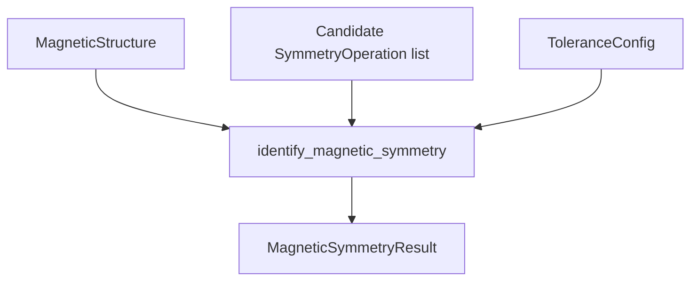

# Core API

## Overview

The `magsym` core API implements operation-level magnetic symmetry identification for explicit Python objects. It provides data models for lattices, sites, spin configurations, magnetic structures, symmetry operations, tolerances, and results.

## Principles

- The first implementation uses Python-object inputs rather than file parsers.
- Symmetry operations are candidate operations supplied by the caller or a fixture.
- Results identify accepted and rejected operations, not full magnetic group names.
- Spin transformations use an axial-vector convention, so improper operations multiply transformed spins by the determinant of the spatial rotation.

## Details

The public package exports `Lattice`, `Site`, `CrystalStructure`, `SpinConfiguration`, `MagneticStructure`, `SymmetryOperation`, `ToleranceConfig`, `MagneticSymmetryResult`, `RejectedOperation`, `identify_magnetic_symmetry`, and `alpha_fe2o3_fixture`.

The `identify_magnetic_symmetry` function checks each candidate operation by transforming source site positions, matching transformed sites under periodic boundary conditions, transforming source spins, and comparing transformed spins with target spins using explicit tolerances.

## Variables

The following variables are used in this note (see [[notation]] for full definitions):

| Symbol | Description | Units |
|--------|-------------|-------|
| `Fe2O3` | Initial validation target represented by the alpha-Fe2O3 fixture. | dimensionless |

## Equations

For an axial spin vector `s` and spatial rotation matrix `R`, the spin transformation uses:

$$
s' = \det(R) R s
$$

If time reversal is present, the transformed spin is multiplied by `-1`.

## Workflow

## Conventions

- Fractional coordinates are wrapped into `[0, 1)`.
- Lattice vectors are stored row-wise in `Lattice.matrix`.
- Site matching uses labels and position tolerance.
- Missing spins are allowed only when both source and target sites are non-magnetic.

## Linked Concepts
- [[project_goal]]: Package goal and spec workflow.
- [[notation]]: Standard notation used in project notes.
