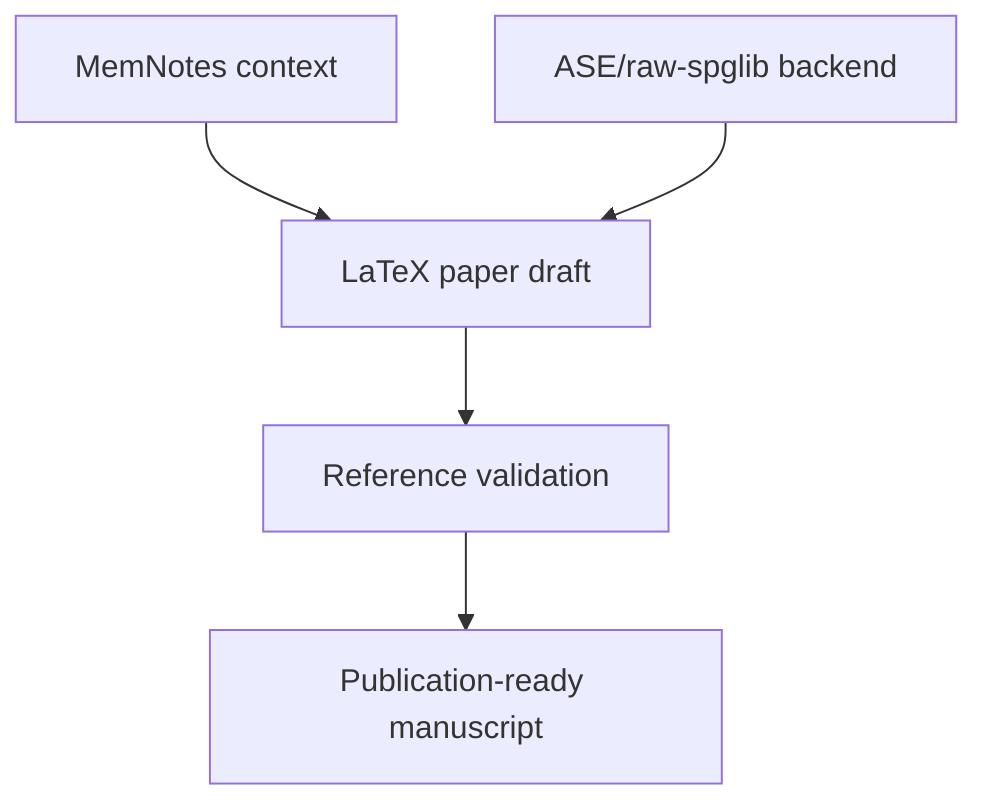

# Fe2O3 magsym Paper

## Overview

The LaTeX paper draft lives in `/home/hexu/projects/Fe2O3/paper/Fe2O3_magsym`. It discusses alpha-Fe2O3, spin reorientation, magnetic symmetry, magnetic properties, and the current minimal `magsym` ASE/raw-spglib workflow.

## Principles

- The paper should distinguish operation-level symmetry filtering from convention-dependent group labels.
- Current `magsym` reports selected `spglib` crystal and magnetic space-group metadata, but does not independently assign final conventional magnetic space-group or magnetic point-group labels.
- Any hematite labels in the paper are scientific context and validation targets unless independently checked against authoritative tables.
- The paper should cite external crystallographic and magnetic references before publication.

## Details

The draft includes sections on the hematite crystal structure, magnetic order, the Morin spin-reorientation transition, the `magsym` API, target spin states for future validation, magnetic group-label caveats, matched primitive/VASP export workflow, magnetic properties, and a reproducible Python example using Materials Project `mp-19770` CIF files with `find_magnetic_symmetry(atoms, magmoms=...)`.

The paper now includes a `Primitive-Cell Spin-Order Comparison` section in `/home/hexu/projects/Fe2O3/paper/Fe2O3_magsym/main.tex` that records the old order `-5, +5, +5, -5`, the new order `+5, -5, +5, -5`, the final average energies, and the per-cell/per-Fe/per-Fe2O3 energy differences. For symmetry, the paper now uses `primitive_matched` as the good reference and compares both orders for easy-axis `z` and easy-plane `x` moments.

The matched primitive symmetry comparison uses `symprec=1e-5`, the default magnetic tolerance, and `angle_tolerance=-1`. It gives: old `(-,+,+,-)` easy-axis `z` 12 accepted operations with 6 time-reversal operations, UNI 1336, BNS `167.106`, type 3; old easy-plane `x` 4/2, UNI 94, BNS `15.87`, type 3; new `(+,-,+,-)` easy-axis `z` 12/0, UNI 1333, BNS `167.103`, type 1; and new easy-plane `x` 4/2, UNI 96, BNS `15.89`, type 3. All four rows retain `R-3c` as the crystallographic source setting. UNI/BNS/type values are reported only as `spglib` metadata, not independently validated magnetic-space-group assignments.

The standalone full operation report is `/home/hexu/projects/Fe2O3/paper/Fe2O3_magsym/full_symmetry_report.md`. It includes the matched primitive Fe site order, a summary table, interpretation notes, and full formatted operation reports for all four configurations.

On 2026-06-15, the paper and Markdown report were extended with standard-SOC TB2J figures from the lower-energy primitive-site Fe order. The source `JvsR.pdf` from the merged TB2J output was converted to `figures/JvsR.png`, and the generated `magnon_bands.png` was copied to `figures/magnon_bands.png`. The rebuilt PDF includes the interaction-parameter figure on page 9 and the magnon-band figure on page 10.

On 2026-06-16, `figures/magnon_bands.png` was replaced with the matched primitive merged TB2J image from `/home/hexu/projects/Fe2O3/calculations/primitive_matched_easy_axis_z_p_m_p_m_pbesolu_0001Ry_norelax_m5_spherical_spinfixdir_nonSCFSO_8mpi/standard_soc/TB2J_results_merged/magnon_bands.png`. The SHA256 hash of the copied paper image matched the source. `main.tex` and `full_symmetry_report.md` now describe the magnon figure as coming from the matched primitive merged TB2J output.

The same update cycle expanded the paper's SHG theory. The paper now explains that active/inactive SHG is a nullspace criterion for the stacked tensor constraints, why inversion forbids bulk electric-dipole SHG, why magnetic electric-dipole SHG must be recomputed from the accepted magnetic operation set, and why magnetic-dipole SHG has different selection rules because its output is axial and time-odd. The full report mirrors this with detailed active/inactive reasoning for each matched Fe2O3 case.

The paper now documents `primitive_matched`: a primitive cell derived from the conventional `mp-19770` cell using `spglib.standardize_cell(..., to_primitive=True, no_idealize=False)` with conventional magnetic moments mapped by Cartesian position equivalence modulo the conventional lattice. This matched primitive setting reproduces the conventional easy-axis and easy-plane operation counts.

The paper records the primitive-to-conventional matrix as:

$$
M =
\begin{pmatrix}
1 & -1 & 0 \\
0 & 1 & -1 \\
1 & 1 & 1
\end{pmatrix}
$$

with:

$$
M A_{\mathrm{prim}} = A_{\mathrm{conv}}
$$

The paper README lists the report and VASP export commands:

```bash
python examples/hematite_mp19770.py --cell conventional --report
python examples/hematite_mp19770.py --cell primitive_matched --report
python scripts/write_matched_primitive_vasp.py --output-dir examples/vasp
```

The associated bibliography file contains placeholder/reference starter entries plus the standard Materials Project citation for `mp-19770` provenance. Bibliographic details and final authoritative magnetic-group citations still need verification.

The LaTeX build succeeds and produces `main.pdf`. The current build has only overfull hbox warnings from long code/path strings, but no fatal errors.

## Variables

The following variables are used in this note (see [[notation]] for full definitions):

| Symbol | Description | Units |
|--------|-------------|-------|
| `Fe2O3` | alpha-Fe2O3 hematite. | dimensionless |

## Equations

The paper uses the axial spin-vector transformation convention documented in [[ase_spglib_backend]]:

$$
\mathbf{s}' = \det(R) R \mathbf{s}
$$

## Workflow



## Conventions

- Use LaTeX `\alpha` for alpha-Fe2O3 in the paper.
- Keep group-label caveats visible until authoritative validation is complete; `spglib` metadata is traceability metadata, not final independent assignment.
- Do not describe removed legacy APIs such as `classify_alpha_fe2o3_spin_state`, `MagneticStructure`, or `MagneticSymmetryResult` as current package outputs.

## Linked Concepts
- [[ase_spglib_backend]]: Minimal ASE/raw-spglib backend behavior.
- [[mp19770_hematite_examples]]: Runnable Materials Project `mp-19770` examples referenced by the paper.
- [[symmetry_operation_report_api]]: Report API, matched primitive setting, and VASP export details referenced by the paper.
- [[tb2jflow_siesta_exchange_workflow]]: Source calculation workflow for the standard-SOC TB2J figures.
- [[notation]]: Project notation reference.
