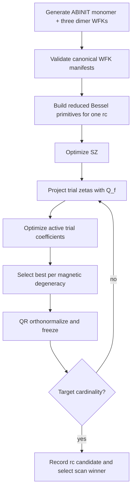

# ABACUS v3 SIAB Bessel Cascade

## Overview

`abacusv3` is an `autonao` strategy that reproduces the structural SIAB workflow with the project's ABINIT-WFK kinetic-spillage objective. It is distinct from the fixed-cutoff Bessel strategy because it grows the basis one zeta at a time and evaluates each prospective zeta in the complement of the already accepted subspace.

## Principles

- The reference set is one isolated monomer plus three isolated dimers. The canonical manifest order is `monomer,d0,d1,d2`; a partial dimer-only set is rejected.
- Primitive functions are reduced spherical-Bessel functions at an externally selected common cutoff. Coefficients are optimized by L-BFGS-B using analytic kinetic-spillage gradients.
- An accepted zeta is QR-orthonormalized and frozen. The next zeta is evaluated only in the active complement, so cascade growth is not a joint reoptimization.
- Every configuration contributes equally; `abinao` applies each configuration's internal k-point weights.

## Details

For each candidate cutoff, the strategy starts from an SZ basis. It tries one additional zeta for each allowed angular-momentum channel, optimizes that trial against the fixed accepted subspace, and accepts the candidate with the largest kinetic-spillage reduction per magnetic degeneracy. The process repeats until the requested cardinality is reached. It then post-processes every coefficient block with QR orthonormalization.

The primitive basis is a reduced Bessel basis at a common cutoff. This preserves the differentiable cutoff behavior used by SIAB while making cutoff selection a discrete external scan. The current CLI accepts `--abacusv3-rcs` as comma-separated Bohr radii.

The underlying `ContractionSpillage.frozen_kinetic_value_and_gradient` performs the required projected calculation. Empty frozen blocks reduce exactly to the ordinary kinetic evaluator. The method is therefore a semantic extension of the existing ABINIT-exact objective rather than a surrogate or a coefficient-freezing shortcut.

## Variables

| Symbol | Description | Units |
|--------|-------------|-------|
| $P_f$ | Orthogonal projector onto all accepted, frozen zeta functions | dimensionless |
| $Q_f$ | Active-complement projector | dimensionless |
| $S$ | Primitive-basis overlap matrix | dimensionless |
| $T$ | Primitive-basis kinetic matrix | Ha |
| $C_f$ | Frozen contraction coefficients | dimensionless |
| $C_a$ | Active trial contraction coefficients | dimensionless |
| $r_c$ | Shared Bessel cutoff used in one scan trial | Bohr |

## Equations

The active complement is defined from the frozen accepted subspace:

$$
Q_f = I - P_f,
\qquad
P_f = C_f(C_f^\dagger S C_f)^{-1}C_f^\dagger S.
$$

The kinetic-spillage objective measures reference kinetic energy not recovered by the full accepted-plus-active subspace. Gradients are differentiated through the active coefficients only; gradients for frozen coefficient columns are not returned to the optimizer.

## Workflow

## Conventions

- Distances are Bohr except the generator's documented input separations, which are Å before conversion.
- A WFK manifest must be safe-loadable YAML and must resolve four WFK payloads in canonical order.
- `freeze` always means an explicit $Q_f$ projector in the mathematical objective, never merely retaining coefficient values while optimizing an unprojected total spillage.

## Execution Evidence

Corrected ABINIT references completed for C, Al, and Fe: four manifests each in `Results/siab-refs/{element}/`, ordered `monomer,d0,d1,d2`. C and Al ran a common-cutoff scan at $r_c=7,8,9,10$ Bohr with 50 L-BFGS-B evaluations per optimizer call and both selected 10 Bohr: kinetic spillage was 0.0051573491 for C and 0.0147137449 for Al. The more expensive Fe $2s\,2p\,2d\,1f$ cascade completed its 10-Bohr validation with kinetic spillage 0.0089123104; it reduced the SZ value 0.0151850157 by successively adding $s$, $p$, $d$, then $f$.

The attempted Fe four-cutoff scan did not finish before the 3,600-second process timeout. Therefore the C/Al cutoff-selection result is evidence for those elements only; Fe is validated at a single cutoff and is not part of an equal-cutoff comparison. The reproducible execution report is `papers/autoresearch/abacusv3-siab-cascade-c-al-fe.md`.

The selected C, Al, and Si `.ion.nc` bases were additionally evaluated by seven-volume SIESTA PBE sweeps against the ASE dcdft/WIEN2k reference. C gives $\Delta=11.7446$ meV/atom at $V_0=11.7936$ Å$^3$/atom; Al gives $\Delta=6.5783$ meV/atom at $V_0=16.3141$ Å$^3$/atom; Si gives $\Delta=0.7404$ meV/atom at $V_0=20.4911$ Å$^3$/atom. These results are stored with the basis provenance in `Results/benchmarks/{C,Al,Si}/abacusv3/result.json`.

Fe does not yet have a valid delta value. Its seven-point curve is monotonic over 9.45–13.55 Å$^3$/atom, so a Birch–Murnaghan equilibrium fit is invalid. A spin-polarized central-volume rerun accepted `SpinPolarized` and `DM.InitSpin` but did not alter that diagnosis. Do not treat Fe's kinetic-spillage result as bulk-EOS validation until an element-appropriate magnetic E–V protocol brackets a minimum.

The representative B, N, O, Mg, P, S, and Ge extension generated 28 additional ABINIT monomer+dimer references and completed reduced-Bessel cascades. B is deliberately excluded from delta testing because $\alpha$-B has an irreducible 12-atom primitive cell. Valid delta fits were obtained for N ($\Delta=2.2069$ meV/atom), O ($40.0886$), Mg ($206.4310$), P ($7.6710$), and Ge ($0.3895$). O and Mg require expanded low-volume scans to bracket their selected PAO basis minima. S remains unvalidated because the configured PBE `S.psml` declares Rn ($Z=86$), yielding an invalid NetCDF basis. Full evidence is in `papers/autoresearch/abacusv3-representative-main-group.md`.

Delta evaluation asks `spglib` for the dcdft primitive structure; when reduction is available it constructs an `ase.Atoms` object of the reduced size. `run_delta_one` rejects a Birch–Murnaghan fit unless every parameter is finite, $B_0>0$, and $V_0$ lies inside the sampled interval. This avoids serializing false numeric delta values from pathological EOS fits; see [Delta EOS Acceptance](delta_eos_acceptance.md).

## Primitive-pool cutoff evidence

`count_primitives` uses Hartree: it retains a Bessel zero when $(z/r_c)^2 < ecut$. SIAB's 100 Ry setting is therefore this strategy's default `ecut=50` Ha. At $r_c=10$ Bohr, the 50, 100, and 200 Ry pools contain 14/14/13, 21/21/20, and 30/30/29 $s/p/d$ primitives respectively.

The controlled Si, C, N, Al, Ge, and Fe sweep establishes a lower representability threshold and an upper transferability risk. Reducing to 50 Ry severely degrades the WFK fit for all elements except Al and produces invalid N, Ge, and Fe EOS fits. Raising to 200 Ry always lowers in-sample kinetic spillage, but worsens delta for N, Al, Ge, and Si; C is the measured exception. The default 100 Ry is consequently the broad, SIAB-matched baseline, not a spillage optimum. Fe needs an element-appropriate magnetic E–V protocol before its periodic result can be used.

The evidence is in [the multi-element ecut report](../../../../papers/autoresearch/story52-multi-element-ecut-sweep.md) and `.tmp/autoresearch/multi-ecut-sweep/`.

## Linked Concepts

- [wfk_runtime_contract](wfk_runtime_contract.md): Validated WFK metadata and cache boundary.
- [equal_budget_optimizer_composition](equal_budget_optimizer_composition.md): Shared strategy accounting discipline.
- [notation](notation.md): Project-wide unit convention.
