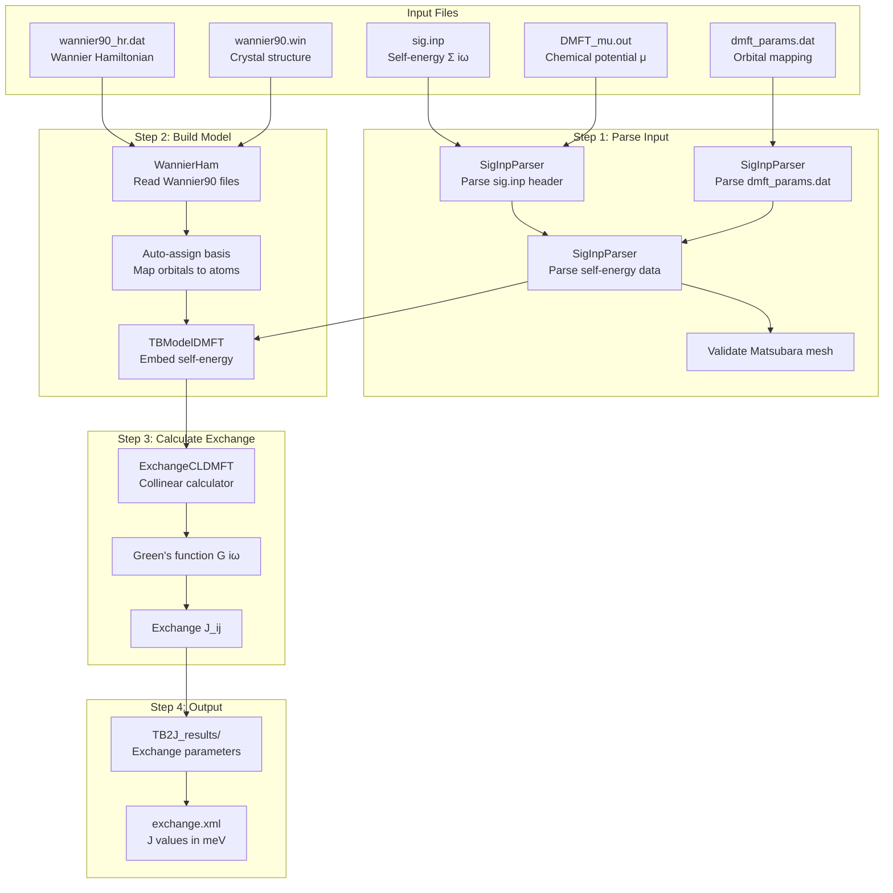

# DMFT-TB2J Calculation Workflow


## Overview
This note describes the complete workflow for calculating magnetic exchange parameters using DMFT self-energies with TB2J. The workflow combines a static Wannier90 tight-binding model with frequency-dependent DMFT self-energies to compute exchange couplings Jᵢⱼ that include electron correlation effects.

## Principles
The DMFT-TB2J workflow follows these key principles:
- **Separation of concerns**: DFT provides the band structure (Wannier90), DMFT provides correlations (self-energy), TB2J computes exchange
- **Collinear spin with different self-energies**: Same Wannier functions for both spins, but different Σ↑(iω) and Σ↓(iω)
- **Local self-energy**: Self-energy is non-zero only on correlated atoms (e.g., Mn d-orbitals)
- **Manual spin assignment**: User explicitly specifies spin channels for each correlated atom

## Workflow Diagram



## Step 1: Input File Preparation

### 1.1 Required Files

| File | Purpose | Format |
|------|---------|--------|
| sig.inp | DMFT self-energy Σ(iωₙ) | Text, see [siginp_format](siginp_format.md) |
| dmft_params.dat | Orbital index mapping | Text, see [dmft_params_format](dmft_params_format.md) |
| DMFT_mu.out | Chemical potential | Single value file |
| wannier90_hr.dat | Wannier Hamiltonian H(R) | Wannier90 format |
| wannier90.win | Crystal structure + k-points | Wannier90 input |

### 1.2 File Location
All files should be in the same directory (or specify paths via CLI options).

### 1.3 Consistency Requirements
- Number of correlated orbitals in sig.inp must match dmft_params.dat
- Wannier90 orbitals must include all correlated orbitals
- Temperature must be consistent between DMFT calculation and sig.inp

## Step 2: Parse Input Files

### 2.1 Self-Energy Parsing (SigInpParser)

The parser reads sig.inp in two phases:

**Phase A: Header Parsing**
```
# nom,ncor_orb= 4774 10
# T=  0.010000000000000
# s_oo-Vdc=  2.595... 3.291... ... (10 values)
# s_oo= [23.112..., 23.808..., ...]
# Vdc= [20.517..., ...]
```

Extracts:
- nom: Number of Matsubara frequencies (4774)
- ncor_orb: Number of correlated orbitals (10)
- T: Temperature in eV
- s_oo: Σ(∞) values per orbital
- Vdc: Double-counting potential per orbital

**Phase B: Data Parsing**
```
0.031416  -0.12345 0.06789  -0.23456 0.07890  ...
```

Each line contains:
- Column 1: Matsubara frequency ωₙ
- Columns 2-3: Re(Σ₁), Im(Σ₁) for orbital 1
- Columns 4-5: Re(Σ₂), Im(Σ₂) for orbital 2
- ... continuing for all ncor_orb orbitals

### 2.2 Orbital Mapping (dmft_params.dat)

Maps sig.inp orbital indices to Wannier90 orbital indices:

```
# Number of total correlated atoms
4
# Number of correlated orbitals per atom
5 5 5 5
# Orbital index for the self-energy at each atom
1 2 3 4 5      # Atom 0 (Mn1): spin up, orbitals 1-5
6 7 8 9 10     # Atom 1 (Mn2): spin down, orbitals 6-10
6 7 8 9 10     # Atom 2 (Mn3): spin down, orbitals 6-10
1 2 3 4 5      # Atom 3 (Mn4): spin up, orbitals 1-5
```

**Spin Channel Convention:**
- Orbital indices 1-5 → Spin up (σ = 0)
- Orbital indices 6-10 → Spin down (σ = 1)

### 2.3 Matsubara Mesh Validation

The parser validates the Matsubara frequency mesh:

$$
\omega_n = \frac{(2n+1)\pi}{\beta}
$$

Checks:
1. All frequencies positive (fermionic)
2. Strictly increasing
3. Equal spacing: Δω = 2π/β
4. Temperature consistency: T = 1/β

## Step 3: Build DMFT Model

### 3.1 Read Static Model

WannierHam reads the Wannier90 files:
- wannier90_hr.dat → Hamiltonian H(R) in real space
- wannier90.win → Crystal structure, atom positions

For LaMnO3 example:
- 56 Wannier orbitals (4 Mn × 5d + 12 O × 3p)
- 20 atoms in unit cell
- Collinear spin (same orbitals for both spins)

### 3.2 Basis Assignment

The `auto_assign_basis_name` function maps each orbital to its atom:

```
Orbital 0-4:   Atom 4 (Mn1)  → d orbitals
Orbital 5-9:   Atom 5 (Mn2)  → d orbitals
Orbital 10-14: Atom 6 (Mn3)  → d orbitals
Orbital 15-19: Atom 7 (Mn4)  → d orbitals
Orbital 20-55: O atoms       → p orbitals
```

### 3.3 Self-Energy Embedding

TBModelDMFT embeds the 5×5 self-energy into the full 56×56 basis:

**Algorithm:**
```
For each correlated atom i:
    Get Wannier orbital indices for atom i
    Get spin channel σ for atom i
    For each frequency ωₙ:
        For each orbital pair (m, n) on atom i:
            sigma_full[σ, ωₙ, orb_i[m], orb_i[n]] = sigma_raw[σ, ωₙ, m, n]
```

**Result:** sigma_full has shape (2, 4774, 56, 56)
- Non-zero only on Mn d-orbital blocks
- Zero on O p-orbital blocks (no correlation)

## Step 4: Calculate Exchange Parameters

### 4.1 Green's Function

For each Matsubara frequency ωₙ:

$$
G(i\omega_n, \mathbf{k}) = \left[ i\omega_n + \mu - H(\mathbf{k}) - \Sigma(i\omega_n) \right]^{-1}
$$

Where:
- H(k) is the Wannier Hamiltonian
- Σ(iωₙ) is the embedded self-energy
- μ is the DMFT chemical potential

### 4.2 Exchange Calculation

For collinear spin, the exchange coupling is computed as:

$$
J_{ij} = \frac{1}{4} \sum_{\mathbf{k}, \omega_n} w_{\omega_n} \text{Tr}\left[ \Delta_i G_{ij}^{\uparrow} \Delta_j G_{ji}^{\downarrow} \right]
$$

Where:
- Δᵢ = 2Pᵢ is the magnetic splitting on atom i
- Pᵢ = (H_local + Σ↑ - H_local - Σ↓)/2
- G↑, G↓ are spin-up/down Green's functions

### 4.3 Frequency Integration

Sum over all Matsubara frequencies with appropriate weights.

## Step 5: Run the Calculation

### 5.1 Command Line

```bash
dmft2J \
    --dmft_file=sig.inp \
    --path=./data \
    --prefix=wannier90 \
    --spin-channels=+1,-1,-1,+1 \
    --magnetic-elements=Mn \
    --nspin=1 \
    --kmesh 4 4 4 \
    --output_path=TB2J_results
```

### 5.2 Key Options

| Option | Description | Example |
|--------|-------------|---------|
| --dmft_file | Path to sig.inp | sig.inp |
| --path | Directory with Wannier90 files | ./data |
| --prefix | Wannier90 file prefix | wannier90 |
| --spin-channels | Manual spin per atom | +1,-1,-1,+1 |
| --magnetic-elements | Magnetic species | Mn |
| --nspin | 1=collinear, 2=non-collinear | 1 |
| --kmesh | k-point mesh | 4 4 4 |
| --total-sigma | Add Σ(∞) to Σ(iω) | (flag) |

### 5.3 Spin Channel Specification

For AFM LaMnO3 with 4 Mn atoms:
- Mn1: spin up (+1)
- Mn2: spin down (-1)
- Mn3: spin down (-1)
- Mn4: spin up (+1)

Format: `--spin-channels=+1,-1,-1,+1`

## Step 6: Output

### 6.1 Output Files

```
TB2J_results/
├── exchange.xml          # Main output: J values
├── exchange.toml         # Alternative format
├── TB2J_results.txt      # Human-readable summary
└── assigned_basis.txt    # Orbital assignments
```

### 6.2 Exchange XML Format

```xml
<exchange>
  <pair atom1="Mn1" atom2="Mn2" R="(1,0,0)">
    <J> 12.5 </J>  <!-- meV -->
  </pair>
  ...
</exchange>
```

## Variables

| Variable | Description | Units |
|----------|-------------|-------|
| Σ(iωₙ) | Self-energy at frequency ωₙ | eV |
| G(iωₙ, k) | Green's function | eV⁻¹ |
| Jᵢⱼ | Exchange coupling | meV |
| μ | Chemical potential | eV |
| β | Inverse temperature | eV⁻¹ |

## Conventions

- **Orbital indices**: 1-based in dmft_params.dat, 0-based in code
- **Spin channels**: +1 = up (σ=0), -1 = down (σ=1)
- **Energies**: All in eV except J values in meV
- **Temperature**: In eV (T = 0.01 eV ≈ 116 K)

## Common Issues

### Issue 1: "operands could not be broadcast"
**Cause**: Self-energy shape mismatch with Hamiltonian
**Solution**: Check that dmft_params.dat correctly maps to Wannier orbitals

### Issue 2: "Atom has odd number of spin-orbitals"
**Cause**: Using --nspin=2 (non-collinear) with collinear data
**Solution**: Use --nspin=1 for collinear calculations

### Issue 3: "Matsubara frequencies must be positive"
**Cause**: Incorrect frequency format in sig.inp
**Solution**: Ensure frequencies are positive real values

## Linked Concepts
- [siginp_format](siginp_format.md): Detailed sig.inp specification
- [dmft_params_format](dmft_params_format.md): Orbital mapping format
- [matsubara_frequencies](matsubara_frequencies.md): Frequency mesh validation
- [self_energy_embedding](self_energy_embedding.md): How Σ is embedded into full basis
- [spin_channel_mapping](spin_channel_mapping.md): Manual spin assignment
