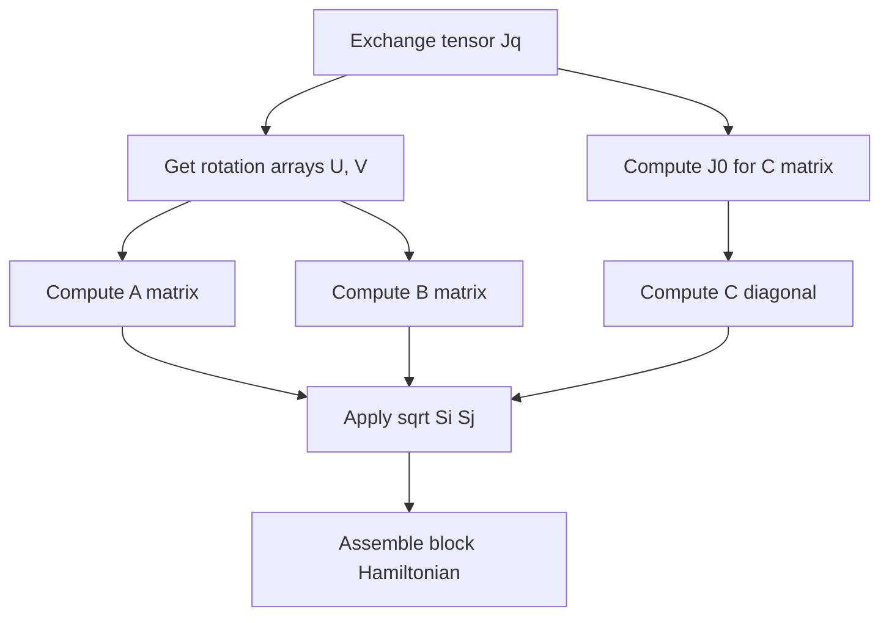

# Magnon Hamiltonian


## Overview

The magnon Hamiltonian is constructed from the q-space exchange tensors using linear spin wave theory (LSWT). It takes the form of a 2N×2N dynamical matrix (N = number of magnetic atoms) with block structure containing A, B, and C matrices.

## Principles

- Local reference frame aligns z'-axis with spin direction
- Holstein-Primakoff transformation expresses spins as bosons
- Hamiltonian has block structure due to bosonic nature
- Rotation arrays U, V define local frame transformation

## Details

### Local Reference Frame

For each magnetic atom, we define a local coordinate system where z' aligns with the spin direction. The rotation matrices U and V characterize this transformation:

$$
U_i = R_{i,x'} + i R_{i,y'}, \quad V_i = R_{i,z'}
$$

where **R**_i rotates from global to local frame.

### Dynamical Matrix Structure

The magnon Hamiltonian in bosonic form is:

$$
\mathbf{H}(\mathbf{q}) = \begin{pmatrix} \mathbf{A}(\mathbf{q}) - \mathbf{C} & \mathbf{B}(\mathbf{q}) \\ \mathbf{B}^*(-\mathbf{q}) & \mathbf{A}^*(-\mathbf{q}) - \mathbf{C} \end{pmatrix}
$$

This is a 2N×2N matrix for N magnetic atoms.

### A Matrix

The A matrix describes normal (non-anomalous) correlations:

$$
A_{ij}(\mathbf{q}) = -\sqrt{S_i S_j} \, U_i^* \cdot \mathbf{J}_{ij}(\mathbf{q}) \cdot U_j
$$

In code:
```python
A1 = np.einsum("ix,kijxy,jy->kij", U, Jq, U.conj())
```

### B Matrix

The B matrix describes anomalous correlations (pair creation/annihilation):

$$
B_{ij}(\mathbf{q}) = -\sqrt{S_i S_j} \, U_i \cdot \mathbf{J}_{ij}(\mathbf{q}) \cdot U_j
$$

In code:
```python
B = np.einsum("ix,kijxy,jy->kij", U, Jq, U)
```

### C Matrix (On-site Term)

The C matrix is diagonal and contains on-site contributions:

$$
C_i = 2 \sum_l V_i \cdot \mathbf{J}_{il}(\mathbf{0}) \cdot V_l \, S_l
$$

This ensures the Goldstone mode for ferromagnets.

In code:
```python
J0 = -self.Jq(np.zeros((1, 3)))[0]
C = np.diag(np.einsum("ix,ijxy,jy,j->i", V, 2*J0, V, self.Snorm))
```

### Final Assembly

The complete Hamiltonian is assembled with sqrt(S_i S_j) prefactors:

```python
A1 = np.einsum("kij, i, j-> kij", A1, Ssqrt, Ssqrt)
A2 = np.einsum("kij, i, j-> kij", A2, Ssqrt, Ssqrt)
B = np.einsum("kij, i, j-> kij", B, Ssqrt, Ssqrt)
H = np.block([[A1 - C, B], [B.swapaxes(-1,-2).conj(), A2 - C]])
```

## Variables

| Symbol | Description | Units |
|--------|-------------|-------|
| **H** | Magnon Hamiltonian matrix | eV |
| **A** | Normal correlation matrix | eV |
| **B** | Anomalous correlation matrix | eV |
| **C** | On-site diagonal matrix | eV |
| U | Complex rotation array (x'+iy') | dimensionless |
| V | Real rotation array (z') | dimensionless |
| S_i | Spin magnitude at site i | ħ |

## Workflow



## Linked Concepts

- [magnon_Jq_transform](magnon_Jq_transform.md): How Jq is computed from real-space J
- [magnon_diagonalization](magnon_diagonalization.md): How to extract eigenvalues from H
- [exchange_tensor](exchange_tensor.md): The exchange tensor decomposition
- [notation](notation.md): Standard variable notations
