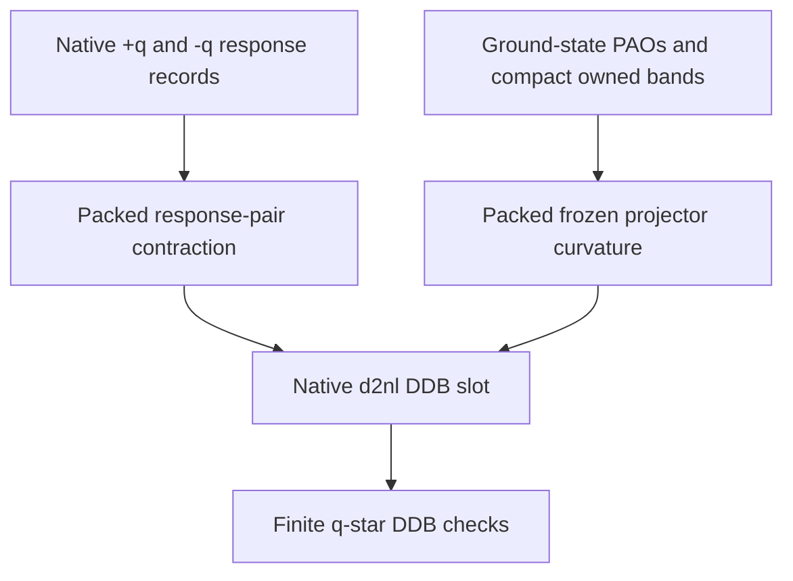

# Packed-Spinor Finite-Q Frozen Projector Curvature

## Overview

The static same-site NC DFT+U finite-$\mathbf q$ DDB route requires two contributions. The native paired response cache supplies the response-pair term, while an explicit second derivative of the PAO projector supplies the frozen-projector curvature. Omitting the latter can produce a finite-looking but incomplete DDB Hessian.

## Exact Contract

For a Dudarev occupation matrix $N$, a mixed perturbation has the exact Hessian

$$
\frac{\partial^2 E_U}{\partial\lambda\,\partial\mu}
=
\operatorname{Tr}\left[V^\lambda N^\mu\right]
+
\operatorname{Tr}\left[V^0N^{\lambda\mu}\right].
$$

Here $V^0$ is the ground-state Hubbard potential, $V^\lambda$ is the first-order potential, and $N^{\lambda\mu}$ contains the second PAO-projector derivative and both ordered products of first projector derivatives. For a physical finite-$\mathbf q$ pair, $N^\mu=N^{-\mathbf q}=N^{\mathbf q\dagger}$.

## Production Ownership and Packing

`m_dfpt_scfcv.F90:1538-1584` first combines the independently computed native $+\mathbf q$ and $-\mathbf q$ response objects through `compute_nc_dftu_response_energy_pair`. It then adds `compute_nc_dftu_frozen_d2_energy_from_wfs` once to the same native `d2nl` DDB slot. No local q-star partner is synthesized.

The helper in `m_nc_dftu.F90:592-847` has a packed `nspinor=2` branch. It fills `n2_packed(2,norb,norb,4)` in the established `(uu,dd,ud,du)` order and contracts it with `V_cplex`. Wavefunctions are not indexed by global band number: `cg` is compact under `proc_distrb`, so the local `iband_me` counter increments only for locally assigned bands and is used both for the wavefunction offset and the next-k-point offset. This is necessary for `paral_kgb` runs; global indexing caused `NaN` DDB entries on eight ranks.

The route intentionally returns no frozen contribution for distinct atomic sites. The phase cancellation used here applies only to the supported same-site pair.

## Workflow

## Validation Evidence

- `tests_nc_dftu_spinor_response` passed all packed-order, adjoint, frozen-curvature, finite-$\mathbf q$ partner, and spin-$z$-rotation contracts.
- `papers/DFTU_NC/math/derive_dftu_equations.py` passed its exact collinear/packed response, source, DDB-Hessian, and deliberate-mutant witnesses.
- Runner-form `v10/t116` matched the permanent NCPU1 and NCPU8 `fldiff` references exactly. It covers the supported packed-spinor Gamma DDK route.
- Direct `v10/t117` and `v10/t118` each terminated with the global `nspinor=2` electric-capability diagnostic and matched their exact expected-failure references. Neither output represents electric-response support.
- Runner-form `v10/t119` matched its NCPU8 `.abo`, U-on DDB, and U=0 DDB references with $10^{-8}$ absolute and relative tolerance. Datasets 5--8 explicitly retain `dftu_u=0` for the complete matched control.
- The generated U-on and U=0 DDBs are distinct: SHA-256 values are `8d22c42657b83121941ac7a5b2ef8c0e994376e7338f83c4f65207c123038b7a` and `950dd50d5e879cc7d59340f55a9665990907f6d0cd9fb78beba87ecf32d12303`, respectively.
- The general `runtests.py` database refresh presently stops before selecting these fixtures because unrelated `v10/t86` metadata is malformed. Direct runner-form execution is therefore the observed registration-independent evidence; no test-harness bypass was added.

## Boundaries

Supported: static, fixed-occupation, Dudarev, `istwfk(:)=1`, no spinor-MPI, same-site atomic finite-$\mathbf q$ pairs.

Not supported: cross-site frozen curvature, strain response, metallic or finite-frequency response, full-interaction finite-$\mathbf q$ double counting, and spinor-MPI DFPT.

## Linked Concepts

- [Finite-q response trace](nc-dftu-finite-q-response-trace.md): response-record and q-star ownership.
- [Frozen-projector DDB gap](nc-dftu-frozen-projector-d2frnl-gap.md): the original PAW-equivalent missing term.
- [Spinor packing convention](nc-dftu-spinor-packing-convention.md): the `(uu,dd,ud,du)` storage order.
- [notation](notation.md): standard NC DFT+U symbols.
