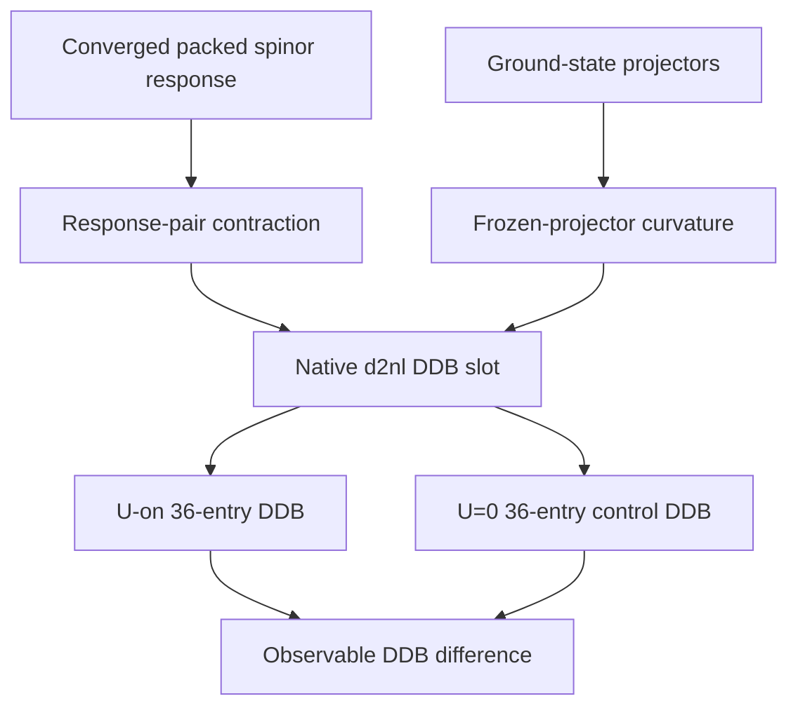

# Packed-Spinor Gamma Phonon DDB Validation

## Overview

The enabled static NC PAO DFT+U spinor phonon route uses the ordinary ABINIT Gamma DDB array and scheduler. The spinor-specific work remains in the packed occupation, potential, source, response-pair, and frozen-projector contractions; native DDB indexing receives the already contracted scalar result.

## Native DDB Contract

For an atomic pair $(\lambda,\mu)$, the source-level path in `m_dfpt_scfcv.F90:1536-1582` creates a frozen partner, contracts it with the converged packed response, adds frozen projector curvature, and inserts the result in the pre-existing slot

$$
d2nl(:, i_\lambda, p_\lambda, i_\mu, p_\mu).
$$

The same slot and `blkflg` ownership are used by the scalar antecedent. There is no NC+U-specific DDB writer or second index convention.

## Eight-Rank Evidence

The temporary `verify494_gamma` fixture is two-atom FM NiO with `nspinor=2`, `nspden=4`, `dftu_dc=0`, both atoms, and all three Gamma displacement directions. The matching controls differ only by $U=0.294$ Ha versus $U=0$.

- Both `mpirun -np 8` calculations ended with `Calculation completed.` and yielded exactly 36 finite DDB entries.
- In the U-on run, the packed $V^1$ and local Hubbard source norms were nonzero. The largest source finite-difference relative error was below $10^{-6}$.
- In the U=0 control, packed $V^1$ and the local Hubbard source were exactly zero while ordinary DFPT still produced its native DDB.
- The maximum entrywise U-on/U=0 DDB difference was $8.389288954122\times10^{1}$ Ha. This establishes that the enabled packed NC+U contribution is observable and has not been replaced by the U=0 control.

## Workflow

## Boundaries

This is temporal runtime evidence, not a permanent reference. The deliberately compact input establishes DDB path integrity, packed-block source diagnostics, U=0 behavior, and sign-sensitive observable separation. It does not certify production-quality phonon frequencies or replace the permanent DDK and finite-$\mathbf q$ regressions.

## Linked Concepts

- [nc-dftu-spinor-packing-convention](nc-dftu-spinor-packing-convention.md): established $(uu,dd,ud,du)$ block mapping.
- [nc-dftu-spinor-finite-q-frozen-curvature](nc-dftu-spinor-finite-q-frozen-curvature.md): the same packed frozen-projector Hessian term at finite $\mathbf q$.
- [notation](notation.md): NC PAO DFT+U symbols.
