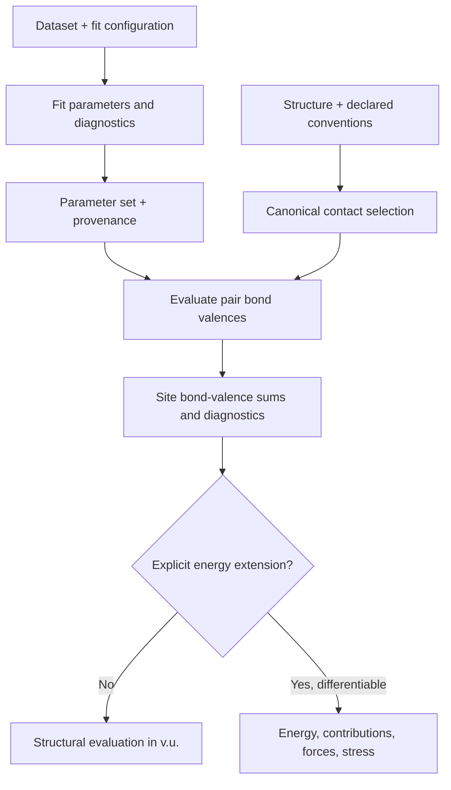

# Bond-Valence Model Boundaries

---
confidence: 0.85
created: 2026-08-09
last_validated: 2026-08-09
validation_procedure: "Verify the conventional relation and parameter scope against Brown and Altermatt (1985), then review each proposed extension against its declared theory and validation dataset."
project: easybondvalence
status: validated
validated_by: scientific-literature review
sources:
  - "Brown, I. D. and Altermatt, D. (1985), Acta Cryst. B 41, 244–247, https://doi.org/10.1107/S0108768185002063"
  - "Altermatt, D. and Brown, I. D. (1985), Acta Cryst. B 41, 240–244, https://doi.org/10.1107/S0108768185002051"
  - "Adams, S. and Rao, R. P. (2009), Phys. Chem. Chem. Phys., https://doi.org/10.1039/B901753D"
tags: [bond-valence, model-design, fitting, scientific-conventions]
---

## Overview

The conventional bond-valence model and its valence multipole expansion are structural descriptors, not energy models. `easybondvalence` preserves that distinction: every conventional evaluation reports bond valences and site sums in valence units, while the current public result has no energy, forces, or stress.

## Principles

- A parameter set is chemistry data. It must carry the pair and oxidation-state convention, length unit, source, applicability, contact policy, and optional uncertainty; a bare mapping of element pairs to numbers is insufficient.
- Assigned formal oxidation states are model inputs used for comparison and fitting. They are not silently inferred as physical ground truth.
- A scalar bond-valence sum, a bond-valence vector sum, global-instability index, and valence multipole are distinct structural observables. The package must not attach them to a misleading `energy` result field.
- “Higher order” has no single canonical energy equation. The rank-0–4 descriptor expansion declares its geometric conventions and validation scope; any later energy model must independently name its theory, parameters, energy units, differentiability, and validation domain.
- Fitting is a reproducible experiment. Geometry, target definitions, contact policy, loss, constraints, data split, optimizer settings, fit diagnostics, and parameter provenance must be retained in the fit result.

## Conventional Model

For a selected contact between sites $i$ and $j$, the conventional exponential relation is

$$
s_{ij} = \exp\left(\frac{R_{0,ij} - r_{ij}}{b_{ij}}\right).
$$

The site bond-valence sum is

$$
V_i = \sum_j s_{ij}.
$$

Here $r_{ij}$, $R_{0,ij}$, and $b_{ij}$ use a common length unit, normally Å. $s_{ij}$ and $V_i$ are in valence units (v.u.). Parameter lookup is conditioned on the chemical pair and, where the parameter source requires it, oxidation state and coordination convention.

An assigned signed oxidation state $z_i$ supplies the non-negative valence target $V_i^{\mathrm{target}}=|z_i|$. This distinction is necessary because conventional $s_{ij}$ and $V_i$ are non-negative, including for anion sites. The site mismatch is $\Delta V_i = V_i - V_i^{\mathrm{target}}$. A site-weighted global-instability index is conventionally an RMS mismatch:

$$
\mathrm{GII} = \sqrt{\frac{1}{N}\sum_i \left(\Delta V_i\right)^2}.
$$

GII is a structural diagnostic, not a thermodynamic stability or energy claim. Any occupancy weighting, selection of sites, and handling of disordered structures must be recorded.

## Interface Consequences

The recommended core seam is evaluation-first:

```python
model = BondValenceModel(parameters, contacts=policy)
result = evaluate(model, structure)
```

`result.structural` always provides canonical contacts, $s_{ij}$, $V_i$, mismatches where signed oxidation states provide a target magnitude, and declared diagnostics such as GII. The core accepts a normalized structure mapping; `ase.Atoms` support belongs in an optional adapter and must not make ASE a core dependency.

The approved angular expansion is a separate, evaluation-afterwards operation:

```python
evaluation = evaluate(model, structure)
expansion = expand_multipoles(evaluation.structural, max_rank=4)
```

It reports raw monopole/dipole/quadrupole values in v.u. and normalized angular coefficients/invariants. It is not an energy, force field, stress model, or crystal-field calculation. A descriptor-only model must reject force or stress requests instead of returning zero arrays.

## Fitting Boundary

The initial fitting workflow freezes a declared conventional-model dataset into immutable site-environment descriptors before numerical optimization:

```python
partition = split_structures(dataset, split_spec)
fit = fit_parameters(partition.training, ConventionalModelDefinition(), fit_plan)
validation_score = fit.score(partition.validation)
```

Each fitting target retains signed oxidation state $z_i$ and uses $V_i^{\mathrm{target}}=|z_i|$. The initial data residual is

$$
r_i = \sqrt{w_i}\left(V_i-V_i^{\mathrm{target}}\right),
$$

where every weight $w_i$ is finite and strictly positive. A frozen descriptor retains stable structure, site, and split-group identifiers; interaction identity; distance; multiplicity or periodic-image identity; the contact-policy and builder versions; and provenance. Neighbor membership must not change while parameters are optimized, because a parameter-dependent cutoff makes the residual discontinuous.

`FitPlan` declares canonical parameter keys, initial values, physical transforms and bounds, and whether each parameter is free, fixed, or equality-tied to a free representative. It declares any robust loss and scale, regularizer, and deterministic supported solver options; arbitrary callbacks and pass-through optimizer keywords are not reproducible public configuration. `FitResult` records physical parameter ordering, residual index, separate data and regularizer costs, normalized termination, data-Jacobian sensitivity, coverage diagnostics, and a conditional covariance report. Covariance is unavailable—not zero—when rank deficiency, robust loss, regularization, active bounds, or insufficient degrees of freedom invalidate its sampling interpretation. Fitting $R_0$ and $b$ over a narrow distance range can be poorly identifiable; successful solver termination alone is insufficient evidence.

## Applicability and Limits

Conventional parameters are empirical and most defensible for predominantly ionic inorganic structures within the parameter source’s domain. The user guide must require visible caution for mixed valence, covalent or metallic bonding, ambiguous coordination, disorder or partial occupancy, missing atoms or hydrogen, unusual coordination, and pressure or temperature extrapolation. A low GII does not establish energetic stability.

Bond-valence-site-energy methods are a separate energetic pseudopotential family; their energy units, pair potentials, electrostatics, and scope must be documented independently. Directional bond-valence-vector sums likewise require an explicit bond-vector orientation and periodic-image convention.

## Documentation Split

The user guide should contain installation, parameter-set selection, structure evaluation, interpretation of result fields, fitting recipes, ASE adaptation, error handling, and reproducibility export. The theory reference should define equations, symbols, units, contact and periodic-image conventions, formal-valence conventions, parameter provenance, diagnostics, energy extensions, derivatives, fitting objectives, applicability, and limitations.

## Variables

| Symbol | Description | Units |
|--------|-------------|-------|
| $r_{ij}$ | Interatomic distance for a selected contact | Å |
| $s_{ij}$ | Bond valence for the selected contact | v.u. |
| $R_{0,ij}$ | Pair reference length | Å |
| $b_{ij}$ | Pair decay length | Å |
| $V_i$ | Site bond-valence sum | v.u. |
| $z_i$ | Signed assigned oxidation state | v.u. |
| $V_i^{\mathrm{target}}$ | BVS target magnitude, $|z_i|$ | v.u. |
| $\Delta V_i$ | Site-valence mismatch | v.u. |
| $\mathrm{GII}$ | RMS site-valence mismatch | v.u. |
| $E$ | Explicit extension energy | Declared by model |

## Workflow



## Conventions

- Normalize geometry to Å before conventional parameter evaluation and expose output units in every result object.
- Canonicalize each periodic contact so it contributes exactly once to each endpoint’s $V_i$.
- Raise an explicit missing-parameter error; never drop a contact or guess a parameter.
- Preserve source identifiers and applicability metadata through evaluation and fitting.
- Keep the distinction between structural BVS diagnostics and energy-based observables in type and documentation names.

## Linked Concepts

- [[notation]]: Standard symbols and units used by this model boundary.
