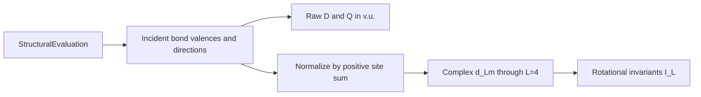

# Valence Multipole Descriptors

---
confidence: 0.9
created: 2026-08-09
last_validated: 2026-08-09
validation_procedure: "Run the rank-0–4 directed-contact, periodic self-image, rotation, inversion, ordering, zero-monopole, and octahedral tests; verify the documented source boundary."
project: easybondvalence
status: validated
validated_by: package tests, documentation validation, and two-axis review
tags: [bond-valence, multipole, structural-descriptor, angular-anisotropy]
sources:
  - "K. M. Shepherd et al. (2016), The valence quadrupole moment, https://doi.org/10.2138/am-2016-5304"
  - "P. J. Steinhardt et al. (1983), Bond-orientational order in liquids and glasses, https://doi.org/10.1103/PhysRevB.28.784"
---

## Overview

`expand_multipoles(evaluation.structural, max_rank=4)` describes the angular distribution of already evaluated incident bond valence. It extends the scalar bond-valence sum into raw dipole and quadrupole moments and a normalized angular spectrum. It is a structural descriptor, not an energy, force field, stress model, or crystal-field calculation.

## Principles

- The expansion consumes the canonical contacts and bond valences already stored in `StructuralEvaluation`; it does not select contacts, resolve parameters, or recompute bond valences.
- Raw moments retain bond-valence units; normalized spherical components and their rotational invariants are dimensionless.
- A non-self contact contributes opposite directions at its two endpoints. A periodic self-image contributes both directions at its one site, matching the conventional site-sum incidence rule.
- The rank-four channel is required because an ideal octahedron has vanishing dipole and quadrupole but nonzero rank-four angular structure.
- The package declares its quadrupole normalization. It does not claim the exact prefactor reproduces the unavailable full-text normalization of Shepherd et al.

## Equations

For each incident contribution $a$ at site $i$, let $s_{ia}$ be its bond valence and $\mathbf u_{ia}$ its directed unit orientation. The raw moments are

$$
V_i = \sum_a s_{ia},
\qquad
\mathbf D_i = \sum_a s_{ia}\mathbf u_{ia},
\qquad
\mathbf Q_i = \sum_a s_{ia}\left(3\mathbf u_{ia}\mathbf u_{ia}^{\mathsf T}-\mathbf I\right).
$$

$V_i$, $\mathbf D_i$, and $\mathbf Q_i$ are in v.u. The factor $3$ and subtraction of $\mathbf I$ are the package convention.

For $V_i>0$, normalized weights and complex orthonormal Condon–Shortley coefficients are

$$
w_{ia}=\frac{s_{ia}}{V_i},
\qquad
d^{(i)}_{Lm}=\sum_a w_{ia}Y_{Lm}(\mathbf u_{ia}),
\qquad
\mathcal I^{(i)}_L=
\sqrt{\frac{4\pi}{2L+1}\sum_{m=-L}^{L}\left|d^{(i)}_{Lm}\right|^2}.
$$

`max_rank` is restricted to $1\leq\mathrm{max\_rank}\leq4$, while output contains ranks $0$ through `max_rank`; components are ordered by $m=-L,\ldots,L$. A zero bond-valence site has no normalized distribution, so evaluation raises `ModelEvaluationError` instead of returning a fabricated zero or NaN spectrum.

## Workflow

## Conventions

The result arrays are immutable. Under a proper rotation $R$, $\mathbf D_i$ transforms as $R\mathbf D_i$, and $\mathbf Q_i$ as $R\mathbf Q_iR^T$; $\mathcal I^{(i)}_L$ is invariant. Inversion reverses $\mathbf D_i$ while preserving $\mathbf Q_i$ and the invariants.

No descriptor magnitude may be interpreted as a calibrated energy or crystal-field splitting without a separately selected model, target data, and validation plan.

## Linked Concepts

- [[bond-valence-model-boundaries]]: Conventional BVS, fitting, and non-energy boundaries.
- [[notation]]: Definitions and units for all symbols used here.
