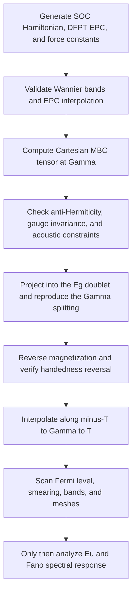

# Molecular Berry Curvature, EPC Downfolding, and Co3Sn2S2 Phonon Splitting

---
confidence: 0.95
created: 2026-08-25
last_validated: 2026-08-25
validation_procedure: "Compare the equations and numerical claims against epcdownfolding/main.tex, Science Advances DOI 10.1126/sciadv.aed7081, its Supplementary Texts S1-S5, the two 2025 PRL experiments, and the released ZS137/MBC source."
project: epcdownfolding
status: validated
validated_by: automatic
tags: [spin-lattice-coupling, electron-phonon-coupling, molecular-berry-curvature, chiral-phonons, co3sn2s2, wannier, epw]
related_files: [epcdownfolding/main.tex, epcdownfolding/research/co3sn2s2_molecular_berry_curvature.md]
---

## Executive conclusion

The electron–phonon downfolding method developed in this project and the molecular Berry-curvature method of Zhang *et al.* begin from closely related first-principles data but calculate different response channels.

The present project contracts an electronic Green function, spin-rotation vertices, and an electron–phonon coupling (EPC) vertex to obtain real-space spin-lattice parameters such as

$$
O_{IJa}
=
\frac{\partial J_{IJ}^{\mathrm{iso}}}{\partial u_a}.
$$

These parameters define a conservative localized-spin Hamiltonian. A natural two-displacement extension can calculate

$$
Q_{IJ,ab}
=
\frac{\partial^2 J_{IJ}^{\mathrm{iso}}}
{\partial u_a\,\partial u_b},
$$

which yields a magnetic-state-dependent correction to the ordinary harmonic force constants. Neither the existing first derivative nor this static second derivative can, by itself, produce the time-reversal-odd chiral splitting of the $E_g$ and $E_u$ phonons in collinear ferromagnetic Co$_3$Sn$_2$S$_2$.

The missing object is the molecular Berry curvature (MBC) $G_{ab}(\mathbf q)$. MBC is antisymmetric in real ionic-coordinate space and anti-Hermitian at general phonon momentum. It enters the ionic equation of motion through a term linear in the phonon frequency,

$$
2i\omega\widetilde G(\mathbf q),
$$

and therefore acts as a gyroscopic or Lorentz-like force. It distinguishes right- and left-handed ionic motion even when every static force constant is real. This velocity-dependent term is not representable by a scalar potential-energy Hessian.

A Co$_3$Sn$_2$S$_2$ calculation is nevertheless technically reachable from the project's existing infrastructure. The Wannier Hamiltonian, dense interpolation, and Cartesian EPC vertices can be reused. The implementation must add a fully relativistic, complex-spinor MBC/Kubo contraction and solve an MBC-modified phonon eigenproblem. This should be described as a **complementary EPC-downfolding channel**, not as a prediction already contained in $dJ/du$.

The most defensible first target is the Raman-active $E_g$ doublet at $\Gamma$. The observed infrared $E_u$ peak separation is mostly a Fano line-shape effect, so reproducing its full experimental value also requires a dynamical phonon self-energy or optical spectral calculation.

## 1. Scope and physical question

The question has two physically distinct interpretations:

1. Can the present spin-lattice method calculate magnetic-order-induced changes of an ordinary phonon force-constant matrix?
2. Can it reproduce the circular-polarization splitting reported for Co$_3$Sn$_2$S$_2$?

The answer to the first is **yes, after a two-displacement extension**. The answer to the second is **not through a static force-constant correction**. Co$_3$Sn$_2$S$_2$ requires a time-reversal-odd dynamical response, for which MBC is the relevant adiabatic electronic term.

This distinction prevents three quantities from being conflated:

- a conservative shift of the equilibrium structure;
- a conservative magnetic correction to harmonic force constants;
- a nondissipative velocity force that splits opposite circular phonons.

## 2. Present EPC-to-spin-lattice downfolding

### 2.1 Effective Hamiltonian

The manuscript partitions the effective Hamiltonian as

$$
H
=
H^{\mathrm{spin}}
+
H^{\mathrm{latt}}
+
H^{\mathrm{SLC}}.
$$

Its generalized spin Hamiltonian can contain isotropic exchange, anisotropic exchange, and Dzyaloshinskii–Moriya interaction (DMI):

$$
H^{\mathrm{spin}}
=
-\sum_{IJ}
\left[
J_{IJ}^{\mathrm{iso}}\,\mathbf S_I\cdot\mathbf S_J
+
\mathbf S_I\cdot\mathbf J_{IJ}^{\mathrm{ani}}\cdot\mathbf S_J
+
\mathbf D_{IJ}\cdot(\mathbf S_I\times\mathbf S_J)
\right].
$$

The demonstrated calculation retains the isotropic term in a collinear system without spin–orbit coupling (SOC). The exchange may be expanded around the reference ionic geometry:

$$
J_{IJ}^{\mathrm{iso}}(\mathbf u)
=
J_{IJ}^{(0)}
+
\sum_a O_{IJa}u_a
+
\frac{1}{2}\sum_{ab}Q_{IJ,ab}u_a u_b
+
\mathcal O(u^3),
$$

where

$$
O_{IJa}
=
\frac{\partial J_{IJ}^{\mathrm{iso}}}{\partial u_a},
\qquad
Q_{IJ,ab}
=
\frac{\partial^2J_{IJ}^{\mathrm{iso}}}
{\partial u_a\,\partial u_b}.
$$

The corresponding displacement-dependent exchange contribution is

$$
H^{\mathrm{SLC}}
=
-\sum_{IJ,a}O_{IJa}u_a\,\mathbf S_I\cdot\mathbf S_J
-
\frac{1}{2}\sum_{IJ,ab}Q_{IJ,ab}u_a u_b\,
\mathbf S_I\cdot\mathbf S_J
+
\mathcal O(u^3).
$$

### 2.2 First and second exchange derivatives

For a frozen spin configuration, the first-order term changes the force:

$$
F_a^{\mathrm{spin}}
=
-\frac{\partial H^{\mathrm{SLC}}}{\partial u_a}
=
\sum_{IJ}O_{IJa}\,
\langle\mathbf S_I\cdot\mathbf S_J\rangle
+
\mathcal O(u).
$$

At $\mathbf u=0$, this is a constant force. It may shift equilibrium positions or generate magnetostriction. It does **not** by itself alter the harmonic curvature around fixed coordinates.

The explicit second derivative produces the frozen-spin force-constant correction

$$
K_{ab}^{\mathrm{spin,frozen}}
=
\frac{\partial^2 H^{\mathrm{SLC}}}
{\partial u_a\,\partial u_b}
=
-\sum_{IJ}Q_{IJ,ab}
\langle\mathbf S_I\cdot\mathbf S_J\rangle.
$$

| Parameter | Leading frozen-spin effect |
|---|---|
| $O_{IJa}$ | Force shift, magnetostriction, and spin–phonon interaction vertex |
| $Q_{IJ,ab}$ | Conservative harmonic force-constant correction |

### 2.3 Relaxed-spin correction

If spin coordinates relax in response to a displacement, the effective ionic curvature has an additional response term. Let $\boldsymbol\xi$ denote independent spin-fluctuation coordinates and write the joint Hessian as

$$
\mathcal H^{(2)}
=
\frac{1}{2}
\begin{pmatrix}
\mathbf u\\
\boldsymbol\xi
\end{pmatrix}^{\!T}
\begin{pmatrix}
K_{uu} & K_{u\xi}\\
K_{\xi u} & K_{\xi\xi}
\end{pmatrix}
\begin{pmatrix}
\mathbf u\\
\boldsymbol\xi
\end{pmatrix}.
$$

Adiabatically minimizing over stable spin fluctuations gives the Schur-complement curvature

$$
K_{uu}^{\mathrm{relaxed}}
=
K_{uu}
-
K_{u\xi}K_{\xi\xi}^{-1}K_{\xi u}.
$$

This expression requires treatment of global spin-rotation zero modes and fails at a magnetic instability where $K_{\xi\xi}$ is singular. It remains a conservative static curvature and does not generate the MBC velocity term.

### 2.4 Electronic Green-function construction

To avoid confusing the electronic Green function with MBC, this note writes the former as $\mathcal G$:

$$
\mathcal G(\mathbf k,\varepsilon)
=
\left[
\varepsilon I-H(\mathbf k)
\right]^{-1}.
$$

In the collinear no-SOC LKAG limit,

$$
J_{IJ}^{\mathrm{iso}}(\mathbf R_J)
=
\frac{1}{4\pi}
\int_{-\infty}^{E_F}d\varepsilon\,
\operatorname{Im}\operatorname{Tr}
\left[
\Delta_I
\mathcal G_{IJ}^{\uparrow}(\mathbf R_J)
\Delta_J
\mathcal G_{JI}^{\downarrow}(-\mathbf R_J)
\right].
$$

A Cartesian lattice perturbation $g_a=\partial V/\partial u_a$ gives

$$
\delta_a\mathcal G
=
\mathcal G^{(0)}g_a\mathcal G^{(0)}.
$$

Differentiating the LKAG expression generates two propagator terms and two onsite-exchange-splitting terms:

$$
\begin{aligned}
\partial_a J_{IJ}^{\mathrm{iso}}
\propto
\operatorname{Im}\int^{E_F}d\varepsilon\,
\operatorname{Tr}\Big[&
\Delta_I(\delta_a\mathcal G_{IJ}^{\uparrow})
\Delta_J\mathcal G_{JI}^{\downarrow}
+
\Delta_I\mathcal G_{IJ}^{\uparrow}
\Delta_J(\delta_a\mathcal G_{JI}^{\downarrow})\\
&+
(\partial_a\Delta_I)\mathcal G_{IJ}^{\uparrow}
\Delta_J\mathcal G_{JI}^{\downarrow}
+
\Delta_I\mathcal G_{IJ}^{\uparrow}
(\partial_a\Delta_J)\mathcal G_{JI}^{\downarrow}
\Big].
\end{aligned}
$$

The manuscript's higher-order appendix identifies

$$
\begin{aligned}
\delta^2_{ab}\mathcal G
={}&
\mathcal G^{(0)}g_a\mathcal G^{(0)}g_b\mathcal G^{(0)}
+
\mathcal G^{(0)}g_b\mathcal G^{(0)}g_a\mathcal G^{(0)}\\
&+
\mathcal G^{(0)}g_{ab}^{(2)}\mathcal G^{(0)},
\end{aligned}
$$

where

$$
g_{ab}^{(2)}
=
\frac{\partial^2V}{\partial u_a\,\partial u_b}.
$$

The first line contains the two Fan-like orderings of first-order EPC vertices. The last term is the genuine second-order or Debye–Waller vertex. A complete $Q_{IJ,ab}$ also contains cross terms where the two exchange propagators are differentiated separately, derivatives of $\Delta_I$ and $\Delta_J$, and mixed propagator–onsite-response terms.

## 3. Molecular Berry curvature

### 3.1 Ionic Berry connection

Let $|\Phi_0(\mathbf R)\rangle$ be the electronic ground state parametrized by ionic coordinates. Its adiabatic Berry connection is

$$
A_a(\mathbf R)
=
i\left\langle
\Phi_0(\mathbf R)
\middle|
\frac{\partial}{\partial R_a}
\Phi_0(\mathbf R)
\right\rangle.
$$

The ionic Hamiltonian acquires a gauge potential analogous to minimal coupling:

$$
H_{\mathrm{ion}}
=
\sum_a
\frac{\left[P_a-\hbar A_a(\mathbf R)\right]^2}{2M_a}
+
V_{\mathrm{eff}}(\mathbf R).
$$

The molecular Berry curvature is

$$
G_{ab}
=
\frac{\partial A_b}{\partial R_a}
-
\frac{\partial A_a}{\partial R_b}.
$$

Equivalently,

$$
G_{ab}
=
i
\left[
\left\langle\partial_a\Phi_0\middle|\partial_b\Phi_0\right\rangle
-
\left\langle\partial_b\Phi_0\middle|\partial_a\Phi_0\right\rangle
\right]
=
-2\operatorname{Im}
\left\langle\partial_a\Phi_0\middle|\partial_b\Phi_0\right\rangle.
$$

The Berry connection $A_a$ is gauge dependent; $G_{ab}$ is gauge invariant. In real space,

$$
G_{ab}=-G_{ba}.
$$

### 3.2 Reciprocal-space properties

After Fourier transformation, the finite-momentum tensor is anti-Hermitian:

$$
G(\mathbf q)
=
-G^{\dagger}(\mathbf q).
$$

Reality of the real-space kernel also implies

$$
G(-\mathbf q)
=
-G^{T}(\mathbf q).
$$

At $\Gamma$, every diagonal entry vanishes in a real Cartesian basis:

$$
G_{aa}(\Gamma)=0.
$$

A complex circular-polarization basis can have nonzero diagonal matrix elements because it diagonalizes an antisymmetric two-dimensional block. That does not contradict the real-basis result.

### 3.3 MBC from EPC vertices

First-order perturbation theory gives

$$
|\partial_a\Phi_0\rangle
=
\sum_{N\neq0}
|\Phi_N\rangle
\frac{
\langle\Phi_N|\partial_a H|\Phi_0\rangle
}{E_0-E_N}.
$$

Substitution into the curvature yields

$$
G_{ab}
=
-2\operatorname{Im}
\sum_{N\neq0}
\frac{
\langle\Phi_0|\partial_aH|\Phi_N\rangle
\langle\Phi_N|\partial_bH|\Phi_0\rangle
}{(E_N-E_0)^2}.
$$

In an independent-particle zero-temperature representation, the excitations are electron-hole pairs. At $\Gamma$,

$$
G_{ab}(\Gamma)
=
\frac{i}{N_{\mathbf k}}
\sum_{\mathbf k,v,c}
\frac{
\left[M^{a\Gamma}_{c\mathbf k,v\mathbf k}\right]^*
M^{b\Gamma}_{c\mathbf k,v\mathbf k}
-
\left[M^{b\Gamma}_{c\mathbf k,v\mathbf k}\right]^*
M^{a\Gamma}_{c\mathbf k,v\mathbf k}
}{
\left(\varepsilon_{c\mathbf k}-\varepsilon_{v\mathbf k}\right)^2
}.
$$

This expression shows that two first-order EPC vertices are required, the antisymmetric imaginary product is retained, and near-degenerate electron-hole pairs are enhanced by the squared denominator.

At finite $\mathbf q$, both $+\mathbf q$ and $-\mathbf q$ transitions are required. Supplementary Eq. S11 has the structure

$$
\begin{aligned}
G_{ab}(\mathbf q)
=
\frac{i}{N_{\mathbf k}}
\sum_{\mathbf k,v,c}
\Bigg[&
\frac{
\left[M^{a\mathbf q}_{c\mathbf{k+q},v\mathbf k}\right]^*
M^{b\mathbf q}_{c\mathbf{k+q},v\mathbf k}
}{
\left(\varepsilon_{c\mathbf{k+q}}-\varepsilon_{v\mathbf k}\right)^2
}\\
&-
\frac{
\left[M^{a\mathbf q}_{v\mathbf k,c\mathbf{k-q}}\right]^*
M^{b\mathbf q}_{v\mathbf k,c\mathbf{k-q}}
}{
\left(\varepsilon_{v\mathbf k}-\varepsilon_{c\mathbf{k-q}}\right)^2
}
\Bigg],
\end{aligned}
$$

with index ordering and normalization fixed by the EPC convention. The two channels enforce anti-Hermiticity and the $\mathbf q\leftrightarrow-\mathbf q$ relation.

For a metal, a practical implementation should not rely blindly on a hard valence/conduction label. A finite-temperature or broadened Kubo form uses occupations $f_{n\mathbf k}$ and must be converged with respect to smearing, Fermi level, band window, and dense $\mathbf k$ sampling. This is critical for Co$_3$Sn$_2$S$_2$ because a flat band lies close to $E_F$.

## 4. MBC-modified lattice dynamics

### 4.1 Mass weighting and eigenproblem

Define

$$
\widetilde K_{ab}
=
\frac{K_{ab}}{\sqrt{M_aM_b}},
$$

and a correspondingly mass-weighted $\widetilde G_{ab}$. Factors of $1/2$ and $\hbar$ depend on whether they are absorbed into $G$. In the convention used by Zhang *et al.*, the final equation is

$$
\left[
\widetilde K(\mathbf q)
+
2\widetilde G^{\dagger}(\mathbf q)\widetilde G(\mathbf q)
+
2i\omega\widetilde G(\mathbf q)
\right]
\boldsymbol\epsilon
=
\omega^2\boldsymbol\epsilon.
$$

This is a quadratic eigenvalue problem because the operator depends on $\omega$.

### 4.2 Perturbative treatment

For small $\widetilde G$, first solve

$$
\widetilde K(\mathbf q)
\boldsymbol\epsilon^{(0)}_{\nu\mathbf q}
=
\left[\omega^{(0)}_{\nu\mathbf q}\right]^2
\boldsymbol\epsilon^{(0)}_{\nu\mathbf q}.
$$

To first order, discard $\widetilde G^{\dagger}\widetilde G$ and diagonalize within each degenerate subspace

$$
\mathcal M_{\nu\nu'}(\mathbf q)
=
2i\omega^{(0)}_{\mathbf q}
\left\langle
\boldsymbol\epsilon^{(0)}_{\nu\mathbf q}
\middle|
\widetilde G(\mathbf q)
\middle|
\boldsymbol\epsilon^{(0)}_{\nu'\mathbf q}
\right\rangle.
$$

For an ideal doublet,

$$
\widetilde G_{	ext{doublet}}
=
\begin{pmatrix}
0 & g\\
-g & 0
\end{pmatrix},
$$

and the circular vectors

$$
\boldsymbol\epsilon_{\pm}
=
\frac{1}{\sqrt2}
\begin{pmatrix}
1\\
\pm i
\end{pmatrix}
$$

diagonalize the perturbation. To leading order,

$$
\delta\omega_{\pm}
\simeq
\pm g,
\qquad
\Delta\omega
\simeq
2g,
$$

within this normalization. Magnetization reversal changes the sign of MBC and exchanges the two handed branches.

### 4.3 Phase-space linearization

The quadratic problem can be linearized using

$$
\Psi
=
\begin{pmatrix}
\mathbf u\\
\mathbf p
\end{pmatrix}.
$$

The supplementary derivation writes the generator schematically as

$$
\frac{d}{dt}
\begin{pmatrix}
\mathbf u\\
\mathbf p
\end{pmatrix}
=
\begin{pmatrix}
\widetilde G & I\\
-D & \widetilde G
\end{pmatrix}
\begin{pmatrix}
\mathbf u\\
\mathbf p
\end{pmatrix},
$$

where $D$ contains the force-constant and second-order MBC contribution in that convention. Stable conservative dynamics gives real phonon frequencies, equivalently purely imaginary eigenvalues of the time-evolution generator.

## 5. Why a static Hessian cannot provide the Co3Sn2S2 splitting

### 5.1 Time-reversal constraint

An ordinary force constant is

$$
K_{ab}
=
\frac{\partial^2V_{\mathrm{eff}}}
{\partial u_a\,\partial u_b},
$$

and therefore

$$
K_{ab}=K_{ba}\in\mathbb R
$$

in real coordinates. Positions and displacements are even under time reversal, so a static coordinate Hessian cannot distinguish clockwise and counterclockwise trajectories through a time-reversal-odd force.

Magnetic order can still affect ordinary force constants. SOC can make the scalar energy different for distortions related by a spatial rotation when the ordered moment breaks that rotation. Such spatial-symmetry lowering is visible to standard DFT. The narrower constraint is that a real static Hessian cannot encode the frequency-odd velocity response.

### 5.2 Co3Sn2S2 symmetry

Co$_3$Sn$_2$S$_2$ has centrosymmetric space group $R\bar3m$. Below approximately $175$ K, its collinear ferromagnetic moment is aligned with the $C_3$ axis. The magnetic order breaks time reversal and vertical mirror symmetry while preserving inversion and $C_3$, reducing the point group from $D_{3d}$ to $C_{3i}$ and giving magnetic space group $R\bar3m'$.

For this order, Supplementary S1 shows that the scalar effective potential gives equal energies to displacements related by the vertical mirror. The ordinary dynamical matrix retains both time reversal and the vertical mirror even with SOC. Standard SOC-DFPT therefore leaves the relevant $E_g$ and $E_u$ modes degenerate.

MBC depends on the adiabatic phase of the electronic state rather than only its energy. It supplies the information that the Hessian lacks.

### 5.3 Why static SOC spin couplings are not equivalent to MBC

Adding derivatives of DMI or anisotropic exchange is necessary for a complete SOC spin-lattice Hamiltonian, but inserting a static spin state into a scalar potential still produces a real symmetric curvature.

A fully dynamical spin subsystem can generate a frequency-dependent phonon self-energy after integration. That is a separate mechanism. In a collinear isotropic ferromagnet,

$$
\mathbf S_I\cdot\mathbf S_J
=
S^2
-
\frac{S^2}{2}
\left|\boldsymbol\theta_I-\boldsymbol\theta_J\right|^2
+
\mathcal O(\theta^3),
$$

so $u\,\mathbf S_I\cdot\mathbf S_J$ contains $u\theta^2$ rather than a bilinear one-phonon/one-magnon term. A harmonic anticrossing needs anisotropy, noncollinearity, or another term linear in the transverse spin fluctuation. The cited Co$_3$Sn$_2$S$_2$ experiments and Zhang *et al.* exclude resonant magnon–phonon coupling as the explanation of these doublets.

### 5.4 Chiral magnon–phonon coupling can split phonons

The negative conclusion above is specific to a **static spin state** and to the mechanism proposed for Co$_3$Sn$_2$S$_2$. A dynamical magnon coupled to a phonon can certainly split a phonon pair. In a rotating-wave description, let $b_s$ annihilate a phonon and $a_s$ a magnon of helicity or pseudoangular-momentum sector $s=\pm$. A minimal harmonic Hamiltonian is

$$
H_2
=
\hbar\sum_{s=\pm}
\left[
\omega_{\mathrm p} b_s^\dagger b_s
+
\omega_{\mathrm m,s}a_s^\dagger a_s
+
\left(
g_s a_s^\dagger b_s
+
g_s^*b_s^\dagger a_s
\right)
\right].
$$

For each allowed helicity sector, the two mixed frequencies are

$$
\Omega_{s,\mathrm{upper/lower}}
=
\frac{\omega_{\mathrm p}+\omega_{\mathrm m,s}}{2}
\pm
\sqrt{
\left(
\frac{\omega_{\mathrm p}-\omega_{\mathrm m,s}}{2}
\right)^2
+
|g_s|^2
}.
$$

At resonance the avoided-crossing gap is $2|g_s|$. In the detuned regime, the phonon-like frequency shift is approximately

$$
\delta\omega_{\mathrm p,s}
\simeq
\operatorname{Re}
\frac{|g_s|^2}
{\omega_{\mathrm p}-\omega_{\mathrm m,s}+i\kappa_{\mathrm m,s}},
$$

so the circular-phonon splitting is

$$
\Delta\omega_{\mathrm p}
\simeq
\operatorname{Re}
\left[
\frac{|g_+|^2}
{\omega_{\mathrm p}-\omega_{\mathrm m,+}+i\kappa_{\mathrm m,+}}
-
\frac{|g_-|^2}
{\omega_{\mathrm p}-\omega_{\mathrm m,-}+i\kappa_{\mathrm m,-}}
\right].
$$

Counter-rotating terms modify this expression away from resonance but not the selection-rule argument. A resolvable splitting requires:

1. phonon and magnon states at the same crystal momentum;
2. compatible magnetic-space-group irreducible representations, including pseudoangular momentum modulo the relevant rotation order;
3. a bilinear one-phonon/one-magnon matrix element;
4. broken time reversal, a magnetic field, or another asymmetry that makes the two helicity self-energies unequal;
5. a coupling-induced separation larger than the phonon and magnon linewidths.

Chirality alone is not sufficient. If $\omega_{\mathrm m,+}=\omega_{\mathrm m,-}$ and $|g_+|=|g_-|$, both phonon helicities shift equally and remain degenerate. Near resonance the eigenstates are magnon polarons rather than pure split phonons.

### 5.5 Which exchange derivatives provide a bilinear coupling

Write the first-order tensor spin-lattice interaction as

$$
H_{\mathrm{SLC}}^{(1)}
=
-
\sum_{IJ,a,\alpha\beta}
O_{IJ,a}^{\alpha\beta}
u_a
S_I^\alpha S_J^\beta,
\qquad
O_{IJ,a}^{\alpha\beta}
=
\frac{\partial J_{IJ}^{\alpha\beta}}{\partial u_a}.
$$

For a collinear reference state along $z$, linear spin-wave theory gives

$$
S^x
\simeq
\sqrt{\frac{S}{2}}(a+a^\dagger),
\qquad
S^y
\simeq
-i\sqrt{\frac{S}{2}}(a-a^\dagger),
\qquad
S^z
=
S-a^\dagger a.
$$

The isotropic term retained in the demonstrated EPC-downfolding calculation,

$$
u_a O_{IJ,a}^{\mathrm{iso}}\,
\mathbf S_I\cdot\mathbf S_J,
$$

contains a constant and terms with two magnon operators, but no term linear in a magnon. It therefore does not create a harmonic magnon–phonon anticrossing about a stationary collinear state.

Off-diagonal SOC-dependent exchange derivatives behave differently:

$$
u_a O_{IJ,a}^{xz}S_I^xS_J^z
\propto
u_a(a_I+a_I^\dagger),
$$

$$
u_a O_{IJ,a}^{yz}S_I^yS_J^z
\propto
-iu_a(a_I-a_I^\dagger).
$$

After projection onto phonon eigenvectors and magnon Bloch modes, the circular-sector coupling contains combinations of the form

$$
g_\pm
\propto
\sum_a
e_{a,\pm}
\left(
O_a^{xz}
\pm
iO_a^{yz}
\right),
$$

with the omitted site and phase factors fixed by the magnetic structure. Derivatives of DMI, single-ion anisotropy, or noncollinear exchange can generate analogous linear couplings.

The manuscript's general Green-function construction already explains how derivatives of anisotropic exchange and DMI can be mapped. The demonstrated implementation, however, is restricted to $dJ^{\mathrm{iso}}/du$ for a collinear system without SOC. A predictive hybridization calculation therefore requires fully relativistic spinor EPC, the complete tensor derivatives, magnon frequencies and eigenvectors, and diagonalization of the coupled bosonic dynamical matrix.

### 5.6 Potential coupling is one block of the full dynamics

In the generalized adiabatic formulation of Ren *et al.*, the slow coordinates include both ionic displacements $u$ and spin cantings $s$:

$$
\begin{pmatrix}
M & 0\\
0 & 0
\end{pmatrix}
\begin{pmatrix}
\ddot u\\
\ddot s
\end{pmatrix}
=
-
\begin{pmatrix}
K^{(\mathrm{pp})} & K^{(\mathrm{ps})}\\
K^{(\mathrm{sp})} & K^{(\mathrm{ss})}
\end{pmatrix}
\begin{pmatrix}
u\\
s
\end{pmatrix}
+
\begin{pmatrix}
G^{(\mathrm{pp})} & G^{(\mathrm{ps})}\\
G^{(\mathrm{sp})} & G^{(\mathrm{ss})}
\end{pmatrix}
\begin{pmatrix}
\dot u\\
\dot s
\end{pmatrix}.
$$

The tensor exchange derivatives above contribute to the conservative mixed Hessian $K^{(\mathrm{sp})}$. Magnon precession is carried by $G^{(\mathrm{ss})}$. Direct molecular Berry curvature is the phonon block $G^{(\mathrm{pp})}$, and a complete electronic treatment may also contain mixed Berry blocks $G^{(\mathrm{sp})}$ and $G^{(\mathrm{ps})}$. Thus an EPC-downfolded magnon–phonon Hamiltonian can capture selective hybridization, but $dJ/du$ alone is not the complete time-reversal-odd lattice response.

### 5.7 Established example and relevance to this project

Cui *et al.* demonstrated the mechanism in FePSe$_3$. Two nearly degenerate phonons $P_1$ and $P_2$ form circular combinations $P_\pm$. Symmetry gives real and imaginary couplings to two opposite-chirality antiferromagnetic magnons, so $P_+$ couples only to $M_\alpha$ and $P_-$ only to $M_\beta$. A magnetic field Zeeman-splits the magnons; the unequal helicity self-energies then split the phonon-like branches. The calculated couplings, $2.00$ and $2.16\ \mathrm{cm}^{-1}$, agree with experiment.

That study obtained the required magnetic derivatives from displaced structures and TB2J. It is therefore a direct benchmark for the present EPC-downfolding strategy: compute $O^{xz}$ and $O^{yz}$ from one relativistic EPC dataset instead of repeated displaced magnetic calculations, then reproduce the field-dependent magnon-polaron branches.

Co$_3$Sn$_2$S$_2$ is different. The Science Advances study explicitly cites its measured spin-excitation spectrum to rule out **resonant** magnon–phonon coupling for the reported $E_g$ and $E_u$ doublets. A magnon-mediated calculation would still be scientifically useful as a quantitative upper bound or complementary self-energy channel, but it should not be presented as the mechanism already identified for those doublets. The reported $E_g$ benchmark is assigned to direct electronic MBC, while most of the observed $E_u$ peak separation is assigned to Fano interference.

## 6. Same ingredients, different response channels

| Aspect               | EPC-to-spin-lattice downfolding                                | Molecular Berry curvature                                      |
| -------------------- | -------------------------------------------------------------- | -------------------------------------------------------------- |
| Target               | $O_{IJa}$ and potentially $Q_{IJ,ab}$                          | $G_{ab}(\mathbf q)$                                            |
| Low-energy variables | Local spins and displacements                                  | Ionic displacement and momentum                                |
| Vertices             | Spin rotations $\Delta_I,\Delta_J$ plus EPC $g_a$              | Two EPC vertices $g_a,g_b$                                     |
| Contraction          | Magnetic-force-theorem response                                | Antisymmetric Kubo/Berry response                              |
| Coordinate symmetry  | Conservative Hessian is symmetric                              | Real-space antisymmetric; finite-$\mathbf q$ anti-Hermitian    |
| Entry in dynamics    | Potential-energy parameters                                    | Velocity term $2i\omega\widetilde G$                           |
| Outputs              | Magnetostriction, exchange modulation, spin-lattice scattering | Chiral splitting, angular momentum, time-reversal-odd dynamics |
| Project status       | Demonstrated for collinear SrMnO$_3$ without SOC               | Not implemented here                                           |

A diagrammatic summary is

$$
\text{exchange:}
\quad
\mathcal G\Delta_I\mathcal G\Delta_J\mathcal G,
$$

$$
\text{first-order SLC:}
\quad
\mathcal G\Delta_I\mathcal G g_a\mathcal G\Delta_J\mathcal G
+
\text{permutations},
$$

$$
\text{second-order conservative SLC:}
\quad
\operatorname{Sym}_{ab}
\left[
\mathcal G\Delta_I\mathcal G g_a\mathcal G g_b
\mathcal G\Delta_J\mathcal G
\right]
+
\text{response terms},
$$

$$
\text{MBC:}
\quad
\operatorname{AntiHerm}_{ab}
\left[
\sum_{v,c}
\frac{(M^a_{cv})^*M^b_{cv}}
{(\varepsilon_c-\varepsilon_v)^2}
\right].
$$

The shared infrastructure is the electronic Hamiltonian, complex wave-function gauge, EPC interpolation, and Brillouin-zone integration. The response observable and symmetry projection differ.

## 7. Published Co3Sn2S2 results

### 7.1 Raman-active Eg mode

At $\Gamma$, Zhang *et al.* report

$$
\Delta E_{E_g}^{\mathrm{MBC}}
\approx
0.253\ \mathrm{meV}
=
2.05\ \mathrm{cm}^{-1}.
$$

The Raman experiment reports

$$
\Delta\widetilde\nu_{E_g}^{\mathrm{exp}}
=
1.27\ \mathrm{cm}^{-1}.
$$

The calculation uses

$$
E_F
=
E_F^{\mathrm{DFT}}+0.025\ \mathrm{eV}
$$

to align with the STM flat band along $\Gamma$–$K$. Supplementary Fig. S3 shows strong Fermi-level sensitivity and reports agreement near $+0.010$ and $+0.060$ eV, with the maximum splitting near $+0.030$ eV.

The $E_g$ doublet is the best validation target because its Raman lines do not show the pronounced asymmetric line shape that complicates $E_u$.

### 7.2 Infrared-active Eu mode and unit inconsistency

The optical experiment reports

$$
\Delta\widetilde\nu_{E_u}^{\mathrm{exp}}
\approx
0.3\ \mathrm{cm}^{-1}.
$$

The Science Advances main text first states

$$
\Delta E_{E_u}^{\mathrm{MBC}}
\approx
0.002\ \mathrm{meV}
=
0.016\ \mathrm{cm}^{-1}.
$$

Later in the main text, and in Supplementary S5, it uses

$$
\Delta\widetilde\nu_{E_u}^{\mathrm{MBC}}
=
0.002\ \mathrm{cm}^{-1}.
$$

These are inconsistent because

$$
0.002\ \mathrm{meV}
\times
8.0655\ \frac{\mathrm{cm}^{-1}}{\mathrm{meV}}
\approx
0.0161\ \mathrm{cm}^{-1}.
$$

The intrinsic $E_u$ benchmark should be clarified with the authors.

### 7.3 Fano contribution

The Fano profile is

$$
I(\omega)
=
\frac{(q_{\mathrm F}+\epsilon)^2}{1+\epsilon^2},
\qquad
\epsilon
=
\frac{2(\omega-\omega_0)}{\Gamma_{\mathrm F}}.
$$

Its maximum is at $\epsilon=1/q_{\mathrm F}$:

$$
\omega_{\mathrm{peak}}
=
\omega_0
+
\frac{\Gamma_{\mathrm F}}{2q_{\mathrm F}}.
$$

The experimental fit gives

$$
\frac{1}{q_{\mathrm F}^{(L)}}\approx0,
\qquad
\frac{1}{q_{\mathrm F}^{(R)}}=0.775,
$$

and the calculated linewidth is

$$
\Gamma_{\mathrm F}=0.095\ \mathrm{meV}.
$$

The peak separation is

$$
\Delta E_{E_u}^{\mathrm{Fano}}
=
\frac{\Gamma_{\mathrm F}}{2}
\left|
\frac{1}{q_{\mathrm F}^{(R)}}
-
\frac{1}{q_{\mathrm F}^{(L)}}
\right|
\approx
0.0368\ \mathrm{meV},
$$

or

$$
\Delta\widetilde\nu_{E_u}^{\mathrm{Fano}}
\approx
0.298\ \mathrm{cm}^{-1}.
$$

This explains almost all of the measured separation. Because the Fano factors come from experiment, the full $E_u$ agreement is not a parameter-free MBC prediction.

### 7.4 Experimental targets

| Observable | Dominant reported mechanism | MBC benchmark? |
|---|---|---|
| $E_g$ splitting at $\Gamma$ | MBC | Yes; primary target |
| $E_g$ along $-T$–$\Gamma$–$T$ | Momentum-dependent MBC | Yes; second stage |
| Intrinsic $E_u$ splitting | Small MBC with unit ambiguity | Only after clarification |
| Observed $E_u$ optical separation | Predominantly Fano interference | Requires spectral response |

## 8. Required implementation

### 8.1 Inputs

A valid calculation requires:

1. a ferromagnetic fully relativistic SOC ground state with magnetization along $C_3$;
2. SOC-consistent DFPT perturbing potentials and complex spinor EPC;
3. a Wannier Hamiltonian reproducing the Weyl bands and flat band near $E_F$;
4. Cartesian atom-resolved EPC vertices, not only mode-resolved strengths;
5. conventional SOC force constants and phonon eigenvectors;
6. dense interpolation for the squared electronic denominator.

The published calculation used PBE norm-conserving pseudopotentials, a $90$ Ry cutoff, an $8\times8\times8$ electronic mesh, a $3\times3\times3$ phonon mesh, and an $80\times80\times80$ MBC interpolation mesh. These are starting points, not independent convergence proof.

### 8.2 Gauge and symmetry checks

The interpolation must preserve the covariance of $(M^a)^*M^b$ under unitary rotations in the Wannier subspace. Required checks include

$$
G(\mathbf q)+G^{\dagger}(\mathbf q)=0,
$$

$$
G(-\mathbf q)+G^T(\mathbf q)=0,
$$

and

$$
G_{aa}(\Gamma)=0
$$

in a real Cartesian basis. Splittings must be invariant under electronic phase changes and allowed rotations of degenerate phonon eigenvectors.

### 8.3 Metallic convergence

The calculation must converge:

- Fermi-level position;
- electronic temperature or smearing;
- dense interpolation mesh;
- outer and frozen Wannier windows;
- number of unoccupied bands;
- denominator cutoff or regularization.

A robust reproduction must include the published Fermi-level scan, not only the $+0.025$ eV point.

### 8.4 Correct phonon solver

The implementation must not create a frequency-independent fictitious matrix

$$
K_{\mathrm{fake}}=K+\Delta K^{\mathrm{MBC}}.
$$

It must solve the quadratic eigenproblem, use the phase-space linearization, or apply controlled degenerate perturbation theory. The full eigenvectors are required to identify circular polarization and magnetization reversal.

### 8.5 Validation ladder

Acceptance checks:

1. $G=0$ when time reversal is restored.
2. Magnetization reversal exchanges the circular branches.
3. $G$ is anti-Hermitian before projection.
4. Acoustic translations remain zero-frequency within tolerance.
5. $E_g$ remains degenerate when MBC is disabled.
6. The enabled result has the published order of magnitude and $E_F$ sensitivity.
7. Results are invariant under rephasing and rotation in the degenerate subspace.

## 9. Released implementation status

The authors released modified EPW source files through GitHub and Zenodo, not a standalone package. The README limits compatibility to Quantum ESPRESSO 7.3.1 and instructs users to copy files into `EPW/src`.

Exposed controls include `molecular_berry_calc`, `mbc_write_am`, `mbc_accustic_limit`, `mbc_smearing`, `MBC_phonself_calc`, and `mbc_k_diss_calc`.

Source inspection finds that:

- the MBC path requires existing Wannier/EPW data and `epwread=.true.`;
- the released routine requires an explicit input Fermi energy;
- the polar long-range path is rejected;
- no complete Co$_3$Sn$_2$S$_2$ input set or regression test is included;
- the MBC phonon-self-energy routine is marked as an unreleased dummy.

The code is useful for normalization and EPW integration details, but is not a turnkey reproduction package.

## 10. Claims supported by the present project

### Supported

The EPC-downfolding framework can be extended to conservative magnetic force-constant corrections through second displacement derivatives of exchange and SOC-dependent spin couplings. This is useful for magnetostriction, ordinary spin-dependent phonon renormalization, and finite-temperature spin-lattice models.

### Not supported

The current $dJ_{IJ}/du$ implementation cannot reproduce the MBC-induced Co$_3$Sn$_2$S$_2$ splitting. A static $d^2J_{IJ}/du\,dv$ Hessian is also not equivalent to MBC because it lacks the frequency-odd anti-Hermitian response.

### Defensible extension

> The existing framework downfolds EPC into localized spin-lattice parameters. A complementary extension could reuse the complex SOC Wannier Hamiltonian and EPC vertices to evaluate the antisymmetric two-EPC-vertex molecular Berry-curvature kernel and incorporate it into lattice dynamics. This is a new response channel rather than a consequence of the existing exchange derivatives.

## 11. Recommended response points

1. Both methods use EPC as microscopic input.
2. The present implementation outputs $dJ_{IJ}/du$ and does not contain MBC.
3. A $d^2J_{IJ}/du\,dv$ extension corrects conservative force constants but cannot produce the Co$_3$Sn$_2$S$_2$ chiral splitting.
4. A common complex Wannier/EPC dataset could support both response channels.
5. The $E_g$ doublet at $\Gamma$ is the clean first benchmark.
6. The measured $E_u$ separation requires Fano/self-energy physics beyond intrinsic MBC.

A useful clarification question is:

> The main text quotes $0.002$ meV, or $0.016$ cm$^{-1}$, for the MBC-induced $E_u$ splitting, while the later discussion and Supplementary S5 use $0.002$ cm$^{-1}$. Which value should be used as the intrinsic benchmark?

## 12. Risks and open questions

### Formal risks

- Symmetrizing the EPC vertices calculates a different response and destroys MBC.
- A hard occupied/unoccupied split is unstable near a metallic Fermi level.
- Fano interference and linewidth require a frequency-dependent complex self-energy.
- The original localized rigid-spin mapping may be inaccurate in an itinerant Weyl semimetal.

### Reproduction risks

- The $E_g$ result is strongly Fermi-level dependent.
- Exact structures, pseudopotentials, Wannier windows, and inputs are not released with the code.
- The released patch is tied to one EPW version and has incomplete paths.
- The intrinsic $E_u$ value is internally inconsistent.
- The full $E_u$ agreement uses experimental Fano parameters.

### Questions for the authors

1. Can they share the SCF, phonon, Wannier90, and EPW inputs?
2. Which $E_u$ MBC value is correct?
3. What denominator regularization and electronic temperature were used on the $80^3$ mesh?
4. How were degenerate phonon gauges aligned along $-T$–$\Gamma$–$T$?
5. Were acoustic constraints imposed directly on $G(\mathbf q)$?
6. Was a finite-temperature occupation formula used for the metal?
7. Can the unreleased MBC phonon-self-energy path be shared?

## 13. Decision summary

| Decision | Rationale |
|---|---|
| Treat $d^2J/du\,dv$ as conservative | It is a second derivative of a scalar spin-lattice energy. |
| Do not identify it with MBC | MBC is anti-Hermitian and frequency odd. |
| Reuse Wannier/EPC infrastructure | Both channels need the same expensive interpolated data. |
| Implement MBC separately | Separate invariants prevent accidental symmetrization. |
| Benchmark $E_g$ first | It is MBC-driven and experimentally cleaner. |
| Treat observed $E_u$ as spectral | Its magnitude is mainly Fano interference. |
| Require an $E_F$ scan | The flat band makes the result Fermi-level sensitive. |

## Variables

Notation is defined in [[notation]]. The crucial distinction is between the electronic Green function $\mathcal G$ and molecular Berry curvature $G$.

| Symbol | Meaning | Units |
|---|---|---|
| $u_a$ | Ionic displacement | length |
| $K_{ab}$ | Harmonic force constant | energy/length$^2$ |
| $O_{IJa}$ | First exchange derivative | energy/length |
| $Q_{IJ,ab}$ | Second exchange derivative | energy/length$^2$ |
| $G_{ab}$ | Molecular Berry curvature | convention dependent before mass weighting |
| $\widetilde G_{ab}$ | Mass-weighted MBC in lattice dynamics | angular frequency |
| $M^a_{mn}$ | Cartesian EPC matrix element | energy/length |
| $q_{\mathrm F}$ | Fano asymmetry parameter | dimensionless |

## Primary sources

1. S. Zhang, M. Wang, P. Zhang, and T. Zhang, “General ab initio framework for electronic-order-induced lattice-dynamics symmetry breaking,” *Science Advances* **12**, eaed7081 (2026). [DOI](https://doi.org/10.1126/sciadv.aed7081) · [Open full text](https://pmc.ncbi.nlm.nih.gov/articles/PMC13281796/)
2. Zhang *et al.*, Supplementary Texts S1–S6. [Publisher supplement](https://www.science.org/doi/suppl/10.1126/sciadv.aed7081/suppl_file/sciadv.aed7081_sm.pdf) · [Europe PMC archive](https://www.ebi.ac.uk/europepmc/webservices/rest/PMC13281796/supplementaryFiles)
3. D. Saparov *et al.*, “Lattice dynamics with molecular Berry curvature: Chiral optical phonons,” *Physical Review B* **105**, 064303 (2022). [DOI](https://doi.org/10.1103/PhysRevB.105.064303)
4. R. Yang *et al.*, “Inherent Circular Dichroism of Phonons in Magnetic Weyl Semimetal Co$_3$Sn$_2$S$_2$,” *Physical Review Letters* **134**, 196905 (2025). [DOI](https://doi.org/10.1103/PhysRevLett.134.196905)
5. M. Che *et al.*, “Magnetic Order Induced Chiral Phonons in a Ferromagnetic Weyl Semimetal,” *Physical Review Letters* **134**, 196906 (2025). [DOI](https://doi.org/10.1103/PhysRevLett.134.196906)
6. Released implementation. [GitHub](https://github.com/ZS137/MBC) · [Zenodo](https://zenodo.org/records/19906198)
7. Local manuscript: `epcdownfolding/main.tex`, especially its spin-lattice Hamiltonian, EPC derivation, limitations, and higher-order appendix.
8. J. Cui *et al.*, “Chirality selective magnon-phonon hybridization and magnon-induced chiral phonons in a layered zigzag antiferromagnet,” *Nature Communications* **14**, 3396 (2023). [DOI](https://doi.org/10.1038/s41467-023-39123-y)
9. S. Ren *et al.*, “Adiabatic Dynamics of Coupled Spins and Phonons in Magnetic Insulators,” *Physical Review X* **14**, 011041 (2024). [DOI](https://doi.org/10.1103/PhysRevX.14.011041) · [arXiv](https://arxiv.org/abs/2307.05668)
10. C. Liu *et al.*, “Spin Excitations and Spin Wave Gap in the Ferromagnetic Weyl Semimetal Co$_3$Sn$_2$S$_2$,” *Science China Physics, Mechanics & Astronomy* **64**, 217062 (2021). [DOI](https://doi.org/10.1007/s11433-020-1597-6) · [arXiv](https://arxiv.org/abs/2006.07339)
