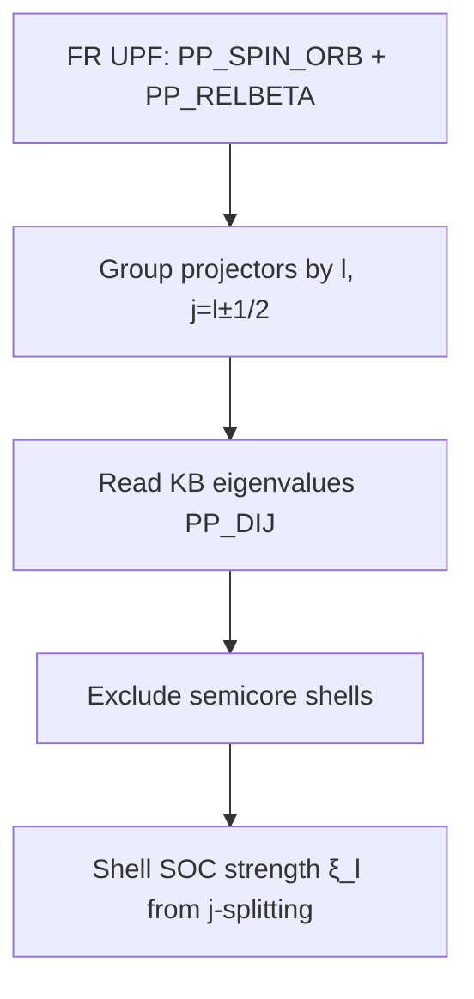

# Fully-Relativistic Norm-Conserving Pseudopotential SOC Encoding

## Overview
A fully-relativistic (FR) norm-conserving pseudopotential encodes spin--orbit coupling (SOC) through
its non-local Kleinman--Bylander (KB) projector operator, whose projectors are resolved by
$j=l\pm\tfrac12$. The file can support a per-shell SOC descriptor only after that **full operator** is
contracted with a named pseudo-atomic or scattering state; differences of bare KB coefficients are
not representation-invariant shell SOC constants.

## Principles
- FR pseudos are generated from all-electron Dirac–Kohn–Sham atomic calculations, so scalar-relativistic
  and SOC effects are transferred together into the pseudo-ion.
- The non-local part is stored in separable KB form, with projectors indexed by total angular momentum
  $j=l\pm\tfrac12$ rather than by $l$ alone.
- A physical shell SOC splitting is the difference between the two $j$-resolved state expectations of
  the non-local operator (or a corresponding radial-$V_{\mathrm{SO}}$ integral), not a difference
  between arbitrarily selected KB coefficients.
- This pseudo-ion quantity is species-level, but its numerical value depends on the specified
  pseudo-atomic/scattering state and pseudopotential family.

## Details
The Dojo FR set in `data/Dojo-NC-FR/PBE/Fe.upf` is a UPF v2.0.1 file with header flags
`pseudo_type="NC"`, `relativistic="full"`. Its section inventory is:

- `PP_SPIN_ORB` — the relativistic spin–orbit section.
- 10 `PP_RELBETA` / `PP_BETA` — relativistic KB projectors (vs. 6 `PP_CHI` / `PP_RELWFC` pseudo
  wavefunctions). The extra projectors are the $j$-resolved partners.
- `PP_DIJ` — the KB coefficient matrix. Its entries parameterize the separable non-local operator but
  are not individually observable: rescaling a projector changes its coefficient while leaving the
  operator unchanged.

For a named state $\chi_{nl,j}$, the candidate pseudo-atomic non-local contribution is

$$
E_{nl,j}^{\mathrm{NL}} =
\sum_{ab}\langle\chi_{nl,j}|\beta_a\rangle D_{ab}
\langle\beta_b|\chi_{nl,j}\rangle.
$$

The relevant $j$-splitting is the difference of these state expectations.

When constructing any chemical-valence descriptor, exclude deep semicore shells. SIESTA provides
`get_n_semicore_shells` (`m_ncps_utils.f90`) for exactly this distinction.

## Variables
The following variables are used in this note (see [notation](notation.md) for full definitions):

| Symbol | Description | Units |
|--------|-------------|-------|
| $\xi_l$ | Per-shell SOC strength for angular momentum $l$ | eV |
| $l$ | Orbital angular momentum quantum number | dimensionless |
| $j$ | Total angular momentum, $j=l\pm\tfrac12$ | dimensionless |
| $Z$ | Atomic number | dimensionless |

## Equations
The atomic SOC Hamiltonian for a shell is

$$
H_\text{SO} = \xi_l(r)\,\mathbf{L}\cdot\mathbf{S},
$$

and its effective shell strength follows from the FR KB $j$-splitting,

$$
\xi_l \;\propto\; \varepsilon_{l}^{\,j=l+1/2} - \varepsilon_{l}^{\,j=l-1/2},
$$

with overall magnitude scaling approximately as

$$
\xi_l \sim Z^{4}.
$$

## Workflow

## Conventions
- Read $\xi_l$ only from *fully-relativistic* (`relativistic="full"`) NC pseudos; scalar-relativistic
  (SR) files have no $j$-splitting and give $\xi_l=0$.
- Always pair $\xi_l$ extraction with semicore exclusion so the descriptor reflects valence SOC.
- Record the pseudopotential family/functional (LDA/PBE/PBEsol) in provenance; $\xi_l$ is weakly
  functional-dependent.

## Production Extraction (magdescriptor, story-001)

Implemented in `magdescriptor/magdescriptor/{readers/upf.py,features/xi_l.py}`. Method:

- **Magnetic shell = largest valence angular momentum from `PP_RELWFC` (`max(lchi)`), NOT from the
  projectors.** This is the key subtlety: Os's pseudopotential (`nproj=14`) carries f *polarization*
  projectors (l=3) with **no** corresponding wavefunction; selecting `max(l)` over projectors wrongly
  picks the f shell and yields a negative, unphysical value (Os −3.94 eV). Selecting over `PP_RELWFC`
  picks the d shell (l=2) → Os +4.6781 eV.
- For the magnetic d/f shell only, $\xi_l$ is the dominant-diagonal (`max|D_ii|`) KB coefficient
  difference between the $j=l+\tfrac12$ and $j=l-\tfrac12$ channels, × `RY_TO_EV`. This is an
  empirically validated monotonic **d/f proxy**; UPF does not label a universally valid
  “valence-coupled” projector, so this shortcut MUST NOT be extended to p channels.
- Non-FR / no `PP_SPIN_ORB` → explicit `ScalarRelativisticError` (no silent zero).

Validated on vendored FR Dojo fixtures: Fe 0.5478, Ni 0.6992, Mo 4.1946, Os 4.6781 eV — monotonic
3d<4d<5d and an exact match to the de-risking spike. The value is a monotonic proxy (~10× atomic
$\xi$); absolute calibration to $\langle\xi(r)\rangle$ is deferred (FR-011 / SIESTA `vso` route).

## Periodic-table visualization

- For the chemical-valence plot, retain every non-semicore outer-valence $(n,l)$ stripe as equal
  height, but color only SOC quantities validated for that channel. Do not collapse an element to one
  nominal oxidation state.
- PBE Ag retains adjacent $4d$ (validated d proxy) and $5s$ (neutral gray; no $j$ partner) stripes,
  supporting later Ag$^{+}$/Ag$^{2+}$ chemistry without re-extracting the pseudopotential.
- Raw p-channel `max|D_ii|` differences are **unvalidated** and MUST NOT be interpreted or rendered
  as physical SOC strength. A future p color requires the full-projector pseudo-atomic expectation
  and calibration against a physical reference; use neutral/unvalidated styling until then.

## Linked Concepts
- [siesta_onsite_soc_hamiltonian](siesta_onsite_soc_hamiltonian.md): SIESTA builds the SOC Hamiltonian from a radial $V_\text{SO}(r,l)$;
  an alternative, consistent route to the same per-shell strength.
- [magnetic_interaction_descriptor_factorization](magnetic_interaction_descriptor_factorization.md): $\xi_l$ is the SOC *prefactor* for MAE/DMI/aniso.
- [notation](notation.md): Standard variable notations used in this note.
