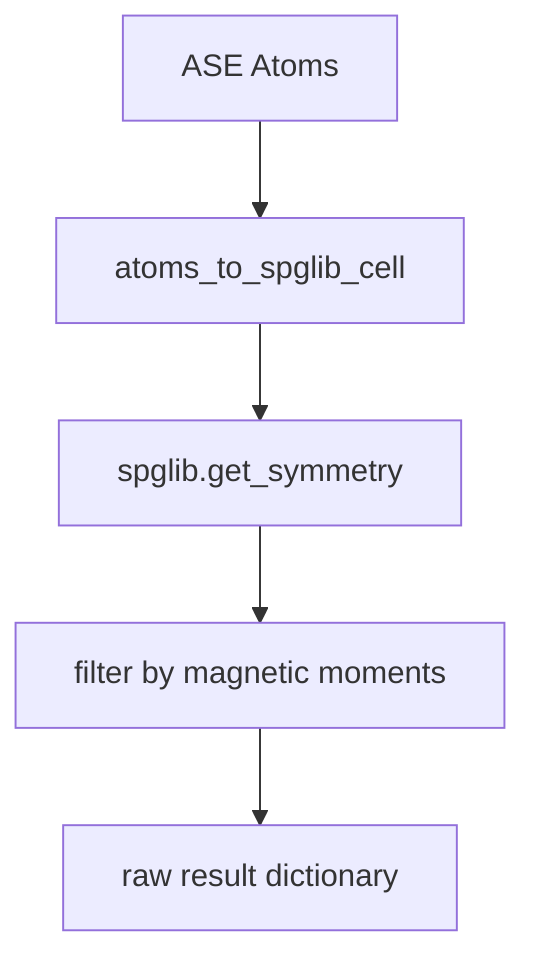

# ASE spglib Backend

## Overview

`magsym` now has a minimal ASE/raw-spglib backend. Users can pass an ASE `Atoms` object directly to `find_magnetic_symmetry`, which calls `spglib.get_symmetry` and filters the returned rotations/translations by magnetic moment preservation. Legacy wrapper modules were removed because the package is new and does not need backward compatibility layers.

## Principles

- ASE `Atoms` is the user-facing structure representation.
- `spglib` performs crystallographic symmetry operation generation.
- `magsym` only converts ASE data and filters magnetic moments.
- The result is a plain dictionary with raw spglib-style arrays rather than wrapper classes.
- No custom `Lattice`, `Site`, `CrystalStructure`, or `SymmetryOperation` public API is kept.

## Details

The complete public API is `atoms_to_spglib_cell(atoms)` and `find_magnetic_symmetry(atoms, magmoms=None, symprec=1e-5, spin_tolerance=1e-6, angle_tolerance=-1.0, include_time_reversal=True)`.

Magnetic moments are read from `atoms.get_initial_magnetic_moments()` if `magmoms` is not supplied. Collinear scalar moments are interpreted as moments along `z`. Explicit `magmoms` may also be provided as an `(N, 3)` array.

## Variables

The following variables are used in this note (see [[notation]] for full definitions):

| Symbol | Description | Units |
|--------|-------------|-------|
| `Fe2O3` | alpha-Fe2O3 hematite. | dimensionless |

## Equations

Spin filtering uses the axial spin-vector transformation convention documented in [[core_api]]:

$$
\mathbf{s}' = \det(R) R \mathbf{s}
$$

## Workflow

## Conventions

- Use `source /home/hexu/projects/myenvs/mydev/bin/activate` before Python commands in non-interactive shells.
- Use `uv pip` for dependency management in `mydev`.
- Runtime dependencies are `ase`, `numpy`, and `spglib`.
- Legacy wrapper code and alpha-Fe2O3 material-specific classifier code were removed from the package baseline.

## Linked Concepts
- [[core_api]]: Earlier wrapper-based operation-level API.
- [[notation]]: Standard project notation.
