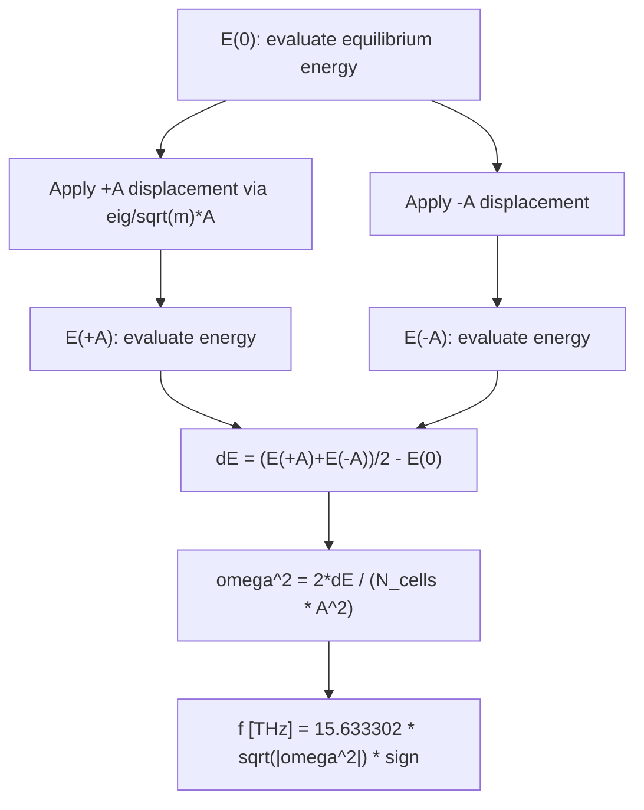

# Energy Finite-Difference Frequency Method

---
confidence: 0.95
created: 2026-03-01
last_validated: 2026-03-01
validation_procedure: "Run `.tmp/test_frequency_fd.py` against BaTiO3 — all modes must match Phonopy reference to <1e-6 THz."
project: phononkit
status: validated
validated_by: automatic
tags: [phonon, finite-difference, frequency, energy, supercell]
---

## Overview

This note describes how phononkit extracts phonon mode frequencies directly
from potential energy evaluations using a central finite-difference (FD) scheme.
The method uses only energy calls (no force projection), making it simple to
interface with any [[ASE]]-compatible calculator.

The implementation lives in
`phononkit/phononkit/displacements/frequency_fd.py`,
function `calculate_mode_frequency_fd`.

## Principles

- **Energy only**: Three energy evaluations ($E(0)$, $E(+A)$, $E(-A)$) are
  sufficient to extract $\omega_m^2$ from the curvature of the harmonic
  potential. No force projection is required.
- **Central symmetry**: Using $+A$ and $-A$ cancels odd-order anharmonic
  contributions, so the result is second-order accurate in $A$.
- **Supercell normalisation**: The calculator reports the total supercell
  energy. Dividing by $N_\text{cells}$ recovers the per-unit-cell quantity
  needed for the formula.
- **Sign convention**: $\omega^2 < 0$ (unstable mode) yields a negative
  frequency, matching Phonopy's imaginary-mode convention.

## Details

### Amplitude definition

The parameter `amplitude` ($A$) is the **normal-mode coordinate** in units of
**Å·√AMU**. It is *not* a plain Cartesian displacement in Å.

The actual Cartesian displacement applied to atom $j$ along direction $\alpha$ is:

$$
u_{j,\alpha} = \frac{e_{m,j,\alpha}}{\sqrt{m_j}} \, A
$$

Phonopy eigenvectors satisfy $\sum_j |e_{m,j}|^2 = 1$ (not the mass-weighted
normalisation $\sum_j m_j |e_{m,j}|^2 = 1$). This means $A$ is directly the
normal-mode coordinate amplitude $q_m$ *in Phonopy's convention*.

The default $A = 0.01\,\text{Å·√AMU}$ produces Cartesian displacements of
order $10^{-3}$–$10^{-2}$ Å — well within the harmonic regime for most
materials.

### Supercell energy and N_cells normalisation

For a harmonic crystal, displacing every replica of the unit cell by $+A$
along mode $m$ raises the energy of each cell by $\tfrac{1}{2}\omega_m^2 A^2$.
The total supercell energy is therefore:

$$
E_\text{supercell}(\pm A) = E_0 + N_\text{cells} \cdot \tfrac{1}{2}\,\omega_m^2\,A^2
$$

Rearranging gives the key formula (see [[#Equations]]).

### Unit conversion

$\omega^2$ computed in eV/(Ų·AMU) is converted to THz using the Phonopy
constant $15.633302$, which equals
$\sqrt{\text{eV}/(\text{Å}^2 \cdot \text{AMU})} / (2\pi) \times 10^{-12}\,\text{s}$.

## Variables

See [[notation]] for the master symbol table. Variables used here:

| Symbol | Description | Units |
|--------|-------------|-------|
| $A$ | Mode displacement amplitude (normal-mode coordinate) | Å·√AMU |
| $e_{m,j,\alpha}$ | Eigenvector component (Phonopy norm: $\sum\lvert e\rvert^2=1$) | dimensionless |
| $m_j$ | Atomic mass | AMU |
| $u_{j,\alpha}$ | Cartesian displacement of atom $j$ | Å |
| $E$ | Supercell potential energy | eV |
| $\Delta E$ | Symmetrised energy rise $[E(+A)+E(-A)]/2 - E(0)$ | eV |
| $N_\text{cells}$ | Number of primitive cells in supercell | dimensionless |
| $\omega_m$ | Mode angular frequency | rad/s (reported in THz) |

## Equations

**Harmonic potential** (per unit cell):

$$
V(q_m) = \frac{1}{2}\,\omega_m^2\,q_m^2 \tag{1}
$$

**Cartesian displacement** from normal-mode coordinate $A$:

$$
u_{j,\alpha} = \frac{e_{m,j,\alpha}}{\sqrt{m_j}}\,A \tag{2}
$$

**Symmetrised energy rise** (supercell):

$$
\Delta E = \frac{E(+A) + E(-A)}{2} - E(0) = N_\text{cells} \cdot \frac{1}{2}\,\omega_m^2\,A^2 \tag{3}
$$

**Frequency extraction**:

$$
\omega_m^2 = \frac{2\,\Delta E}{N_\text{cells}\cdot A^2} \tag{4}
$$

**Unit conversion**:

$$
f_m\,[\text{THz}] = 15.633302 \times \sqrt{\omega_m^2\,[\text{eV}/(\text{Å}^2\cdot\text{AMU})]} \tag{5}
$$

If $\omega_m^2 < 0$ (unstable mode): $f_m = -15.633302\times\sqrt{-\omega_m^2}$.

## Workflow

## Conventions

- **Amplitude default**: `amplitude=0.01` Å·√AMU. Increase if energies are too
  noisy; decrease if anharmonic effects are suspected.
- **Primitive cell vs supercell**: When `supercell=None`, $N_\text{cells}=1$
  and the primitive cell is displaced directly.
- **Imaginary modes**: Returned as negative THz values, e.g. $-6.05$ THz
  means a $6.05i$ THz imaginary mode.

## Linked Concepts

- [[normal_mode_coordinate]]: Why $q_m$ carries units Å·√AMU and why it gives a clean harmonic energy formula.
- [[notation]]: Master symbol table for all phononkit notes.
