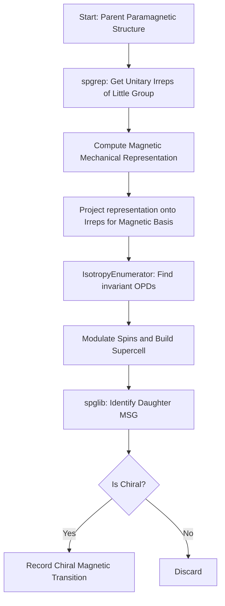

# Magnetic Chiral Phase Transitions

---
confidence: 0.95
created: 2026-02-27 11:38:55
last_validated: 2026-02-27 11:38:55
validation_procedure: "Review against magnetic_transitions.py and scripts/generate_magnetic_class_ii.py"
project: symphon
status: validated
validated_by: automatic
tags: [magnetic, chiral, spgrep, spglib]
---

## Overview
This note describes the implementation pipeline for discovering spin-driven chiral phase transitions. It extends the structural (phonon/displacement) pipeline to handle magnetic structures, moving from an achiral paramagnetic parent (gray group) to a chiral magnetic space group (MSG) driven by the ordering of magnetic moments.

## Principles
This concept follows these key principles:
- **Axial Vectors**: Magnetic moments transform as axial vectors (pseudovectors). They are invariant under spatial inversion but flip under time-reversal, unlike structural displacements (polar vectors).
- **Magnetic Space Groups (MSGs)**: The resulting daughter phase is described by an MSG. A chiral MSG contains only proper rotations (determinant +1); no improper rotations, roto-inversions, reflections, or time-reversed improper rotations.
- **Symmetry Breaking via OPDs**: Complex Order Parameter Directions (OPDs) modulate the magnetic basis vectors across a supercell, breaking the parent symmetry to yield a daughter MSG.

## Details

The core logic is implemented in the `MagneticTransitionFinder` class within `magnetic_transitions.py`. The pipeline consists of four main steps:

### 1. Magnetic Mechanical Representation
Unlike phonons where displacements transform as polar vectors, spins transform as axial vectors. The magnetic mechanical representation matrix for a given symmetry operation $(R|t)$ and atom mapping $j \rightarrow k$ is constructed manually:
- The base transformation for a spin is `np.linalg.det(R) * R` (because spins are axial).
- A phase factor $\exp(-2\pi i \mathbf{q} \cdot \Delta\mathbf{t})$ is applied if the operation translates the mapped atom into a different unit cell relative to the original position.
- Time-reversal operation is not explicitly included in the spatial transformations but is inherently broken by the appearance of static magnetic moments.

### 2. Irrep Projection & Basis Generation
The mechanical representation is projected onto the unitary irreducible representations (irreps) of the little group, provided by `spgrep.get_spacegroup_irreps()`.
By calculating the trace (character) of each irrep matrix and taking the weighted sum over the little group operations:
$$ P = \frac{d}{|G_k|} \sum_{g \in G_k} \chi^{(\alpha)}(g)^* \Gamma_{mag}(g) $$
where $d$ is the irrep dimension, $|G_k|$ is the little group order. The resulting projection matrix $P$ is decomposed via Singular Value Decomposition (SVD) to extract orthogonal, symmetry-adapted magnetic basis vectors.

### 3. OPD Application and Supercell Generation
The unitary irrep matrices are passed directly to `spgrep_modulation.isotropy.IsotropyEnumerator` to generate invariant OPDs.
These OPDs (often complex) are multiplied with the magnetic basis vectors to compute the base spin configuration for the magnetic sites in the parent cell.
A commensurate supercell is built based on the $\mathbf{q}$-point's denominator. For each atom in the supercell at translation $\mathbf{t}_{vec}$, its magnetic moment is modulated as:
$$ \mathbf{S} = 2 \text{Re}\left( \mathbf{M}_{base} \exp(2\pi i \mathbf{q} \cdot \mathbf{t}_{vec}) \right) $$

### 4. MSG Identification and Chirality Check
The generated supercell and modulated magnetic moments are passed to `spglib.get_magnetic_symmetry_dataset()`.
- The symmetry dataset returns the `uni_number` (UNI symbol) and BNS number of the MSG.
- Chirality is confirmed by verifying that all symmetry operations in the daughter MSG have `np.linalg.det(R) > 0` (i.e., only proper rotations exist).

## Variables
The following variables are used in this note (see [[notation]] for full definitions):

| Symbol | Description | Units |
|--------|-------------|-------|
| `R` | Rotation matrix of a symmetry operation | N/A |
| `t` | Translation vector of a symmetry operation | Fractional |
| `q` | Reciprocal space wavevector | Fractional |
| `S` | Modulated magnetic moment (spin) | N/A |
| `M_{base}` | Base complex magnetic moment from basis * OPD | N/A |

## Equations
The transformation of a magnetic moment $\mathbf{S}$ under a spatial symmetry operation $R$ is given by:

$$
\mathbf{S}' = \det(R) R \mathbf{S}
$$

The projection operator onto an irrep $\alpha$ is:

$$
P^{(\alpha)} = \frac{d_\alpha}{|G_k|} \sum_{g \in G_k} \chi^{(\alpha)}(g)^* \Gamma_{mag}(g)
$$

## Workflow
The following diagram shows the workflow for this process:

## Conventions
When implementing this concept, follow these conventions:
- **Separation of Concerns**: Keep magnetic logic (`magnetic_transitions.py`) strictly isolated from the structural logic to avoid breaking existing phonon workflows.
- **Complex OPDs**: OPDs must be kept as complex numbers throughout the `IsotropyEnumerator` and supercell modulation phases to properly encode spiral spin waves and handedness. Wait until the final structural modulation to take the real part.
- **Cache Atomic Saves**: When running batch scripts across all space groups, write output to a `.tmp` file and rename it to prevent JSON corruption on interruptions.

## Linked Concepts
- [[chiral_transition_theory]]: Core theory regarding isotropy subgroups and Landau theory.
- [[spglib_usage]]: Details on how `spglib` detects space groups (extended to MSGs).
- [[notation]]: Standard variable notations used in this note.
