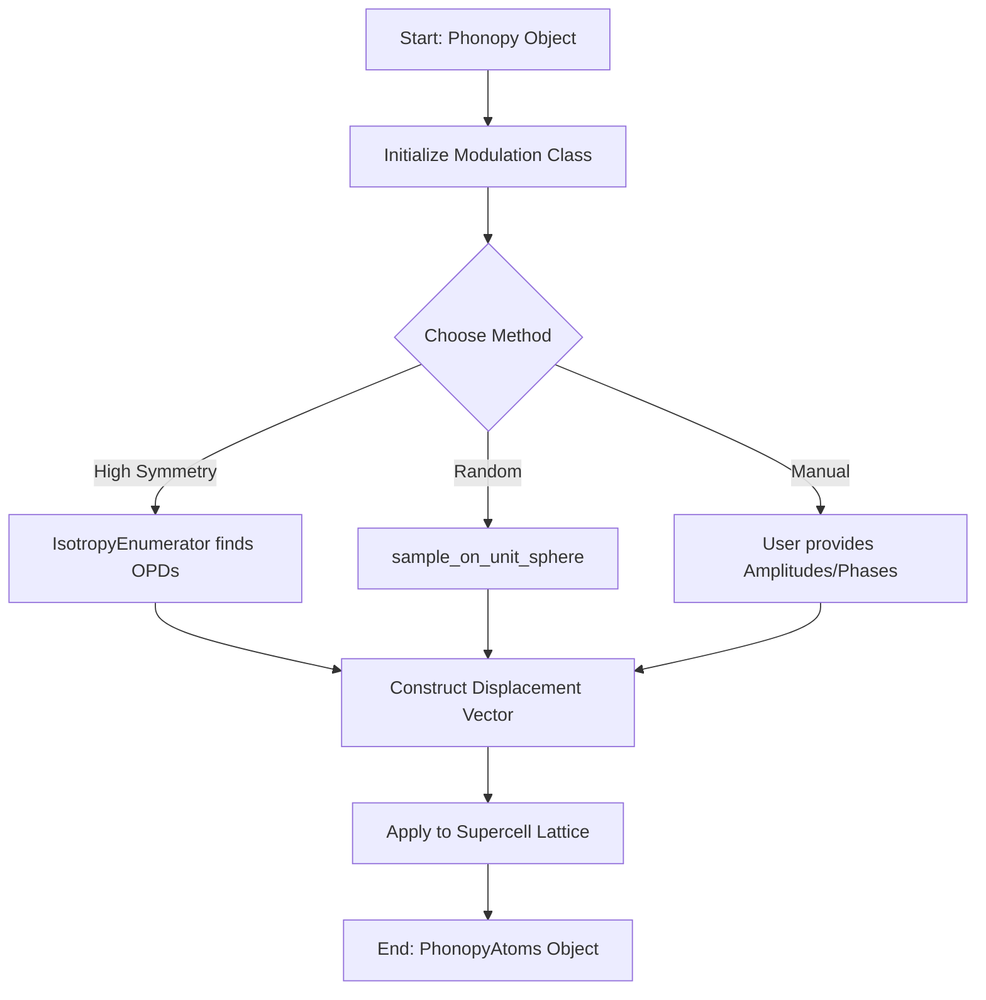

# Spgrep-Modulation Methods

---
confidence: 0.9
created: 2026-03-14
last_validated: 2026-03-14
validation_procedure: "Source code review of spgrep_modulation/modulation.py and spgrep_modulation/irreps.py"
project: symphon
status: validated
validated_by: automatic
tags: [spgrep, modulation, symmetry, phonons]
---

## Overview
This note describes the core methods provided by the `spgrep-modulation` package for generating crystal distortions (modulations) based on phonon eigenmodes. These methods handle both non-degenerate and degenerate modes, using group-theoretical analysis to identify high-symmetry distortions.

## Principles
The modulation process follows these key principles:
- **Commensurability**: Modulations are defined at a specific wavevector $\mathbf{q}$ that must be commensurate with the chosen supercell.
- **Irrep Decomposition**: Phonon modes are classified by the irreducible representations (irreps) of the parent space group.
- **Order Parameter Directions (OPD)**: Distortions are constructed as linear combinations of basis vectors within an irrep space, where the combination coefficients define the order parameter.

## Details
The `spgrep_modulation.modulation.Modulation` class is the main entry point for generating distorted structures.

### Manual Modulation
The method `get_modulated_supercell_and_modulation(frequency_index, amplitudes, arguments)` allows for explicit construction of a modulation. It takes a list of `amplitudes` $a_\lambda$ and `arguments` (phases) $\phi_\lambda$ for each basis vector $\lambda$ in the degenerate subspace.

### High-Symmetry Modulation
The method `get_high_symmetry_modulated_supercells(frequency_index, maximal_displacement)` uses the `IsotropyEnumerator` to find "special" directions in the representation space. These directions (OPDs) maximize the stabilizer group of the distortion, often leading to structures with higher symmetry than a random distortion. It typically returns 1D subspaces where the relative phase and amplitude of the components are fixed by symmetry.

### Random Sampling
The method `get_modulated_supercells(frequency_index, maximal_displacement, max_size)` allows for exploring the full order parameter space by randomly sampling directions on a unit sphere. This is useful for finding general-symmetry distortions or for statistical sampling of the energy landscape. It uses the `sample_on_unit_sphere` utility.

### Representation Projection
The lower-level function `project_eigenmode_representation` decomposes the representation of the little group $G_{\mathbf{q}}$ acting on the phonon displacement space into its constituent irreps. This provides the basis vectors $\mathbf{e}(\kappa; \mathbf{q}\alpha s \lambda)$ used by the other methods.

## Variables
The following variables are used in this note (see [[notation]] for full definitions):

| Symbol | Description | Units |
|--------|-------------|-------|
| $\mathbf{q}$ | Wavevector (q-point) | Reciprocal Lattice Units |
| $a_\lambda$ | Amplitude of the $\lambda$-th mode | Dimensionless (normalized) |
| $\phi_\lambda$ | Phase (argument) of the $\lambda$-th mode | Radians |
| $\mathbf{u}(\kappa; \mathbf{q})$ | Displacement of atom $\kappa$ | Å or Bohr |
| $M_\kappa$ | Mass of atom $\kappa$ | amu |

## Equations
The total displacement field $\mathbf{u}(\kappa, \mathbf{l})$ in a supercell for a set of order parameters $\{\eta_\lambda = a_\lambda e^{i\phi_\lambda}\}$ is given by:

$$
\mathbf{u}(\kappa, \mathbf{l}) = \text{Re} \left[ \sum_{\lambda} a_\lambda e^{i\phi_\lambda} \frac{\mathbf{e}(\kappa; \mathbf{q}\lambda)}{\sqrt{M_\kappa}} e^{i\mathbf{q}\cdot\mathbf{R}_l} \right]
$$

where $\mathbf{R}_l$ is the lattice vector of the $l$-th unit cell in the supercell.

## Workflow
The flowchart below illustrates the generation of a modulated supercell:

## Conventions
When implementing these methods:
- **Phase Choice**: The basis vectors are chosen to be consistent with Phonopy's dynamical matrix definition.
- **Normalization**: Modulations are typically scaled by `maximal_displacement` to ensure physical realism.

## Linked Concepts
- [[notation]]: Standard variable notations used in this note
- [[spgrep_usage]]: General usage of the spgrep package
- [[chiral_transition_theory]]: Theoretical background for chiral transitions
