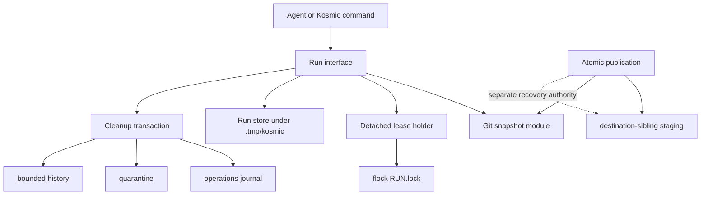

# Feature Architecture: Managed Run Workspaces

A new `kosmic_runs.py` module owns the managed-run lifecycle behind five cohesive operations: begin, finish, extend failed retention, promote a durable file, and report or collect runs. The module resolves one worktree-local root, records Git state, owns a detached lease-holder process, applies retention, and journals mutations. Callers never construct scratch paths, parse manifests, manipulate locks, or delete run trees.




The selected interface combines the minimal design's small surface with the supervised-process design's only viable cross-call lease: one detached holder per active run. Capability-only authority is rejected because persistent data cannot provide liveness; without a live holder, cleanup falls back to timestamps or PIDs as lease authority.

The feature remains Linux/Unix-local in its destructive mode. `fcntl.flock` is advisory and tied to an open file description; a holder process is required because independent agent tool calls do not share file descriptors. Network filesystems and restricted environments that cannot launch the holder fail closed.

## Architectural Decisions

### AD-MRW1: One deep Run Workspace module

**Status**: Proposed

**Context**: Temporary-path selection, Git capture, leases, manifests, retention, cleanup, and reporting are currently scattered. Exposing each mechanic would create a shallow interface and reproduce policy in callers.

**Decision**: Add `skills/scripts/kosmic_runs.py` as the sole implementation module. Its library interface is:

```python
@dataclass(frozen=True)
class RunHandle:
    run_id: str
    path: Path
    handle_file: Path
    state: str

@dataclass(frozen=True)
class RunReceipt:
    run_id: str
    state: str
    path: Path | None
    expires_at: datetime | None
    git_start_sha256: str
    git_finish_sha256: str | None
    code: str

@dataclass(frozen=True)
class PromotionReceipt:
    run_id: str
    source_sha256: str
    destination: Path
    destination_sha256: str
    git_before_sha256: str
    git_after_sha256: str
    code: str

@dataclass(frozen=True)
class RunEntry:
    run_id: str | None
    category: Literal["active", "retained", "expired", "abandoned", "oversized", "malformed", "unattributed"]
    state: str | None
    path: Path
    bytes: int
    expires_at: datetime | None
    report_only_reason: str | None

@dataclass(frozen=True)
class RunReport:
    entries: tuple[RunEntry, ...]
    counts: Mapping[str, int]
    total_bytes: int
    selected_bytes: int
    action: str
    code: str

begin_run(worktree: Path, purpose: str, retention: str = "diagnostic", active_for: timedelta = timedelta(hours=24)) -> RunHandle
finish_run(handle_file: Path, outcome: Literal["succeeded", "failed"], detail: str = "") -> RunReceipt
extend_run(handle_file: Path, until: datetime) -> RunReceipt
promote_file(handle_file: Path, source: PurePath, destination: Path, overwrite: bool = False) -> PromotionReceipt
report_runs(worktree: Path, action: Literal["status", "gc-dry-run", "gc-apply"], run_id: str | None = None) -> RunReport
```

`begin_run` completes only after contained directories, start Git snapshot, manifest, private handle file, detached holder, control socket, and observed lock are valid. `finish_run` completes only after authenticated quiescing, holder release, exclusive lock acquisition, terminal Git snapshot, state transition, durable receipt publication, and required cleanup or expiry. `extend_run` completes only after a failed diagnostic run receives a capped idempotent expiry transition. `promote_file` completes only after contained-source validation, no-overwrite publication, hash equality, before/after Git capture, and a durable receipt. `report_runs` completes only after every immediate managed entry is classified and byte-accounted; destructive mode additionally requires one committed cleanup receipt per selected run.

CLI verbs remain explicit for agents:

```text
scratch begin
scratch succeed
scratch fail
scratch extend
scratch promote
scratch status
scratch gc --dry-run
scratch gc --apply
```

The CLI is an adapter over the library operations, not a second implementation.

**Consequences**: Callers learn one leading concept and five cohesive operations; lock, path, manifest, Git, and mutation protocols remain hidden. Tests cross the same interface. Internal schemas may evolve without changing every command.

**Alternatives considered**: expose manifest/lock/path helpers (rejected: shallow and misuse-prone); one method per lifecycle detail (rejected: large interface); capability-only lease (rejected: no liveness); one global daemon (rejected: unrelated run failure and deployment complexity become shared).

### AD-MRW2: One worktree-local root and no temporary defaults

**Status**: Proposed

**Context**: Python defaults reach `/tmp`; agents also choose arbitrary root and `.tmp` paths. The user requires rational worktree-local placement and no `/tmp` or `/dev/shm`.
**Decision**: `resolve_run_root(worktree)` validates `git rev-parse --show-toplevel`, opens the Git top-level as a trusted directory file descriptor, and walks or creates `.tmp/kosmic/{runs,quarantine,operations,handles}` relative to retained directory descriptors. Every component is opened with `O_DIRECTORY|O_NOFOLLOW|O_CLOEXEC`, then checked with `fstat` for directory type, current UID, required private mode, and device. Any symlink, wrong owner/mode, non-directory, or unexpected device fails closed. Non-Git input returns `NO_GIT_WORKTREE`.

The resolver verifies that worktree-root ignore rules exclude `.tmp/`. Every ordinary temporary directory and Git temporary index receives an explicit directory below the active run. No implementation reads `TMPDIR`, `TEMP`, or platform defaults. All lock, manifest, operation, handle, quarantine, rename, and removal operations are descriptor-relative to the verified root; stored absolute paths are diagnostic only.

Run IDs are `<UTC basic timestamp>-<sanitized slug>-<128-bit random hex prefix>`. Roots and runs use mode `0700`; control and handle files use `0600`.

Destination-sibling atomic writes and tree publication are the only exceptions. They retain destination-relative staging because `os.replace` and `os.rename` require same-filesystem placement.

**Consequences**: Scratch location is predictable and isolated per linked worktree. Removing a worktree removes its ignored scratch. Tools cannot silently spill to system temporary storage.

**Alternatives considered**: XDG state (rejected: detached from worktree and persistent by default); `/tmp` or `/dev/shm` (rejected by user and lifecycle goals); configurable precedence matrix (rejected: restores randomness); shared root across worktrees (rejected: ownership collisions).

### AD-MRW3: Detached holder plus `fcntl.flock` is the cross-call lease

**Status**: Proposed

**Context**: A real lease must span independent tool-call processes. A PID, token, timestamp, or manifest state is persistent data, not a liveness-coupled lease.

**Decision**: `begin_run` launches a bounded double-fork holder with a new session, detached from inherited terminals and standard streams. The intermediate process reports spawn failure; the final holder opens the existing `RUN.lock`, acquires `fcntl.flock(fd, LOCK_EX|LOCK_NB)`, binds a private Unix-domain control socket below the run, and sends readiness through the inherited pipe. The parent returns only after readiness and a second non-blocking lock probe confirm survival beyond the spawning process.

Later calls pass only a private handle-file path. The file contains the run ID and opaque token, is opened relative to the verified `handles/` descriptor with no-follow and owner/mode checks, and never appears in JSON output, argv values, logs, or diagnostics except as a path. The holder accepts one canonical length-bounded JSON request per Unix-socket connection, requires `SO_PEERCRED` UID equality, compares the supplied token with `hmac.compare_digest`, writes one acknowledgement, and closes the connection. Same-UID access remains the trust boundary; the token prevents accidental cross-run finalization, not a malicious process running as the same user.

On authenticated finish, the holder atomically changes `active` to internal `finalizing` while retaining the lock, stops accepting work, acknowledges the outcome, closes the socket, and exits. `finish_run` then acquires the same lock, revalidates `finalizing`, captures terminal Git state, and commits `succeeded` or `failed`. If the caller dies, recovery completes the persisted requested outcome under the free lock.

The default active lifetime is 24 hours and `begin_run(active_for=...)` exposes values up to seven days. At expiry, the holder atomically changes `active` to `abandoned` while still holding the lock, closes the socket, and releases. An unexpected holder crash may leave `active` unlocked; status labels it `abandoned-candidate`, and a collector may transition it to `abandoned` only after the 24-hour grace while holding the lock. Thus no intentionally unlocked run remains `active`.

While the lock is held, status obtains authoritative live state from the holder socket. If the socket is unreachable while the lock remains held, it reports `LIVE_UNREACHABLE` and performs no mutation. With a free lock, status acquires it and reads canonical on-disk state. Holder spawn/readiness failure, unsupported `fcntl`, non-local filesystem, or ambiguous locking rolls back creation without returning a handle. The actual physical cleanup bound after an unexpected crash is eligibility plus the next status/startup/GC pass; no system daemon is claimed.

**Consequences**: Kernel close-on-crash behavior releases leases without PID-reuse risk. One lightweight, session-detached process exists per active run. Sandboxes that kill detached descendants cannot satisfy begin's survival check and fail closed. The manifest is the sole run-state truth; no parallel run journal exists.

**Alternatives considered**: `lockf` (no advantage and weaker portability); heartbeat/PID (race-prone and forbidden as authority); token-only capability (no liveness); `flock(1)` (external dependency); global daemon (larger failure domain).

### AD-MRW4: Versioned manifests and monotonic transitions

**Status**: Proposed

**Context**: Crashes can interrupt creation, finalization, or retention changes. Directory timestamps cannot establish valid state.

**Decision**: `RUN.json` is canonical versioned JSON written by `atomic_replace`: write a same-parent temporary file, flush and `fsync` it, `os.replace` it, then `fsync` the parent directory. Creation additionally synchronizes the new run directory and `runs/` parent. Any required `fsync` failure aborts mutation; destructive mode is unavailable on filesystems that reject directory synchronization.

Schema v1 contains identity, purpose, worktree metadata, state, retention, times, holder diagnostics, token hash, Git snapshot hashes, requested terminal outcome, and transition sequence. The manifest is the sole run-state authority.

Transitions are compare-before-write and monotonic:

```text
creating -> active -> finalizing -> succeeded | failed
active -> abandoned
active + unexpected unlocked grace -> abandoned
failed + diagnostic -> failed + extended-diagnostic
```

`creating` is never returned as a successful begin. Unknown schemas and invalid transitions are report-only. Before deleting a terminal run, `finish_run` atomically rewrites the private handle file as a bounded terminal receipt retained for thirty days. Repeated finish through that handle returns the receipt; a conflicting outcome fails with `RUN_ALREADY_FINALIZED`. Receipt lookup survives process restart and run deletion.

**Consequences**: Recovery can distinguish partial creation from an active lease and can retry terminal operations without changing outcomes.

**Alternatives considered**: infer state from files (rejected: ambiguous); append-only manifest (rejected: expensive full replay for every command); SQLite (rejected: unnecessary shared database and recovery surface).

### AD-MRW5: Git snapshots are evidence, not ownership

**Status**: Proposed

**Context**: Every run and mutation must record related Git status, but concurrent work makes temporal deltas insufficient for ownership.

**Decision**: A private `GitSnapshot` implementation captures HEAD, branch, top-level, common Git directory, and `git status --porcelain=v2 --branch --untracked-files=all -z`. It stores raw bytes inside retained runs and a parsed canonical summary plus SHA-256 in manifests, operation records, handle receipts, and bounded history. The parser implements documented porcelain-v2 NUL records and rejects unknown record types.

Each begin, finish, cleanup, extension, and durable promotion uses the required snapshot boundary. Cleanup history commits only after post-removal capture. Interrupted finalization records `snapshot_complete: false`; recovery adds a distinct recovery snapshot. Git failure prevents destructive mutation. While a run is active, status is served by the holder; otherwise readers acquire the run lock before combining manifest and snapshot state.

The lifecycle module never automatically records ambient environment variables, subprocess argv, stdout, or stderr. `logs/` is caller-populated scratch governed by the run retention class. Lifecycle JSON, diagnostics, manifests, receipts, and history redact token values and known credential-shaped fields; tests seed representative secrets and require their absence. Any future command-output capture requires a separately reviewed allowlist/redaction contract.
The parser follows porcelain-v2 NUL grammar and treats unknown records as an error. Pre-existing and newly observed paths are classifications only. Positive ownership comes from the managed run allocation or reviewed durable publication.

**Consequences**: Reviewers can relate run actions to the worktree without threatening user changes. Status capture has cost proportional to the worktree's reported state.

**Alternatives considered**: human status output (rejected: unstable); store full diffs (rejected: sensitive and heavy); use Git delta as ownership (rejected: concurrent data-loss risk); capture only at completion (rejected: no baseline).

### AD-MRW6: Whole-run retention and owner-driven finalization

**Status**: Proposed

**Context**: Per-file retention multiplies states and leaves partial debris. Successful scratch should disappear immediately, while failed diagnostics need bounded recovery time.

**Decision**: Retention is selected at begin and applied to the whole run. Omitted means `diagnostic`; unknown values fail. `diagnostic` deletes on success and retains failure for 72 hours. `disposable` deletes either terminal outcome. A failed diagnostic may be extended once or repeatedly, but never beyond seven days from failure.

Owner-driven cleanup during `finish_run` uses the same journaled transaction as GC and is available in the initial release. General `gc --apply` remains disabled until the destructive-cleanup release gate passes.

**Consequences**: Every run has one answer to “when may it disappear?” A retained failure includes exact expiry in its receipt.

**Alternatives considered**: per-artifact TTL (rejected: complexity without current use); retain every failure seven days (rejected: unnecessary disk use); delete every failure (rejected: loses reproducer evidence); mtime-based expiry (rejected: unrelated writes extend lifetime).

### AD-MRW7: Cleanup is a journaled quarantine transaction

**Status**: Proposed

**Context**: A crash between rename, deletion, post-Git capture, and history append can strand state or record a false result.

**Decision**: Each cleanup owns `.tmp/kosmic/operations/<operation-id>.json` with monotonic states `planned`, `quarantined`, `deleted`, `recorded`. All paths are operated relative to verified directory file descriptors from AD-MRW2. The transaction:

1. validates an immediate non-symlink run child, schema, ownership, permissions, expiry, and device using no-follow descriptor-relative opens;
2. captures pre-cleanup Git state; writes and synchronizes `planned` with `atomic_replace`;
3. acquires the existing run lock non-blockingly and revalidates;
4. uses descriptor-relative `os.rename` into a unique nonexistent quarantine child, then `fsync`s both `runs/` and `quarantine/` directories before recording `quarantined`;
5. requires `shutil.rmtree.avoids_symlink_attacks is True`, revalidates the immediate child with `lstat`, and invokes `shutil.rmtree(child, dir_fd=quarantine_fd)`; otherwise destructive cleanup is disabled. It then `fsync`s `quarantine/` before recording `deleted`;
6. captures post-cleanup Git state, appends and `fsync`s bounded history, synchronizes any rotation replacement and parent directory, then records `recorded`.

Every operation-state replacement synchronizes its file and `operations/` parent. Failure of required file or directory `fsync` leaves the prior durable state and aborts; read-only reporting remains available. `EXDEV` and unexpected `st_dev` fail closed; `EBUSY` is retryable without state advancement.

Recovery inspects operation records before ordinary runs. Source present/quarantine absent retries quarantine; source absent/quarantine present resumes deletion; both absent records observed deletion and captures recovery Git state; both present is a conflict and report-only. Missing or invalid operation records and unexpected quarantine children are report-only.

`history.jsonl` rotates through a synchronized same-parent temporary file and atomic replacement at 10 MiB; records older than thirty days are omitted during rotation. Operation records and private handle receipts remain until history commit succeeds; receipts expire after thirty days.

**Consequences**: Cleanup is idempotent, descriptor-anchored, and auditable across crashes. Destructive activation requires a platform where no-follow directory operations, directory `fsync`, and symlink-resistant `rmtree` are all available.

**Alternatives considered**: direct `rmtree` (rejected: race and no recovery); history-before-delete (rejected: records unobserved success); global transaction database (rejected: unnecessary shared failure domain).

### AD-MRW8: Atomic publication has separate recovery authority

**Status**: Proposed

**Context**: Publication staging must be destination-adjacent and may live outside `.tmp/kosmic`. A run manifest must not authorize deletion there, yet SIGKILL can bypass `finally` cleanup.

**Decision**: Extend the existing `publish_tree` seam to own reserved sibling stage/backup names and a versioned marker containing operation ID, destination identity, source Git snapshot hash, phase, and creation/expiry timestamps. Normal `finally` remains the primary cleanup.

A publication recovery operation scans only a caller-supplied destination and its reserved exact-name candidates. It acquires a destination-specific sibling lock, validates the marker and old/new canonical state, and selects restore, finish, or retire. It never performs general glob deletion. Recovery must prove exactly one valid canonical tree before removing any backup. Abandoned candidates have a 24-hour grace and seven-day maximum retention; unresolved ambiguity is report-only.

Publication records related source-worktree Git status before and after recovery. Install destinations outside the Git worktree still use the source worktree's snapshot.

**Consequences**: All temporary artifacts receive bounded ownership without broadening general GC. Atomic publication remains one authority.

**Alternatives considered**: move staging under `.tmp` (rejected: possible `EXDEV`); general-run GC for siblings (rejected: excessive deletion authority); rely only on `finally` (rejected: crash leaks).

### AD-MRW9: Exhaustive migration and skill clean cutover

**Status**: Proposed

**Context**: Partial migration leaves hidden `/tmp` callers and duplicate prose. Research found fourteen production temporary call sites: two default-temp defects, one correct atomic single-file write, and eleven destination-sibling staging sites. No worktree `.tmp/` ignore rule exists. Scratch policy appears in eight skill/document locations.

**Decision**: Check in a versioned migration inventory naming every production caller and policy consumer. Classification is one of `managed-run`, `atomic-single-file`, `atomic-publication`, `durable`, or `defect`; completion permits no unexplained row.

The known default-temp defects—projection validation's `TemporaryDirectory` and provenance's temporary Git index—move below managed runs. Atomic single-file replacement remains sibling-scoped. Every destination-sibling staging caller adopts the publication marker/recovery contract or documents why it is not publication.

Replace the current multi-paragraph scratch policy in `skills/SKILL.md` with one mandatory managed-run step and a pointer to `references/managed_run_lifecycle.md`. Update `skills/README.md`, `task_implement_story.md`, `task_quick_task.md`, `task_create_spec.md`, `task_project_skills.md`, relevant ADR/spec references, and every inventory-discovered consumer in the same cutover. Preserve durable source, Evidence Pack, specification, project-log, and pending-test rules.

**Consequences**: No second scratch convention survives. Future direct `tempfile` use is rejected by a focused source-policy test unless classified as an allowed sibling primitive.

**Alternatives considered**: migrate only known leaks (rejected: unverifiable completeness); retain duplicated summaries (rejected by `writing-great-skills` single-source rule); mechanically move all sibling staging (rejected: breaks atomic replacement).

### AD-MRW10: Staged destructive capability

**Status**: Proposed

**Context**: Read-only status is low-risk; garbage collection and publication recovery can destroy data.

**Decision**: Initial delivery includes run creation/finalization, owner cleanup, status, dry-run GC, exhaustive migration, and report-only abandoned publication detection. `gc --apply`, bounded startup collection, and destructive publication recovery remain disabled behind explicit capability constants until focused acceptance suites pass.

Activation is a clean source cutover, not runtime configuration. The story enabling destructive behavior changes the constants, records the required evidence, runs security review, and removes no safety checks.

**Consequences**: The system begins preventing new leaks before gaining broad cleanup authority. Destructive behavior has a separate evidence boundary.

**Alternatives considered**: ship apply with dry-run (rejected: insufficient operational evidence); permanent feature flag (rejected: dual behavior); external confirmation prompts (rejected: nondeterministic for agents).


### AD-MRW11: Durable promotion is a journaled file publication

**Status**: Proposed

**Context**: Moving a useful result out of a run changes the Git worktree and must not overwrite user material or lose provenance.

**Decision**: `promote_file` accepts a handle file, a run-relative regular-file source, a worktree-relative destination, and `overwrite=False`. It validates both roots through directory descriptors, rejects symlinks and non-regular sources, captures Git before state, hashes the source, copies into a private same-parent destination staging file, synchronizes and re-hashes it, then publishes it. Default publication uses `os.link(stage, destination, src_dir_fd=..., dst_dir_fd=...)` for atomic no-clobber creation; explicit overwrite uses `os.replace` only after recording the prior destination identity. It synchronizes the destination parent, captures Git after state, verifies source/destination hashes, and records a promotion receipt in `operations/` and the handle file before removing staging.

Recovery uses the operation ID, stage identity, destination precondition, and hashes to finish or report ambiguity idempotently. It never removes an unexpected destination. Directory promotion is out of this interface; governed tree publication uses existing `publish_tree`.

**Consequences**: Durable file creation has exact Git evidence and no silent overwrite. One additional public operation earns its place by hiding a high-risk multi-step transaction.

**Alternatives considered**: caller copy/move (rejected: no atomicity or Git evidence); generic arbitrary-path promotion (rejected: excessive authority); always overwrite (rejected: user-data loss).

### AD-MRW12: Reports are complete, bounded classifications

**Status**: Proposed

**Context**: Status and dry-run GC must expose every required category, disk pressure, and report-only reason without requiring callers to parse manifests.

**Decision**: `RunReport` contains one `RunEntry` for every immediate child of `runs/`, every operation/quarantine remnant, and every unattributed immediate child under `.tmp/kosmic`. Categories are `active`, `retained`, `expired`, `abandoned`, `oversized`, `malformed`, and `unattributed`; an entry may include secondary flags so an oversized retained run remains identifiable. Reports include per-category counts, total managed bytes, selected cleanup bytes, configured quota thresholds when present, expiry, stable reason codes, and truncation/error status. Disk usage uses no-follow descriptor traversal and never crosses devices. Any unreadable or unstable subtree becomes report-only rather than disappearing from totals.

**Consequences**: CLI and tests consume one stable result shape. Reporting cost is bounded to the canonical root and explicit entry limits; partial reports state that they are partial.

**Alternatives considered**: prose diagnostics only (rejected: not checkable); expose raw manifests (rejected: shallow interface); omit byte accounting until quotas (rejected: violates current status contract).


## Module Design
```text
skills/scripts/
├── kosmic_runs.py                 # authoritative run lifecycle
├── kosmic_routines.py             # publication transaction/recovery
├── kosmic_project_skills.py       # CLI adapter and existing commands
└── kosmic_shared_library.py       # caller of publication interface

tests/
├── test_kosmic_runs.py
├── test_kosmic_routines.py
└── test_kosmic_project_skills.py
```

Internal seams in `kosmic_runs.py`:

- `RootAnchor`: descriptor-relative, no-follow root traversal and device/owner/mode checks.
- `RunStore`: manifest, handle, operation, receipt, and history atomic writes with required synchronization.
- `RunLease`: detached holder, readiness handshake, Unix control socket, authenticated release, and non-blocking probe.
- `GitSnapshot`: raw capture, strict parser, hashes, and before/after classifications.
- `CleanupTransaction`: validation, quarantine, symlink-resistant removal, recovery, and receipts.
- `PromotionTransaction`: no-clobber file publication, hashing, Git evidence, and recovery.

These are private implementation seams. Tests primarily cross all five public operations; focused internal tests are permitted for fault injection and descriptor-level security invariants that cannot be observed otherwise.

## Data Models

### `RUN.json` schema v1

Required fields:

```json
{
  "schema": 1,
  "sequence": 1,
  "run_id": "20260914T120000Z-validation-a1b2c3d4",
  "project_id": "kosmic",
  "purpose": "validate canonical skill pair",
  "state": "active",
  "retention": "diagnostic",
  "created_at": "2026-09-14T12:00:00Z",
  "finished_at": null,
  "expires_at": "2026-09-15T12:00:00Z",
  "lease_expires_at": "2026-09-15T12:00:00Z",
  "holder_pid": 12345,
  "token_sha256": "<64 lowercase hex>",
  "worktree_root": "/absolute/metadata-only/path",
  "git_common_dir": "/absolute/metadata-only/path",
  "git_start_sha256": "<64 lowercase hex>",
  "git_finish_sha256": null,
  "snapshot_complete": false
}
```

Paths in manifests are diagnostic metadata. Operations derive mutation paths from trusted roots and validated IDs, never from stored absolute paths.

### Private handle/receipt schema v1

Each file under `handles/` has an opaque filename unrelated to a caller-supplied path. While active it stores `schema`, `run_id`, token bytes, owner UID, creation time, and state. It is opened only relative to the verified `handles/` descriptor with no-follow and `0600` checks. At terminal finalization it is atomically rewritten as a receipt containing the token hash, outcome, Git hashes, cleanup result or expiry, and receipt expiry. Raw token bytes never enter argv, stdout JSON, manifests, history, or diagnostics.

### `RunReport` schema v1

The JSON representation contains sorted entry objects with `run_id`, primary `category`, secondary flags, state, display-only relative path, bytes, expiry, stable `report_only_reason`, and eligibility. Top-level fields contain per-category counts, total bytes, selected bytes, configured warning thresholds, action, truncation state, and result code. Required categories are active, retained, expired, abandoned, oversized, malformed, and unattributed.

### Promotion operation schema v1

Promotion operation records add run ID, contained source identity/hash, destination precondition, destination identity/hash, Git before/after hashes, staging identity, overwrite decision, and states `planned -> staged -> published -> recorded`. Recovery never removes or replaces a destination that fails the recorded precondition.

### Cleanup operation schema v1

```json
{
  "schema": 1,
  "operation_id": "<opaque id>",
  "run_id": "<validated id>",
  "state": "planned",
  "git_before_sha256": "<hash>",
  "git_after_sha256": null,
  "result": null,
  "created_at": "<UTC>",
  "updated_at": "<UTC>"
}
```

### Git delta schema v1

Arrays contain normalized worktree-relative paths:

```json
{
  "head_changed": false,
  "pre_existing": [],
  "introduced": [],
  "modified": [],
  "removed": [],
  "renamed": [],
  "unattributed": []
}
```

## CLI Design

```text
kosmic_project_skills.py scratch begin --project <path> --purpose <text> [--retention diagnostic|disposable] [--active-for <duration>]
kosmic_project_skills.py scratch succeed --project <path> --handle-file <path>
kosmic_project_skills.py scratch fail --project <path> --handle-file <path> [--detail <text>]
kosmic_project_skills.py scratch extend --project <path> --handle-file <path> --until <UTC>
kosmic_project_skills.py scratch promote --project <path> --handle-file <path> --source <run-relative-file> --destination <worktree-relative-file> [--overwrite]
kosmic_project_skills.py scratch status --project <path> [--run <id>]
kosmic_project_skills.py scratch gc --project <path> --dry-run
kosmic_project_skills.py scratch gc --project <path> --apply
```

Machine-readable JSON goes to stdout; diagnostics go to stderr; failures use exit code 2. `begin` returns a private handle-file path, never token bytes. Later lifecycle commands accept that path, reopen it through the verified handle root, and reject raw handle/token arguments. Diagnostics redact handle contents. `--apply` is rejected until AD-MRW10 activation.

## Verification Strategy

| Level | Approach | Required coverage |
|---|---|---|
| Module behavior | Temporary Git worktrees with all five public operations | begin readiness, path, permissions, retention default, terminal and persisted receipts, extension, promotion, report categories, idempotency, invalid transitions |
| Root anchoring | Real descriptor-relative filesystem fixtures | symlinked `.tmp`/ancestor/component, wrong owner/mode, mount/device boundary, concurrent component swap, no-follow opens |
| Lease processes | Real subprocesses and `fcntl.flock` | double-fork/session survival after parent exit, held probe, authenticated socket release, crash, SIGKILL, active TTL transition, `LIVE_UNREACHABLE`, token mismatch, concurrent finish |
| Git evidence | Real repositories with spaces, branches, detached HEAD, renames, untracked files, and concurrent changes | strict porcelain-v2 NUL parsing, unknown records, hashes, start/final/recovery pairs, no ownership inference |
| Cleanup transaction | Fault injection after every synchronized mutation | directory-fsync failure, quarantine no-clobber, `EXDEV`, `EBUSY`, nested/top-level symlink swaps, `rmtree.avoids_symlink_attacks`, wrong permissions, competing collectors, each recovery quadrant, history ordering |
| Retention | Frozen private clock | diagnostic/disposable outcomes, explicit post-failure extension, 72-hour expiry, seven-day cap, active TTL terminal transition, 24-hour unexpected-crash grace, boundary instants |
| Promotion | Real contained files and injected crashes | default no-overwrite, explicit overwrite precondition, source/stage/destination hashes, Git failure, recovery ambiguity, exact Git delta, directory rejection |
| Reporting | Mixed valid/malformed/unknown trees with byte fixtures | every required category and secondary flag, disk totals, selected totals, report-only reasons, partial report state, no device crossing |
| Output privacy | Seeded credential/token environment and command data | lifecycle output, manifests, receipts, history, errors, and logs contain no automatically captured secrets or raw token |
| Publication recovery | Existing real publication interface with injected crashes | every stage/backup phase, one-valid-tree invariant, unrelated sibling preservation, source Git snapshots, bounded expiry |
| Migration | Checked-in inventory plus source-policy scanner | all fourteen current call sites classified, two default-temp defects migrated, all policy consumers cut over, no unexplained `tempfile` or scratch-policy use |
| Skill behavior | Fresh-context agent scenarios | one managed-run step selected, lifecycle reference loaded only when needed, completion criterion observed, durable rules preserved |
| End to end | Actual CLI in a temporary linked Git worktree | no `/tmp` or `/dev/shm` artifacts, cross-tool-call holder survival, clean success, retained failure, extension, promotion, interrupted recovery, dry-run then activated apply |
| Security review | Dedicated reviewer before destructive activation | descriptor anchoring, path traversal, symlink swaps, handle confusion, malicious schemas, wrong owner/mode, network filesystem fail-closed |

Tests may set a private clock or failure injector through internal construction, but production callers receive no clock, filesystem, or lock configuration surface.

## Migration Sequence

1. Add the exhaustive caller/policy inventory and a failing source-policy test.
2. Implement contained path resolution, Git snapshots, manifests, and read-only classification.
3. Implement the detached holder, private handle file, Unix control transport, and five-operation run interface.
4. Implement terminal retention and owner-driven journaled cleanup.
5. Migrate the two default-temp defects and all other managed-run classifications.
6. Add atomic-publication markers and report-only abandoned-state detection.
7. Cut over the Kosmic skill and references to one managed-run pointer.
8. Verify the initial-release matrix and review; publish without general destructive GC.
9. Prove cleanup concurrency/recovery/security scenarios and activate `gc --apply` in a later approved story.
10. Prove atomic-publication recovery separately, activate it, then remove any migration-only reporting code.

No compatibility alias or second scratch root remains after cutover.

## Risks and Mitigations

| Risk | Impact | Mitigation |
|---|---|---|
| Detached holder prohibited or killed by environment | High | bounded double-fork/session detach, no inherited PTY/streams, readiness plus survival probe; fail begin cleanly when the runtime kills descendants |
| Holder crashes after begin | High | kernel releases lease; status records an unlocked candidate; physical deletion occurs only after grace and a later status/startup/GC pass |
| Network filesystem changes `flock` behavior | High | destructive behavior requires verified local filesystem semantics; otherwise begin or apply fails closed |
| Handle contents leak or wrong run is finalized | High | token exists only in a no-follow owner-only handle file, travels over the private socket, is redacted everywhere, and remains accident protection within the same-UID trust model |
| Ambient credentials enter retained output | High | lifecycle captures no environment/argv/stdout/stderr; seeded-secret tests cover every owned output; future capture requires separate allowlist/redaction review |
| Git status is expensive in a large dirty worktree | Medium | one bounded command per required boundary; no diff capture; report duration and fail rather than silently skip |
| Symlink or ancestor race escapes cleanup | Critical | trusted root directory FD, no-follow descriptor traversal, owner/mode/device validation, descriptor-relative rename/rmtree, mandatory symlink-resistant platform support |
| Crash after deletion but before history | High | external synchronized operation journal observes absent source/quarantine and records recovery Git result before completion |
| Atomic-stage recovery deletes the only valid tree | Critical | destination-specific lock, marker validation, prove old/new tree validity and one-visible-tree invariant before removal |
| Skill policy remains duplicated | Medium | exhaustive policy inventory and clean-cutover source check |
| Existing user `.tmp` data is mistaken for Kosmic data | Critical | only verified `.tmp/kosmic` entries with module-created schemas are candidates; unknown entries are report-only |

## Dependencies

- Python 3.11+ standard library: `fcntl`, `socket`, `subprocess`, `os`, `pathlib`, `json`, `hmac`, `hashlib`, `secrets`, `datetime`, `shutil`.
- Git executable for worktree resolution and porcelain-v2 status.
- Local filesystem semantics supporting `flock` and same-parent atomic rename for destructive mode.
- Existing `publish_tree` interface and atomic-publication invariant.
- Research: [Managed Run Workspace Mechanisms](research/2026-09-14-managed-run-workspace-mechanisms.md).

## Review Record

Complete Architecture and security reviews initially requested changes. All findings were corrected; focused re-review and a final regression check returned **Approve** on both axes. The user approved the Architecture on 2026-09-14.

| Finding | Resolution |
|---|---|
| ARCH-001 | Selected a private authenticated Unix-socket release transport with bounded requests and acknowledgement. |
| ARCH-002 | Active TTL transitions state while the holder still owns the lease; unexpected crashes use a separate grace path. |
| ARCH-003 | Added explicit idempotent `extend_run` and `scratch extend`. |
| ARCH-004 | Added journaled, no-clobber, hash-verified `promote_file` with Git evidence. |
| ARCH-005 | Defined complete `RunEntry` and `RunReport` contracts with categories and byte totals. |
| ARCH-006 | Defined file and directory `fsync` points and fail-closed durability. |
| ARCH-007 | Required descriptor-relative roots and symlink-resistant `rmtree`, otherwise destructive mode is disabled. |
| ARCH-008 | Persisted bounded terminal receipts in private handle files before deleting runs. |
| ARCH-009 | Prohibited automatic ambient output capture and added seeded-secret verification. |
| SEC-001 | Removed raw tokens from argv, JSON, and logs; private handle files and socket authentication carry authority. |
| SEC-002 | Anchored every root component through no-follow directory descriptors with owner, mode, and device checks. |
