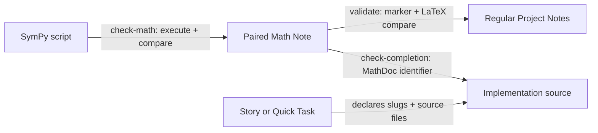

# Architecture — Math Derivation Layer

Implements the approved [Math Derivation Layer PRD](prd-math-derivation-layer.md).
All FR-001..008 and NFR-001..007 are Must requirements.

## System overview

The authority chain has four artifacts and one checker per edge:



`mathdocs/` is a vault-only sibling of `notes/`; projection remains unchanged.
SymPy establishes symbolic consistency, not physical truth: assumption/domain/
unit review stays human-gated.

## Technical decisions

### AD-M1: Side-by-side mathdocs registry (FR-001, FR-002)

**Status**: Proposed

**Context**: Pairing, indexing, and lookup must work without importing SymPy or
projecting derivations.

**Decision**: `Project` gains `mathdocs_dir`. `ensure_project_structure`
creates `mathdocs/`; `ensure_mathdocs_index` atomically creates this exact empty
index when absent and never rewrites an existing index:

```markdown
# Math Derivations

| Derivation | Status | Result summary |
|------------|--------|----------------|
```

`load_math_registry(project)` is the deep internal module interface. It returns
an immutable `MathRegistry` keyed by slug and hides directory walking, pairing,
frontmatter parsing, index parsing, source hashing, and marker parsing. The CLI
and tests consume the same interface. Each `MathEntry` contains slug, script
path, note path, status, source hash, environment metadata, and named verified
results.

Initialization and migration call `ensure_mathdocs_index` before notes
migration/pair generation. Migration is additive and idempotent.

**Consequences**: One registry load serves `validate`, `check-math`, and
`check-completion`; no second interpretation of mathdocs structure. Existing
Projects receive an empty directory/index without note or projection changes.

**Alternatives considered**:
- Put math notes under `notes/`: rejected; it would project executable-detail
  knowledge and mix OKF lifecycle with derivation mechanics.
- Lazy-create on first derivation: rejected; contradicts the every-Project
  invariant and makes migration state ambiguous.

### AD-M2: Versioned JSON child protocol (FR-003, FR-006; NFR-001..003)

**Status**: Proposed

**Context**: The stdlib-only parent CLI cannot import SymPy but must compare
machine results deterministically.

**Decision**: invoke each script as:

```text
{sys.executable} {slug}.py --kosmic-json
```

The child writes exactly one UTF-8 JSON object to stdout:

```json
{
  "schema_version": 1,
  "python_version": "3.11.9",
  "sympy_version": "1.13.3",
  "results": [
    {"name": "force_constant", "srepr": "...", "latex": "..."}
  ]
}
```

Contract:
- `schema_version` is integer `1`; unknown versions fail loudly.
- `results` is non-empty and lexically sorted by unique names matching
  `[a-z][a-z0-9_]*`.
- Every `srepr` and `latex` is a non-empty single JSON string; CRLF normalizes
  to LF, no other canonicalization occurs.
- No other stdout is allowed; diagnostics go to stderr.
- The parent independently records `source_sha256` and trusts version strings
  only after successful schema validation.

The parent uses `subprocess.run` with an argument vector, `shell=False`, cwd at
`mathdocs/`, captured UTF-8 streams, timeout (default 30 s), and deterministic
environment overrides `PYTHONHASHSEED=0`, `PYTHONIOENCODING=utf-8`, and a UTF-8
C locale. Slugs execute in lexical order. A trust warning is emitted before
running third-party/unreviewed scripts; the CLI claims no OS sandbox.

**Consequences**: Test fixtures can emit protocol JSON without importing
SymPy. SymPy-version output changes become explicit verification failures.

**Alternatives considered**:
- Import derivation modules into the CLI: rejected; contaminates the CLI
  process, requires SymPy for structural commands, and permits import-time side
  effects.
- Compare human-formatted stdout only: rejected; no named result identity or
  canonical symbolic representation.

### AD-M3: Generated result block and equation markers (FR-003, FR-004)

**Status**: Proposed

**Context**: A file hash proves script identity but not that notes carry its
current results.

**Decision**: the paired note has exactly one generated region:

```markdown
<!-- KOSMIC-MATH-RESULTS:START -->
## Verified Results

<!-- MathDoc: project-id/slug#result-name -->
$$
<exact JSON latex value>
$$
<!-- KOSMIC-SREPR: <exact JSON srepr value> -->
<!-- KOSMIC-MATH-RESULTS:END -->
```

The renderer owns the entire region. Outside it, maintainers own assumptions,
units, explanations, and `## Corrections`. Duplicate/missing/nested markers,
unknown result names, or mismatched LaTeX/srepr fail.

Stable regular notes use one marker immediately before each display equation:

- `<!-- MathDoc: project-id/slug#result-name -->` — authoritative final result;
  `validate` requires exact LaTeX agreement with the registry.
- `<!-- MathDoc-Exposition: project-id/slug -->` — explanatory equation;
  resolution and frontmatter declaration are checked, but equality is not.

Both require the script path in plural `derivations:` frontmatter. Math scanning
runs outside fenced code blocks. Inline math is notation/exposition only; a
relied-upon result must be promoted to marked display math.

**Consequences**: structural `validate` proves regular notes agree with the
last verified paired note without running SymPy. `check-math` proves that
paired note agrees with the current script and environment.

**Alternatives considered**:
- Only require a note-level link: rejected; it cannot detect stale copied
  equations.
- Rewrite whole notes: rejected; generated output would overwrite human
  assumptions/corrections.

### AD-M4: Hash and environment currency (FR-003, PRD-004)

**Status**: Proposed

**Decision**: `load_math_registry` requires the approved flat frontmatter keys
on stable Math Derivation notes. `source_sha256` is compared to script bytes
during structural validation. Version/time/host/directory syntax is validated
without importing SymPy. `check-math` additionally compares recorded Python
and SymPy versions with child protocol output.

`verified_directory` records resolved `--source-root`; `verified_host` uses
`socket.gethostname()`. `verified_at` is UTC with a trailing `Z`. Code-state
provenance remains in the Project log/Evidence Pack rather than duplicating
Git/jj fields in every math note.

**Consequences**: Moving a vault does not invalidate verification; moving the
source checkout changes recorded context only on explicit update. Any script
byte change immediately makes structural validation fail until re-verified.

### AD-M5: Copy-on-write directory publication (FR-006; NFR-004)

**Status**: Proposed

**Context**: Existing `atomic_write` protects one file; `check-math --update`
must not publish half of a selected set.

**Decision**: default `check-math` is read-only. For `--update`, execute and
validate every selected derivation first, copy the whole `mathdocs/` directory
to a temporary sibling, render all metadata/result-block changes there, reload
and validate the temporary registry, then use existing `publish_directory` to
replace the canonical directory with rollback. Explanatory content and
Corrections sections are preserved byte-for-byte outside generated regions.

**Consequences**: selected updates are all-or-none and reuse the repository's
proven atomic publication mechanism. Cost is one directory copy per update;
mathdocs are expected to be small text trees.

**Alternatives considered**:
- Call `atomic_write` per note: rejected; later failure leaves mixed versions.
- Auto-update during `validate`: rejected; validation must stay read-only and
  host-independent.

### AD-M6: Validation orchestration (FR-002..004)

**Status**: Proposed

**Decision**: add `validate_project_content(project)` as the internal
orchestration seam:

1. `registry = load_math_registry(project)` — pairing, index, frontmatter,
   source hashes, paired result block.
2. `validate_notes_bundle(project.notes_dir, math_registry=registry)` — existing
   OKF/evidence checks plus stable-note equation markers.
3. Existing evidence and impact-ledger validation remains unchanged.

Top-level `validate`, `check-completion`, `review`, and generation prechecks use
this orchestration interface rather than calling note validation directly.
Notes migration uses the empty/loaded registry after `ensure_mathdocs_index`.

**Consequences**: order is explicit: math authority loads before dependent
notes. The interface stays small; parsing/regex details remain local.

### AD-M7: Completion-time implementation references (FR-005; NFR-007)

**Status**: Proposed

**Decision**: extend `check-completion` with `--source-root` (default cwd).
Math gating runs before the existing `consumer_interface_change` early return,
like Evidence Pack gating. If either `derivations` or
`math_implementation_files` is declared, both are mandatory.

For each implementation path: reject absolute paths, `..`, missing files,
directories, and resolved symlink escapes from source root. Scan text for exact
`MathDoc: {project_id}/{slug}` identifiers, optionally followed by a known
`#result-name`. Every declared slug must occur in at least one listed file;
every listed file must reference at least one declared slug. Language-specific
comment adjacency remains a Task 7 review check; the CLI deliberately avoids
pretending to parse every source language.

**Consequences**: source files carry durable, searchable traceability while the
work item gives the validator a finite language-agnostic search set.

**Alternatives considered**:
- Search the whole repository: rejected; slow, noisy, and cannot distinguish
  implementation from docs/generated output.
- Store absolute source paths in the vault: rejected; non-portable across
  machines.

### AD-M8: CLI and skill integration (FR-006, FR-008)

**Status**: Proposed

**Decision**:
- Parser: add `check-math --project --slug --source-root --update --timeout`.
- `Project`: add `mathdocs_dir` property.
- Task M (`references/task_math_note.md`) owns script/note/index lifecycle and
  calls `check-math`; Task 3 searches `mathdocs/index.md` before deep search.
- Task 6 requires declared math inputs before tests/code; Task 7 verifies
  assumptions and source-marker adjacency; Task 4 checks stale/unused mathdocs.
- Templates: add empty math index, derivation script, derivation note, and math
  work-item fields. Task 1/8 backfill the directory/index.
- Projection roots stay `notes/` only; no mathdocs path enters generated skills.

## Data flow and failure behavior

```text
Task M authors script + explanatory note
  -> check-math --update executes every selected script in temp state
  -> versioned JSON validates
  -> generated result blocks + metadata render in temporary mathdocs
  -> temporary registry validates
  -> publish_directory swaps atomically
  -> validate checks regular-note markers against registry
  -> Task 6 adds MathDoc identifiers to implementation
  -> check-completion verifies work item + source files + current registry
  -> Task 7 reviews assumptions/domains/units and marker adjacency
```

Every failure names the derivation slug and failed layer (`script protocol`,
`paired note`, `regular note`, or `implementation`). No failure mutates
canonical mathdocs unless publication had completed successfully.

## Test strategy

| Level | Approach | Contract covered |
|-------|----------|------------------|
| Unit | protocol/index/marker/frontmatter/path parsers with table-driven fixtures | malformed/duplicate JSON results, markers, hashes, versions, rows, traversal |
| CLI integration | temporary Projects and fake child scripts emitting protocol JSON | pairing, verify/update, timeout, missing dependency, stderr, deterministic ordering, no partial update |
| Notes integration | stable/draft notes with result and exposition markers | plural resolution, exact result agreement, code-fence exclusion, inline boundary |
| Completion integration | temporary source roots with multi-language text fixtures and symlink escapes | two-field declaration, finite-file markers, slug coverage, path containment, early-return placement |
| Migration | empty/existing/custom mathdocs fixtures with injected publication failure | idempotent creation, no overwrite, rollback |
| Dogfood | one real SymPy derivation in the kosmic Project | actual SymPy execution, note comparison, source reference, all three CLI gates |

Tests use the existing `unittest` suite; fake protocol scripts keep most tests
independent of SymPy. The dogfood smoke check is the only test requiring the
installed SymPy environment.

## Risks and mitigations

| Risk | Impact | Mitigation |
|------|--------|------------|
| A script executes unsafe code | High | trusted-code warning, no shell, controlled cwd/env, timeout; no false sandbox claim |
| A derivation encodes wrong assumptions | High | assumptions/domains/units required in note; Task 7 human review; unresolved discrepancies block code |
| SymPy version changes rendering | Medium | version recorded and compared; mismatch requires explicit `--update` and review |
| Generated-block parser corrupts prose | High | marker uniqueness, temp-tree rendering, byte-preserve outside region, full temporary validation + rollback |
| Source marker exists but is not adjacent to derived code | Medium | finite file check by CLI; adjacency verified by Task 7 language-aware review |
| Exact LaTeX comparison is sensitive to harmless formatting | Medium | renderer owns verified blocks; regular-note results copy the canonical string; exposition marker handles explanatory forms |
| Large/slow derivations | Medium | lexical sequential execution and configurable per-script timeout; parallelism deliberately deferred |

## Explicitly deferred

- Numeric tolerance/benchmark datasets, plotting, and experimental evidence.
- Sandboxing untrusted Python beyond process controls.
- Projecting mathdocs into Usage/Development skills.
- Parallel derivation execution or dependency graphs between derivations.
