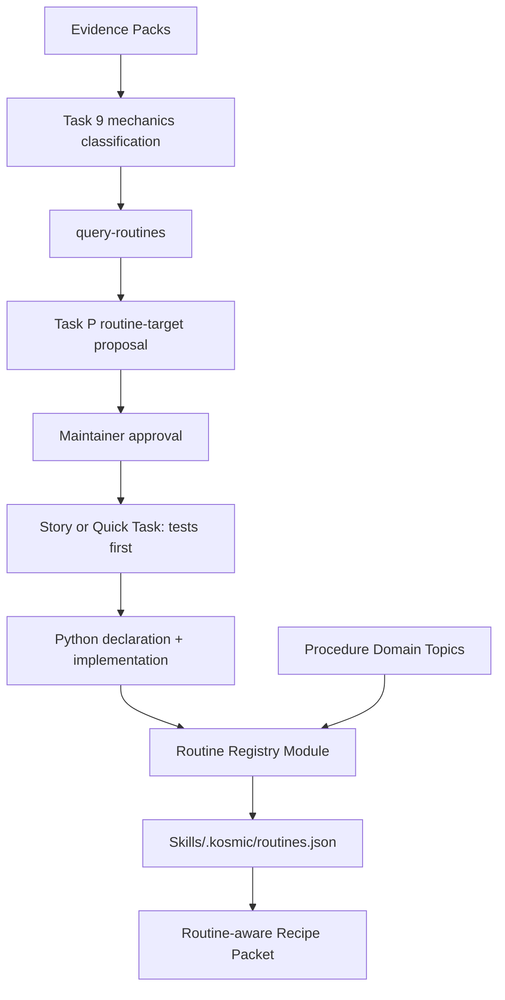

# Feature Architecture: Procedure Compilation and Routine Reuse

## Overview

This feature adds one deep Routine Registry Module beside the existing Project Projection and Shared Library modules. Python source remains authoritative. A restricted static declaration in each owning source module describes reusable routines; generation parses those declarations without importing code, validates symbols/tests/consumers against repository and vault indexes, and emits one hash-pinned inventory under the existing `Skills/.kosmic/` publication.

Domain Topics remain the source of operational intent and policy. A procedure may declare routine IDs, but Recipe Packets expose only the routine contract and invocation interface. The router never embeds or executes source. Task 9 and Task P decide whether mechanics deserve compilation; the deterministic CLI validates recorded decisions.



## Architectural Decisions

### AD-PC1: One Routine Registry Module deepens the existing CLI

**Context**: routine metadata, validation, generation, querying, and packet enrichment would otherwise spread across two already-large scripts and every workflow document.

**Decision**: add `skills/scripts/kosmic_routines.py`. Its external interface is limited to:

```python
build_routine_inventory(repo_root: Path, source_root: Path, library_root: Path) -> dict[str, object]
validate_routine_inventory(repo_root: Path, source_root: Path, library_root: Path, inventory: dict[str, object]) -> None
query_routines(inventory: dict[str, object], query: RoutineQuery) -> tuple[RoutineRecord, ...]
publish_tree(staged: Path, destination: Path, managed_paths: Sequence[str] | None = None) -> None
```

`repo_root` contains the declared test and caller files; `source_root` is its contained `skills/scripts/` directory. The CLI derives both from its installed source location by default (`Path(__file__).resolve().parents[2]` and `Path(__file__).resolve().parent`) and exposes one explicit `--source-root` override for repository development and fixtures. The override's parent is the repository root and must contain `tests/`. Shared-library functions receive these resolved roots from CLI dispatch rather than rediscovering them from the vault.

`RoutineRecord`, `RoutineQuery`, and typed errors are the interface data. Parsing, AST traversal, normalization, hashing, rollback, and matching remain implementation details. `kosmic_project_skills.py` owns CLI dispatch; `kosmic_shared_library.py` consumes inventory and publication functions.

**Consequences**: callers learn one small module interface. Tests exercise the same seam. The module earns its existence because deleting it would redistribute static parsing, validation, querying, and atomic rollback across both generators.

**Alternatives considered**: add helpers to both scripts (rejected: duplication); generic plugin framework (rejected: unused seam); separate executable per routine (rejected: discovery and lifecycle fragmentation).

### AD-PC2: Restricted module-level literals are authoritative declarations

**Context**: decorators require importing modules to inspect metadata, while a handwritten registry drifts from source.

**Decision**: an owning Python module may contain exactly one module-level assignment named `KOSMIC_ROUTINES`. Its value is a tuple of dictionary literals accepted by `ast.literal_eval`. Each record contains:

```python
KOSMIC_ROUTINES = ({
    "id": "kosmic/atomic-publish-tree",
    "symbol": "publish_tree",
    "summary": "Atomically replace a tree or an explicit managed path set with rollback.",
    "owner": "kosmic-maintainers",
    "deterministic": True,
    "offline": True,
    "side_effects": ["filesystem"],
    "tests": ["tests/test_routines.py::RoutinePublicationTest"],
    "callers": [
        "python:kosmic_project_skills:generate",
        "python:kosmic_shared_library:generate_library",
    ],
    "procedures": [],
},)
```

The module path is derived from the scanned file and cannot be overridden. IDs match `domain/slug`; Kosmic-core routines use domain `kosmic` and owner `kosmic-maintainers`, satisfying ownership without inventing a separate Skill Domain. Domain-owned routines use that domain's approved Maintainer ID. Declarations may refer only to literal strings, booleans, lists, tuples, and dictionaries.

**Consequences**: generation remains static, deterministic, and offline. Metadata stays beside implementation. Existing helpers need no wrapper solely for registration.

**Alternatives considered**: decorators/import introspection (rejected: execution); JSON sidecars (rejected: second authority); docstring directives (rejected: weak structure and escaping).

### AD-PC3: Static AST validation closes declarations over real artifacts

**Context**: a literal declaration can still name a missing function, test, caller, or procedure.

**Decision**: the Registry Module parses only configured `skills/scripts/*.py` source files and validates:

1. one globally unique routine ID;
2. exactly one top-level `def` or `async def` matching `symbol` in the declaring module;
3. owner and ID domain consistency against the generated domain catalog, with the explicit Kosmic-core owner rule;
4. every `tests` reference resolves to a repository-contained Python file and named class/function AST node;
5. every `python:` caller resolves statically to a named top-level symbol;
6. every `topic:` procedure resolves to an active procedure-role Domain Topic;
7. deterministic/offline are literal `true`; side effects use a fixed vocabulary;
8. every declared procedure lists the routine ID in `uses_routines`, and every `uses_routines` edge has a reciprocal declaration.

Validation never imports modules, resolves dynamic aliases, follows arbitrary filesystem roots, or claims runtime call-graph proof. Known caller migration remains a reviewed clean-cutover obligation supported by explicit declarations and tests.

**Consequences**: errors are actionable and static. The interface is honest about what can and cannot be proven without execution.

**Alternatives considered**: grep callsites (rejected: false authority); full Python type checker dependency (rejected: non-stdlib); runtime import sandbox (rejected: still executes code).

### AD-PC4: One generated inventory joins the existing manifest transaction

**Context**: a separately published inventory could disagree with the catalog used by the resolver.

**Decision**: `generate-library` builds `.kosmic/routines.json` in the same staging tree as catalog and manifest. The manifest records its SHA-256 and increments the schema/generator versions. The inventory has:

```json
{
  "schema": "kosmic.routines/v1",
  "generator_version": 1,
  "source_root": "skills/scripts",
  "routines": [],
  "inventory_sha256": "..."
}
```

Records sort by ID; all nested lists sort and deduplicate. `inventory_sha256` covers the object excluding itself. Catalog generation, inventory generation, manifest generation, validation, and swap are one transaction. A failure preserves the prior complete library.

**Consequences**: resolver plans can pin one manifest and inventory hash. No partial routine publication exists.

**Alternatives considered**: Project-local inventories (rejected: duplicate cross-domain authority); append-only registry (rejected: current interfaces need clean updates); independent publication (rejected: split-brain state).

### AD-PC5: Query is bounded deterministic inventory matching

**Context**: agents must search before implementing without scanning repositories or loading every procedure.

**Decision**: add:

```bash
python3 kosmic_project_skills.py query-routines \
  --vault VAULT [--query TEXT] [--id ID] [--domain DOMAIN] [--module MODULE] \
  [--symbol SYMBOL] [--owner OWNER] [--caller REF] [--procedure TOPIC_ID]
```

At least one selector is required. Exact selectors filter first; `--domain` matches the routine-ID prefix exactly and remains distinct from the Maintainer selected by `--owner`. Normalized query tokens score only ID, domain, summary, module, symbol, caller, and procedure fields using fixed integer weights. Ties return all tied records sorted by ID; no-match returns `NO_ROUTINE_MATCH`. Output is one compact, sort-key JSON object with inventory and manifest hashes. It reads only `.kosmic/routines.json` and `.kosmic/manifest.json`.

**Consequences**: search is reproducible, cheap, and honest. It does not infer semantic equivalence; Contributor judgment chooses reuse or extension.

**Alternatives considered**: embeddings/network search (rejected: nondeterministic); repository scan per query (rejected: unbounded); silently return partial fuzzy matches (rejected: weak reuse decision).

### AD-PC6: `uses_routines` is a procedure-only typed edge

**Context**: packet consumers need to know which compiled mechanics a procedure invokes without receiving source code.

**Decision**: active procedure Domain Topics may declare `uses_routines: [routine-id]`; all other roles must omit it or use an empty list. Catalog topic rows preserve the sorted IDs. Closure does not treat routines as Domain Topics. Recipe Packet framing adds `routines:id,...`; the plan adds a deduplicated `routines` array containing ID, module, symbol, summary, side effects, source SHA-256, and declaration SHA-256. Plans pin `routine_inventory_sha256`. Loader rechecks all hashes and exact framed bytes before emission.

Procedures retain preconditions, judgment, decisions, verification, and failure policy. They name the Python invocation and expected result but do not restate its algorithm.

**Consequences**: agents get executable coordinates and policy together. Routines do not become independently routable skills or bypass procedure authority.

**Alternatives considered**: model routines as procedure topics (rejected: conflates mechanics with authority); embed source in packets (rejected: budget and execution risk); Markdown links (rejected: untyped).

### AD-PC7: Routine decisions extend SkillProposal without changing `result`

**Context**: the approved proposal lifecycle, fingerprints, and completion gate accept exactly `create|update|no_action`.

**Decision**: add optional proposal fields:

```yaml
target_kind: procedure | routine
routine_action: reuse | extend | create | keep_as_prose | none
routine_id: kosmic/atomic-publish-tree
linked_proposals: []
consumer_approvals: []
```

Legacy absence means `target_kind: procedure` and no routine fields. Routine targets use the new `scope: shared-routine`, target `domain/slug`, and `target_ref: routine://domain/slug`; procedure target kinds retain every existing scope and reference rule. A routine create requires empty `target_sha256`; an update requires the current inventory record's `routine_sha256`, which hashes the complete declaring module bytes plus canonical declaration bytes and is also pinned in `input_manifest`. Routine mapping is fixed:

| routine_action | result | target requirement | behavior/approval |
|---|---|---|---|
| create | create | new routine ID | fresh-context; owner and initial consumer-domain approvals; baseline/candidate evidence |
| extend | update | existing routine ID + routine hash | fresh-context; owner and affected consumer-domain approvals; evidence |
| reuse | no_action | existing routine ID | inventory match and caller plan; no candidate evidence |
| keep_as_prose | no_action | procedure target | reason proving mechanics are judgment/context-dependent |
| none | no_action | empty routine target | reason proving no eligible mechanics |

Create and extend proposals require a non-empty `## Routine Candidate` body section with four labeled paragraphs: `Repetition`, `Contract` (inputs, outputs, invariants, and side effects), `Expected failures`, and `Leverage`. Static validation checks their presence; Task 7 evaluates their truth and module depth.

`consumer_approvals` contains sorted `domain:maintainer-id` strings and must cover exactly the distinct domains of reciprocal `topic:` consumers other than the owner domain. Each ID must occur in that Domain Skill's `maintainers` list. Reuse, keep-as-prose, and none require an empty list.

One artifact has one target kind. A procedure change plus routine change uses two proposals linked bidirectionally. Routine fields contribute to the immutable fingerprint and rejection-memory key only when `target_kind` is explicitly present in frontmatter. Legacy artifacts omit the new keys from canonicalization, preserving their current fingerprint bytes exactly; a fixture pins one existing done proposal and one rejected proposal through validation.

**Consequences**: one lifecycle governs both decisions without combinatorial result states.

**Alternatives considered**: replace results with five routine states (rejected: incompatible); new RoutineProposal artifact (rejected: duplicates lifecycle); encode action in prose (rejected: ungated).

### AD-PC8: Declared work-item fields make the gate deterministic

**Context**: the CLI cannot infer whether prose contains materially changed mechanics.

**Decision**: new Story and Quick Task templates require:

```yaml
routine_decision_required: true | false
routine_proposals: []
```

True requires one or more contained proposal paths, each valid and covering a unique routine target. False requires an empty list and a `## Routine Decision` reason in the body. A work item that adds or changes any `uses_routines` edge must declare true. Completion calls existing proposal validation and additionally requires accepted create/extend decisions, declared behavioral evidence, reciprocal routine/topic links, caller migration evidence, and convergent Task 7 review. For create/extend it computes consumer domains from reciprocal edges and requires exact validated `consumer_approvals` coverage. Reuse/no-action decisions need a valid done proposal but not candidate evidence.

Legacy absence is no-op. The gate runs before Consumer Interface early returns.

**Consequences**: enforcement is explicit and testable without semantic inference.

**Alternatives considered**: inspect diffs for helper changes (rejected: unreliable); require proposals for every task (rejected: noise); optional unvalidated prose (rejected: omission recurs).

### AD-PC9: Task 9 classifies mechanics without creating a second note role

**Context**: `artifact_role` already defines a note's authority.

**Decision**: Task 9 adds `## Mechanics Classification` to its distillation record or linked proposal input, not Project-note frontmatter. It records exactly one of judgment, deterministic-routine, or mixed-procedure, the observed repetition/correctness-critical exception, inventory query result, and routine-decision requirement. Only procedure-role material is eligible. Uncertain classification records no action and stays prose pending review.

**Consequences**: the semantic role model remains unchanged. Classification is evidence feeding Task P rather than a new routing axis.

**Alternatives considered**: `mechanics_role` note metadata (rejected: orthogonal permanent taxonomy); CLI inference (rejected: judgment masquerading as determinism); classify non-procedures (rejected: no executable authority).

### AD-PC10: Atomic publication is the first compiled routine

**Context**: Project Skill Pair publication swaps a complete staged directory, while Shared Library generation replaces a managed set of generated paths with rollback. Both independently implement filesystem transaction mechanics.

**Decision**: `publish_tree(staged, destination, managed_paths=None)` owns both modes:

- `managed_paths is None`: replace the complete destination tree;
- explicit sorted paths: replace only those contained relative paths and restore each prior path on failure.

The implementation validates containment and duplicate paths, stages backups beside the destination, uses same-filesystem `os.replace`, supports the existing deterministic failure-injection checkpoints, restores in reverse order, and always removes staging/backup artifacts. It returns `None`; success means the requested publication is complete, failure raises a typed exception with the prior destination restored.

`generate`, `migrate_notes_bundle`, the MathDocs synchronization path, and `generate_library` become the canonical callers. All three current `publish_directory` callers move directly to `publish_tree`; `publish_directory` and `_replace_generated` are removed rather than retained as aliases. Focused interface tests cover absent/existing destination, whole/managed modes, nested paths, injected failures at each mutation boundary, restoration, and cleanup. Existing end-to-end tests prove unchanged public behavior.

**Consequences**: high-risk rollback logic gains locality and four real callers. The interface exposes the one variation that exists; internal backup mechanics remain hidden.

**Alternatives considered**: force both callers into whole-tree swaps (rejected: shared library owns user-maintained Domain Topics); retain wrappers (rejected: obscures cutover); general transaction DSL (rejected: shallow and unnecessary).

### AD-PC11: Migration inventories existing helpers without cosmetic wrappers

**Context**: many useful helpers predate this feature; immediate mandatory registration would create churn.

**Decision**: v1 registers only atomic publication and any existing routine deliberately reused by a changed procedure. Untouched helpers and procedures remain valid. Migration reporting lists declared routines, procedure edges, legacy candidates noted by Task 9, and unregistered helpers only when explicitly supplied—never by heuristic source scanning. A later approved schema cutover may tighten requirements after real use.

**Consequences**: adoption follows value. No compatibility alias or permanent dual registry is introduced.

**Alternatives considered**: register every function (rejected: functions are not automatically reusable routines); infer candidates from call counts (rejected: unreliable semantics); require wrappers (rejected: weightless code).

## Module and Data Flow

```text
Task 9 / Task P records
          │
          v
kosmic_project_skills.py  ── CLI dispatch and completion policy
          │
          v
kosmic_routines.py        ── static declarations, validation, query, publish_tree
          │
          ├── reads skills/scripts/*.py via ast
          ├── checks tests and Skills domain/topic indexes
          └── emits Skills/.kosmic/routines.json
                         │
                         v
kosmic_shared_library.py ── catalog/manifest transaction and Recipe Packets
```

## Error Interface

| Code | Meaning |
|---|---|
| `INVALID_ROUTINE_DECLARATION` | Literal schema, ID, ownership, or side-effect vocabulary invalid. |
| `DUPLICATE_ROUTINE_ID` | More than one source declaration owns an ID. |
| `MISSING_ROUTINE_SYMBOL` | Declared top-level symbol absent or ambiguous. |
| `MISSING_ROUTINE_TEST` | Declared test file or AST symbol absent. |
| `INVALID_ROUTINE_CALLER` | Caller or reciprocal procedure edge invalid. |
| `STALE_ROUTINE_INVENTORY` | Source, declaration, catalog, manifest, or inventory hash changed. |
| `NO_ROUTINE_MATCH` | Bounded query found no eligible record. |
| `ROUTINE_PUBLICATION_FAILED` | Atomic publication failed after restoring the previous destination. |
| `ROUTINE_DECISION_REQUIRED` | Completion metadata or linked proposal is missing/incomplete. |

All errors include the routine ID or responsible path and produce exit code 2 unless an existing collision or migration code applies.

## Test Strategy

| Layer | Coverage |
|---|---|
| Routine module interface | literal parsing, schema, AST symbols/tests/callers, query scoring, hashes, whole/managed publication, rollback and cleanup |
| Shared Library integration | inventory joins manifest transaction, catalog routine edges, plan hashes, packet framing, stale inventory, budgets |
| Project workflow | proposal routine fields/fingerprints, template defaults, Task 9 classification, completion gate ordering and lifecycle |
| Compatibility | legacy proposals/procedures/helpers remain valid and byte-stable where authoritative inputs are unchanged |
| Dogfood | `generate` and `generate-library` use `kosmic/atomic-publish-tree`; baseline/candidate success and injected failures match |
| Release | full unittest suite, Project/shared validation, deterministic regeneration, independent two-axis review, four-adapter byte verification |

## Migration and Release Sequence

1. Add red Routine Registry Module and atomic-publication interface tests.
2. Add static declaration/inventory/query behavior and CLI tests.
3. Move all three Project-module callers—`generate`, `migrate_notes_bundle`, and MathDocs synchronization—to `publish_tree(staged, destination)` whole-tree mode; remove `publish_directory`.
4. Move Shared Library managed-path publication to `publish_tree`; remove `_replace_generated`.
5. Add `uses_routines`, plan/inventory hashing, and packet framing.
6. Extend Task P, fingerprints, templates, Task 9, and completion gates additively.
7. Generate the first inventory and run baseline/candidate plus failure-injection dogfood.
8. Run full validation, deterministic regeneration, independent Standards/Spec review, and four-adapter publication checks.
9. Publish Evidence Pack, stable Project Knowledge update, impact entries, and release metadata.

All generated artifacts swap once after the complete staged graph validates. No intermediate schema becomes canonical.

## Requirement Traceability

| Decisions | Requirements |
|---|---|
| AD-PC1–PC3 | FR-PC02, PC05–PC10, PC14–PC17; NFR-PC02, PC04, PC06 |
| AD-PC4–PC6 | FR-PC03, PC06–PC12, PC16–PC18; NFR-PC01–PC05 |
| AD-PC7–PC9 | FR-PC01–PC04, PC06, PC13–PC15, PC19, PC21; NFR-PC02, PC07 |
| AD-PC10 | FR-PC09–PC13, FR-PC18, FR-PC20; NFR-PC01, PC02, PC04, PC05 |
| AD-PC11 | FR-PC10, PC15, PC21; NFR-PC07 |

## Open Questions

None. The architecture deliberately avoids runtime plugins, source execution during discovery, semantic routine inference, and mandatory registration of every helper.
