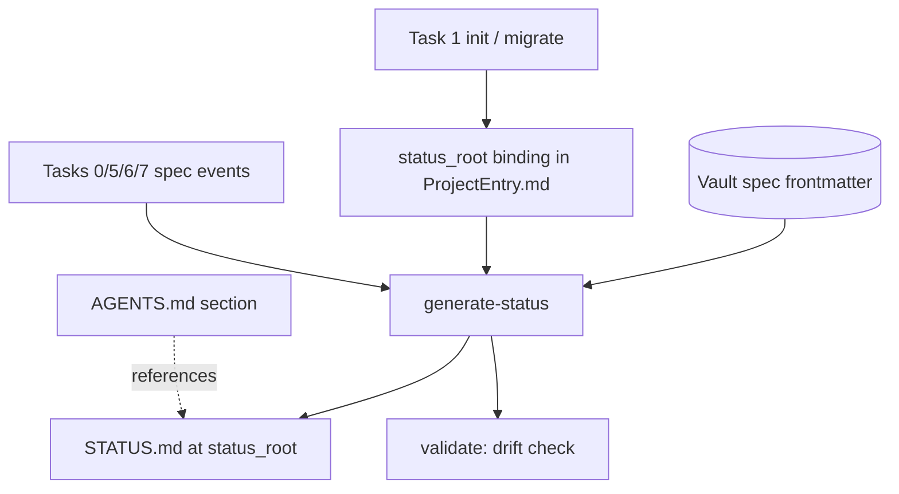

# Architecture: Project Status File

## System Overview

STATUS.md is a third generated projection surface. The vault stays the only
authority; the Projection CLI derives the status document from spec
frontmatter, writes it into the bound working directory, and re-verifies it
during validation. Initialization binds the directory; the workflow regenerates
on every spec event.



## Technical Decisions (ADRs)

### AD-S1: STATUS.md is generated projection output

**Status**: Proposed

**Context**: The working directory needs a status surface, but a hand-edited
file would fork the truth that already lives in the vault.

**Decision**: STATUS.md is produced only by `generate-status`, byte-derived
from spec frontmatter. Hand edits are drift, caught by `validate`. The file
carries a generated marker line. `specs/INDEX.md` stays authoritative for
navigation; STATUS.md never feeds back into it.

**Consequences**: One more projected surface to keep deterministic; zero
possibility of divergent status truth.

**Alternatives Considered**: Hand-maintained status file (truth fork); symlink
to vault INDEX (breaks outside the repo, wrong shape).

---

### AD-S2: Frontmatter scan is the source, not INDEX.md

**Status**: Proposed

**Context**: INDEX.md is navigational and can lag; frontmatter is the
per-artifact authority the lifecycle already uses.

**Decision**: `generate-status` walks `specs/{prd,architecture}*.md`,
`epics/`, `stories/`, `quick-tasks/`, and `skill-proposals/*.md` and reads
each file's `status`, `updated`, and title. Rows are sorted by class then
path. Determinism: identical frontmatter state yields identical bytes; the
header records vault HEAD (or `no-head`) plus project id, never wall clock.

**Consequences**: STATUS.md can disagree with a stale INDEX.md — by design;
the index is then wrong and review fixes the index.

**Alternatives Considered**: Parsing INDEX.md tables (inherits staleness);
mixed sources (ambiguity).

---

### AD-S3: status_root binding in ProjectEntry.md

**Status**: Proposed

**Context**: The CLI must know which working directory owns the STATUS.md.

**Decision**: Optional `status_root:` field in `ProjectEntry.md` — an
absolute path, set by `init`/`migrate --status-root`. `generate-status`
resolves and requires the path to exist and be a Git worktree root or a
subdirectory of one. Absent field: `generate-status` fails with
`STATUS_ROOT_UNBOUND`; `validate` only warns that spec state is unprojected
(FR-S5). Two projects may never bind the same root; `validate` fails on
cross-project root collision.

**Consequences**: Migration is one optional field; multi-project directories
are excluded by the collision check rather than by convention.

**Alternatives Considered**: Storing the root in a generated manifest
(hidden from users); AGENTS.md parsing (fragile).

---

### AD-S4: Workflow enforcement and initialization

**Status**: Proposed

**Context**: Regeneration must follow spec events or STATUS.md goes stale.

**Decision**: Task 1 writes the binding, generates the first STATUS.md, and
the `agents_template.md` section gains one sentence pointing to STATUS.md.
Tasks 0, 5, 6, and 7 references add `generate-status --project ...` as a
required step after spec creation or any status transition, listed beside
"log update". `check-completion` additionally fails when the work item's
project has a bound root and the working-tree STATUS.md is stale, so a story
cannot reach `done` with a stale status file.

**Consequences**: The completion gate becomes the mechanical backstop;
workflow prose is the first line.

**Alternatives Considered**: Filesystem watchers or git hooks (ambient,
outside Kosmic's fail-closed model).

---

### AD-S5: Content contract and open-question resolutions

**Status**: Proposed

**Context**: FR-S2 fixes the tables; the PRD left two questions open.

**Decision**: Sections, in order: header block (project id, HEAD marker,
generated marker), `## Spec Status` with one subsection per class
(`PRD`, `Architecture`, `Epics`, `Stories`, `Quick Tasks`, `Skill
Proposals`) each a `| Spec | Status | Updated |` table with vault-relative
links, then `## Open Work` — a count of nonterminal stories/epics/quick
tasks plus draft PRD/Architecture gates and pending proposals, and one bullet
per open item. Dream content stays out (spec-only). Multi-project
directories: excluded via the AD-S3 collision rule.

**Consequences**: The document is complete for an agent cold-start; dream
integration remains a future PRD if wanted.

**Alternatives Considered**: Including dreams (vault-level, wrong scope).

---

## Data Models

STATUS.md (generated):

```markdown
<!-- Generated by the Kosmic Projection CLI. Do not edit. -->
# Status: {PROJECT_ID}

Vault HEAD: {sha-or-no-head}

## Spec Status

### PRD
| Spec | Status | Updated |
|------|--------|---------|
| [PRD](../../memnotes/Projects/{T}/specs/prd-x.md) | approved | 2026-09-27 |

... (Architecture, Epics, Stories, Quick Tasks, Skill Proposals)

## Open Work

- 1 open item: story-064 (in_progress) — [link]
```

Links are POSIX relative paths from STATUS.md to the vault spec file.

## API Design

- `generate-status --project {PROJECT}` — reads the bound root from
  ProjectEntry; writes STATUS.md atomically (temp + replace); prints the path.
- `init --project {DIR} --project-id {ID} [--status-root {DIR}]` and
  `migrate --project {DIR} --project-id {ID} [--status-root {DIR}]`.
- Failures: `STATUS_ROOT_UNBOUND`, `STATUS_ROOT_MISSING`,
  `STATUS_ROOT_COLLISION`, `STATUS_WRITE_FAILED`; drift code `STATUS_STALE`.

## Test Strategy

| Level | Approach | Coverage |
|-------|----------|----------|
| Unit | Fixture project with scripted specs | Deterministic bytes, class tables, sorting, link relativity, HEAD marker |
| Unit | Binding fixtures | Unbound/missing/colliding roots; init and migrate flows |
| Integration | Status flip → generate-status → validate green; hand edit → STATUS_STALE; completion gate blocks stale story |
| E2E | Task 1 fresh fixture project | AGENTS.md section + STATUS.md present and matching |

## Risks & Mitigations

| Risk | Impact | Mitigation |
|------|--------|------------|
| Agents edit STATUS.md by hand | Medium | Generated marker + validate drift failure |
| Stale INDEX vs STATUS disagreement confuses readers | Low | STATUS is derived from frontmatter; review fixes INDEX |
| Root path portability across machines | Medium | Absolute binding documented; migrate re-binds |

## Dependencies

- Projection CLI parser/frontmatter infrastructure (existing).
- `check-completion` gate insertion point (existing early-return pattern
  documented in cli-extension-conventions).
- `agents_template.md` (Task 1).
