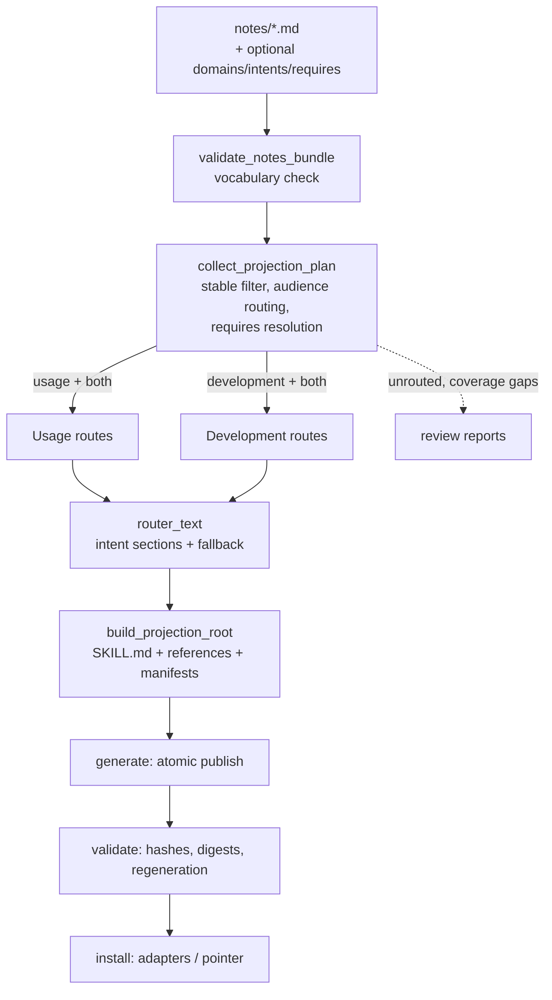

# Architecture: Route-Graph Project Skill Pair

## System Overview

Extend the deterministic projection pipeline in `skills/scripts/kosmic_project_skills.py`. The authoritative OKF notes bundle gains additive, optional routing metadata; `collect_projection_plan` parses and validates it; generation renders intent-keyed route manifests instead of flat topic lists; validation and review enforce routing integrity. No new commands, no new files, no format break for notes without metadata.

Unchanged invariants: notes remain the sole authority; exactly two packages per Project; generation stays deterministic and atomic; provenance (source path + SHA-256) and drift detection are preserved; specs/logs never project.

## Technical Decisions (ADRs)

ADR numbering continues the repository sequence (`docs/adr/0001-*`).

### ADR-0002: Route metadata is additive optional note frontmatter; vocabularies are CLI-owned constants

**Status**: Accepted

**Context**: Routing must be derived from Project Knowledge, never hand-authored in generated skills, and must not break existing notes (FR-001, FR-005, FR-009).

**Decision**: Notes may declare optional `domains: [list]`, `intents: [list]`, `requires: [note-list]` in frontmatter. The controlled vocabularies live exactly once, as module constants beside `REQUIRED_PROCEDURE_SKILLS`:

- `ROUTE_DOMAINS = (interfaces, configuration, operations, architecture, testing, release)`
- `ROUTE_INTENTS = (configure, invoke, integrate, troubleshoot, change, test, review, release)`

`validate_notes_bundle` rejects unknown values in any note (draft included — catches typos early). `requires` entries are note paths relative to `notes/` (same resolution rules as `resolve_related_note`); resolution is enforced only for stable notes during planning, so drafts may reference not-yet-written notes.

**Consequences**: Vocabulary changes require a `GENERATOR_VERSION` bump and regeneration; notes with no metadata project unchanged under the fallback route. Agents authoring notes learn three optional fields.

**Alternatives Considered**: A separate routing manifest file per Project (rejected: second source of truth drifts from notes); free-form tags (rejected: no validation, no deterministic routes).

---

### ADR-0003: Development package projects `both` notes directly

**Status**: Accepted

**Context**: Today `collect_projection_plan` (lines 490-493) sends `both` notes to Usage only; contributors reach shared knowledge only through the companion instruction (the core fragmentation defect).

**Decision**: Route `audience: both` notes into both packages: `usage_notes` and `development_notes` each receive them. The Development router's "Required companion" section is retained (FR-006 validates its presence and the manifest `requires` entry) but reworded: shared knowledge is now inline; load the Usage Skill only for Consumer Interface specifics not present in Development routes.

**Consequences**: Development packages grow; the companion contract stays installable and backward-validatable. Pair manifests record `both` sources in both packages — provenance is per-package, so drift detection keeps working unmodified.

**Alternatives Considered**: Shared references directory outside both packages (rejected: adapters install self-contained package dirs; a third tree breaks the exactly-two-packages invariant); symlinked references (rejected: non-portable across adapters).

---

### ADR-0004: Routers render intent-keyed routes with deterministic ordering and inline prerequisites

**Status**: Accepted

**Context**: Flat topic lists leave selection, ordering, and stopping to agent discretion (PRD problem 2).

**Decision**: `router_text` renders, per package, one section per intent that has at least one routed note, in `ROUTE_INTENTS` order, then a "General topics" fallback section. Within a route, references sort by `(ROUTE_DOMAINS index of first declared domain, title)`. Each entry carries its prerequisites:

```markdown
## Route: troubleshoot
Ordered references; stop when the failure mode is identified.
- [Failure modes](references/interfaces/failure-modes.md) — requires: [interface-contract](references/interfaces/interface-contract.md)
```

Each route section opens with a one-line stopping rule generated from a fixed per-intent template (CLI-owned, like the vocabularies). Route membership: a stable projected note appears in every route whose intent it declares, in each package its audience admits.

**Consequences**: A note in many intents lengthens the router; NFR-004's ~150-line budget is enforced by keeping per-route prose to the fixed template. Determinism is total: same notes → same bytes.

**Alternatives Considered**: Explicit per-route ordering metadata (rejected: another field to maintain; domain-major sort is sufficient); DAG-ordered routes from `requires` (rejected per PRD open question 1 — resolvable-only).

---

### ADR-0005: Backward-compatible fallback route; per-intent coverage reporting; per-interface coverage deferred

**Status**: Accepted

**Context**: FR-005/FR-007/FR-009 require old projects to regenerate cleanly and review to report gaps. The PRD's "missing coverage per Consumer Interface" is not computable today — nothing declares a Project's Consumer Interfaces.

**Decision**: Stable notes without `intents` project under a per-package "General topics" section exactly as today's flat list (sorted by title). `review` reports: unscoped notes (existing), stable notes with no route metadata ("unrouted"), and per-intent coverage gaps — consumer intents (`configure, invoke, integrate, troubleshoot`) lacking any `usage`/`both` note, contributor intents (`change, test, review, release`) lacking any `development`/`both` note. Per-Consumer-Interface coverage is deferred until an interface registry exists (candidate: optional `consumer_interfaces` in ProjectEntry frontmatter). PRD FR-007 is amended accordingly.

**Consequences**: Existing projects regenerate with zero note edits and see at most review noise about unrouted notes. No new mandatory metadata anywhere.

**Alternatives Considered**: `--strict-routing` failing generation on unrouted notes (rejected per PRD open question 3 — defer); inferring interfaces from `domains: [interfaces]` notes (rejected: inference, not declaration).

---

### ADR-0006: Validation and migration reuse the existing determinism machinery

**Status**: Accepted

**Context**: FR-006/FR-010 must hold without weakening provenance, digest, or regeneration checks.

**Decision**:
- `validate_notes_bundle`: reject unknown `domains`/`intents` values (all notes).
- `collect_projection_plan`: for stable notes, reject `requires` entries that do not resolve to an existing note file, and reject prerequisites that are not projection-eligible in the same package (route must not point at excluded notes).
- `projection_manifest`: each source entry gains `domains`, `intents`, `requires` (resolved relative paths) — the route inventory FR-010 requires.
- `validate_projection_root`: unchanged mechanics (source hashes, package digests, regeneration byte-comparison) automatically cover routers and manifests.
- Migration: bump `GENERATOR_VERSION`. Existing canonical pairs fail `validate` as stale (byte comparison), which is the documented, intended path: re-run `generate`, then `install`. Installed old pairs keep working until the next `install` attempt, which validates first and refuses until regeneration.

**Consequences**: One-command upgrade per Project (`generate` → `install`), consistent with the existing lifecycle. No migration command needed.

**Alternatives Considered**: A dedicated `migrate-routes` command (rejected: regeneration already is the migration); version-tolerant validation accepting both router formats (rejected: doubles the validation surface).

---

## System Design



## Data Models

`Note` gains `domains: tuple[str, ...]`, `intents: tuple[str, ...]`, `requires: tuple[str, ...]` (validated). `ProjectionPlan` routing change:

```python
if audience in {"usage", "both"}:
    usage.append(note)
if audience in {"development", "both"}:   # was: == "development"
    development.append(note)
```

Manifest source entries extend to:

```json
{
  "path": "notes/interfaces/failure-modes.md",
  "sha256": "…",
  "audience": "both",
  "reference": "references/interfaces/failure-modes.md",
  "domains": ["interfaces"],
  "intents": ["troubleshoot", "invoke"],
  "requires": ["notes/interfaces/interface-contract.md"]
}
```

## API Design

No CLI surface changes (commands, flags, exit-code taxonomy unchanged). Generated-content contract changes only: router `SKILL.md` body, manifest source entries, `GENERATOR_VERSION`.

## Test Strategy

| Level | Approach | Coverage |
|-------|----------|----------|
| Unit (fixture CLI runs, `tests/test_project_skills_cli.py`) | subprocess against temp vaults, per existing `setUp` pattern | FR-001 unknown vocab rejected; FR-003 `both` note present in both packages and routed; FR-004 route sections ordered with prerequisites; FR-005 fallback section; FR-006 unresolvable/excluded `requires` rejected; FR-009 fixture without metadata regenerates and validates |
| Integration | full `generate → validate → install --adapter codex` on mixed-audience fixture | atomic publish, adapter digests, stale-pair refusal after note edit |
| Review behavior | `review` on fixture with unrouted + unscoped notes and missing intents | FR-007 reporting |
| Determinism | two `generate` runs byte-identical (existing snapshot comparison) | NFR-001 |

## Risks & Mitigations

| Risk | Impact | Mitigation |
|------|--------|------------|
| Router bloat on metadata-heavy projects | Medium | Fixed per-intent prose templates; NFR-004 line budget; fallback stays title-only |
| Vocabulary churn breaks notes | Medium | Vocab is CLI-owned; changes ride a `GENERATOR_VERSION` bump and clear error messages naming valid values |
| Installed stale pairs block `install` after upgrade | Low | Intended; error text tells the user to regenerate (verify wording in story) |
| Contributors stop reading Usage entirely | Low | Companion section retained and validated; Development routes carry only shared + contributor knowledge |

## Dependencies

- Existing Projection CLI (`skills/scripts/kosmic_project_skills.py`) — all changes in place.
- `tests/test_project_skills_cli.py` — extended, same subprocess/unittest conventions.
- PRD `prd.md` (approved); research memo `research/2026-09-02-route-graph-skill-projection.md`.
- PRD amendment: FR-007 reworded to per-intent coverage with per-interface deferred (ADR-0005).
