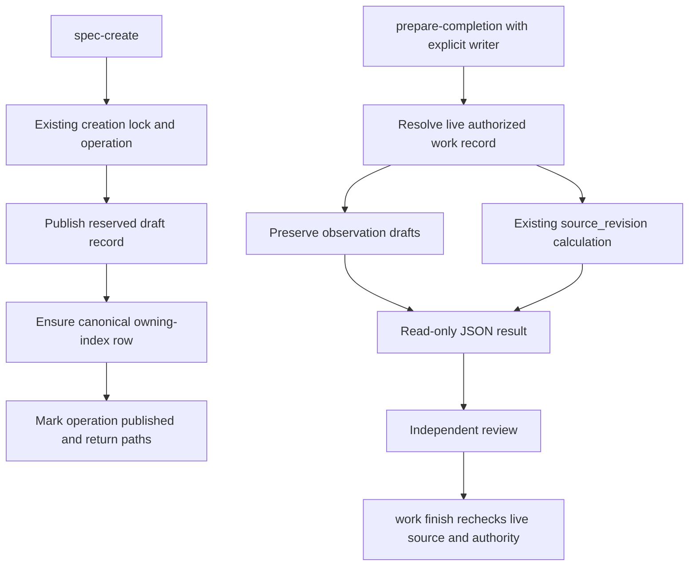

# Command-owned indexes and completion review context

## Scope and Approval

Implements the [approved PRD](prd.md) through two existing modules: spec creation owns record/index publication; completion preparation exposes the existing review fingerprint. The user approved this technical design in the conversation. No feature source has been changed. Epic and Story approval gates remain before implementation.

Code inspection resolved the technical questions; no separate research memo or evidence sidecar is needed. Decisions and their supporting code locations remain local to this design.

## Observed Implementation

- `skills/scripts/kosmic_specs.py`: `_creation_lock` serializes supported creation; `.kosmic/create-ops/` stores PRD reservation/publication state. `_stage_bytes` publishes new files without following symlinks and refuses differing existing bytes. `_create_subproject` supports PRD resume; `_create_owned_record` stages only the other record kinds and has no operation-backed resume.
- `skills/scripts/kosmic_completion.py::_update_indexes` changes existing Markdown table rows with a `status` column and an exact relative record link. It neither inserts missing rows nor changes bullet entries. PRD bootstrap currently creates a bullet index.
- `kosmic_completion.prepare_completion` returns record-local observations, preserving authored entries and leaving unauthored observations blank. The CLI currently accepts `--project` and `--work-record`, with no writer argument.
- `kosmic_completion.source_revision` already computes the digest enforced by finish. `skills/references/work_completion.md` exposes it through an inline Python import recipe.
- `finish_work` checks the current fingerprint and repeats freshness/record-authority checks before publication. Preparation is not a substitute for those checks.

Evidence locations at drafting: `kosmic_specs.py:538-711,870-1042`; `kosmic_completion.py:154-260,515-551,674-777`; `kosmic_project_skills.py:4484-4488,4539-4549,4810-4815`. Symbol names, not these snapshot line numbers, identify the implementation seams.

## System Design



### Module Responsibilities

| Module | Responsibility |
|--------|----------------|
| `kosmic_specs.py` | Immutable reservation, existing creation lock/operation lifecycle, owner paths, record publication, canonical row insertion/replay. |
| `kosmic_completion.py` | Existing observation drafting and fingerprint algorithm; finish's existing row-status update, serialized with creation's index edits. |
| `kosmic_project_skills.py` | One optional preparation flag and conditional output field; creation result includes explicit owning index path; existing error handling and mutation classification. |
| Workflow references, canonical notes and generated guidance | Consume successful outputs directly; remove the obsolete manual row-creation and internal-import recipes only after native behavior works. |

No generic transaction manager, new persistent record class, dependency or background process is introduced.

## Technical Decisions

### ADR-001: Extend Existing Completion Preparation

**Status:** Accepted.

**Decision:** Add optional `--worktree` to `work prepare-completion`. If supplied, the successful JSON additionally contains `source_revision`, computed by the unchanged function. Omission preserves today's arguments, payload and behavior. Never default to the current directory or Git HEAD.

Three interface designs were evaluated independently:

1. **Existing preparation plus explicit writer:** one command returns preserved observations and the review fingerprint. Hides record resolution and hashing behind the established read-only interface. Chosen: no extra command vocabulary or two-command preparation sequence.
2. **Separate `work source-revision`:** a narrow fingerprint-only result avoids observation parsing, but adds a sibling command and a second documented preparation operation. Rejected for this common workflow; its useful explicit-writer rule is retained.
3. **Separate bundled review-context interface / implicit source root:** can assemble more context, but duplicates preparation and risks guessing the writer. Rejected: no extra bundle, implicit working directory, evidence or approval generation is needed.

The selected extension retains preparation's existing acceptance-criterion refusals. A caller wanting a fingerprint must still select a valid authorized implementation record; no terminal/planning-record bypass is added.

**Consequence:** Criterion drafting and fingerprint calculation share one read-only result. Callers that do not need a writer fingerprint remain unaffected.

### ADR-002: Reuse the Existing Creation Operation for Every Kind

**Status:** Accepted.

**Decision:** Extend `.kosmic/create-ops/` and `_creation_lock` to `prd`, `architecture`, `epic`, `story` and `quick-task`. Reserve the immutable identity and all output paths under the lock before publishing the first output. Keep the lifecycle `reserved → published`; no separate recovery journal.

Each new operation retains the existing identity/title/state plus enough deterministic reservation data to replay the same outputs: `local_id`, parent where applicable, canonical record/index paths and the expected draft content or its deterministically reproducible inputs. Resume never reallocates a sequential ID or derives a new identity from a retyped title.

Record publication keeps `_stage_bytes`' existing no-follow, no-overwrite behavior. Index publication uses a targeted current-content merge, not whole-index immutable bootstrap bytes. Mark `published` only after both declared outputs succeed.

**Alternatives:** Agent-written rows retain today's bookkeeping burden; index insertion in finish leaves drafts unindexed; a new all-files transaction framework is disproportionate. None is selected.

**Consequence:** Publication remains stepwise, not cross-file atomic. An error may leave a reserved draft or row visible; the operation ID provides explicit, deterministic recovery. Exit success means all promised outputs were published, not that the draft was approved.

### ADR-003: Use the Index Shape Finish Already Consumes

**Status:** Accepted.

**Decision:** For new rows, use a Markdown table with `Kind`, linked `Record`, and `Status` information; the header must contain a `status` column and the row an exact record-relative Markdown link. The stored title, kind and lifecycle state come from the reserved/current record, not an agent-authored summary.

- Feature records use `subprojects/{owner}/specs/INDEX.md`. New PRD bootstrap creates its own table row rather than a bullet.
- Shared Quick Tasks use Project `specs/INDEX.md`.
- Reuse a compatible table in the owning index. If none exists, append a small canonical records table without rewriting existing sections.
- Match by the canonical relative link, not title substring. A matching compatible row is retained if its record facts agree. Conflicting facts, multiple matches, or a conflicting non-table entry produce `RESERVATION_CONFLICT`, not an extra row or silent overwrite.
- Missing owning indexes are created with the appropriate minimal heading/table. Preserve all unrelated existing prose, sections and rows.

Existing historical bullets and unrelated status rows are not bulk-converted. Adding a new Architecture to an old bullet-style owner index appends its own canonical row; it does not migrate the old PRD entry. Finish's status-matching semantics and completion publication order remain unchanged.

**Consequence:** New native rows can be updated by existing finish logic. Historical index repair remains separate, rather than being hidden in every creation.

### ADR-004: Serialize Supported Index Writers and Preserve Concurrent Content

**Status:** Accepted.

**Decision:** Both creation's ensure-row operation and finish's existing index-status update use the existing creation lock for index read/merge/publication. Finish acquires it only around index updates; no new finish admission gate or completion lifecycle is introduced.

Resume rereads the current index under that lock, preserves unrelated edits, and ensures only the operation-owned row. It never replaces the index with an old snapshot. Keep existing no-follow and atomic per-file publication primitives. Detect external divergence before replacing a previously read index and refuse rather than overwrite it.

The lock serializes supported CLI writers, not arbitrary editors. Raw concurrent edits must not be presented as a cross-process transaction guarantee: an editor ignoring the lock can race any read/replace. On detected divergence, report the conflicting path and operation ID for reconciliation/resume. Do not weaken record conflicts or silently accept a changed draft merely because its frontmatter identity matches.

**Consequence:** Supported concurrent creations/finish updates preserve each other's content. Recovery is idempotent without inventing rollback or claiming arbitrary filesystem transactions.

## Public CLI Contracts

### Creation

Existing invocation forms remain:

```bash
python3 {KOSMIC_SKILL_DIR}/scripts/kosmic_project_skills.py spec-create \
  --project "{PROJECT_ROOT}" --kind architecture \
  --subproject "{SUBPROJECT_ID}" --title "{TITLE}"
```

Use the existing `--parent` argument for Epic/Story as documented. Quick Tasks remain shared; no owner or ancestry rules are widened. Existing CLI bootstrap admission and human approval gates are unchanged.

All kinds return a non-null owning `operation_id`, canonical `record_path` and `index_path` relative to the Project, plus the existing identity/status/result fields. Preserve existing `paths` keys and value representations rather than silently normalizing its historical PRD representation in this feature. The explicit path fields are the consistent caller interface.

For incomplete publication, retain the operation ID, original kind/title/owner/parent inputs and resume:

```bash
python3 {KOSMIC_SKILL_DIR}/scripts/kosmic_project_skills.py spec-create \
  --project "{PROJECT_ROOT}" --kind architecture \
  --subproject "{SUBPROJECT_ID}" --title "{ORIGINAL_TITLE}" \
  --resume --operation-id "{RETURNED_OPERATION_ID}"
```

The same form applies to other kinds with their original arguments. Failures identify the operation and incomplete/conflicting path. Reuse `RESERVATION_CONFLICT` and existing unsafe-path/I/O diagnostics rather than inventing success-shaped partial results. Do not retry creation after success; published-operation resume retains its current refusal behavior.

### Read-only Completion Preparation

```bash
python3 {KOSMIC_SKILL_DIR}/scripts/kosmic_project_skills.py work prepare-completion \
  --project "{PROJECT_ROOT}" --work-record "{QUALIFIED_RECORD}" \
  --worktree "{REGISTERED_ROOT}"
```

Output retains `identity`, `record_path`, and `completion_observations`, adding a top-level `source_revision` string only when `--worktree` is supplied. Authored observation mappings retain every field verbatim; unauthored criteria retain blank observation/source drafts. Do not add outcomes, approvals, reviewer decisions, timestamps or generated evidence.

Resolve the record live using existing authorized nonterminal Story/Quick Task rules. Resolve the explicit writer as finish/source_revision already do (`expanduser().resolve()`); let existing Git/path-read errors surface. No new clean-worktree, registration, ownership-repair or start requirement is added. Same-root, nested-Project and external-Project writer relationships retain the current algorithm's behavior.

Preparation creates no lock, registry edit, run manifest, log, receipt, STATUS refresh or other Project/writer output. No `--write` mode.

## Fingerprint and Authority Invariants

- Call `source_revision` directly; do not reimplement its digest or exclusions. It hashes the sorted changed-path content map from Git status, including untracked files and non-file/deletion markers, not the commit ID.
- Preserve the exact current `.tmp`, Git, STATUS and Project/record-path exclusions, including the distinct same-root/nested/external cases. This feature does not repair or broaden those exclusions.
- Preparation is a point-in-time read, not a source snapshot, permission cache or review approval. Concurrent edits can invalidate its result; reviewers hold their actual reviewed revision and finish recomputes the live value.
- Preserve both finish's review-revision comparison and pre-publication record/source/authority rechecks. Do not repin stale reviews automatically.
- A fingerprint alone cannot bind excluded work-record context. Existing context/scope review rules remain required.
- Do not rewrite historical pins, receipts, published operation history or unrelated records.

## Recovery State

| Visible state | Resume behavior |
|---------------|-----------------|
| Reservation exists; outputs absent | Publish the reserved record and ensure its row using the same identity. |
| Reserved record has expected bytes; index/row absent | Keep the record; merge the row into the current index. |
| Correct row exists; publication marker absent | Retain it without duplication; complete remaining outputs, then mark published. |
| Unrelated index content changed | Preserve it and merge only the owned row under the lock. |
| Reserved record differs, row conflicts, or path is unsafe | Refuse with the operation ID/path; preserve current bytes for explicit reconciliation. |
| Operation already published | Retain existing refusal semantics; callers use the original successful result. |

Existing incomplete PRD operations must remain readable without rewriting historical operation files on inspection. Derive their known bootstrap identity/paths for safe resume; conflicting existing bytes remain conflicts. This is recovery compatibility, not a historical index migration.

## Caller Cutover

After implementation and CLI smoke:

- Replace manual row creation and non-PRD resume caveats in `task_create_spec.md` and Quick Task/completion instructions with returned native paths and owning-operation recovery.
- Replace `work_completion.md`'s internal-Python imports with the explicit-writer preparation command; retain actual reviewer pinning and evidence requirements.
- Update `skills/SKILL.md`, README, relevant templates, CLI references, `record_first_contract()` generated prose, and the repository instruction caller where they describe ownership. Research memos and non-`spec-create` artifacts do not gain native indexing by implication.
- Update the existing canonical CLI invariant note and regenerate its Usage/Development projections; do not edit generated or installed files directly.
- Retain independent content/approval gates and full-absolute-path handoff links. Command exit success needs no administrative read-back or extra validation invocation.

No compatibility alias, duplicate manual fallback or replacement evidence framework remains for supported native creation. Pre-existing missing historical rows are not automatically repaired.

## Verification Strategy

Implementation Stories use existing test conventions and TDD; no production feature code or new tests are authorized by this Architecture draft.

| Consumer-visible behavior | Verification |
|---------------------------|--------------|
| All five kinds create indexed drafts | CLI cases assert canonical relative link, correct title/kind/status, preserved unrelated prose and explicit record/index paths. |
| Recovery publishes once without clobbering | Interrupt between reservation/record/index/marker; resume with the same operation. Cover unrelated index edits, conflicting draft/row, duplicate replay and unsafe path refusal. |
| Supported writers preserve each other's updates | Interleave two creations and a finish-status update through the lock; observe retained rows and statuses, not lock implementation details. |
| Native rows remain finish-compatible | Exercise actual creation through finish and observe its owning row become `done` with unchanged receipt/review gates. |
| Preparation preserves the old contract | Existing no-writer callers remain unchanged; authored observations survive and blank criteria remain unauthored. |
| Explicit writer yields the actual review binding | Real changed/untracked/deleted source affects the returned value as the unchanged algorithm dictates; excluded metadata does not. Finish accepts a matching reviewed value and rejects changed source. |
| Preparation is read-only and authority-neutral | Snapshot both Project and writer before/after success and refusal. Cover existing draft/terminal/ancestry/acceptance refusals and invalid writer errors. |

Likely existing suites: `test_kosmic_spec_creation.py`, `test_prepare_completion_prefill.py`, `test_kosmic_work_records.py`, `test_unified_finish_completion.py`, `test_record_scoped_completion.py`. Update broken behavioral contracts; remove tests that only pin incidental generated wording or exact scaffolding.

Final smoke uses the actual documented CLI sequence on disposable governed fixtures: create/resume records, consume returned indexes and preparation JSON, then exercise matching/stale review binding at finish. Inspect resulting behavior once; successful command outputs are authoritative for their declared administrative outputs. Run the integrated affected suite after implementation stabilizes, not once per edit.

## Risks and Dependencies

- **Partial publication:** unavoidable with current per-path writes; keep the operation reserved until all outputs exist and expose recovery clearly.
- **Human-authored index diversity:** preserve unrelated content; append a compatible native table or refuse an ambiguous matching entry rather than rewriting the document.
- **Lock ordering:** creation already owns its lock. Index helpers must have a clear lock-owned calling convention to avoid recursive acquisition; finish takes it only for its index phase.
- **Fingerprint drift:** returned values are observations, never cached permission; the existing finish checks remain the authority.
- **Caller drift:** retire manual instructions only in the same verified cutover, then regenerate canonical projections.

Dependencies are the existing Python standard library, Git worktree behavior, creation lock/staging helpers, live record resolver and fingerprint implementation. No external service or scheduler.

## Epics

- [Native indexed spec creation and recovery](epics/epic-001.md) — draft; creation, recovery, supported index-writer coordination and caller cutover.
- [Read-only completion fingerprints](epics/epic-002.md) — draft; optional explicit writer, unchanged review binding and caller cutover.

## Next Gate

Architecture approved by the user. Present the draft Epics for approval before creating Stories; each Story requires approval before implementation. Do not implement the two CLI changes under the completed guidance Quick Task.
