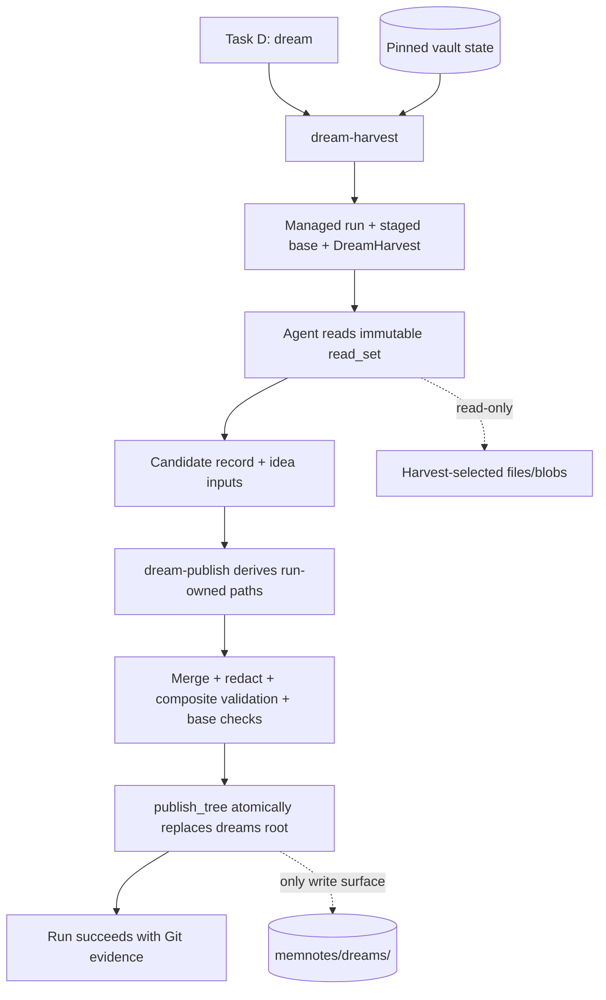

# Architecture: Dream Reflection

## System Overview

Dream is a Task D workflow over deterministic CLI seams. `dream-harvest`
begins a managed run, snapshots the canonical dream tree into run-owned
staging, and emits a complete, versioned reflection contract. Task D reads
only that contract's hash-pinned `read_set` and writes only two run-owned
inputs: a candidate dated record and proposed idea entries. `dream-publish`
derives every path from the authenticated handle, merges those inputs into the
staged tree, redacts, validates, checks concurrency/replacement preconditions,
atomically promotes the tree, and finalizes the run. The CLI never performs
language-model judgment; Task D never discovers the delta or copies canonical
state.



## Technical Decisions (ADRs)

### AD-DR1: Observable target-day union, not an exact edit-time claim

**Status**: Proposed

**Context**: Git records commit time, frontmatter records declared knowledge
time, and dirty state records only the present. No source reconstructs an
unrecorded historical edit exactly.

**Decision**: Harvest resolves the effective timezone as explicit
`--timezone` first, otherwise the host's resolvable IANA timezone; failure to
resolve one fails closed. Omitted `--date` means the preceding calendar date
in that timezone, including DST boundaries. From captured `HEAD`, harvest
walks all reachable commits (all parents; deterministic topological/time/SHA
ordering) whose committer instant falls in that UTC-converted date window.
Merge commits use first-parent tree diffs; shallow history emits a coverage
warning.

The authoritative Markdown surfaces are `Projects/**`, `Skills/**`, and
vault-root Markdown. `dreams/**` is excluded from the target-day delta to
avoid self-input, except that prior Skill Candidate sections are collected
explicitly. Under `--project`, project-local discovery is limited to the
selected Project while shared `Skills/**` and root records remain included
and are labeled shared.

Harvest unions: (1) ordered Git before/after observations; (2) one
metadata-only pass selecting `created == date` or `updated == date`; and (3)
porcelain-v2 staged, unstaged, untracked, renamed, and deleted state under the
same surfaces. Each file has old/new paths, status, available blob IDs and
hashes, and origins `git|frontmatter|dirty`. Untracked Markdown may be read for
frontmatter; dirty deletions carry no current content. Coverage records
commits, HEAD, shallow-history warning, dirty classes, and exclusions. The
product says “observable target-day delta,” never “exact edits.”

**Consequences**: Late commits and untracked dated notes remain observable;
missing metadata stays an explicit limitation. Content reads remain bounded.

**Alternatives Considered**: Git alone, mtimes, or frontmatter alone—all lose
a required class of observable work.
---

### AD-DR2: Vault-level dream surface and validator

**Status**: Proposed

**Context**: Dreams span projects and therefore cannot be validated by
project-scoped `validate --project`.

**Decision**: `memnotes/dreams/` contains only `{YYYY-MM-DD}.md`, `index.md`,
and `ideas.md`. New `validate-dreams --vault` validates:

- record filename/date and required frontmatter/section schema;
- relative links and allowed paths;
- exactly one reverse-chronological index row per date;
- unique `{date}-{slug}` idea IDs and valid `merges:` targets;
- absence of `.tmp/kosmic/` paths and known secret-bearing field labels.

Dream records are records, not atomic Project Knowledge, so they are outside
projection and unattributed-note checks. `dream-publish` always validates the
staged tree before promotion.

**Consequences**: Validation ownership is explicit and independent of project
selection. Unknown children fail closed.

**Alternatives Considered**: Extending project validation (wrong scope),
overloading `validate-library` (wrong domain), unvalidated records (not
acceptable).

---

### AD-DR3: Typed harvest is the complete reflection contract

**Status**: Proposed

**Context**: Reflection needs judgment, but its discovery inputs must be
bounded and auditable. The original delta-only schema could not support open
work, flags, historical transitions, or repetition evidence.

**Decision**: `dream-harvest` emits `kosmic.dream.harvest/1` containing:

- provenance, canonical ordering rules, coverage, and exact Git before/after
  blob observations;
- per-project changed files, selected log items, status changes derived from
  ordered old/new frontmatter blobs, evidence, and impact entries;
- `open_work` from authoritative records: nonterminal stories, epics, and
  quick tasks under `Projects/*/specs/**`; draft PRD/Architecture approval
  gates; and pending Skill Proposals. Terminal `done|rejected|deprecated`
  records are excluded. `--project` applies before enumeration;
- deterministic knowledge checks, link index, candidate evidence, and a
  hash-pinned reflection `read_set`;
- canonical dream-tree base digest and per-date generated-record state.

Knowledge-check algorithms are fixed: a selected log item is a Markdown list item in the target-date log not already containing `[Extracted]`; a changed draft is frontmatter `status: draft`. Harvest performs one complete link-only scan of every Markdown file in the AD-DR1 authoritative surfaces at captured HEAD overlaid with enumerated dirty state. It uses the existing relative Markdown-link parser and NFC-normalized vault-relative paths; anchors do not affect file identity and nonportable Wikilinks are unsupported. `uncited-draft` means zero backlinks in that complete snapshot. Declared stale means `usage_stale: true` or `stale_after < target date`; evidence-order emits when a valid MANIFEST date is strictly later than a citing note's valid `updated`. Missing or malformed required metadata is a validation finding, not silently ordered. Multiple citations emit one structured finding per note/pack pair.

Task D may read only current paths or materialized immutable Git blobs listed
in `read_set`, after hash verification. Possible contradiction remains
judgmental and must link both inputs.

**Consequences**: Open work begun before the target day is included; historical
status transitions do not depend on current files; mechanics/judgment blame is
clean.

**Alternatives Considered**: Agent-led discovery or a delta-only contract.

---

### AD-DR4: Advisory-only mutation boundary

**Status**: Proposed

**Context**: Dream must propose without bypassing Task Review, Task 9, Task P,
or Shared Skill Library governance.

**Decision**: Task D writes only the designated candidate dated record and proposed idea-input file inside its managed run. Knowledge Flags, Today actions, and Skill Candidates are prose with evidence links. A Skill Candidate needs two evidence references and a proposed Task P scope. Cross-project/shared candidates remain judgment outputs and can enter the library only through a later explicit Task P action. `dream-publish` alone rebuilds the index and merges ideas; no note, log, spec, status, marker, proposal, or library file is mutated.

**Consequences**: The workflow is useful without acquiring hidden authority.

**Alternatives Considered**: Auto-proposals and `[Extracted]` writes (rejected
by user choice and governance).

---

### AD-DR5: Managed-run handshake and whole-tree publication

**Status**: Proposed

**Context**: Agent judgment spans more than one CLI process, but scratch ownership, publication paths, cancellation, retry, and crash cleanup must remain authenticated and deterministic.

**Decision**:

1. `dream-harvest` begins the existing managed run, authenticates vault/run
   binding, copies the canonical `dreams/` tree into a run-owned stage using
   no-follow containment checks, and writes harvest/control data there. Its
   compact stdout contains the public run ID, private handle path, and harvest
   path; stage paths are derived later from the handle, never caller-selected.
2. Task D writes only the designated run-owned candidate-record and idea-input files. The candidate must omit `generated_content_sha256`; Task D never reads or mutates the copied base tree.
3. `dream-publish --handle ... [--replace]` resolves all paths from the authenticated handle; rejects escapes, symlinks, devices, FIFOs, wrong owner/mode, and vault mismatch; rechecks `read_set`; deterministically merges inputs; redacts; canonically serializes the final record; computes and inserts `generated_content_sha256`; validates against the staged dream tree overlaid on hash-pinned external link targets; compares the canonical tree with `base_dreams_sha256`; then calls `publish_tree`.
4. Identical idea IDs deduplicate only when normalized entries match; a nonidentical collision fails closed. Index rebuilding is CLI-owned.
5. Success finalizes the run. Validation/input errors leave the active run retryable. Concurrency drift is retryable only after a new harvest. `dream-abort --handle ...` and holder expiry provide authenticated, idempotent failed finalization for cancellation or agent crash.

**Consequences**: No agent runtime is embedded in Python, caller-supplied paths
cannot escape the run, and record/index/ideas publication cannot split.

**Alternatives Considered**: A fictitious full-pipeline CLI, agent-owned base copy, three promotions, or direct writes.

---

### AD-DR6: Rerun, filter, ordering, and deferred behavior

**Status**: Proposed

**Context**: One record per date collides with project filters, reruns, and manual edits; a whole-tree concurrency digest cannot distinguish reviewed prose from its last generated ancestor.

**Decision**:

- `--project` filters project evidence/open work while retaining labeled shared
  evidence; it still writes the one canonical date record.
- Every generated record stores `generated_content_sha256`. `dream-publish` alone generates and inserts it after merge and redaction from the exact canonical bytes specified by the record schema; candidate input containing the field fails. Harvest only verifies the persisted field using that same byte algorithm. Match means generated state; mismatch means manual divergence and sets `replacement_requires_replace: true`. First creation has no prior digest; legacy records without the field require `--replace`.
- `--replace` authorizes replacing the diverged dated record only. It never
  bypasses whole-tree base drift, read-set drift, validation, or idea-ID
  collision checks.
- `index.md` is rebuilt from date filenames newest first. Idea IDs dedupe
  exactly; near duplicates use explicit `merges:` links.
- Weekly rollup and configurable aging are deferred. Cross-project skill
  candidates remain judgment over supplied evidence.

**Consequences**: Rerun and manual-edit behavior is testable, filtered runs
cannot fork records, and reviewed prose cannot be erased silently.

**Alternatives Considered**: Per-filter records, append-only reverse indexes, unconditional overwrite, or a whole-tree digest standing in for record ancestry.

---

### AD-DR7: Secret and provenance boundary

**Status**: Proposed

**Context**: Agent-authored prose may accidentally preserve run handles,
scratch paths, or credentials.

**Decision**: Harvest exposes a public run ID but marks the private handle path
as control data excluded from the reflection `read_set`. Before validation,
`dream-publish` applies the existing Kosmic purpose-redaction rules to staged
Markdown. Validation rejects `.tmp/kosmic/`, private-handle field labels, and
known token field labels. `produced_by` contains `dream/{public-run-id}` only.
Task D instructions prohibit copying credential values even when present in a
source note.

**Consequences**: Permanent provenance remains useful without publishing run
capabilities or scratch topology. Heuristic rejection supplements—not
replaces—the Task D rule.

**Alternatives Considered**: Validator-only token regexes (false confidence)
or no automated guard.

## Data Models

### DreamHarvest

```json
{
  "schema": "kosmic.dream.harvest/1",
  "date": "2026-09-16",
  "timezone": "Europe/Brussels",
  "head": "{sha}",
  "source_commits": ["{sha}"],
  "project_filter": null,
  "coverage": {"shallow": false, "dirty_classes": [], "warnings": [], "excluded_surfaces": ["dreams/"]},
  "base_dreams_sha256": "{sha256-or-empty-tree-digest}",
  "replacement": {"existing": true, "generated_match": false, "requires_replace": true},
  "projects": [{
    "project": "kosmic",
    "files": [{"old_path": "...", "new_path": "...", "status": "modified", "old_blob": "{sha}", "new_blob": "{sha}", "origins": ["git"]}],
    "log_items": [{"id": "{stable-id}", "ref": "..."}],
    "status_changes": [{"path": "...", "from": "in_progress", "to": "done", "old_blob": "{sha}", "new_blob": "{sha}"}],
    "open_work": [{"kind": "story", "path": "...", "status": "blocked", "blocker": "approval", "updated": "2026-09-16"}],
    "evidence_packs": ["Projects/kosmic/evidence/.../MANIFEST.md"],
    "impact_entries": ["Projects/kosmic/impact.md#..."]
  }],
  "knowledge_checks": [{"kind": "unextracted-log", "subject": {"path": "...", "id": "..."}, "evidence": [{"path": "...", "sha256": "..."}]}],
  "link_index": [{"source": "...", "target": "..."}],
  "candidate_evidence": [{"kind": "prior-dream|routine", "ref": "...", "summary": "..."}],
  "read_set": [{"kind": "path|git-blob", "ref": "...", "role": "...", "sha256": "..."}]
}
```

All arrays use documented stable sort keys (projects/paths lexical; commits by
topological order then committer instant/SHA; origins by fixed enum order;
findings by kind/subject). Paths are NFC-normalized POSIX vault-relative
strings. Duplicates collapse by typed identity. JSON is UTF-8, sorted keys,
compact separators, and one trailing newline.

### Dream record

Schema `kosmic.dream.record/1` fixes YAML types and enums: ISO date string, IANA timezone string, unique lexical lists for projects/commit SHAs, `project_filter: null|string`, `status: draft`, structured coverage-warning strings, public `produced_by`, and lowercase SHA-256 `generated_content_sha256`. Required H2 sections appear once in the FR-D4 order. `dream-publish` is the sole serializer: frontmatter uses schema key order and canonical scalar/list rendering; the document is NFC-normalized UTF-8 with LF line endings and exactly one trailing newline; body whitespace otherwise remains unchanged. The generated hash covers those final persisted bytes with only the complete `generated_content_sha256` YAML line removed, and is computed after merge/redaction but before final validation and promotion.

### Ideas entry

`- {date}-{slug} — {idea} — trigger: {relative-link} — next: {action} (added {date})`
with optional `merges: {id}`. IDs are immutable; identical normalized entries
dedupe and differing same-ID entries fail.

## API Design

- `dream-harvest --vault {VAULT} [--date YYYY-MM-DD] [--timezone IANA] [--project TARGET]`
- `validate-dreams --vault {VAULT} [--root STAGED_DREAMS] [--harvest HARVEST]`
- `dream-publish --vault {VAULT} --handle HANDLE [--replace]`
- `dream-abort --vault {VAULT} --handle HANDLE --reason TEXT`

Task D (`dream`) composes these commands and owns reflection prose. External
links are checked against the live vault only after their harvested hashes are
reverified; staged internal links resolve against the candidate tree. No-delta
is valid because open work is still reported. Invalid date/timezone/project,
shallow required history, handle/path/schema/hash/base drift, or malformed
inputs fail closed.
## Test Strategy

| Level | Approach | Coverage |
|-------|----------|----------|
| Unit | Fixture Git repositories, late commits, target-date frontmatter, dirty trees, pinned timezone | Union/origin semantics, deterministic JSON, disclosed coverage |
| Unit | Scripted status/link/evidence fixtures | `open_work` and every deterministic Knowledge Flag oracle |
| Unit | Valid/malformed staged dream trees | Validator paths, schema, ordering, IDs, links, secret/scratch rejection |
| Integration | Harvest → staged reflection fixture → publish; injected digest drift/failure | Managed-run handshake, whole-tree atomicity, rollback, concurrency |
| Integration | Two dates, filtered run, same-date reruns, manual divergence | Reverse index, ideas dedupe, idempotence, `--replace` contract |
| E2E dogfood | Real managed-run release day | Done/In Flight ground truth, late/uncommitted fixture, contradiction links, evidence-backed candidate, zero proposal writes |

## Risks & Mitigations

| Risk | Impact | Mitigation |
|------|--------|------------|
| Historical edit time is unknowable without evidence | Medium | Observable-union semantics and explicit coverage warnings (AD-DR1) |
| Metadata pass grows with vault | Medium | Metadata-only single pass; content bounded by `read_set`; future date index if measured necessary |
| Agent reflection varies | Medium | Task D pins evidence rules; dogfood review gates delivery |
| Concurrent/manual dream edits | High | Base-tree digest and explicit replacement semantics (AD-DR5/6) |
| Prose leaks control data | High | Redaction plus fail-closed validation and Task D instruction (AD-DR7) |

## Dependencies

- Shipped managed-run lifecycle and `publish_tree` transaction (Epics 23–25).
- Existing routine query and Task P governance for candidate evidence/routing.
- Existing Markdown/frontmatter parser, purpose redaction, Git snapshot, and
  directory digest helpers.
