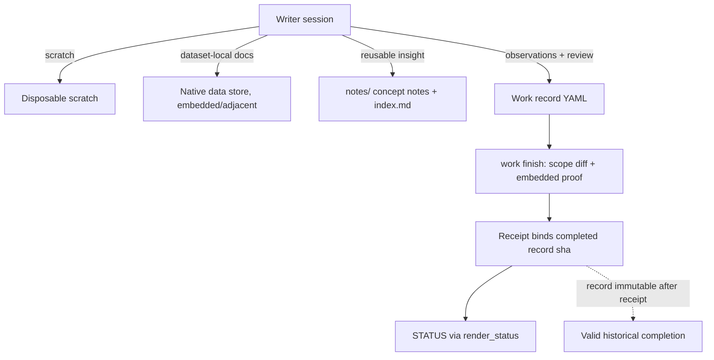

# Architecture: Knowledge-first notes and evidence retirement

## Approval

**Accepted (user approval, 2026-10-17).** The design in this document is
accepted: ADR-A through ADR-F, including the ADR-F candidacy/resource metadata
field names and defaults (`skill_candidate`, `skill_resources`; absent =
false/empty) and the per-scope checkpoint/interval contract as presented. This
is design acceptance only — nothing in this document is implemented at
runtime, and wording below keeps "proposed" for names, interfaces, and
checkpoint files that do not yet exist in code. Implementation proceeds only
through the gated hierarchy: [Epic 001](epics/epic-001.md) is approved
(2026-10-18), and its five draft Stories require individual approval before
implementation. Live-vault
disposition and installation are separate, later approvals and are not
authorized by this document.

## System Overview

Retire mandatory Evidence Pack / manifest / distillation / sidecar machinery while
keeping real verification, independent review, source binding and scope authority.
Placement follows ownership and reuse: single-dataset metadata and interpretation
stay embedded or adjacent to their dataset in the native repository (inside or
outside memnotes); only independently reusable explanations become `notes/`
entries. Completion shrinks to the work record plus the existing machine receipt;
a completed record becomes immutable and its receipt stays valid regardless of
later note or data-doc evolution.

**Affected surfaces** (scout-verified). Runtime: `skills/scripts/kosmic_completion.py`
(sidecar validation, `source_revision` binding, receipt validation, publish order
record→indexes→log→receipt→STATUS), `kosmic_work.py` (`work finish --scope`
diff claims), `kosmic_project_skills.py` (wiring; `render_status` :4049 /
`generate_status` :4195; `validate`/`check-completion` evidence-pack gates;
math/proposal gates in `_check_existing_completion`), `kosmic_specs.py` (catalog
integration calling `render_status`). Canonical docs: `skills/references/task_distill.md`
(retire forced pack flow); `task_add_note.md` (trim stale `confidence: 0.8`/
`evidence: []` template fields to the practiced set `type, title, status, created,
updated, audience, artifact_role`; drop session-summary AUTO-TRIGGER rows
conflicting with FR-001; records the ADR-F creation-time assessment and feeds
the optional separate curation routine); `task_implement_story.md` step 3.7, `task_quick_task.md`
pack-writing steps, `work_completion.md`, `cli-projection-commands.md`, SKILL/README
task matrices; `CONTEXT.md` glossary (delete/redefine `Evidence Pack`,
`Distillation`, `Pattern`, `Impact Ledger`; observed role terms are
`procedure`/`knowledge`/`guideline` — fix stray `Guidance` usages to `guideline`);
`docs/adr/0002`; retire `impact.md` ledger entries within existing task records.
Generated projections (`skills/kosmic-{usage,development}/`,
`Skills/{domain}/index.md`, `.kosmic-projection.json` pins) are never hand-edited
— regenerated by the parent after canonical edits; curated proposal inputs under
`specs/skill-proposals/inputs/curated/` stay protected historical snapshots.

## Note lifecycle rules (prose; enforced by review, not machine checks)

- **Refine**: improve the current explanation in place; never duplicate a concept.
- **Merge**: combine duplicate concepts; differing physical settings, conditions,
  uncertainty, and negative results survive consolidation verbatim or as
  explicitly contrasted variants — a status label or timestamp settles nothing
  scientific.
- **Split**: split independently maintainable topics when they evolve separately.
- **Correct / Retract**: invalid claims get a prominent correction/retraction at
  the top of the affected section; the supported current conclusion leads;
  consequential failed approaches and their settings are retained as explained
  negatives; superseded wording is marked, not silently deleted.
- **Deprecate**: `status: deprecated` with a pointer to the successor; note stays
  readable.
- Every edit above updates incoming links and the `index.md` entry in the same
  change; broken links are repaired, not left dangling.
- **Stable promotion** requires substantive human review of content sufficiency —
  never elapsed time, formatting checks, or test success; useful unresolved
  findings remain `draft`; temporary working material belongs in managed scratch,
  never a note status.
- **Locality**: dataset-only material stays embedded/adjacent to its dataset in
  the native data store; dataset docs are a necessary part of that dataset's
  record (locality decentralizes *where* docs live, not *whether* they exist).
  Only independently reusable insight is extracted to `notes/` with precise
  source links; no per-dataset duplicate note or pointer is manufactured.

## Technical Decisions (ADRs)

### ADR-A: Placement by ownership and independent reuse — Accepted

Pack rules forced per-dataset metadata and interpretation into `evidence/`
paperwork and every finding into a note. Decision: one audience-keyed rule (see
lifecycle Locality bullet). Scratch stays disposable; task-specific observations
and review stay in the owning work record. No orphan per-dataset pointer notes,
no central registry, no content validator scanning external data stores —
misplacement is caught by bounded content review, not path scanners. Rejected:
central dataset-doc index (retired machinery renamed); mandatory pointer stubs
(orphan duplicates).

### ADR-B: Compact work-record completion; receipt stays authoritative — Accepted

Context: `kosmic_completion.py` requires `acceptance_evidence` →
`kosmic.acceptance-evidence/1` and `review_record` → `kosmic.work-review/1` JSON
sidecars plus the `kosmic.work-receipt/1` receipt under `.kosmic/work-receipts/`;
sidecars carry criterion results with `{path, sha256}` artifacts re-hashed against
live bytes and reviewer decisions bound to `reviewed_revision == source_revision()`
— the "paperwork beside code copies" pattern the PRD retires.

Decision: move criterion observations and the review decision into the work
record via **proposed** frontmatter fields (names proposed, not present today):

```yaml
completion_observations:     # one entry per acceptance criterion, full coverage
  - criterion: "<exact criterion checkbox text>"
    observation: "<what was actually run/observed>"
    source: "<revision or artifact path observed>"
completion_review:           # the real independent review decision
  reviewer: "<identity>"
  axes:                      # both existing review axes preserved
    standards: {decision: "approved", reviewer: "<identity>"}
    spec:      {decision: "approved", reviewer: "<identity>"}
  decision: "approved | changes-requested | user-accepted"
  approved_by: "<identity when user-accepted>"
  review_base: "<fixed review base pin>"
  reviewed_revision: "<source_revision of reviewed source>"
  findings:                  # stable finding ledger, never erased by approval
    - {id: "<stable id>", disposition: "Blocking|Non-blocking",
       status: "resolved | risk-accepted", risk_accepted_by: "<human identity>",
       risk_acceptance_note: "<what is accepted and why>"}
  scope: ["<declared finish --scope claims>"]
```

The receipt payload keeps its existing field names and shapes: `schema`,
`identity`, `status: "successful"`, `record_path`, `record_sha256`,
`proof` (a path→sha256 map, not a single digest), `completed_at`, `detail`.
**Proposed proof map for new receipts, exactly**:

```json
{"proof": {"<canonical record_path>": "<sha256 of completed record bytes at finish>"}}
```

`work finish` validates the embedded fields instead of sidecar JSONs. Preserved
verbatim: criterion strings matching Acceptance Criteria checkboxes with full
coverage; both Standards/Spec axes with per-axis reviewer identity; `review_base`
+ `reviewed_revision` binding via the unchanged `source_revision` function
**including its `specs/`/`evidence/`/`log/`/record exclusion list** (dataset-local
placement must never widen this set); stable finding IDs with blocking findings
either resolved or explicitly risk-accepted by a named human; `--scope` diff
checking; "unreceipted `done` is pending" in the single `render_status` seam.
No new dossier, manifest, note bytes, or live downstream artifact hashes enter
completion validity. Rejected: renamed sidecars (replacement dossier, NFR-003);
collapsing review to one reviewer/free-text note.

### ADR-C: Completed records are immutable; receipts verify frozen originals — Accepted

Context: today `validate_receipt_payload` demands `record_sha256 == hash(current
record bytes)` and `proof == recompute(now)` against live sidecar/artifact bytes,
so any later edit retroactively breaks historical receipts — and the previously
drafted "self-consistent frozen payload" alternative would bless arbitrary
forged JSON.

Decision: **a completed work record is immutable after its receipt.** Terminal
validation stays simple and strong: check receipt schema, qualified identity,
canonical `record_path`, `status: successful`, and `record_sha256 == sha256(current
completed-record bytes)` — valid precisely because the completed record no longer
changes — and validate the receipt `proof` map against those same unchanged
original record bytes (which now embed observations + review). No recursive
rehashing of linked notes, data docs, or supporting artifacts: later knowledge
note edits, merges, and deprecations never affect completion validity (FR-006
covers exactly note edits/merges/deprecations — a post-completion **work-record**
edit breaks the receipt by design, detecting completion drift). These hashes
detect drift, not adversarial fabrication: actual reviewer attribution and the
existing trusted publication path remain required. Legacy receipts
recorded against sidecar files validate against those sidecars' unchanged
historical bytes until an approved migration establishes an equivalent durable
historical record; unresolved historical validity is surfaced as pending or an
explicit blocker, never repinned or re-blessed against current bytes. No new
subcommand modes are introduced. Rejected: frozen self-consistent payload
(blesses forgeries); re-validate live artifacts forever (retroactive revocation);
drop validation (unreceipted `done` passes).

### ADR-D: Coherent cutover, verification boundary, bounded legacy disposition — Accepted

(a) `docs/adr/0002-single-evidence-layer.md` (research merged into Evidence
Packs) is superseded by a new ADR ("knowledge-first notes; no separate evidence
layer") written during the implementation story, not planning. Docs/templates/
generated guidance stop naming Evidence Packs in that same story. Obsolete
evidence-pack CLI modes (`evidence_packs:` gate, sidecar-file acceptance inputs,
stable-note `evidence:` path checks, forced distillation chain) are **removed**;
existing commands keep only meaningful duties (identity/scope checks, math and
proposal gates, receipt validation) — reuse of an existing command is allowed,
creation of no-op shims is not. Projections are regenerated, never hand-edited.
(b) Data locality is not license to weaken scientific verification: `check-math`,
MathDoc structural validation, derivation pairing, and completion linkage stay
unchanged — `mathdocs/` are formal derivation records, not "evidence packs". The
cutover documents the boundary: strict machine-checked math vs compact
record-embedded narrative evidence. (c) Existing vault `evidence/` varies from
unique snapshots to duplicated paperwork. A finite source→destination disposition
map (pack → recovered snapshot location / dataset-adjacent doc / note /
scratch-delete) lives inside an **existing approved migration work record** at
execution time — no universal registry. Unique snapshots recovered and links
repaired before any destructive step; destructive batches approved separately;
no recreation of vault evidence archives. Historical doc records preserved and
labeled; only current guidance cuts over.

### ADR-E: Bounded renderer authorization for planning records — Accepted

Context: `generate_status` (`kosmic_project_skills.py:4195`, writing generated
STATUS.md via `render_status`) accepts only approved/in_progress Story/QuickTask
work records; an approved PRD reports `WORK_PHASE_DENIED`, and `spec-create`
bootstraps planning records with no work-handle gate (`WORK_HANDLE_REQUIRED` is a
dead error-table entry) — so planning cannot refresh STATUS today.

Decision: bounded renderer authorization, no authority escalation. Accept
planning-phase records as work-record authority **for the derived STATUS path
only**: approved PRD and Architecture records, plus `draft` planning records when
the authorized action is creating/refreshing their own hierarchy (a new
Architecture draft must be able to refresh STATUS). The authorization scope is
the status derivation itself — it grants no `work finish` capability, no source
mutation, and no receipt semantics; `work finish` stays restricted to
implementation records (Story/QuickTask). Rejected: relaxing `work finish` phases;
new planning-only completion channels.

### ADR-F: Skill-curation metadata and incremental curation window — Accepted

Context: the user requires a creation-time assessment of whether a note could
evolve into skill material, metadata recording which skills actually use a note,
and weekly/manual curation limited to notes changed since the last successful
check — without rescanning all history and without any promotion automaton.
Planning-only: names below are proposed, nothing is implemented.

Decision: new notes emit two `notes/` frontmatter fields; missing legacy fields
read as the defaults, without a bulk rewrite:

```yaml
skill_candidate: false   # suitable to evolve into skill material? absent = false
skill_resources: []      # stable ids of skill topics ACTUALLY using this note; absent = []
```

Default note: candidate false / resources empty. Published resource: non-empty
`skill_resources`, synced only after an approved skill publication or removal;
Task P governs applicable procedure proposals. A live resource may stay
candidate for additional use. The resource
list is never a wish list. Assessment happens at creation and on substantive
content updates, recorded in the note itself — no separate assessment artifact;
supporting knowledge/guideline notes can be useful skill references without
becoming procedures.

Curation-relevant change rule: setting `skill_candidate` false→true (or
intentionally clearing/reassessing it) is a semantic change and MUST bump the
note's `updated`, so a manually nominated old note enters the next window.
`skill_resources` linkage syncs and check/bookkeeping-only writes never bump
`updated`.

Window: selection reads the semantic `updated` instant (`created` fallback only
if never updated; UTC with microsecond precision, e.g.
`2026-10-17T09:30:00.123456Z`; never fs mtime or rounded day/second values).
A run freezes cutoff `U` at start and reviews only `L < updated <= U`
(`L` = previous checkpoint instant), prioritizing `skill_candidate: true` notes
and staleness-checking existing `skill_resources` entries. Values equal to `L`
are excluded; values equal to `U` are included. Post-cutoff saves must receive
a timestamp greater than `U`, not one rounded back into the consumed interval.
Selection is metadata-driven; review is semantic content review. Legacy
date-only values cannot establish an exact instant: an overlapping uncertain
day blocks checkpoint advancement until an explicit bounded baseline resolves
its disposition. Do not invent historical times, silently drop ambiguous notes,
or semantically review out-of-window notes. Subsequent substantive saves get
real UTC timestamps; missing skill metadata still means false/empty.

Checkpoint: one last-successfully-checked-through instant per scope (proposed: a
small per-scope JSON holding the UTC instant plus run identity), shared by
weekly and full-scope manual runs. Its upper bound is the start cutoff `U`, so
in-run edits land next run. It advances only after successful review of the full
eligible snapshot — no-action runs advance; skill approval, failed or partial
runs never do. Targeted manual subsets use the same timestamp window without
advancing the full-scope checkpoint; same-scope runs serialize (single writer).
First run takes an explicit lower bound or an intentional baseline — no invented
prior checkpoint, no automatic all-history sweep. Scope stays within memnotes
`notes/`; external data stores are never scanned. The run revalidates selected
source revisions against its in-memory snapshot before checkpoint publication;
an unprocessed in-window change blocks advancement. These are current note
snapshots, not historical completion-receipt hashes or new evidence copies.

Boundaries: no new scheduler, daemon, or automatic daily output — one
manual/scheduled invocation with scope and interval bounds (proposed interface).
Dream's day-only collector cannot express this window unchanged: reuse its
proposal/review record concepts, never force Dream reports. Batch runs may skip
notes assessed false at creation unless they are live `skill_resources` needing
staleness checks. Promotion stays human-gated (no keyword-only auto promotion);
curation nominates only — publication, approval, and installation remain
separate gates.

## System Design



**Data models**: Note contract unchanged except the optional ADR-F curation
fields (`skill_candidate`, `skill_resources`; absent = false/empty) — frontmatter `type` /
`status: draft|stable|deprecated` (+ optional `stale_after`), concept-named,
current-truth-first, self-contained body, relative links, `index.md` entry; no
length cap, no confidence scores; `evidence: []` becomes optional ungated
reproducibility `sources:` links. Work-record completion fields per ADR-B;
`acceptance_evidence`/`review_record` remain valid only in historical records
(immutable inputs). Receipt schema/field names unchanged; new-receipt proof map
per ADR-B. External dataset docs keep native formats — no Markdown flattening of
numerical datasets, no kosmic-side schema imposed.

## Interface Changes (proposed, bounded)

| Surface | Change |
|---|---|
| `work finish` | Reads `completion_observations`/`completion_review`; sidecar JSON paths no longer accepted on new records; completed records immutable thereafter |
| `check-completion` | Receipt checks per ADR-C (identity/path/status/`record_sha256`/proof vs unchanged original bytes); drops `evidence_packs:`→note and stable-note `evidence:` gate enforcement; no new modes |
| `generate-status` | Renderer authorization per ADR-E: planning records (approved PRD/Architecture; draft hierarchy refresh) allowed for the derived STATUS path only |
| Task 9 / note gates | Forced pack-to-note chain removed; admission = prose lifecycle rules + bounded content review + human promotion gate |
| Curation routine | Proposed only: one manual/scheduled invocation with scope/from/to cutoff; metadata-driven selection, semantic review, per-scope checkpoint, serialization, snapshot revalidation (ADR-F); no flags implemented in planning |
| Legacy ledger | `impact.md` generation/publication entries retired inside existing records; no replacement ledger |
| Docs | References/templates/glossary cutover in one story; `note-writing-style.md` documents the ADR-F fields and the updated-bump rule; curation stays an optional separate routine; projections regenerated by parent |

## Test Strategy

| Level | Approach | Coverage |
|-------|----------|----------|
| Unit | `kosmic_completion`: embedded-proof validation; receipt validity vs unchanged completed record; receipt invalidation on post-completion record edit; unreceipted `done` pending; legacy receipt vs unchanged sidecar bytes; unresolved legacy validity → pending/blocker | ADR-B/C |
| Unit | Renderer authorization: approved PRD/Architecture and draft-hierarchy refresh render STATUS; `work finish` still refuses planning records | ADR-E |
| Behavioral | Bounded-copy transformations of the four audited examples (PRD Success Criteria): retraction ordered correction; conflicting metadata merged into one coherent note; campaign report → dataset-adjacent docs + reusable notes; **locality-only dataset produces no memnotes note**; later note edits leave historical completion intact | Success Criteria |
| Behavioral (planned) | ADR-F metadata: absent fields read false/empty (default vs published resource); false→true candidacy bumps `updated` into the next window; `skill_resources` sync and bookkeeping writes never bump; resource may stay candidate | ADR-F |
| Behavioral (planned) | Curation window: `L < updated <= U`; exact UTC boundaries, post-cutoff saves, ambiguous legacy dates block rather than disappear; explicit first-run lower bound/baseline; successful full-scope no-action advances, failed/partial/targeted runs do not; same-scope runs serialize and revalidate selected revisions | ADR-F |
| CLI smoke | Test-vault invocations: `work start` → edit → `work finish --scope` with no `evidence/`; `generate-status` reflects receipt; removed modes absent from `--help`; `check-math` still passes | FR-005/008, ADR-D |
| Content review | Lifecycle prose (refine/merge/split/correct/retract/deprecate, negative-result preservation, link repair, human stable gate) reviewed by bounded content review, **not** new machine tests | Lifecycle rules |
| Migration dry-run | Disposition map applied to copied legacy packs; snapshot recovery and link repair asserted before any destructive op | ADR-D(c) |

## Risks & Mitigations

| Risk | Impact | Mitigation |
|------|--------|------------|
| STATUS authority mismatch blocks planning-phase reporting | Medium | Bounded renderer authorization (ADR-E), separately implemented |
| Compact fields lose review sufficiency detail | Medium | Both axes + per-axis reviewer identities + stable finding ledger with explicit human risk-acceptance fields; sufficiency stays human judgment |
| Unreceipted `done` or drifted completion record | High | Completed-record immutability + `record_sha256`/proof drift checks; trusted publication and real reviewer attribution remain required; unreceipted-pending rule unchanged (ADR-C) |
| Partial cutover leaves shim commands | Medium | Remove obsolete modes; reuse only meaningful existing commands (ADR-D) |
| Approved quick task `restore-evidence-inventories-for-projection-hygiene` conflicts with retirement | Medium | Superseding decision recorded in that record at implementation; pack-inventory rows not executed post-cutover |
| Dataset-local docs scattered across repos harder to discover | Low | Accepted decentralization; dataset docs remain a necessary part of each dataset's record, located beside it; reusable findings still extracted to notes |

## Dependencies

- Existing Projection CLI modules above; no new packages or replacement formats.
- ADR 0002 supersession (new ADR file at implementation).
- Existing approved migration work record hosting the legacy disposition map.
- memnotes note conventions (`notes/note-writing-style.md`) for extracted notes.
