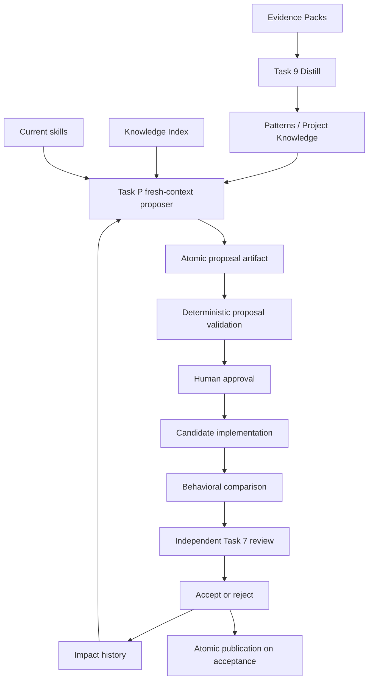

# Architecture: Skill Proposal Loop

## System Overview

The feature adds one explicit reasoning stage between maintained Project Knowledge and skill implementation. Task P is the agent-facing proposer interface; `SkillProposal` validation is the deterministic machine seam. The proposer can inspect only a curated package and writes one reviewable Markdown artifact. It never edits a canonical or installed skill. Approved procedural proposals are implemented through ordinary approved Stories or Quick Tasks and accepted only after behavioral comparison and Task 7 review.

Project Knowledge remains deterministic: `project-knowledge` results feed existing note review and Skill Pair projection. `project-procedure` results propose a change represented by a stable Development note and regenerated Development Skill. `global-procedure` results propose a change to a separately maintained procedure skill. The exactly-one Project Skill Pair invariant remains intact.



## Technical Decisions

### AD-P1: Dedicated Task P, not inference inside the CLI

**Status**: Proposed

**Context**: WikiSkill assigns discovery and refinement to a Wiki-informed Skill Proposer. Kosmic's Projection CLI is intentionally deterministic and offline.

**Decision**: add `references/task_propose_skill.md` and route it as `Task P: Propose Skill Change` after Task 9 when a reusable Pattern is created or materially changed. The task emits one proposal artifact with result `create`, `update`, or `no_action`. Python validates but never generates the decision.

**Consequences**: proposal becomes mandatory and auditable without introducing an LLM dependency into the CLI. Agent quality remains a trust input controlled by approval and review.

**Alternatives Considered**: make `generate` infer changes (rejected: nondeterministic and unsafe); retain implicit story-flow proposal (rejected: current failure); import WikiSkill's benchmark harness (rejected by PRD).

---

### AD-P2: Curated proposer package and tiered independence

**Status**: Proposed

**Context**: Merely naming the current implementation agent “proposer” preserves execution and confirmation bias. A fresh process is useful only if its information set is also separated.

**Decision**: Task P constructs a bounded input manifest containing the proposal procedure, `notes/index.md`, explicitly relevant notes and Evidence Packs, current target-skill files, relevant `impact.md` entries, and concise work outcomes. The parent transcript and unrestricted repository context are excluded by default. A `global-procedure` proposal and any proposal targeting a shared skill require `proposer_mode: subagent`, a non-empty `proposer_ref`, and fresh-context attestation. `project-knowledge`, `project-procedure`, and `no_action` may use `same-agent` only with a non-empty `proposer_reason` and the same curated input manifest.

**Consequences**: shared changes fail closed if delegation is unavailable. Project-local maintenance remains usable during agent outages. The CLI validates recorded policy compliance, not the truth of process identity; Task 7 checks the referenced execution record.

**Alternatives Considered**: require subagents always (rejected: needless availability dependency for local/no-action decisions); never require them (rejected: weak independence for transferable procedures); send the full transcript (rejected: defeats context separation).

---

### AD-P3: Flat, Markdown-native proposal artifact

**Status**: Proposed

**Context**: Proposal state must be Obsidian-readable, compatible with Kosmic's small frontmatter parser, and independently machine-validatable.

**Decision**: one file per run at `specs/skill-proposals/{YYYY-MM-DD}-{slug}.md`. Frontmatter is flat:

```yaml
---
status: draft
created: 2026-09-06
updated: 2026-09-06
result: create
scope: global-procedure
target: example-skill
target_ref: skill://example-skill
target_sha256: <sha256-or-empty-for-create>
proposer_mode: subagent
proposer_ref: agent://identifier
proposer_reason: ""
input_manifest: [notes/index.md, notes/pattern.md, evidence/pack/MANIFEST.md]
evidence_packs: [pack]
related_notes: [pattern.md]
behavioral_evidence: []
decision: pending
reconsiders: ""
fingerprint: <sha256>
---
```

Required body sections are `Problem`, `Evidence`, `Proposed Change`, `Applicability`, `Behavioral Validation`, and `Risks`. `Proposed Change` must identify the exact files and instructions to add, replace, or remove; it cannot be a generic recommendation. For `no_action`, `target`, `target_ref`, and `target_sha256` are empty, `No-Action Reason` replaces `Proposed Change`, and `Behavioral Validation` may state why no candidate run is applicable. For `update`, `target_ref` identifies the inspected skill and `target_sha256` pins its reviewed content. `decision` is `pending | accepted | rejected`; only accepted/rejected artifacts can reach `done`.

`SkillProposal` is an immutable dataclass returned by `load_skill_proposal(project, path)`. This is the sole internal interface used by validation, completion, review, and ledger operations. Project-relative manifest entries must resolve beneath the Project root; external skill inputs are represented by pinned `target_ref`/`target_sha256`, not traversal paths.

**Consequences**: the format is human-reviewable and testable through one seam. Nested YAML and a second parser dependency are avoided.

**Alternatives Considered**: JSON (rejected: poor review ergonomics); proposal directory with mutable candidate skill (rejected: publication ambiguity); encode proposals in `impact.md` (rejected: ledger is history, not authoring state).

---

### AD-P4: Explicit work-item gate with backward compatibility

**Status**: Proposed

**Context**: Mechanical enforcement is needed, but completed legacy work must remain valid.

**Decision**: add `proposal_required: true | false` and `skill_proposal: relative/path.md` to new Story and Quick Task templates. Task 4 records the same decision in its session log or a maintenance Quick Task. `check_completion` validates `proposal_required` when present. If true, it resolves exactly one `skill_proposal`, calls `load_skill_proposal`, and requires at least a valid Task P result. If false, `skill_proposal` must be absent. An absent key remains a no-op for legacy work. The gate runs after Evidence linkage and before the existing `consumer_interface_change` early return.

Task 9 requires `proposal_required: true` when it creates or materially changes a note whose content contains a repeatable action sequence, decision procedure, recovery procedure, or tool workflow; otherwise it records false with a reason in the work-item body.

**Consequences**: new work cannot silently omit the decision, while old records remain checkable. The same gate-order regression pattern is reused.

**Alternatives Considered**: infer requirement from `evidence_packs` (rejected: evidence may contain facts only); require the key retroactively (rejected: breaks completed work); checklist-only enforcement (rejected: repeats the original defect).

---

### AD-P5: Two-step approval and implementation lifecycle

**Status**: Proposed

**Context**: A proposal is not an implementation, and behavioral evidence cannot exist before a candidate does.

**Decision**:

1. Task P creates `status: draft`, `decision: pending`.
2. Task 7 proposal review checks evidence, novelty, scope, independence, and validation design; human approval changes status to `approved`.
3. An approved Story or Quick Task implements the candidate outside canonical and installed skill paths. Project-procedure candidates are authored as draft Development notes and projected only after acceptance; global candidates use that skill's normal managed/repository workflow.
4. Candidate and baseline run the predeclared behavioral comparison. Results enter a new execution Evidence Pack and its path is added to `behavioral_evidence`.
5. Convergent Task 7 code/spec review sets `decision: accepted | rejected`, appends one Impact Ledger decision, and moves the artifact to `done`.
6. Only accepted changes are published and installed. Rejected candidate changes are removed; evidence and proposal remain.

**Consequences**: candidate evaluation cannot contaminate active skills. Human gates remain authoritative. One proposal may require a subsequent implementation work item.

**Alternatives Considered**: implement during proposal (rejected: bypasses approval); publish before comparison then roll back (rejected: exposes unaccepted behavior); compare only tests (rejected: does not show that instructions change agent behavior).

---

### AD-P6: Behavioral comparison as an evidence contract

**Status**: Proposed

**Context**: WikiSkill uses validation-score improvement. Real projects often lack a scalar benchmark but still need observable evidence that a skill helps.

**Decision**: the proposal body declares one agent-runnable command or scenario, invariant inputs, observable verdict, and baseline/candidate modes. Creation compares no-skill versus candidate; update compares current versus candidate. Both runs are captured in an Evidence Pack. Deterministic product tests remain required but cannot substitute for the behavioral comparison. A `no_action` result requires no candidate comparison.

The validator checks references and required declarations; Task 7 judges whether the seam and observation are meaningful. Acceptance requires candidate success and no regression in the baseline contract, not an invented numeric score.

**Consequences**: validation is project-realistic and falsifiable. Some proposals will remain approved but unaccepted until an adequate runnable seam exists.

**Alternatives Considered**: mandatory scalar score (rejected: unavailable for many tasks); test suite only (rejected: validates implementation, not skill use); subjective reviewer judgment only (rejected: weak evidence).

---

### AD-P7: Proposal fingerprint and rejection memory

**Status**: Proposed

**Context**: WikiSkill uses skill-impact history to avoid repeating rejected interventions. Kosmic's six-field ledger must remain stable.

**Decision**: compute `fingerprint = sha256(canonical(result, scope, target, related_notes, Proposed Change body))`. `evidence_packs` are excluded, so merely attaching new evidence does not disguise an identical intervention. `validate_skill_proposal` scans done/rejected proposal artifacts for the same fingerprint. A repeat fails unless the new artifact declares `reconsiders: relative/rejected-proposal.md` and its body has a `New Evidence` section. Ledger decisions use `targets: [target]` and `refs: proposal:<relative-path>#<fingerprint>` without changing the six-field schema.

**Consequences**: rejected changes stay queryable and mechanically resistant to repetition. Materially revised proposals naturally get a new fingerprint.

**Alternatives Considered**: ledger-text similarity (rejected: nondeterministic); include evidence in fingerprint (rejected: easy accidental duplication); prohibit all reconsideration (rejected: new evidence can invalidate an earlier decision).

---

### AD-P8: Activation is observable but adapter-limited

**Status**: Proposed

**Context**: WikiSkill injects all skills and therefore does not exercise native retrieval. Kosmic cannot claim activation merely because adapter files exist.

**Decision**: generated descriptions become fixed, concrete trigger sentences:

- Usage: `Use when invoking, configuring, integrating, validating, installing, or troubleshooting {project_id} consumer interfaces.`
- Development: `Use when changing, testing, reviewing, or releasing {project_id} implementation or development infrastructure.`

`install` reports `installed on disk; active-session discovery unverified` and names the adapter's reload/new-session action. Add `check-installation` to validate installed bytes and manifest identity. Runtime inventory verification remains a documented adapter probe when the host exposes an inventory; absence is reported as unverifiable, never success.

**Consequences**: activation language improves and status claims become accurate. The stdlib CLI does not depend on private runtime databases or pretend to inspect an active model session.

**Alternatives Considered**: full skill injection (rejected: adapter-specific and context-heavy); claim file presence equals activation (rejected: observed false); introspect undocumented runtime state (rejected: brittle).

## Module Design

External CLI interface:

```text
validate-proposal --project PROJECT --proposal FILE
check-installation --project PROJECT --adapter ADAPTER --home HOME
check-completion --project PROJECT --work-item FILE [existing options]
validate --project PROJECT  # includes every proposal artifact
```

Internal interface:

```python
@dataclass(frozen=True)
class SkillProposal:
    path: Path
    status: str
    result: str
    scope: str
    target: str
    target_ref: str
    target_sha256: str
    proposer_mode: str
    proposer_ref: str
    input_manifest: tuple[str, ...]
    evidence_packs: tuple[str, ...]
    related_notes: tuple[str, ...]
    behavioral_evidence: tuple[str, ...]
    decision: str
    fingerprint: str
    reconsiders: str


def load_skill_proposal(project: Project, path: Path) -> SkillProposal: ...
def validate_skill_proposals(project: Project) -> None: ...
def validate_proposal_completion(project: Project, work_item: MarkdownDocument) -> None: ...
def validate_installed_pair(project: Project, adapter: str, home: Path) -> Path: ...
```

`load_skill_proposal` earns the seam: callers do not know frontmatter parsing, path containment, section rules, fingerprint construction, independence policy, duplicate rejection history, or lifecycle consistency.

## Test Strategy

| Level | Approach | Coverage |
|-------|----------|----------|
| Unit | Temporary Project fixtures through CLI commands | Every proposal field, lifecycle combination, scope/mode policy, fingerprint, reconsideration, containment, and legacy absent-key behavior |
| Integration | `check-completion` with real notes/evidence/proposal fixtures | Gate ordering, true/false declarations, no-action reason, behavioral evidence before acceptance |
| Publication | Adapter-home fixtures and byte snapshots | `check-installation`, collision/identity, stale bytes, accurate unverified-activation message |
| Behavioral dogfood | Fresh proposer subagent plus baseline/candidate task runs | One real Kosmic global-procedure proposal from evidence through acceptance/rejection |
| Regression | Full `unittest` suite and canonical `validate`/`review` | Existing evidence, MathDocs, projection, and install behavior |

## Risks and Mitigations

| Risk | Impact | Mitigation |
|------|--------|------------|
| Proposal spam from weak Patterns | High | explicit repeatable-procedure trigger, atomic result, novelty search, human approval |
| Same agent rubber-stamps its own global skill | High | mandatory fresh-context subagent and independent Task 7 review |
| Metadata claims fake independence | Medium | preserve `proposer_ref` and curated input manifest; reviewer verifies execution record |
| Candidate leaks into active installation | High | stage outside canonical/installed roots; publish only after acceptance |
| Behavioral comparison is subjective | High | predeclare runnable seam, invariant input, and observable verdict; capture both runs |
| Rejected proposal repeats under a new filename | Medium | canonical fingerprint plus explicit reconsideration path and New Evidence |
| Native runtime still ignores installed skill | Medium | concrete descriptions, check installed bytes separately, report activation as unverified unless observed |
| New gate invalidates historical work | High | absent-key compatibility; new templates declare the decision explicitly |
| Task P grows context without bound | Medium | curated manifest; proposer reads only listed inputs and follows references deliberately |

## Dependencies

- Existing Evidence Packs, note `evidence:` linkage, and Task 9 Distillation.
- Existing flat six-field Impact Ledger.
- Existing Task 7 human and convergent review gates.
- Agent harness subagent support for shared/global proposal runs; fail closed when unavailable.
- No new Python package dependency.
