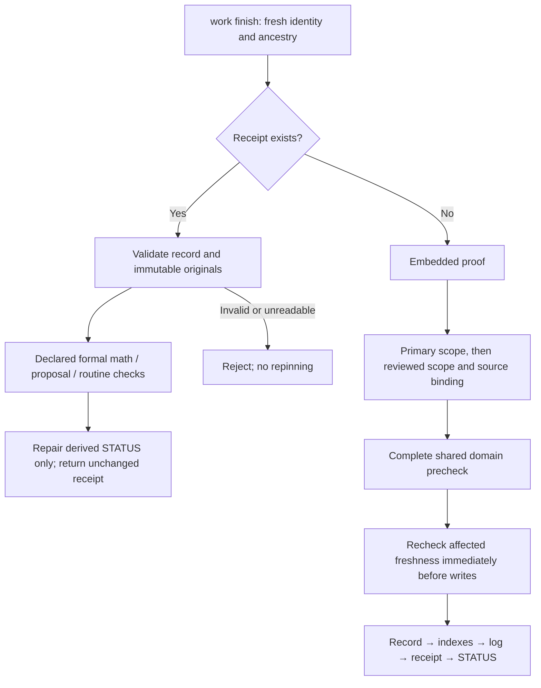

# Architecture: Workflow Efficiency and Selective Delegation

## Status

**Approved by the user.** The Architecture and ADRs below are accepted design
decisions, not implementation claims. Epic approval, Story approval and
implementation/review remain separately gated.

## System Overview

The efficiency direction changes how the existing kosmic workflow is
*exercised*, not what safety machinery exists. No new persisted state of any
kind is introduced — no episode/session store, token, cache, queue, or
completion dossier. Work reuses the existing authorizing record and worktree
when they already cover the scope; questions, searches, and unchanged-state
checks stay record-free; and every mutating CLI keeps re-deriving fresh
identity, ancestry, scope, and approval at invocation, so context reuse never
becomes cached permission. Completion becomes one ordinary nonterminal
invocation that runs the full gate set (with the necessary freshness
rechecks) instead of two choreographed commands; terminal-receipt retries get
a fast route that skips mutable re-verification. Criterion prefill is a new
**read-only** CLI; review packets become risk-proportional but keep both
independent axes; measurement lands in existing notes.

**Affected surfaces:** `skills/scripts/kosmic_completion.py`
(`finish_work`, `validate_completion_proof`, `_checked_review`,
`source_revision`, `validate_receipt_payload`, `check_done_record_gates`,
`check_completion_gates`), `kosmic_work.py` (`resolve_work_record`,
`check_record_changes`, `_ancestry_approved`, `WorkdirError` codes),
and `kosmic_project_skills.py` (`_check_existing_completion`, `check_completion`,
the `work` subcommand tree and `check-completion` dispatch).
The chosen shape **extends the existing completion module** and
shares the domain precheck through the established deferred import between
`kosmic_completion` and `kosmic_project_skills`; no new preflight module.

## Technical Decisions (ADRs — all Accepted)

### ADR-A: Reuse before creation; permission is never cached — Accepted (FR-001, FR-002)

If an existing record already authorizes the work, it is reused — no new
record; a record starts work once, and resuming continues inside its recorded
scope, reusing the existing worktree. Otherwise the choice is Quick Task vs
full spec by actual scope and risk. Questions, code search, and checks that
inputs are unchanged are record-free. Every mutating CLI call re-resolves
identity, ancestry, and scope live (`resolve_work_record`,
`_ancestry_approved`, `check_record_changes`) at invocation; mid-episode
scope/approval changes therefore reject the next mutating call instead of
proceeding on cached authority, and a resumed episode can never silently
widen its recorded scope. Rejected: episode/session persistence; any new
authority artifact.

### ADR-B: Unified nonterminal finish; shared domain precheck — Accepted (FR-003)

The public surface is unchanged: `finish_work(project_root, worktree,
record_ref, scope, *, detail="") -> dict` and the `work finish` CLI JSON
receipt. One ordinary invocation runs the full nonterminal gate order:
resolve authority; validate embedded proof (`validate_completion_proof`);
primary scope check (`check_record_changes` on the finish claims —
SCOPE_DENIED precedence); reviewed scope/`source_revision`/fixed-base review
(`_checked_review`); then the **complete shared readonly domain precheck**,
performed by calling the existing
`kosmic_project_skills._check_existing_completion(project, record.path,
source_root=worktree, record_scoped=True, record_owner=record.subproject_id)`
via the established deferred import — not by recursing through the whole
`check-completion` CLI path. This covers depends_on, STATUS drift,
retired inputs/content, `consumer_interface_change`, math/proposal/routine
gates, related stable usage notes, and projection. A missing/unreadable
Project config is **not swallowed** on this finish precheck path (unlike the
tolerant STATUS-candidate enumeration). No auto STATUS/projection repair or
pin refresh happens inside the precheck: stale inputs surface as explicit
diagnostics. A domain `KosmicError` from the precheck translates on the
public finish path to `WorkdirError("COMPLETION_PRECHECK_FAILED", …)`
retaining the original diagnostic and cause; existing authority, scope,
proof and review error codes remain unchanged. Standalone
`check-completion` remains diagnostic/fail-fast and
calls the same helper. Freshness rechecks affected by the checking (record
bytes, source revision, authority) run immediately before writes; then the
publication order record → indexes → completion log → receipt → STATUS is
unchanged.

### ADR-C: Terminal-receipt route precedes mutable re-verification — Accepted (FR-004)

Before any full precheck, proof validation, or source binding, finish
resolves identity/approved ancestry and attempts receipt validation
(`validate_receipt_payload`): current receipts bind
`{record_path: record_sha256}`; legacy receipts byte-verify only their
recorded immutable originals. Valid retry repairs only the derived STATUS
reports — receipt and completion log are immutable, and the receipt is
returned unchanged — after applying the declared formal math/proposal/routine
checks exactly as the existing plain done path does (`load_math_registry`
restricted to the record's `derivations` + `_check_math_proposal_routine_gates`).
A receipt that is present but unreadable or inconsistent is rejected
(`COMPLETION_PENDING`/`COMPLETION_DRIFT`) and never repaired by repinning or
re-blessing against current bytes. Only an absent receipt falls through to
the full nonterminal path: interrupted pre-receipt finishes recover by
rerunning every gate, and an unreceipted `done` is never conflated
with terminal success. No linked note/data rehash, no current dirty-source
review binding recomputation, no historical pin refresh ever occurs on this
route.

### ADR-D: Criterion prefill via read-only `work prepare-completion` — Accepted (FR-005)

New read-only CLI:
`python3 skills/scripts/kosmic_project_skills.py work prepare-completion --project P --work-record R`.
It resolves record identity but performs no mutation or work start (no `--worktree`).
It accepts only authorized nonterminal Story/Quick Task records and refuses
completed ones. Output is JSON:
`identity`, canonical `record_path`, and `completion_observations` holding
each exact criterion in canonical record order. Criteria are parsed with the
same semantics as the validator (the `## Acceptance Criteria` checkbox scan in
`validate_completion_proof`); each exact-matched authored entry is preserved
field-for-field, including adverse findings; a criterion with no authored
entry yields empty `observation`/`source` — a draft that remains invalid at
finish. The command generates no outcome, reviewer statement, or approval.
It rejects missing, duplicated/ambiguous criteria and unknown or duplicate
authored mappings — nothing is silently dropped. There is no `--write` mode
and no sidecar (NFR-003); applying the output is ordinary scoped record
editing, and any subsequent record/source change invalidates the review
binding exactly as today.

### ADR-E: Risk-proportional packets on the existing review machinery — Accepted (FR-006, FR-007)

A review packet is bounded to the actual delta plus acceptance context drawn
from the existing record and review ledger: fixed review base, criteria,
observations, checks, and adverse facts. Reviewer count is never reduced:
every packet review — including a low-risk one — still shows two distinct
independent Standards/Spec reviewers, stable finding IDs, rounds 1–3, and the
existing escalation; a failed review escalates, never downgrades. Low risk
limits packet scope and depth only. Stronger domain review is triggered by
category — numerics/scientific claims, methods, security, and API/data/
schema/publication/receipt changes — regardless of line count; risk is judged
from content and blast radius, never line count alone. Unchanged inputs
receive no fresh audit round; a changed input or contract, or a failed check,
reruns the affected checks on the fixed base rather than resetting into a
fresh audit.

### ADR-F: Discretionary delegation and check cadence — Accepted (FR-008, FR-009)

A subagent checkpoint is justified only by genuine independence, useful
parallelism, or context isolation, and must carry a concrete bounded question
or slice with explicit input/output and a named integration owner, recorded
in the existing launch request/trace. Coupled work has one owner; no
phase-default fanout, tiny clerical delegation, nested exploration without
benefit, or authority expansion. Host-mandated delegation and fresh-context
proposer/reviewer independence are untouched. Verification cadence: focused
checks run during work; the integrated suite runs once after affected
changes stabilize; only checks whose inputs or contracts changed or that
previously failed are rerun; scientific validation is never skipped.

### ADR-G: Batched episode completion, no new artifact classes — Accepted (FR-010)

Knowledge notes, log entries, and publication completion for one authorized
episode are batched into a single pass, with one appropriate canonical
refresh per batch; an actual content change to a published note source still
counts and refreshes. No note, proposal, or publication is forced; optional
curation stays off the critical path unless correctness requires immediate
action. Dataset-only metadata remains native-adjacent per the knowledge-first
placement rule. No new scheduler, queue, dashboard, or artifact class.

### ADR-H: Honest three-case measurement in existing notes — Accepted (FR-011)

The three representative scenarios are identified now: (1) small coding fix,
(2) exploratory scientific research/campaign, (3) substantial feature. The
assessment lands as one bounded section in this subproject's existing
Research or Story Technical Notes, written after implementation scope exists;
historical cases are chosen by actual complete trace availability. Elapsed
time is reported where traces support it and `UNKNOWN` otherwise, with
explicit observed-vs-expected counts of mandatory manual operations (copy,
record, start, CLI, handoff). Receipt `completed_at` timestamps are never
treated as durations. Foreground Kosmic admin work, approval-wait/handoff
delay, primary coding/analysis, necessary scientific validation, and
background compute are reported separately; overlapping workers never sum.
No fabricated case timings and no invented speedup targets.

### ADR-I: Coherent cutover and human-facing full-path links — Accepted (FR-012, FR-013)

At implementation, current docs, CLI guidance, examples, and consumer
contracts are updated coherently; historical receipt/pin bytes stay
unchanged; no installs or live/global vault changes outside existing
boundaries. FR-013 is a **human-facing prose rule, deliberately not
machine-enforced**: every created or presented PRD, Architecture, Epic, or
Story is individually linked with its full absolute path as the visible label
and the actual file as the target; every receipted finished Story is linked
again, with final canonical links after any integration move. Future or
nonexistent paths, index/directory substitutes, and alterations of the CLI
JSON receipt schema are prohibited. Review approval alone is never
completion.

## Completion flow

Every gate failure rejects before its route's publication step. Primary-scope
failure precedes reviewed-scope failure; the diagram does not imply a fallback
from an invalid existing receipt to a new completion attempt.

## Data and API contracts

Persisted schemas remain unchanged: observations and review stay inside the
governing record; receipts keep their current record-byte binding and historical
receipts retain their immutable originals. No new durable fields or artifact
classes are needed. The only new output is the read-only JSON described in
ADR-D; it is a draft editing aid, not a completion proof or authorization.
`work finish` retains its required `--project`, `--worktree`, `--work-record`
and repeated `--scope` arguments; standalone precheck and CLI receipt JSON remain
available. All commands are subcommands of
`python3 skills/scripts/kosmic_project_skills.py`, not a new standalone executable.

## Failure, ordering, and race behavior

- **Ordering is normative.** SCOPE_DENIED precedence means mis-scoped work
  fails before review validation; the precheck runs after the review gates so
  domain diagnostics never mask scope/proof defects; no receipt exists until
  every gate has passed.
- **Error codes** are retained (`RECORD_NOT_AUTHORIZED`, `WORK_PHASE_DENIED`,
  `ACCEPTANCE_INVALID`, `RETIRED_INPUT`, `SCOPE_DENIED`, `REVIEW_INVALID`,
  `COMPLETION_PENDING`, `COMPLETION_DRIFT`); the single new public code is
  `COMPLETION_PRECHECK_FAILED`, which wraps the retained domain diagnostic.
- **Races.** No global filesystem atomicity is promised. There is one writer
  per episode; the last freshness recheck runs immediately before the write
  sequence, and detected drift rejects the invocation — the caller reruns.
  There is no automatic rebind of a moved or changed record/source.
- **Interruptions** preserve existing semantics: before the receipt, the
  record is not-done or done-pending and a rerun completes it through the
  full path; after the receipt, retry repairs only derived STATUS.

## Alternatives considered

**(A — chosen) Extend the existing completion module and share the domain
precheck via the established deferred import.** Low churn: the gate logic,
publication order, and error surface stay in one place callers and tests
already exercise (`finish_work`, `check_completion_gates`); the cost is that
the completion module keeps its current coupling to `kosmic_project_skills`,
which the pre-existing lazy-import pattern already manages.

**(B) Extract a new preflight module.** A clean seam in principle, but every
full gate would require moving CLI-specific config, type, and domain helpers
out of `kosmic_project_skills`; a narrow extraction would strand the
unified-finish requirement (FR-003) behind partial coverage, and the broad
one is an unnecessary restructure with no behavioral gain.

**(C) An ephemeral prepared-completion object/token.** It would only save
criteria parsing; authority resolution and source-freshness checks would
still be mandatory per invocation, so it adds API surface, state, and
staleness risk for no measured benefit. Prefill (ADR-D) achieves the parsing
saving read-only, with nothing to expire.

## Test strategy

Behavior-level tests only, on existing suites: gate refusal before any
receipt exists; gate ordering (scope rejection over review validation);
terminal immutability and the declared formal checks on the terminal route;
prefill preservation of authored entries, its error cases, and proof it
writes nothing; authority drift mid-episode; two-axis presence and
escalation-under-failure. The human-link rule, discretionary delegation, and
the three-case flow are checked through observed real producer/handoff
exercises, not permanent source-text, wiring, or incidental-wording
tests. Cadence per ADR-F: focused checks during the work, the integrated
suite once the changes stabilize, scientific checks never skipped.

## Risks and dependencies

- Choice (A) retains the `kosmic_completion` ↔ `kosmic_project_skills`
  coupling; the pre-existing deferred-import pattern is the mitigation, and
  import cycles must not deepen.
- Adding the domain precheck to finish creates new failure modes on the
  public path; the `COMPLETION_PRECHECK_FAILED` translation plus the
  retained standalone diagnostic keep failures explicit and debuggable.
- Terminal-route formal checks depend on the record's declared
  `derivations`/proposal metadata remaining coherent with the plain
  completion path; both must call one shared implementation.
- Measurement quality depends on partial historical traces; gaps stay
  `UNKNOWN` by design rather than being reconstructed.
- The FR-013 link rule is prose-enforced and depends on presenter discipline;
  it is deliberately not a machine gate.

## Requirements traceability

| FR | Where addressed |
|----|-----------------|
| FR-001 | ADR-A (reuse-first single episode; record-free checks) |
| FR-002 | ADR-A and ADR-B (fresh authority at entry and before writes; no cached permission) |
| FR-003 | ADR-B (one nonterminal finish; shared precheck; unchanged publication order) |
| FR-004 | ADR-C (terminal route; immutability; legacy originals; formal checks) |
| FR-005 | ADR-D (`work prepare-completion`; verbatim criteria; no fabrication) |
| FR-006 | ADR-E (bounded packets; unchanged inputs unaudited; domain categories) |
| FR-007 | ADR-E (two axes, fixed base, stable IDs, rounds 1–3, escalation) |
| FR-008 | ADR-F (checkpoint criteria; bounded I/O; integration owner) |
| FR-009 | ADR-F (focused vs integrated cadence; rerun only changed/failed) |
| FR-010 | ADR-G (batched notes/log/publication; no forced artifacts) |
| FR-011 | ADR-H (three scenarios; UNKNOWN; separated accounting; no timestamp durations) |
| FR-012 | ADR-I (coherent cutover; historical bytes immutable) |
| FR-013 | ADR-I (individual full-absolute-path links; receipt schema untouched) |

## Related knowledge

- [PRD](prd.md) — this subproject's approved requirements.
- [Knowledge-first PRD](../../knowledge-first-notes-and-evidence-retirement/specs/prd.md)
  and [Knowledge-first Architecture](../../knowledge-first-notes-and-evidence-retirement/specs/architecture.md)
  — record-embedded completion proof (ADR-B) and receipt-immutability
  boundaries (ADR-C) this design reuses unchanged.
- [Terminal-receipt coherence Quick Task](../../../specs/quick-tasks/keep-completion-status-coherent-with-terminal-receipts.md)
  — existing retry/repair semantics preserved by ADR-C.
- [Note writing style](../../../notes/note-writing-style.md) and
  [Shared Skill Library](../../../notes/shared-domain-skill-library.md) —
  conditional capture and coherent publication constraints on ADR-G.

## Delivery Epics

- [Epic 001: Safe Single-Invocation Completion](epics/epic-001.md) — runtime completion and read-only criterion preparation.
- [Epic 002: Lean Workflow, Accessible Handoffs and Measured Overhead](epics/epic-002.md) — workflow guidance, full-path handoffs and the three-case assessment.

Both Epics are drafts pending approval. Their acceptance does not authorize
implementation until their Stories are created and approved.
