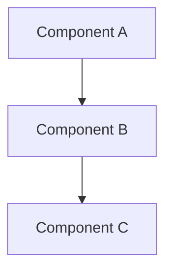

# Architecture: {Feature/Product Name}

## System Overview

{High-level description of the system architecture}

## Technical Decisions (ADRs)

### ADR-001: {Decision Title}

**Status**: Accepted | Proposed | Deprecated | Superseded

**Context**: 
{Why is this decision needed? What is the problem?}

**Decision**: 
{What is the change that we're proposing/making?}

**Consequences**: 
{What becomes easier or harder because of this change?}

**Alternatives Considered**: 
{What other options were evaluated? Why were they not chosen?}

---

### ADR-002: {Decision Title}

**Status**: ...

**Context**: ...

**Decision**: ...

**Consequences**: ...

**Alternatives Considered**: ...

---

## System Design

## Data Models

{Schema definitions, entity relationships}

## API Design

{Endpoints, request/response formats if applicable}

## Test Strategy

| Level | Approach | Coverage |
|-------|----------|----------|
| Unit | ... | ... |
| Integration | ... | ... |
| E2E | ... | ... |

## Risks & Mitigations

| Risk | Impact | Mitigation |
|------|--------|------------|
| ... | High/Medium/Low | ... |

## Dependencies

- Dependency 1: {description}
- Dependency 2: {description}
